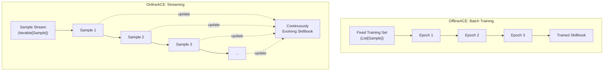
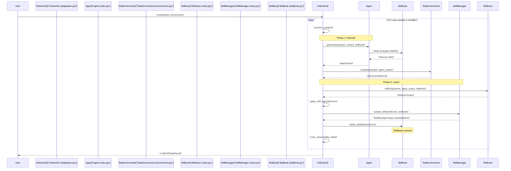
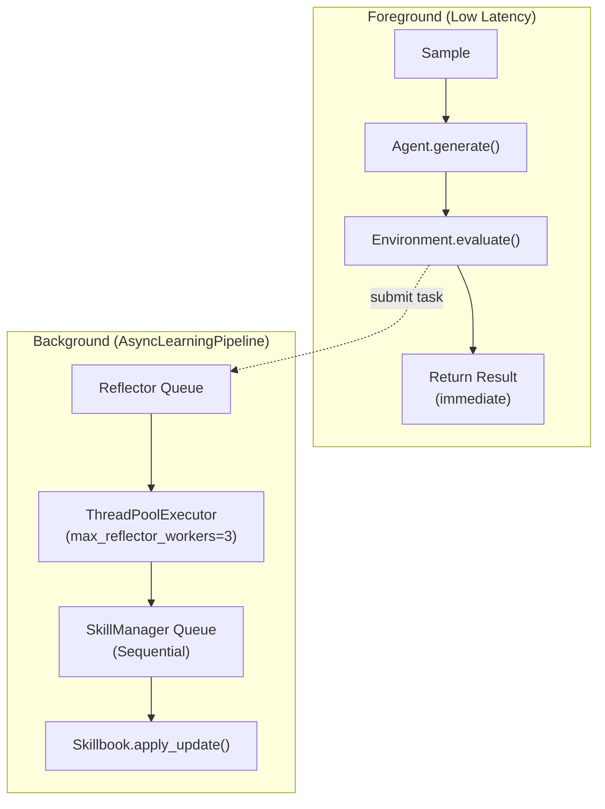
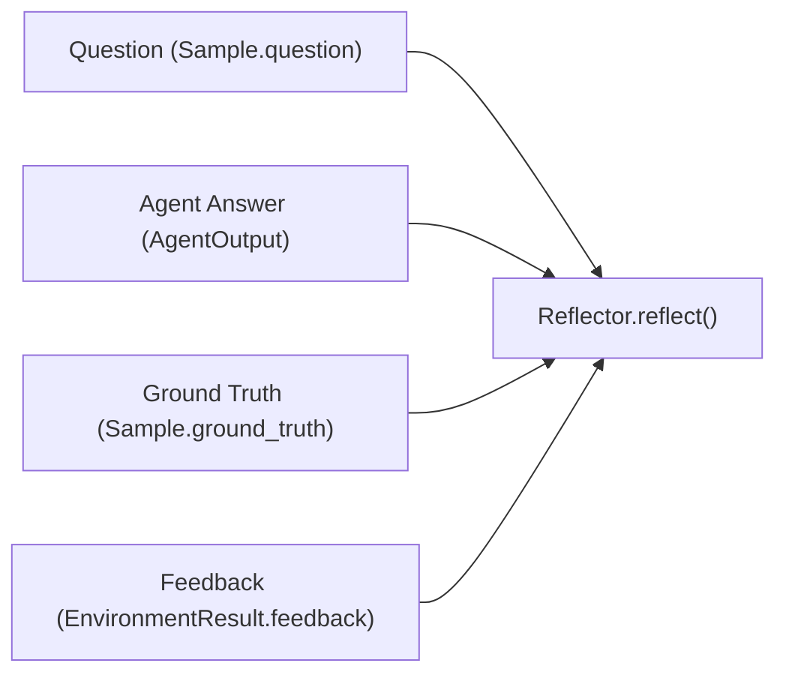

<!-- source: DeepWiki mcp.deepwiki.com · repo kayba-ai/agentic-context-engine · page 6.4 Online Adaptation · fetched 2026-10-26 -->

# Online Adaptation

<details>
<summary>Relevant source files</summary>

The following files were used as context for generating this wiki page:

- [docs/concepts/insight-levels.md](docs/concepts/insight-levels.md)
- [docs/guides/async-learning.md](docs/guides/async-learning.md)

</details>


**Purpose:** This page describes how to use `OnlineACE` for real-time continuous learning in production environments, where the agent processes samples one at a time and updates its skillbook immediately after each interaction.

**Scope:** For batch training over multiple epochs, see [Offline Training](6.3). For integration with existing agentic frameworks, see the Integration Patterns section of the [User Guide](8).

---

## Overview

`OnlineACE` orchestrates continuous learning by processing samples sequentially as they arrive, updating the skillbook after each one. This enables agents to adapt to new patterns and correct mistakes in real-time during deployment.

**Key Characteristics:**
- Processes each sample exactly once (no epochs).
- Updates skillbook immediately after each interaction.
- Supports streaming/infinite sample sources.
- Ideal for production deployment with continuous improvement.
- Can operate in async mode for low-latency requirements.

Sources: [ace/adaptation.py:789-850]()

---

## OnlineACE vs OfflineACE

The two adaptation modes serve different phases of the agent lifecycle:

| Aspect | OfflineACE | OnlineACE |
|--------|-----------|-----------|
| **Use Case** | Initial training before deployment | Production deployment with live learning |
| **Sample Processing** | Multiple passes (epochs) over fixed dataset | Single pass over streaming samples |
| **Learning Goal** | Build comprehensive initial skillbook | Adapt to emerging patterns in production |
| **Sample Source** | Fixed training set (`Sequence[Sample]`) | Stream or iterable (`Iterable[Sample]`) |
| **Execution Mode** | Batch processing | Sequential, potentially infinite |
| **Checkpoint Strategy** | Periodic saves during training | Save on demand or by sample count |

**Architecture Comparison:**



Sources: [ace/adaptation.py:600-786](), [ace/adaptation.py:789-850]()

---

## Basic Usage

### Initialization

Create an `OnlineACE` instance with the three core ACE roles and an optional pre-trained skillbook:

```python
from ace import OnlineACE, Agent, Reflector, SkillManager
from ace.llm_providers import LiteLLMClient

# Initialize LLM client
client = LiteLLMClient(model="gpt-4o-mini")

# Create ACE components
agent = Agent(client)
reflector = Reflector(client)
skill_manager = SkillManager(client)

# Option 1: Start with empty skillbook
online_ace = OnlineACE(
    agent=agent,
    reflector=reflector,
    skill_manager=skill_manager
)

# Option 2: Start with pre-trained skillbook
from ace import Skillbook
pretrained = Skillbook.load_from_file("pretrained.json")

online_ace = OnlineACE(
    skillbook=pretrained,
    agent=agent,
    reflector=reflector,
    skill_manager=skill_manager
)
```

**Constructor Parameters:**

| Parameter | Type | Default | Description |
|-----------|------|---------|-------------|
| `skillbook` | `Optional[Skillbook]` | `None` | Initial skillbook (creates empty if None) |
| `agent` | `Agent` | Required | Agent instance for task execution |
| `reflector` | `Reflector` | Required | Reflector instance for analysis |
| `skill_manager` | `SkillManager` | Required | SkillManager for skillbook updates |
| `max_refinement_rounds` | `int` | `1` | Max reflection refinement attempts |
| `reflection_window` | `int` | `3` | Number of recent reflections to maintain |
| `async_learning` | `bool` | `False` | Enable async learning pipeline |
| `max_reflector_workers` | `int` | `3` | Parallel Reflector threads (if async) |
| `dedup_config` | `Optional[DeduplicationConfig]` | `None` | Skill deduplication configuration |

Sources: [ace/adaptation.py:789-850](), [ace/adaptation.py:168-220]()

---

## Online Learning Flow

The following diagram bridges the "Natural Language Space" of user tasks to the "Code Entity Space" by mapping the execution flow to specific classes and methods.



**Key Methods:**

- `OnlineACE.run()`: Main orchestration loop [ace/adaptation.py:852-891]().
- `ACEBase._process_sample()`: Process single sample synchronously [ace/adaptation.py:461-540]().
- `ACEBase._apply_skill_tags()`: Apply helpful/harmful tags based on environment feedback [ace/adaptation.py:395-400]().
- `ACEBase._update_recent_reflections()`: Maintain reflection window for context [ace/adaptation.py:387-393]().
- `Skillbook.apply_update()`: Apply an `UpdateBatch` (ADD, UPDATE, REMOVE) to the skillbook.

Sources: [ace/adaptation.py:461-540](), [ace/adaptation.py:852-891](), [ace/roles.py:212-264](), [ace/roles.py:604-689](), [ace/roles.py:836-933]()

---

## Async Learning Mode

For production systems with strict latency requirements, `OnlineACE` supports async learning where the Agent returns immediately while learning happens in the background.

### Architecture

This diagram illustrates how the `AsyncLearningPipeline` decouples execution from reflection using thread pools and queues.



**Why This Architecture:**

| Component | Parallelization | Reason |
|-----------|-----------------|--------|
| `Agent` | Sequential | Uses current skillbook state (eventual consistency). |
| `Environment` | Sequential | Usually fast, returns immediately after evaluation. |
| `Reflector` | **Parallel** | Read-only analysis of traces, safe to parallelize. |
| `SkillManager` | **Sequential** | Writes to skillbook; must handle deduplication and consistency. |

Sources: [ace/adaptation.py:168-220](), [ace/adaptation.py:300-343](), [docs/guides/async-learning.md:7-25]()

---

## Enabling Async Learning

### Basic Configuration

```python
from ace import OnlineACE

online_ace = OnlineACE(
    skillbook=skillbook,
    agent=agent,
    reflector=reflector,
    skill_manager=skill_manager,
    async_learning=True,           # Enable async mode
    max_reflector_workers=3,       # Parallel Reflector threads
)

# Run with automatic wait for learning completion
results = online_ace.run(samples, environment, wait_for_learning=True)
```

### Fire-and-Forget Mode

For maximum throughput, return results immediately without waiting for learning:

```python
# Process samples without waiting for learning
results = online_ace.run(
    samples, 
    environment, 
    wait_for_learning=False  # Don't wait
)

# Check learning progress via statistics
print(online_ace.learning_stats)

# Wait when needed (e.g., before saving skillbook)
online_ace.wait_for_learning(timeout=60.0)
online_ace.skillbook.save_to_file("production_learned.json")
```

**Control Methods:**

| Method | Return Type | Description |
|--------|-------------|-------------|
| `start_async_learning()` | `None` | Start the async pipeline (called automatically). |
| `stop_async_learning(wait, timeout)` | `int` | Stop pipeline, return remaining tasks. |
| `wait_for_learning(timeout)` | `bool` | Block until queue empty, return success. |
| `learning_stats` | `Dict[str, Any]` | Get queue sizes and completion counts. |

Sources: [ace/adaptation.py:317-381](), [docs/guides/async-learning.md:27-58]()

---

## Insight Levels in Online Adaptation

The precision of learning in `OnlineACE` depends on the `Insight Level` provided to the `Reflector`.

| Level | Reflector Scope | Feedback Source | Implementation |
|-------|-----------------|----------------|----------------|
| **Micro** | Single interaction | Environment (ground truth) | `OnlineACE` with `TaskEnvironment` |
| **Meso** | Full agent run | Execution trace (no ground truth) | Integration runners (`BrowserUse`, `LangChain`) |

### Micro-Level Learning
In Micro-level adaptation, the `Reflector` receives the agent's output **and** environment feedback (ground truth). This is the most precise learning signal.



Sources: [docs/concepts/insight-levels.md:13-23]()

---

## Observability and Monitoring

`OnlineACE` automatically tracks metrics when observability is enabled. This can be monitored via the `learning_stats` property.

```python
# Access observability data
stats = online_ace.learning_stats
print(f"Tasks submitted: {stats['tasks_submitted']}")
print(f"Reflections completed: {stats['reflections_completed']}")
print(f"Skill updates completed: {stats['skill_updates_completed']}")
```

**Tracked Metrics:**
- Performance score per sample.
- Skill count evolution.
- Token usage and costs (if using `MeteredModel`).
- Successful vs failed predictions.

Sources: [ace/adaptation.py:225-296](), [ace/adaptation.py:359-376]()

---

## Related Pages

- [Offline Training](6.3) - Batch training with multiple epochs.
- [Working with Skillbooks](6.1) - Managing skillbook persistence.
- [Creating Custom Task Environments](6.2) - Implementing evaluation logic.
- [ACELiteLLM Integration](7.2) - Simple conversational agents.
- [ACELangChain Integration](7.4) - Complex workflows with LangChain.

---

