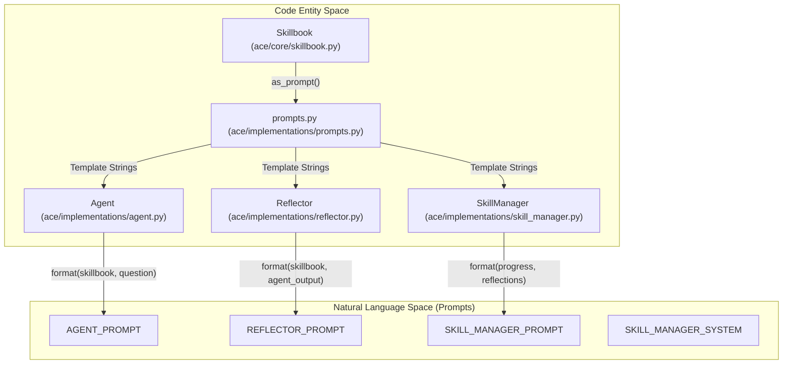
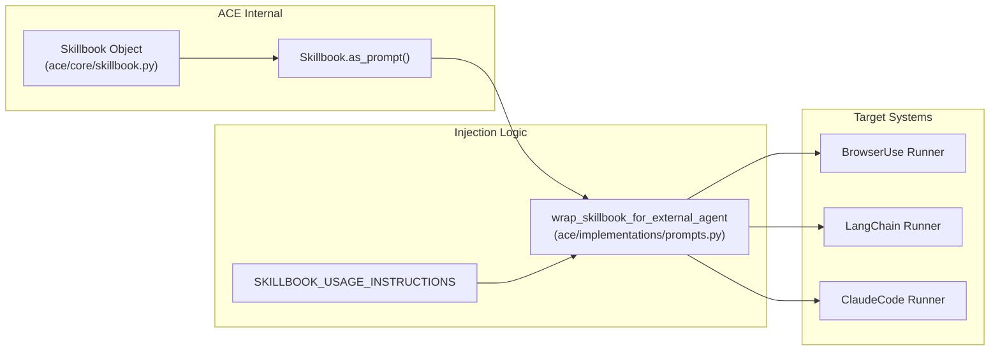

<!-- source: DeepWiki mcp.deepwiki.com · repo kayba-ai/agentic-context-engine · page 6.6 Prompt Version Management · fetched 2026-10-26 -->

# Prompt Version Management

<details>
<summary>Relevant source files</summary>

The following files were used as context for generating this wiki page:

- [ace/implementations/prompts.py](ace/implementations/prompts.py)
- [ace/implementations/skill_manager.py](ace/implementations/skill_manager.py)
- [docs/api/index.md](docs/api/index.md)
- [docs/concepts/skillbook.md](docs/concepts/skillbook.md)
- [docs/concepts/updates.md](docs/concepts/updates.md)
- [docs/design/SKILLBOOK_V2_PLAN.md](docs/design/SKILLBOOK_V2_PLAN.md)
- [docs/guides/composing-pipelines.md](docs/guides/composing-pipelines.md)
- [docs/guides/prompts.md](docs/guides/prompts.md)

</details>


## Purpose and Scope

This document covers the prompt management system in the ACE framework, centered around default v2.1 templates and the `PromptManager`. It explains how prompt versions are selected, how `Skillbook` context is injected into various roles, and the technical implementation of domain-specific variants.

The framework currently defaults to **v2.1 prompts**, which are optimized for high compliance, strategic reasoning, and structured citation of learned skills.

Sources: [ace/implementations/prompts.py:1-5](), [ace/implementations/prompts.py:68-74]()

## The Prompt Management Architecture

ACE uses a role-based prompting architecture where each core component—`Agent`, `Reflector`, and `SkillManager`—receives a specialized template. These templates are designed to interact with the `Skillbook` to facilitate the Execute → Evaluate → Reflect → Update cycle.

### Data Flow: From Code to Prompt

The following diagram illustrates how code entities and data structures are transformed into the final strings sent to the LLM.

**Natural Language Space to Code Entity Space Mapping**



Sources: [ace/implementations/prompts.py:48-59](), [ace/implementations/prompts.py:91-101](), [ace/implementations/skill_manager.py:181-189]()

## Core Prompt Templates (v2.1)

The v2.1 prompts prioritize **Strategy Application Protocols** and **Critical Requirements** to ensure the agent doesn't just solve the problem, but uses the learned knowledge store effectively.

### Agent Prompt (`AGENT_PROMPT`)
The Agent prompt [ace/implementations/prompts.py:68-176]() defines the identity of "ACE Agent v2.1". Key features include:
*   **Skillbook Application Protocol**: A 4-step process (Analyze → Consider → Process → Generate) [ace/implementations/prompts.py:88-101]().
*   **Specificity Constraints**: Rules preventing the agent from over-specifying tools unless the skill explicitly recommends them [ace/implementations/prompts.py:133-139]().
*   **Output Format**: A strict JSON schema requiring `reasoning`, `step_validations`, `final_answer`, and `quality_check` [ace/implementations/prompts.py:164-176]().

### SkillManager Prompt (`SKILL_MANAGER_PROMPT`)
The SkillManager uses a two-tier prompting system:
1.  **System Prompt (`SKILL_MANAGER_SYSTEM`)**: Defines the "Skillbook Architect" persona and the taxonomy of `context` vs `harness` sections [ace/implementations/skill_manager.py:30-30]().
2.  **User Prompt (`SKILL_MANAGER_PROMPT`)**: Provides the current skillbook statistics, progress, and the reflections to be processed [ace/implementations/skill_manager.py:181-189]().

Sources: [ace/implementations/prompts.py:68-176](), [ace/implementations/skill_manager.py:30-30]()

## Version Selection and Customization

While ACE provides robust defaults, developers can override templates at the role level.

### Using Custom Templates
Each role constructor accepts a `prompt_template` argument. If not provided, it defaults to the v2.1 constants in `ace/implementations/prompts.py`.

```python
from ace import Agent
from my_app.prompts import CUSTOM_PROMPT

# Overriding the default v2.1 prompt
agent = Agent(
    model="gpt-4o",
    prompt_template=CUSTOM_PROMPT
)
```

Sources: [ace/implementations/skill_manager.py:95-104](), [docs/guides/prompts.md:12-22]()

### Template Variables
Templates must include specific placeholders that the roles fill at runtime:

| Role | Required Variables | File Reference |
| :--- | :--- | :--- |
| **Agent** | `{skillbook}`, `{question}`, `{context}`, `{reflection}` | [ace/implementations/prompts.py:91-99]() |
| **Reflector** | `{skillbook}`, `{question}`, `{agent_output}`, `{ground_truth}`, `{feedback}` | [docs/guides/prompts.md:38-44]() |
| **SkillManager** | `{progress}`, `{stats}`, `{injected_skill_ids}`, `{reflections}`, `{question_context}` | [ace/implementations/skill_manager.py:181-188]() |

## Skillbook Injection Patterns

A critical part of prompt management is how the `Skillbook` is rendered for consumption by different agents, especially external ones (e.g., Browser-Use, LangChain).

### External Agent Injection
The `wrap_skillbook_for_external_agent` function is the canonical way to format strategies for non-ACE agents. It adds:
1.  **Usage Instructions**: Guidelines on how to cite skill IDs (e.g., `Following [content_extraction-00001]...`) [ace/implementations/prompts.py:15-28]().
2.  **Success Metrics**: It displays helpful/harmful counts so the agent can prioritize effective strategies [ace/implementations/prompts.py:53-55]().

**Diagram: Skillbook Context Injection**



Sources: [ace/implementations/prompts.py:31-60](), [docs/api/index.md:59-96]()

## Domain-Specific Variants

ACE supports specialized prompts for different domains (e.g., math, code) through the `PromptManager` or by manual template selection.

### Section Taxonomy
Skills are categorized into two primary sections that prompts must respect:
*   **`context`**: Strategies the agent applies during task execution. **Insights are mandatory** for this section [docs/concepts/skillbook.md:72-73](), [docs/design/SKILLBOOK_V2_PLAN.md:118-119]().
*   **`harness`**: Learnings about the environment or runtime (e.g., rate limits). Insights are optional here [docs/concepts/skillbook.md:74-75]().

### Atomicity and Precision
Prompts in v2.1 emphasize **Atomicity Scoring**. The `SkillManager` is instructed to ensure that each added skill addresses a single, focused issue rather than a compound problem [docs/design/SKILLBOOK_V2_PLAN.md:9-10](). This is enforced via the `SkillManagerReport` which requires the agent to provide reasoning for its mutations [ace/implementations/skill_manager.py:44-57]().

Sources: [docs/concepts/skillbook.md:70-75](), [docs/design/SKILLBOOK_V2_PLAN.md:9-15](), [ace/implementations/skill_manager.py:44-57]()

---

