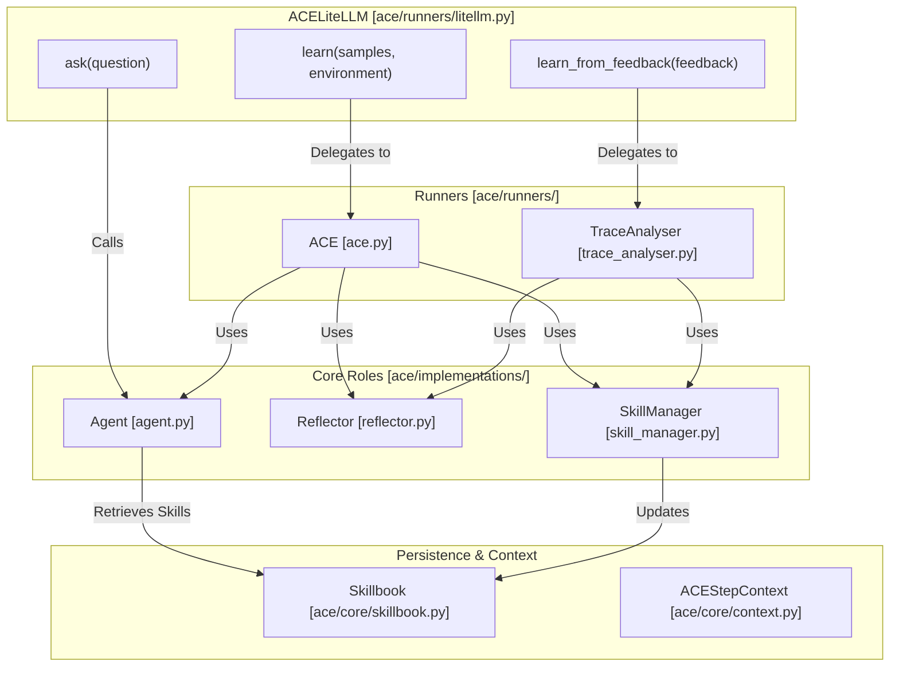
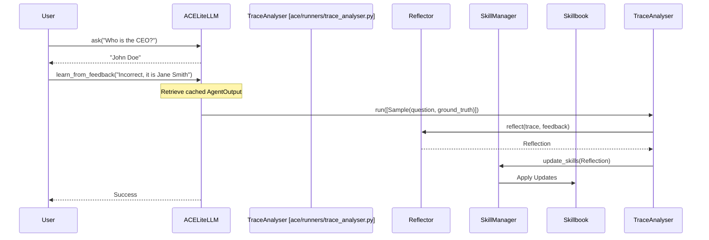

<!-- source: DeepWiki mcp.deepwiki.com · repo kayba-ai/agentic-context-engine · page 7.2 ACELiteLLM Integration · fetched 2026-10-26 -->

# ACELiteLLM Integration

<details>
<summary>Relevant source files</summary>

The following files were used as context for generating this wiki page:

- [CLAUDE.md](CLAUDE.md)
- [README.md](README.md)
- [ace/runners/litellm.py](ace/runners/litellm.py)
- [assets/kayba-banner.png](assets/kayba-banner.png)
- [examples/ace/ace_demo.py](examples/ace/ace_demo.py)

</details>


**Purpose**: `ACELiteLLM` is a high-level, "batteries-included" integration that bundles ACE's core learning roles (`Agent`, `Reflector`, `SkillManager`) and the `Skillbook` knowledge store into a single conversational interface. It simplifies the implementation of self-improving agents for simple Q&A, classification, and reasoning tasks.

**Scope**: This page covers the `ACELiteLLM` class located in `ace/runners/litellm.py`. It details the high-level API for interactive learning (`ask`, `learn_from_feedback`) and batch learning (`learn`). For browser automation, see [Browser Automation with ACEAgent](#7.3). For LangChain workflows, see [LangChain Integration](#7.4).

---

## Architecture Overview

`ACELiteLLM` acts as a facade over the `ACE` and `TraceAnalyser` runners. It manages the lifecycle of the three core roles and provides a unified interface for both execution and adaptation.

### Component Relationship Diagram



**Sources**: [ace/runners/litellm.py:35-126](), [ace/runners/litellm.py:270-334](), [ace/runners/litellm.py:382-446]()

---

## Core Components

### Initialization and Construction

`ACELiteLLM` can be initialized directly with a model string or via specialized factory methods that load configuration from the environment or `ace.toml` files.

| Method | Source | Description |
|--------|--------|-------------|
| `__init__` | [ace/runners/litellm.py:57-126]() | Basic constructor. Resolves model settings and initializes roles. |
| `from_setup` | [ace/runners/litellm.py:131-178]() | Builds from `ace.toml` + `.env` (created by `ace setup`). |
| `from_config` | [ace/runners/litellm.py:180-219]() | Builds from an `ACEModelConfig` allowing different models per role. |

**Sources**: [ace/runners/litellm.py:57-219]()

### Shared Role Configuration

By default, `ACELiteLLM` initializes the three roles using the same model string and `ModelSettings`.

*   **Agent**: Executes tasks using strategies from the `Skillbook`. [ace/runners/litellm.py:85]()
*   **Reflector**: Analyzes traces to extract insights. [ace/runners/litellm.py:86-88]()
*   **SkillManager**: Curates the `Skillbook` based on reflections. [ace/runners/litellm.py:89-91]()

---

## Key Functional Methods

### ask(question, context)

Executes a single interaction. Unlike the base `Agent.generate()` method, `ask()` is designed for high-level conversational use, returning only the final answer while caching the execution trace internally for potential future learning.

**Data Flow**:
1.  Retrieves current strategies from the `Skillbook`.
2.  Calls `Agent.generate(question, context, skillbook_view)`. [ace/runners/litellm.py:254-256]()
3.  Caches the `AgentOutput` in `_last_interaction`. [ace/runners/litellm.py:265]()
4.  Returns the `final_answer` string. [ace/runners/litellm.py:267]()

**Sources**: [ace/runners/litellm.py:227-268]()

### learn(samples, environment, epochs)

Performs batch learning using the `ACE` runner. This is the primary method for "training" an agent on a specific dataset.

**Execution Logic**:
-   Initializes an `ACE` runner from the current roles. [ace/runners/litellm.py:308-315]()
-   Configures deduplication and checkpointing if provided. [ace/runners/litellm.py:317-322]()
-   Executes the full learning pipeline: `Agent` → `Evaluate` → `Reflect` → `Update`. [ace/runners/litellm.py:328-330]()

**Sources**: [ace/runners/litellm.py:270-334]()

### learn_from_feedback(feedback, ground_truth)

Enables "Human-in-the-loop" learning. It takes the trace from the most recent `ask()` call and processes it through the `Reflector` and `SkillManager`.

**Sequence Diagram**:



**Sources**: [ace/runners/litellm.py:382-446]()

---

## Usage Examples

### Pattern 1: Interactive Learning Loop

```python
from ace import ACELiteLLM

# Initialize
agent = ACELiteLLM(model="gpt-4o-mini")

# Interaction 1
print(agent.ask("Is there a seahorse emoji?"))

# Learn from user feedback
agent.learn_from_feedback("There is no seahorse emoji in Unicode.")

# Interaction 2 (Now uses the learned strategy)
print(agent.ask("Is there a seahorse emoji?"))
```

**Sources**: [README.md:54-70](), [ace/runners/litellm.py:50-55]()

### Pattern 2: Batch Learning from Samples

```python
from ace import ACELiteLLM, Sample, SimpleEnvironment

agent = ACELiteLLM(model="gpt-4o-mini")
samples = [
    Sample(question="What is 2+2?", ground_truth="4"),
    Sample(question="Capital of France?", ground_truth="Paris")
]

# Run batch learning
agent.learn(samples, environment=SimpleEnvironment(), epochs=2)

# Save the updated skillbook
agent.save("my_skills.json")
```

**Sources**: [examples/ace/ace_demo.py:107-145](), [ace/runners/litellm.py:336-340]()

---

## Configuration and Observability

### Persistence
`ACELiteLLM` provides convenience wrappers for `Skillbook` persistence.
-   `save(path)`: Serializes the current skillbook to a JSON file. [ace/runners/litellm.py:336-340]()
-   `get_strategies()`: Returns the current skills formatted as a system prompt block. [ace/runners/litellm.py:342-346]()

### Observability with Logfire
If initialized with `logfire=True`, the class automatically configures `Logfire` for tracing LLM calls and pipeline steps. This requires the `logfire` extra to be installed.

**Sources**: [ace/runners/litellm.py:111-118]()

### Checkpointing and Deduplication
For long-running batch learning, `ACELiteLLM` supports:
-   **Checkpointing**: Periodically saving the skillbook to a directory. [ace/runners/litellm.py:107-108]()
-   **Deduplication**: Automatically merging similar skills during the learning process using a `DeduplicationManager`. [ace/runners/litellm.py:97-104]()

---

## Summary of File Sources
| File | Role |
|------|------|
| `ace/runners/litellm.py` | Main implementation of the `ACELiteLLM` class. |
| `ace/runners/ace.py` | Implementation of the batch learning runner used by `.learn()`. |
| `ace/runners/trace_analyser.py` | Implementation of the trace learning runner used by `.learn_from_feedback()`. |
| `ace/core/skillbook.py` | Logic for storing and retrieving learned strategies. |
| `ace/core/context.py` | Definition of `ACEStepContext` used for data flow between roles. |

**Sources**: [ace/runners/litellm.py:1-539]()

---

