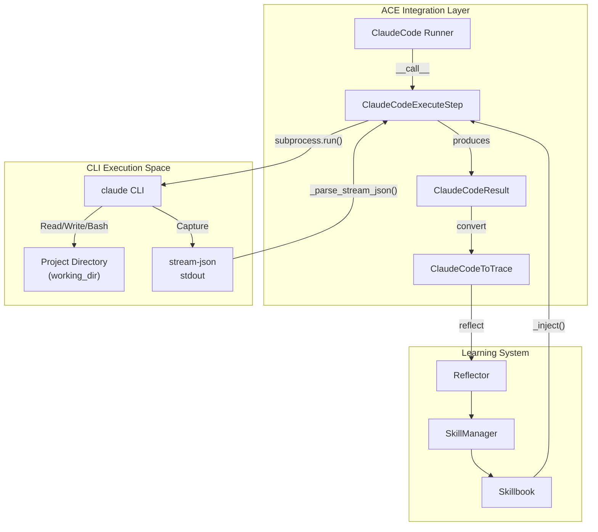
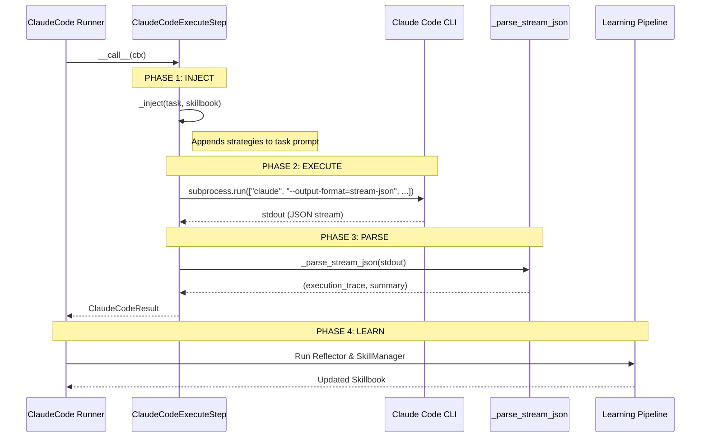

<!-- source: DeepWiki mcp.deepwiki.com · repo kayba-ai/agentic-context-engine · page 7.5 Claude Code Integration · fetched 2026-10-26 -->

# Claude Code Integration

<details>
<summary>Relevant source files</summary>

The following files were used as context for generating this wiki page:

- [ace/integrations/claude_code.py](ace/integrations/claude_code.py)
- [docs/getting-started/installation.md](docs/getting-started/installation.md)
- [docs/integrations/browser-use.md](docs/integrations/browser-use.md)
- [docs/integrations/claude-code.md](docs/integrations/claude-code.md)
- [docs/integrations/langchain.md](docs/integrations/langchain.md)

</details>


The `ClaudeCode` runner wraps the [Claude Code CLI](https://docs.anthropic.com/en/docs/claude-code) with ACE learning. The agent runs coding tasks in your project directory and learns strategies from each execution — improving code generation, debugging, and project-specific patterns over time.

## Overview

The integration provides a high-level `ClaudeCode` runner that orchestrates Claude Code CLI sessions with automatic learning between iterations. This is particularly effective for autonomous coding tasks where the agent benefits from learning what strategies work (e.g., project-specific test patterns, module structures) and what patterns to avoid.

**Sources**: [docs/integrations/claude-code.md:1-5](), [ace/integrations/claude_code.py:1-12]()

---

## Architecture

### System Components and Data Flow

The following diagram illustrates how the `ClaudeCodeExecuteStep` bridges the "Natural Language Space" of tasks and skillbooks with the "Code Entity Space" of CLI execution and transcript parsing.



**Sources**: [ace/integrations/claude_code.py:48-136](), [docs/integrations/claude-code.md:61-67]()

### Execution Sequence

The `ClaudeCode` integration follows the standard ACE **INJECT → EXECUTE → LEARN** pattern.



**Sources**: [ace/integrations/claude_code.py:74-136](), [docs/integrations/claude-code.md:61-67]()

---

## Implementation Details

### ClaudeCodeExecuteStep

The `ClaudeCodeExecuteStep` is the core component that manages the CLI interaction. It requires `sample` (the task) and `skillbook` in the `ACEStepContext` and provides a `trace` [ace/integrations/claude_code.py:55-56]().

*   **Injection**: The `_inject` method uses `wrap_skillbook_for_external_agent` to format learned strategies into a prompt that is appended to the user's task [ace/integrations/claude_code.py:89-96]().
*   **CLI Execution**: It invokes the `claude` command with `--output-format=stream-json` to allow for structured parsing of the agent's actions [ace/integrations/claude_code.py:103-109]().
*   **Parsing**: The `_parse_stream_json` method iterates through the JSON events, extracting "assistant" messages, tool uses (Read, Write, Bash, etc.), and reasoning blocks to build a chronological `execution_trace` [ace/integrations/claude_code.py:157-200]().

### ClaudeCodeResult

The output of the execution step is a `ClaudeCodeResult` object containing the following:

| Field | Type | Description |
|-------|------|-------------|
| `task` | `str` | The original task prompt |
| `success` | `bool` | True if returncode is 0 |
| `output` | `str` | Final text summary from Claude |
| `execution_trace` | `str` | Chronological log of steps and reasoning |
| `returncode` | `int` | Process exit code |
| `error` | `Optional[str]` | Stderr content if failed |

**Sources**: [ace/integrations/claude_code.py:28-40]()

---

## Usage

### Installation

To use this integration, install the `claude-code` extra:

```bash
uv add 'ace-framework[claude-code]'
```

**Sources**: [docs/getting-started/installation.md:18](), [docs/integrations/claude-code.md:19]()

### Basic Integration

```python
from ace import ClaudeCode

# Initialize the runner
runner = ClaudeCode.from_model(working_dir="./my_project")

# Run a task; ACE will inject skills, run Claude, and learn from the result
results = runner.run("Add unit tests for utils.py")

# Persist the learned strategies
runner.save("coding_expert.json")
```

**Sources**: [docs/integrations/claude-code.md:7-14]()

### Parameters

The `from_model()` and `from_roles()` methods allow for detailed configuration:

| Parameter | Type | Default | Description |
|-----------|------|---------|-------------|
| `working_dir` | `str` | `None` | Path to the project directory |
| `timeout` | `int` | `600` | Execution timeout in seconds |
| `model` | `str` | `None` | Claude model override (e.g., `claude-3-5-sonnet-latest`) |
| `allowed_tools` | `list[str]` | `None` | Specific Claude Code tools to allow |
| `ace_model` | `str` | `"gpt-4o-mini"` | Model used for the ACE Reflector and SkillManager |

**Sources**: [docs/integrations/claude-code.md:29-50](), [ace/integrations/claude_code.py:60-72]()

---

## The kayba-pipeline Skill

The `kayba-pipeline` is a specialized skill that can be installed directly into the Claude Code environment. It provides a 7-stage evaluation and improvement pipeline triggered via chat.

1.  **Analyze traces**: Extract patterns from transcripts.
2.  **Compute metrics**: Score traces against quality dimensions.
3.  **Build rubric**: Generate a structured evaluation rubric.
4.  **Plan fixes**: Propose concrete improvements.
5.  **HITL review**: Human-in-the-loop approval gate.
6.  **Apply fixes**: Execute approved changes.
7.  **Verify**: Confirm fixes pass the rubric.

Install it with:
```bash
kayba setup
```

**Sources**: [docs/integrations/claude-code.md:75-93](), [docs/getting-started/installation.md:97-103]()

---

