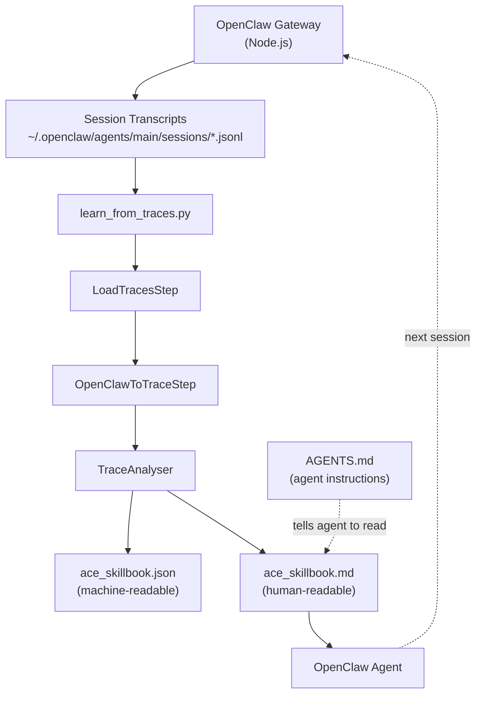
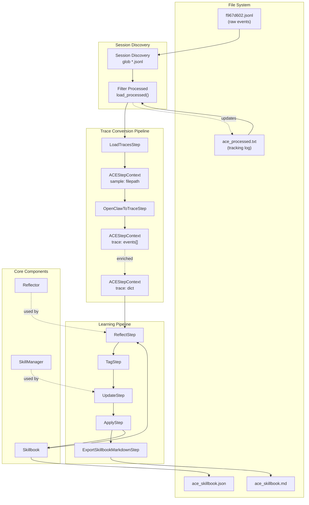
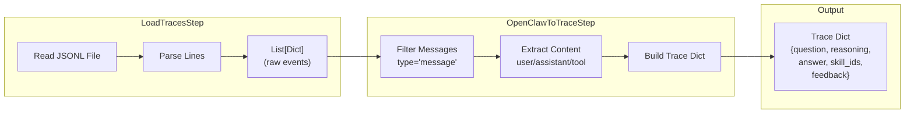
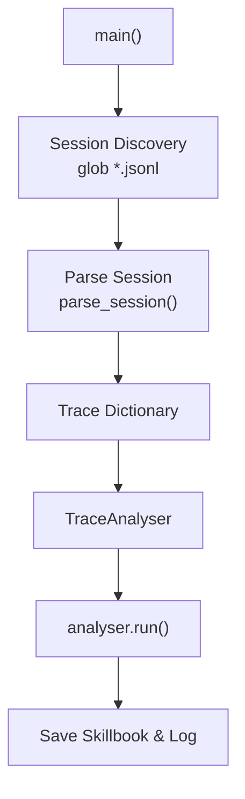

<!-- source: DeepWiki mcp.deepwiki.com · repo kayba-ai/agentic-context-engine · page 7.6 OpenClaw Integration · fetched 2026-10-26 -->

# OpenClaw Integration

<details>
<summary>Relevant source files</summary>

The following files were used as context for generating this wiki page:

- [.claude/settings.json](.claude/settings.json)
- [ace/integrations/openclaw/to_trace.py](ace/integrations/openclaw/to_trace.py)
- [docs/integrations/openclaw.md](docs/integrations/openclaw.md)
- [examples/openclaw/AGENTS.md.snippet](examples/openclaw/AGENTS.md.snippet)
- [examples/openclaw/Dockerfile.ace](examples/openclaw/Dockerfile.ace)
- [examples/openclaw/README.md](examples/openclaw/README.md)
- [examples/openclaw/ace-learn.sh](examples/openclaw/ace-learn.sh)
- [examples/openclaw/kayba-ace/SKILL.md](examples/openclaw/kayba-ace/SKILL.md)
- [examples/openclaw/kayba-ace/learn_from_traces.py](examples/openclaw/kayba-ace/learn_from_traces.py)
- [examples/openclaw/setup.py](examples/openclaw/setup.py)
- [examples/openclaw/trace_examples/b3db607f-7ae8-4089-b806-44800e961672.jsonl](examples/openclaw/trace_examples/b3db607f-7ae8-4089-b806-44800e961672.jsonl)
- [specs/001-openclaw-integration/spec.md](specs/001-openclaw-integration/spec.md)

</details>


## Purpose and Scope

This page documents the integration between ACE Framework and [OpenClaw](https://github.com/openclaw/openclaw), an open-source AI assistant gateway. The integration enables learning from OpenClaw session transcripts by extracting strategies into a skillbook that the agent loads at runtime.

This integration follows the standard ACE pattern: **INJECT → EXECUTE → LEARN**. Unlike other integrations that wrap the execution phase, the OpenClaw integration operates post-hoc on recorded transcripts. 

**Sources:** [docs/integrations/openclaw.md:1-18](), [examples/openclaw/README.md:1-7]()

---

## What is OpenClaw?

OpenClaw is a self-hosted AI assistant gateway that connects LLM providers (Claude, GPT, etc.) to messaging platforms (Telegram, WhatsApp, Discord). It stores all data as files under `~/.openclaw/`, including session transcripts in JSONL format at `~/.openclaw/agents/<agent_id>/sessions/*.jsonl`.

ACE reads these transcripts, analyzes conversation patterns via the `TraceAnalyser`, and extracts reusable strategies into a skillbook. The agent loads this skillbook at session start, applying learned strategies to improve future interactions.

**Sources:** [docs/integrations/openclaw.md:7-11]()

---

## Integration Architecture

### High-Level Flow



**Learning Trigger Modes:**

| Mode | Trigger | Use Case |
|------|---------|----------|
| Docker (recommended) | Agent calls `ace-learn` at session start | Fully automatic, zero manual intervention |
| Host + Cron | Scheduled task runs `learn_from_traces.py` | No Docker customization needed |
| Host + Manual | User runs `learn_from_traces.py` | On-demand learning, development |

**Sources:** [docs/integrations/openclaw.md:15-36](), [examples/openclaw/README.md:67-91]()

### Pipeline Execution Flow



**Sources:** [examples/openclaw/kayba-ace/learn_from_traces.py:1-307](), [ace/integrations/openclaw/to_trace.py:10-40]()

---

## Trace Conversion Process

### JSONL Event Format

OpenClaw writes session events as line-delimited JSON. Each line represents an event (message, tool call, thinking, etc.). The `OpenClawToTraceStep` processes these events to reconstruct the conversation and reasoning.

**Sources:** [examples/openclaw/trace_examples/b3db607f-7ae8-4089-b806-44800e961672.jsonl:1-20](), [ace/integrations/openclaw/to_trace.py:42-131]()

### Conversion Pipeline



**LoadTracesStep** reads the JSONL file and parses each line into a list of raw events.

**OpenClawToTraceStep** ([ace/integrations/openclaw/to_trace.py:10-40]()) converts raw events to a structured trace dictionary:

| Trace Field | Source / Logic |
|-------------|----------------|
| `question` | Concatenated text from all `user` role messages. |
| `reasoning` | Combined blocks of `thinking`, `toolCall`, and `toolResult`. |
| `answer` | The content of the very last `assistant` message. |
| `skill_ids` | Initialized as an empty list `[]`. |
| `feedback` | Summary string including message counts, model ID, and token usage. |

**Sources:** [ace/integrations/openclaw/to_trace.py:42-131](), [examples/openclaw/kayba-ace/learn_from_traces.py:92-111]()

---

## Setup Methods

### Docker Setup (Recommended)

Extends the OpenClaw Docker image with Python 3.12 and ACE pre-installed. The agent calls `ace-learn` at session start automatically.

**Build Process:**

```bash
# 1. Build the base OpenClaw image
docker build -t openclaw:base .
# 2. Extend with ACE
docker build -t openclaw:local -f Dockerfile.ace .
```

The `Dockerfile.ace` ([examples/openclaw/Dockerfile.ace:1-74]()):
1. Installs `uv` for Python management ([examples/openclaw/Dockerfile.ace:34]()).
2. Clones the ACE repository and syncs dependencies ([examples/openclaw/Dockerfile.ace:45-50]()).
3. Inlines a wrapper script at `/usr/local/bin/ace-learn` ([examples/openclaw/Dockerfile.ace:54-63]()).

**Sources:** [examples/openclaw/Dockerfile.ace:1-74](), [docs/integrations/openclaw.md:179-267]()

### Host Setup

Runs ACE on the host machine. Useful for development or environments where Docker modification is restricted.

**Execution:**
```bash
uv run python examples/openclaw/kayba-ace/learn_from_traces.py
```

The script derives `OPENCLAW_HOME` from its location or environment variables to locate the sessions directory ([examples/openclaw/kayba-ace/learn_from_traces.py:31-33]()).

**Sources:** [examples/openclaw/kayba-ace/learn_from_traces.py:25-43](), [examples/openclaw/README.md:47-65]()

---

## Skill Installation

The `setup.py` script ([examples/openclaw/setup.py:1-160]()) automates the installation of the ACE skill into an OpenClaw workspace.

**Key Actions:**
- **Finds OpenClaw Home:** Resolves `~/.openclaw` or custom path ([examples/openclaw/setup.py:28-47]()).
- **Copies Skill Folder:** Transfers `kayba-ace/` contents to the workspace, ensuring generated files like `ace_skillbook.json` are not overwritten ([examples/openclaw/setup.py:50-69]()).
- **Patches AGENTS.md:** Appends a snippet ([examples/openclaw/AGENTS.md.snippet:1-72]()) that instructs the agent to run `ace-learn` and load the resulting markdown skillbook ([examples/openclaw/setup.py:72-107]()).

**Sources:** [examples/openclaw/setup.py:1-160](), [docs/integrations/openclaw.md:109-167]()

---

## Output Files

The learning process generates three primary files in the skill directory:

| File | Purpose |
|------|---------|
| `ace_skillbook.json` | The persistent, machine-readable skillbook containing all learned strategies. |
| `ace_skillbook.md` | A human-readable version of the skillbook that the agent reads into its context. |
| `ace_processed.txt` | A log of session filenames already analyzed to prevent redundant processing. |

**Tracking Implementation:**
The `load_processed` and `save_processed` functions manage the tracking log ([examples/openclaw/kayba-ace/learn_from_traces.py:75-86]()).

**Sources:** [examples/openclaw/kayba-ace/learn_from_traces.py:161-163](), [examples/openclaw/README.md:139-146]()

---

## CLI Reference

### learn_from_traces.py

**Synopsis:**
```bash
python learn_from_traces.py [OPTIONS] [FILES...]
```

**Key Arguments:**
- `--dry-run`: Parses sessions but skips LLM-based learning ([examples/openclaw/kayba-ace/learn_from_traces.py:127-130]()).
- `--reprocess`: Ignores `ace_processed.txt` to re-analyze all sessions ([examples/openclaw/kayba-ace/learn_from_traces.py:132-135]()).
- `--agent`: Specifies the OpenClaw agent ID (defaults to `main`) ([examples/openclaw/kayba-ace/learn_from_traces.py:137-140]()).

**Sources:** [examples/openclaw/kayba-ace/learn_from_traces.py:122-158](), [examples/openclaw/kayba-ace/SKILL.md:17-26]()

---

## Implementation Details

### Main Execution Flow



The `parse_session` function uses `LoadTracesStep` and `OpenClawToTraceStep` to convert JSONL files into the format required by the ACE learning pipeline ([examples/openclaw/kayba-ace/learn_from_traces.py:96-111]()).

### Integration with OpenClaw Agent

The agent is instructed via `AGENTS.md` to:
1. Run `ace-learn` at the start of every session ([examples/openclaw/AGENTS.md.snippet:19-25]()).
2. Report the number of new sessions and strategies to the user ([examples/openclaw/AGENTS.md.snippet:26-30]()).
3. Read `skills/kayba-ace/ace_skillbook.md` to load learned strategies ([examples/openclaw/AGENTS.md.snippet:59-65]()).
4. Cite strategy IDs when they influence a response ([examples/openclaw/AGENTS.md.snippet:67-72]()).

**Sources:** [examples/openclaw/AGENTS.md.snippet:1-72](), [docs/integrations/openclaw.md:152-164]()

---

