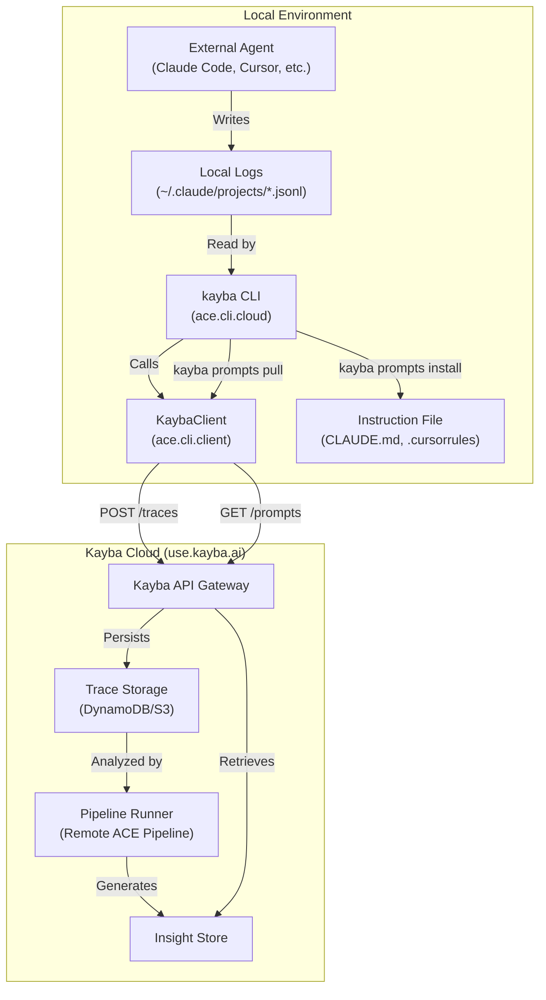
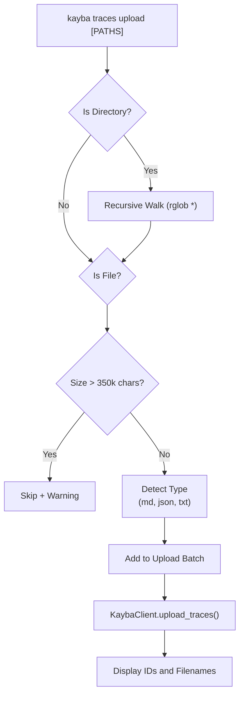

<!-- source: DeepWiki mcp.deepwiki.com · repo kayba-ai/agentic-context-engine · page 7.8 Kayba Hosted API · fetched 2026-10-26 -->

# Kayba Hosted API

Relevant source files

The following files were used as context for generating this wiki page:

- [ace/cli/__init__.py](ace/cli/__init__.py)
- [ace/cli/client.py](ace/cli/client.py)
- [ace/cli/cloud.py](ace/cli/cloud.py)
- [ace/cli/commands/__init__.py](ace/cli/commands/__init__.py)
- [ace/cli/commands/kayba-agent-instructions.md](ace/cli/commands/kayba-agent-instructions.md)
- [ace/integrations/__init__.py](ace/integrations/__init__.py)
- [ace/integrations/claude_sdk.py](ace/integrations/claude_sdk.py)
- [docs/guides/integration.md](docs/guides/integration.md)
- [docs/integrations/claude-sdk.md](docs/integrations/claude-sdk.md)
- [docs/integrations/hosted-api.md](docs/integrations/hosted-api.md)
- [tests/test_kayba_cli.py](tests/test_kayba_cli.py)

## Purpose and Scope

The Kayba Hosted API provides a cloud-based service for offloading ACE Framework operations. Instead of running heavy reflection and skill management roles locally, users can upload execution traces to the Kayba cloud, run optimization pipelines remotely, and pull optimized prompts (skillbooks) back into their local agents.

The service is primarily interacted with via the `kayba` CLI, which wraps the REST API endpoints. This enables a "thin client" architecture where local agents (like Claude Code or custom LangChain implementations) focus on execution, while the Kayba cloud handles the computationally intensive task of learning and strategy extraction.

**Sources:** [docs/integrations/hosted-api.md:1-13](), [ace/cli/cloud.py:1-2]()

---

## Architecture and Data Flow

The Kayba cloud integration consists of a local CLI client, a structured HTTP client, and the remote Kayba API. The data flow typically moves from local agent transcripts to the cloud for analysis, then back to the local environment as optimized instructions.

### System Components and Data Flow

**Sources:** [docs/integrations/hosted-api.md:34-56](), [ace/cli/cloud.py:75-98](), [ace/cli/client.py:57-110]()

### Implementation Detail: The KaybaClient

The `KaybaClient` class in `ace/cli/client.py` handles the low-level HTTP communication. It manages authentication via the `KAYBA_API_KEY` and implements automatic request chunking to stay within API payload limits.

- **Authentication:** Uses a Bearer token in the `Authorization` header [ace/cli/client.py:91]().
- **Chunking:** The `_chunk_trace_uploads` function splits large batches of traces into multiple requests if the total size exceeds `MAX_TRACE_UPLOAD_BODY_BYTES` (900KB) [ace/cli/client.py:22-54]().
- **Error Handling:** Maps HTTP status codes to `KaybaAPIError` with specific codes like `PAYLOAD_TOO_LARGE` or `AUTH_MISSING` [ace/cli/client.py:115-156]().

**Sources:** [ace/cli/client.py:57-160](), [ace/cli/client.py:22-54]()

---

## Trace Management

Kayba does not automatically ingest local agent transcripts. Traces must be explicitly uploaded. The CLI supports multiple formats and directory recursion.

### Trace Upload Logic

**Sources:** [ace/cli/cloud.py:100-111](), [ace/cli/cloud.py:114-147](), [docs/integrations/hosted-api.md:84-88]()

### Supported Sources

| Agent | Log Location | Type |
|-------|--------------|------|
| **Claude Code** | `~/.claude/projects/<slug>/*.jsonl` | JSONL |
| **Codex** | `~/.codex/sessions/YYYY/MM/DD/*.jsonl` | JSONL |
| **OpenClaw** | Session transcripts | JSONL |
| **Generic** | `.md`, `.markdown`, `.txt` | Markdown/Text |

**Sources:** [docs/integrations/hosted-api.md:40-52](), [ace/cli/cloud.py:50-56]()

---

## Remote Pipeline Execution

The `kayba run` command triggers the ACE pipeline on the Kayba servers. This pipeline executes the Reflector and SkillManager roles against the selected traces.

### Execution Options

The remote runner supports several configuration parameters passed via the CLI:

- **`--model`**: Specifies the LLM to use for analysis (e.g., `claude-sonnet-4-6`) [docs/integrations/hosted-api.md:120]().
- **`--epochs`**: Number of analysis iterations [docs/integrations/hosted-api.md:121]().
- **`--reflector-mode`**: Choose between `recursive` (Recursive Reflector) or `standard` [docs/integrations/hosted-api.md:122]().
- **`--wait`**: Polls the job status until completion instead of returning immediately [docs/integrations/hosted-api.md:124]().

**Sources:** [docs/integrations/hosted-api.md:91-126](), [ace/cli/commands/kayba-agent-instructions.md:15-18]()

---

## Insights and Prompt Installation

Once the pipeline completes, it generates "Insights" (learned strategies). These must be triaged before they are compiled into a final prompt.

### Triage and Generation Workflow

1.  **List Insights**: `kayba insights list` shows pending strategies [docs/integrations/hosted-api.md:143-150]().
2.  **Triage**: `kayba insights triage --accept-all` moves insights to the "accepted" state [docs/integrations/hosted-api.md:152-160]().
3.  **Generate**: `kayba prompts generate` compiles accepted insights into a structured prompt block [docs/integrations/hosted-api.md:165-170]().
4.  **Install**: `kayba prompts install --target <agent>` writes the prompt into local configuration files [docs/integrations/hosted-api.md:183-188]().

### Prompt Installation Targets

The `kayba prompts install` command recognizes specific agent files to ensure prompts are placed correctly without duplication, using `<!-- KAYBA:PROMPT:START -->` markers.

| Target | File | Description |
|--------|------|-------------|
| `claude-code` | `CLAUDE.md` | Anthropic Claude Code instructions |
| `cursor` | `.cursorrules` | Cursor IDE rules |
| `universal` | `AGENTS.md` | Standard markdown instructions |
| `windsurf` | `AGENTS.md` | Windsurf agent instructions |

**Sources:** [ace/cli/cloud.py:33-39](), [ace/cli/cloud.py:31-32](), [tests/test_kayba_cli.py:89-114]()

---

## External Integrations

The Hosted API can connect directly to external observability platforms to pull traces automatically.

- **MLflow**: Requires tracking URI, auth type, and experiment name [docs/integrations/hosted-api.md:214]().
- **LangSmith**: Requires API URL, API key, and project name [docs/integrations/hosted-api.md:215]().

These integrations are configured via `kayba integrations configure <name>` and stored securely in the Kayba cloud (DynamoDB) [docs/integrations/hosted-api.md:204-217]().

**Sources:** [docs/integrations/hosted-api.md:194-217](), [ace/cli/commands/kayba-agent-instructions.md:45-47]()

---

