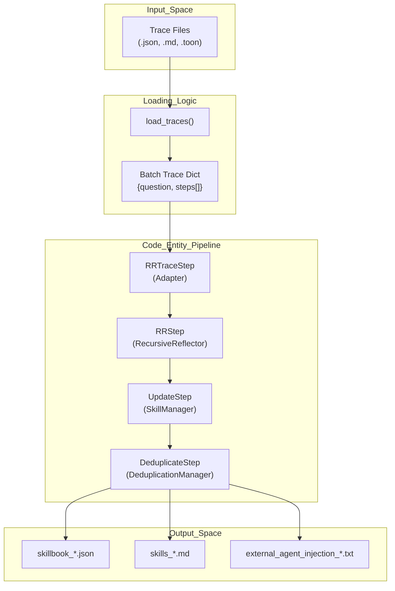
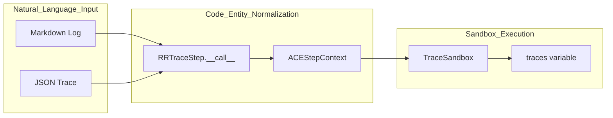

<!-- source: DeepWiki mcp.deepwiki.com · repo kayba-ai/agentic-context-engine · page 8.2 Agentic System Prompting · fetched 2026-10-26 -->

# Agentic System Prompting

<details>
<summary>Relevant source files</summary>

The following files were used as context for generating this wiki page:

- [.claude/commands/checkout-branch.md](.claude/commands/checkout-branch.md)
- [.claude/commands/create-branch.md](.claude/commands/create-branch.md)
- [.claude/commands/list-branches.md](.claude/commands/list-branches.md)
- [.claude/commands/remove-branch.md](.claude/commands/remove-branch.md)
- [CONTRIBUTING.md](CONTRIBUTING.md)
- [LICENSE](LICENSE)
- [examples/ace/rr_benchmark.py](examples/ace/rr_benchmark.py)
- [examples/agentic-system-prompting/README.md](examples/agentic-system-prompting/README.md)
- [examples/agentic-system-prompting/recursive_agentic_system_prompting.py](examples/agentic-system-prompting/recursive_agentic_system_prompting.py)
- [examples/agentic-system-prompting/skillbook_20260318_145249.json](examples/agentic-system-prompting/skillbook_20260318_145249.json)
- [examples/agentic-system-prompting/skills_20260318_144601.md](examples/agentic-system-prompting/skills_20260318_144601.md)
- [examples/agentic-system-prompting/skills_20260318_144659.md](examples/agentic-system-prompting/skills_20260318_144659.md)
- [examples/agentic-system-prompting/skills_20260318_144917.md](examples/agentic-system-prompting/skills_20260318_144917.md)
- [examples/agentic-system-prompting/skills_20260318_145205.md](examples/agentic-system-prompting/skills_20260318_145205.md)
- [examples/agentic-system-prompting/skills_20260318_145249.md](examples/agentic-system-prompting/skills_20260318_145249.md)
- [test_rr_live.py](test_rr_live.py)
- [tests/test_rr_pipeline/test_rr_stress.py](tests/test_rr_pipeline/test_rr_stress.py)
- [tests/test_rr_pipeline/test_runner.py](tests/test_rr_pipeline/test_runner.py)

</details>


**Purpose**: This page describes how to use the ACE Framework's offline trace analysis capabilities to extract reusable strategies from pre-recorded agent conversations, building skillbooks that serve as dynamic system prompts for external agents.

Agentic System Prompting treats the skillbook as a learned system prompt that evolves by analyzing successful and unsuccessful agent interactions. Unlike online learning which adapts during execution, or offline training which trains on sample datasets with evaluation, this approach analyzes completed conversation logs to extract transferable patterns.

## Overview

Agentic System Prompting is a post-hoc learning approach where:
1. Pre-recorded agent conversation traces are loaded from files.
2. `TraceAnalyser` processes traces as a single batch or sequence.
3. `RRStep` (Recursive Reflector) analyzes conversation patterns in a sandboxed REPL.
4. Learned strategies are consolidated into a skillbook.
5. The skillbook is exported for injection into external agents.

This workflow enables building reusable knowledge bases from historical agent interactions without re-executing tasks or requiring ground truth evaluations.

### Data Flow Diagram

The following diagram illustrates the flow from raw trace files to an optimized system prompt.

Title: Agentic Prompt Optimization Pipeline

Sources: [examples/agentic-system-prompting/recursive_agentic_system_prompting.py:1-28](), [examples/agentic-system-prompting/recursive_agentic_system_prompting.py:198-237]()

## Trace Handling and Normalization

### File Formats
The analysis system loads traces from multiple file types, converting them into a unified format that the `TraceSandbox` can process.

| Format | Extension | Structure | Use Case |
|--------|-----------|-----------|----------|
| JSON | `.json` | Structured trace dict | API logs, structured data |
| Markdown | `.md` | Plain text conversation | Chat logs, human-readable traces |
| Toon | `.toon` | Plain text format | Custom serialization format |

Sources: [examples/agentic-system-prompting/recursive_agentic_system_prompting.py:95-130]()

### RRTraceStep Adapter
The `RRTraceStep` class acts as a bridge between `TraceAnalyser` and `RRStep`. It ensures that the raw trace data is normalized into the dictionary format that the `TraceSandbox` expects, specifically looking for a `steps` key.

Title: Trace Normalization to Code Entities

Sources: [examples/agentic-system-prompting/recursive_agentic_system_prompting.py:67-93](), [ace/steps/rr_step.py:15-16](), [ace/core/sandbox.py:22-23]()

## Analysis Architecture

### Component Configuration
The system uses a multi-role configuration to analyze traces. The `RRStep` manages the recursive analysis, while the `SkillManager` handles the actual mutation of the `Skillbook`.

*   **RRStep**: Uses a `RecursiveConfig` to manage the REPL iteration budget. It executes code against the traces in a `TraceSandbox` [ace/steps/rr_step.py:15-16]().
*   **SkillManager**: Analyzes the `ReflectorOutput` to generate `UpdateBatch` operations (ADD, UPDATE, etc.) [examples/agentic-system-prompting/recursive_agentic_system_prompting.py:189-189]().
*   **DeduplicationManager**: Uses embeddings (e.g., `text-embedding-3-small`) to merge semantically similar insights [examples/agentic-system-prompting/recursive_agentic_system_prompting.py:190-196]().

### Budget Management
Analysis is governed by `RRConfig` (or `RecursiveConfig`), which limits the number of LLM requests and iterations to prevent runaway costs.
*   `max_requests`: Total LLM calls allowed per analysis [tests/test_rr_pipeline/test_rr_stress.py:137-142]().
*   `max_tokens`: Total token budget for the analysis session [tests/test_rr_pipeline/test_rr_stress.py:146-151]().

Sources: [examples/agentic-system-prompting/recursive_agentic_system_prompting.py:182-196](), [ace/implementations/rr/config.py:10-10]()

## Implementation Example

The `recursive_agentic_system_prompting.py` example demonstrates a full offline pipeline. It loads all traces from a directory into a single "batch" trace. This allows the agentic reflector to see patterns across multiple conversations simultaneously.

### Pipeline Assembly
```python
# Build pipeline: RRTraceStep → Update → Dedup
rr = RRStep(args.model, config=RRConfig(max_requests=60))
skill_manager = SkillManager(args.model)
dedup = DeduplicationManager(DeduplicationConfig(enabled=True, similarity_threshold=args.threshold))

pipeline = Pipeline([
    RRTraceStep(rr),
    UpdateStep(skill_manager),
    DeduplicateStep(dedup)
])
```
Sources: [examples/agentic-system-prompting/recursive_agentic_system_prompting.py:182-237]()

### Execution Loop
The `TraceAnalyser` runner is used in offline mode to drive the pipeline. It can run for multiple `epochs` to refine the skillbook.

```python
analyser = TraceAnalyser(
    model=args.model,
    pipeline=pipeline,
    skillbook=skillbook
)

# Run analysis on the batch trace
results = analyser.run([batch_trace], epochs=args.epochs)
```
Sources: [examples/agentic-system-prompting/recursive_agentic_system_prompting.py:239-254]()

## Outputs and Exports

After analysis, the system generates three primary artifacts:
1.  **Skillbook JSON**: The raw persistent state of the learned knowledge [examples/agentic-system-prompting/recursive_agentic_system_prompting.py:261-268]().
2.  **Human-Readable Markdown**: A formatted summary of skills, justifications, and evidence [examples/agentic-system-prompting/recursive_agentic_system_prompting.py:271-284]().
3.  **Prompt Injection Text**: A clean text block ready to be pasted into an external agent's system prompt [examples/agentic-system-prompting/recursive_agentic_system_prompting.py:294-299]().

The `wrap_skillbook_for_external_agent` function is used to convert the internal `Skillbook` structure into a format suitable for external LLMs [examples/agentic-system-prompting/recursive_agentic_system_prompting.py:59-59]().

Sources: [examples/agentic-system-prompting/recursive_agentic_system_prompting.py:256-304]()

---

