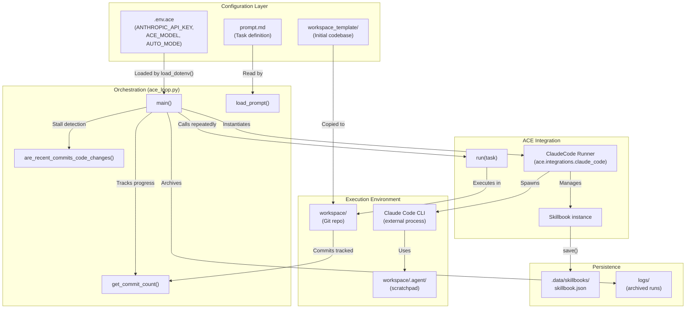
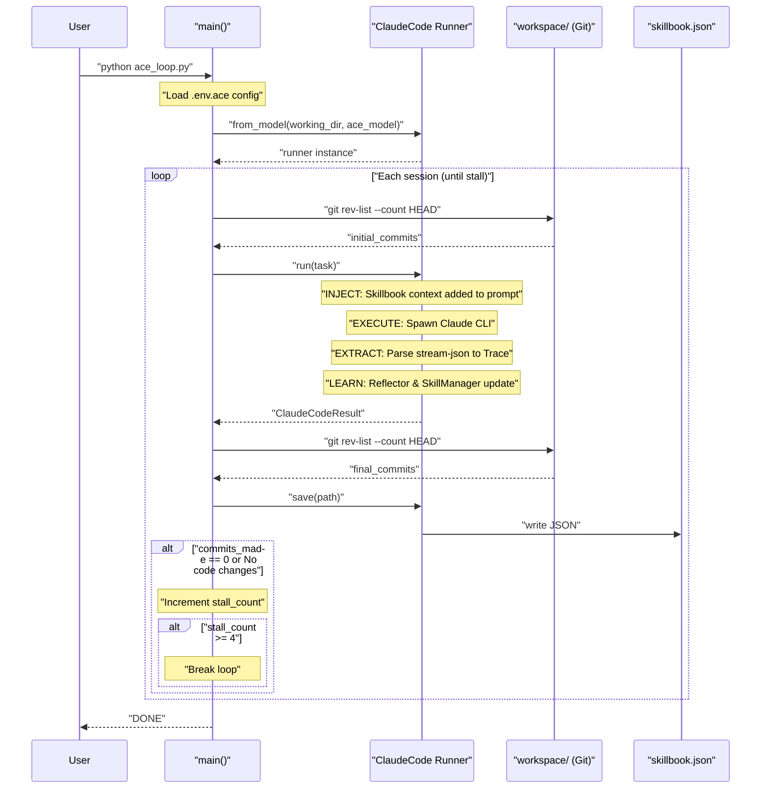
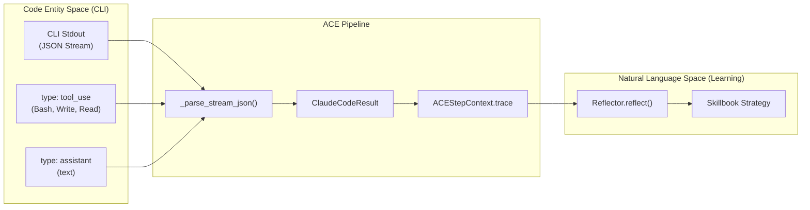

<!-- source: DeepWiki mcp.deepwiki.com · repo kayba-ai/agentic-context-engine · page 8.3 Claude Code Loop · fetched 2026-10-26 -->

# Claude Code Loop

<details>
<summary>Relevant source files</summary>

The following files were used as context for generating this wiki page:

- [ace/integrations/claude_code.py](ace/integrations/claude_code.py)
- [docs/getting-started/installation.md](docs/getting-started/installation.md)
- [docs/integrations/browser-use.md](docs/integrations/browser-use.md)
- [docs/integrations/claude-code.md](docs/integrations/claude-code.md)
- [docs/integrations/langchain.md](docs/integrations/langchain.md)

</details>


## Purpose and Scope

This page documents the Claude Code Loop example, a continuous learning system for autonomous code development. The loop orchestrates the [Claude Code CLI](https://docs.anthropic.com/en/docs/claude-code) in iterative sessions, with ACE learning from each execution to improve subsequent iterations. This enables long-running autonomous coding tasks that improve through experience by capturing project-specific patterns, debugging approaches, and architectural conventions.

For the underlying `ClaudeCode` integration class, see [Claude Code Integration](7.5). For general online learning strategies, see [Online Adaptation](6.4).

**Sources:** [docs/integrations/claude-code.md:1-4](), [docs/integrations/claude-code.md:61-64]()

---

## System Architecture

The Claude Code Loop is a self-contained example that wraps the `ClaudeCode` runner in an orchestration loop with stall detection and progress tracking.

### Component Architecture



**Sources:** [docs/integrations/claude-code.md:7-14](), [docs/integrations/claude-code.md:61-67](), [ace/integrations/claude_code.py:48-56]()

---

## Loop Execution Flow

The main loop follows a pattern: execute Claude Code, track commits, detect stalls, learn, and repeat. The `ClaudeCode` runner handles the extraction of the CLI transcript via `--output-format=stream-json` and converts it into an ACE trace for the Reflector.

### Iteration Sequence



**Sources:** [docs/integrations/claude-code.md:52-67](), [ace/integrations/claude_code.py:74-83](), [ace/integrations/claude_code.py:102-136]()

---

## Integration Details

### ClaudeCodeExecuteStep

The core of the loop is the `ClaudeCodeExecuteStep`. It implements the standard ACE `INJECT` and `EXECUTE` phases for the Claude Code CLI.

| Phase | Method | Logic |
| :--- | :--- | :--- |
| **INJECT** | `_inject` | Uses `wrap_skillbook_for_external_agent` to format skillbook strategies into a text block appended to the task prompt. |
| **EXECUTE** | `_execute` | Spawns `claude` CLI with flags: `--print`, `--output-format=stream-json`, and `--dangerously-skip-permissions`. |
| **EXTRACT** | `_parse_stream_json` | Parses the JSON stream from stdout, extracting assistant reasoning, tool calls (Read, Write, Bash, etc.), and final text. |

**Sources:** [ace/integrations/claude_code.py:48-56](), [ace/integrations/claude_code.py:89-96](), [ace/integrations/claude_code.py:102-114](), [ace/integrations/claude_code.py:157-181]()

### Data Flow: CLI to Trace

The loop bridges the "Code Entity Space" of CLI output to the "Natural Language Space" of ACE strategies using the `ClaudeCodeResult` and the stream parser.



**Sources:** [ace/integrations/claude_code.py:28-40](), [ace/integrations/claude_code.py:157-203]()

---

## Stall Detection Mechanism

Stall detection prevents infinite loops when Claude Code stops making productive progress. Progress is defined by Git commits that modify source code files.

*   **Code Extensions:** `.ts`, `.tsx`, `.js`, `.py`.
*   **Excluded Files:** `README.md`, `CHANGELOG.md`, `CONTRIBUTING.md`, `LICENSE`.
*   **Stall Threshold:** 4 consecutive sessions without code-modifying commits triggers an automatic halt.

**Sources:** [docs/integrations/claude-code.md:81-89](), [ace/integrations/claude_code.py:187-197]()

---

## Installation and Setup

To use the Claude Code Loop, ensure the CLI is installed and the ACE framework has the necessary extras.

```bash
# Install ACE with Claude Code support
uv add 'ace-framework[claude-code]'

# Install the Kayba pipeline skill into Claude Code
# This adds a 7-stage evaluation pipeline to the CLI
kayba setup
```

The `kayba setup` command installs a specialized skill into `.claude/skills/kayba-pipeline/` which allows triggering ACE-style evaluations directly from within a Claude Code chat session using the command "run the pipeline".

**Sources:** [docs/getting-started/installation.md:18-18](), [docs/getting-started/installation.md:97-103](), [docs/integrations/claude-code.md:75-81]()

---

