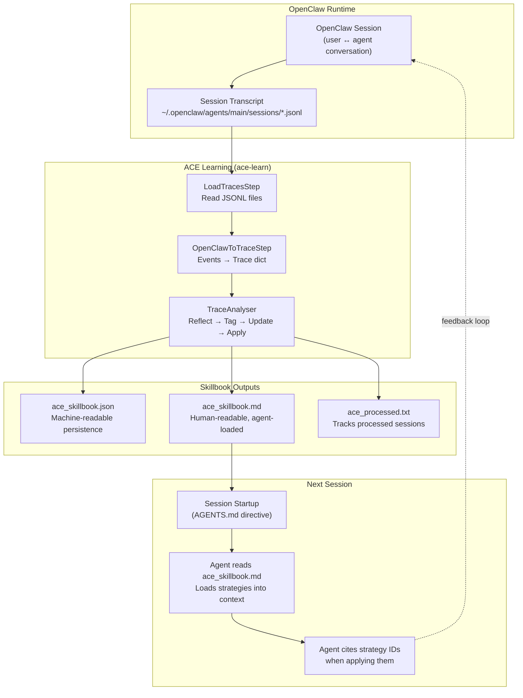
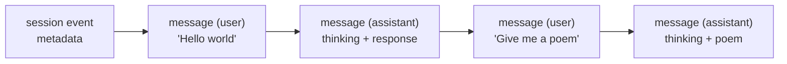
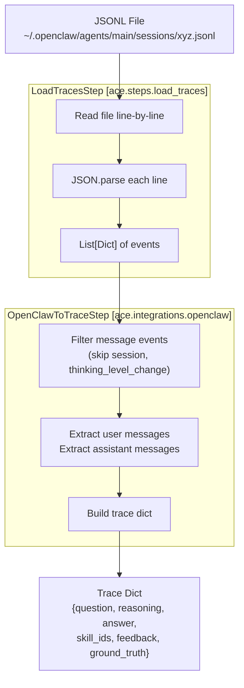
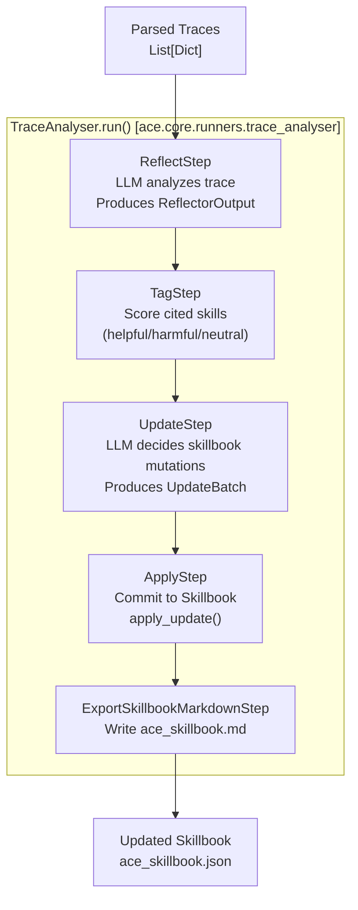
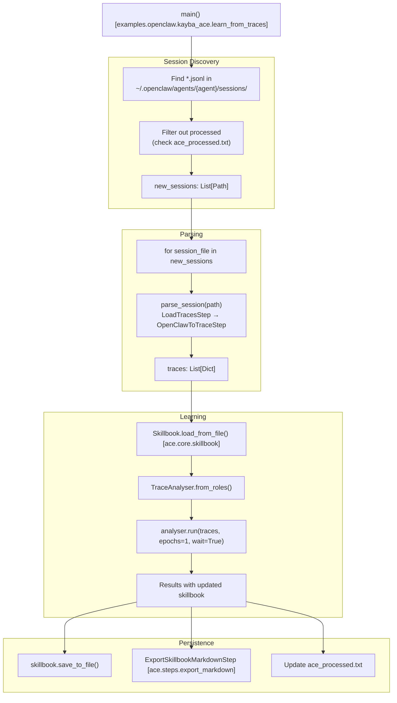
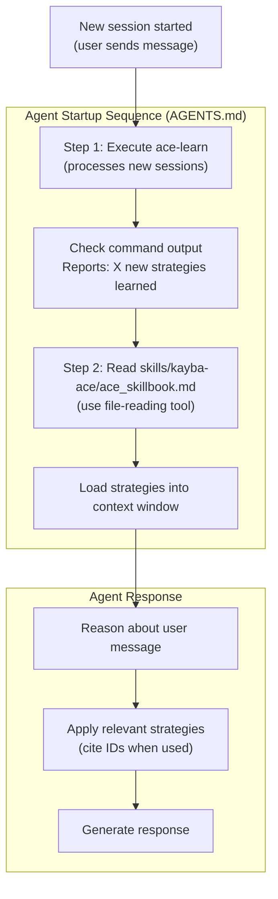
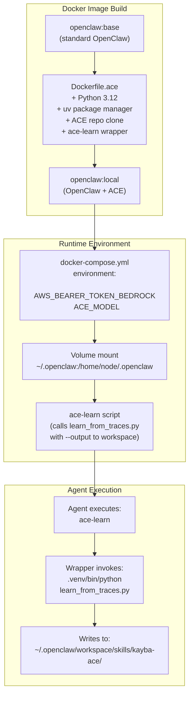
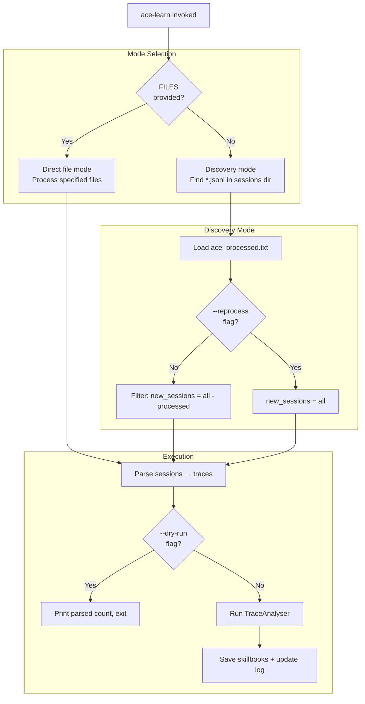
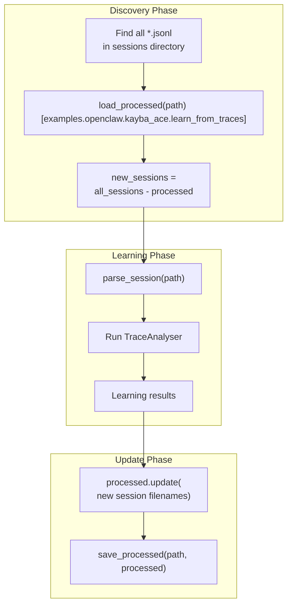

<!-- source: DeepWiki mcp.deepwiki.com · repo kayba-ai/agentic-context-engine · page 8.4 OpenClaw Session Learning · fetched 2026-10-26 -->

# OpenClaw Session Learning

<details>
<summary>Relevant source files</summary>

The following files were used as context for generating this wiki page:

- [.claude/settings.json](.claude/settings.json)
- [docs/integrations/openclaw.md](docs/integrations/openclaw.md)
- [examples/openclaw/Dockerfile.ace](examples/openclaw/Dockerfile.ace)
- [examples/openclaw/README.md](examples/openclaw/README.md)
- [examples/openclaw/ace-learn.sh](examples/openclaw/ace-learn.sh)
- [examples/openclaw/kayba-ace/SKILL.md](examples/openclaw/kayba-ace/SKILL.md)
- [examples/openclaw/kayba-ace/learn_from_traces.py](examples/openclaw/kayba-ace/learn_from_traces.py)
- [examples/openclaw/setup.py](examples/openclaw/setup.py)
- [examples/openclaw/trace_examples/b3db607f-7ae8-4089-b806-44800e961672.jsonl](examples/openclaw/trace_examples/b3db607f-7ae8-4089-b806-44800e961672.jsonl)
- [examples/openclaw/trace_examples/f967d602-325a-4a45-8d54-ee17484cfd96.jsonl](examples/openclaw/trace_examples/f967d602-325a-4a45-8d54-ee17484cfd96.jsonl)

</details>


## Purpose and Scope

This document describes how ACE learns from OpenClaw session transcripts to build a self-improving skillbook. OpenClaw is an AI assistant gateway that saves conversation logs as JSONL files; ACE processes these logs through the `TraceAnalyser` pipeline to extract reusable strategies. The agent reads the resulting skillbook at session start, enabling it to learn from past interactions without requiring manual curation.

For information about the TraceAnalyser pipeline architecture, see [Pipeline Engine (pipeline/)](3.2). For details about skillbook structure and persistence, see [Skillbook System](2.2). For general integration patterns, see [Integration Pattern Overview](7.1).

---

## Architecture Overview

The OpenClaw integration implements the standard ACE pattern: **INJECT → EXECUTE → LEARN**, where the INJECT phase occurs at session start (agent reads `ace_skillbook.md`), EXECUTE is handled by OpenClaw itself, and LEARN runs post-hoc by processing completed session transcripts.

**High-Level Flow**



**Sources:** [docs/integrations/openclaw.md:17-36](), [examples/openclaw/README.md:67-91]()

---

## Session Transcript Format

OpenClaw writes each session as a JSONL file where each line is a JSON object representing an event. The `OpenClawToTraceStep` class parses these events and converts them into the standard ACE trace format.

**Event Types**

| Event Type | Description | Fields |
|------------|-------------|--------|
| `session` | Session metadata | `id`, `timestamp`, `cwd` |
| `message` | User or assistant message | `role`, `content`, `usage`, `model` |
| `thinking_level_change` | Thinking mode change | `thinkingLevel` |
| `toolResult` | Tool execution result | `toolCallId`, `toolName`, `content` |
| `custom` | Custom metadata | `customType`, `data` |

**Example Session Structure**



**Sources:** [examples/openclaw/trace_examples/b3db607f-7ae8-4089-b806-44800e961672.jsonl:1-20](), [docs/integrations/openclaw.md:456-466]()

---

## Parsing Pipeline

The learning script uses a two-step pipeline to convert JSONL transcripts into structured traces.

**Pipeline Architecture**



**Implementation Details**

The `LoadTracesStep` class reads the JSONL file and parses each line as JSON. It is initialized in the `learn_from_traces.py` script to handle raw file ingestion.

[examples/openclaw/kayba-ace/learn_from_traces.py:92-92]()

The `OpenClawToTraceStep` class converts the raw events into the trace format expected by the `Reflector`. It concatenates user messages into the `question` field, assistant reasoning and tool calls into `reasoning`, and the final assistant response into `answer`.

[examples/openclaw/kayba-ace/learn_from_traces.py:93-93]()

**Trace Structure**

```python
{
    "question": "User: Hello world\n\nUser: Give me a poem of 2 paragraphs",
    "reasoning": "[thinking] User wants a poem...\n[response] Here you go:\n...",
    "answer": "Final assistant response text",
    "skill_ids": [],  # Cited skills (empty for OpenClaw)
    "feedback": "OpenClaw session: 3 user messages, 1 assistant responses, model: claude-sonnet-4-5, 14605 tokens",
    "ground_truth": None
}
```

**Sources:** [examples/openclaw/kayba-ace/learn_from_traces.py:92-110](), [docs/integrations/openclaw.md:452-466]()

---

## Learning Workflow

Once traces are parsed, they're fed to the `TraceAnalyser` runner which executes the standard learning tail: Reflect → Tag → Update → Apply.

**TraceAnalyser Pipeline**



**Code Flow in learn_from_traces.py**



**Key Classes and Functions**

- `TraceAnalyser.from_roles()`: Factory method to create analyser with `Reflector` and `SkillManager` roles. [examples/openclaw/kayba-ace/learn_from_traces.py:264-269]()
- `analyser.run(traces, epochs=1, wait=True)`: Execute learning pipeline synchronously. [examples/openclaw/kayba-ace/learn_from_traces.py:271-271]()
- `Skillbook.load_from_file()`: Load existing skillbook from JSON. [examples/openclaw/kayba-ace/learn_from_traces.py:222-222]()
- `skillbook.save_to_file()`: Persist updated skillbook. [examples/openclaw/kayba-ace/learn_from_traces.py:292-292]()

**Sources:** [examples/openclaw/kayba-ace/learn_from_traces.py:117-303](), [docs/integrations/openclaw.md:467-474]()

---

## Output Files

The learning script produces three files in the output directory (default: `~/.openclaw/workspace/skills/kayba-ace/`).

**File Structure**

| File | Format | Purpose | When Updated |
|------|--------|---------|--------------|
| `ace_skillbook.json` | JSON | Full skillbook persistence, used by ACE internally | Every learning run |
| `ace_skillbook.md` | Markdown | Human-readable skillbook, loaded by agent | Every learning run |
| `ace_processed.txt` | Text | Tracks processed session filenames (one per line) | After successful learning |

**ace_skillbook.json Structure**

```json
{
  "skills": [
    {
      "id": "conversation_style-00003",
      "content": "Maintain brief, natural responses without performative language",
      "justification": "Establishes consistent conversational tone across interaction types",
      "evidence": "Maintained direct, helpful tone across greeting, creative request, modification, and casual follow-up",
      "section": "conversation_style",
      "helpful": 5,
      "harmful": 0,
      "neutral": 0,
      "metadata": {}
    }
  ]
}
```

**ace_skillbook.md Format**

The markdown export groups skills by section with readable formatting, generated via `ExportSkillbookMarkdownStep`.

[examples/openclaw/kayba-ace/learn_from_traces.py:61-61]()

**ace_processed.txt Format**

Simple newline-delimited list of processed filenames:

```
b3db607f-7ae8-4089-b806-44800e961672.jsonl
f967d602.jsonl
a1b2c3d4.jsonl
```

**Sources:** [docs/integrations/openclaw.md:373-386](), [examples/openclaw/README.md:139-145](), [examples/openclaw/kayba-ace/learn_from_traces.py:289-300]()

---

## Agent Integration

The agent loads the skillbook at session start via an explicit instruction in `AGENTS.md`. This pattern is required because OpenClaw does not automatically inline file references.

**Session Startup Flow**



**AGENTS.md Snippet**

The setup script appends this directive to `AGENTS.md`. The `setup.py` script checks for the `AGENTS_MARKER` ("## Auto-Learning") to ensure it doesn't duplicate instructions.

[examples/openclaw/setup.py:25-25]()
[examples/openclaw/setup.py:72-107]()

The key requirements:
1. Run `ace-learn` at session start (Docker setup only)
2. Report learning results to user
3. Read `skills/kayba-ace/ace_skillbook.md` into context
4. Cite strategy IDs when applying learned strategies (e.g., `conversation_style-00003`)

**Sources:** [docs/integrations/openclaw.md:152-164](), [examples/openclaw/setup.py:72-107]()

---

## Setup Modes

The integration supports two deployment models: Docker (bakes ACE into the OpenClaw image) and Host (runs ACE externally).

**Comparison Matrix**

| Feature | Docker | Host |
|---------|--------|------|
| **Installation** | Rebuild OpenClaw image with `Dockerfile.ace` | `uv sync` in ACE repo |
| **Learning trigger** | Agent calls `ace-learn` at session start | Cron job or manual invocation |
| **Automation** | Fully automatic | Requires external scheduler |
| **Customization** | Requires image rebuild | Edit script directly |
| **Use case** | Production deployment | Development, testing |

**Docker Setup Components**



**Dockerfile.ace Key Sections**

[examples/openclaw/Dockerfile.ace:1-74]()

- Lines 34-39: Install `uv` and Python 3.12
- Lines 45-50: Clone ACE repo, install dependencies with `--extra claude-code`, and make `node:node` owner.
- Lines 54-63: Create `ace-learn` wrapper script that sets `OPENCLAW_HOME` and output directory.

**ace-learn Wrapper**

[examples/openclaw/ace-learn.sh:1-21]()

The wrapper ensures:
- `OPENCLAW_HOME` is set (needed for session discovery).
- Output files go to workspace volume (persisted across container restarts).
- Python script runs in ACE virtual environment.

**Sources:** [docs/integrations/openclaw.md:169-370](), [examples/openclaw/Dockerfile.ace:1-74](), [examples/openclaw/ace-learn.sh:1-21]()

---

## CLI Usage

The learning script is invoked either through the `ace-learn` wrapper (Docker) or directly via `uv run` (host).

**Command Syntax**

```bash
# Docker
ace-learn [OPTIONS] [FILES...]

# Host
uv run python examples/openclaw/kayba-ace/learn_from_traces.py [OPTIONS] [FILES...]
```

**Options**

| Option | Type | Default | Description |
|--------|------|---------|-------------|
| `--dry-run` | Flag | False | Parse sessions without LLM calls |
| `--reprocess` | Flag | False | Ignore `ace_processed.txt`, reprocess all sessions |
| `--agent ID` | String | `$OPENCLAW_AGENT_ID` or `"main"` | Agent ID for session discovery |
| `--output DIR` | Path | Script directory | Output directory for skillbook files |
| `--opik` | Flag | False | Enable Opik observability logging |
| `FILES...` | Paths | None | Specific JSONL files to process (skips discovery) |

**Execution Modes**



**Sources:** [examples/openclaw/kayba-ace/learn_from_traces.py:122-158](), [docs/integrations/openclaw.md:435-449](), [examples/openclaw/kayba-ace/SKILL.md:17-100]()

---

## Configuration

**Environment Variables**

The script reads configuration from environment variables, with fallback to `.env` files in `$OPENCLAW_HOME/.env` and `~/.env`.

[examples/openclaw/kayba-ace/learn_from_traces.py:44-47]()

| Variable | Default | Purpose |
|----------|---------|---------|
| `ACE_MODEL` | `bedrock/us.anthropic.claude-sonnet-4-20250514-v1:0` | LLM model for `Reflector` and `SkillManager` |
| `OPENCLAW_AGENT_ID` | `"main"` | Agent ID for session discovery (overridden by `--agent`) |
| `OPENCLAW_HOME` | Three dirs up from script location | OpenClaw installation directory |
| `AWS_BEARER_TOKEN_BEDROCK` | — | AWS Bedrock authentication token |
| `ANTHROPIC_API_KEY` | — | Anthropic API key |
| `OPENROUTER_API_KEY` | — | OpenRouter API key |
| `LITELLM_API_KEY` | — | Generic LiteLLM API key |
| `SPH_LITELLM_KEY` | — | Alternative LiteLLM key variable |

**API Key Priority**

The script selects the first available API key in this order:

[examples/openclaw/kayba-ace/learn_from_traces.py:240-246]()

**Docker Configuration**

For Docker setups, pass environment variables through `docker-compose.yml`. Important: Do NOT set `OPENCLAW_HOME` in `docker-compose.yml`. The base OpenClaw image derives it from `$HOME/.openclaw`, and setting it explicitly causes double-nesting.

[examples/openclaw/Dockerfile.ace:65-66]()

**Path Resolution**

The script derives all paths from its location. It uses `SCRIPT_DIR.parents[2]` to infer `OPENCLAW_HOME` if not provided.

[examples/openclaw/kayba-ace/learn_from_traces.py:29-33]()

**Sources:** [examples/openclaw/kayba-ace/learn_from_traces.py:29-67](), [docs/integrations/openclaw.md:422-434](), [examples/openclaw/Dockerfile.ace:65-66]()

---

## Processed Session Tracking

The script maintains a log of processed sessions to avoid redundant LLM calls. This implements incremental learning where only new sessions are analyzed each run.

**Tracking Implementation**



**Code Functions**

[examples/openclaw/kayba-ace/learn_from_traces.py:75-86]()

**Bypass Modes**

- `--reprocess` flag: Skips loading the log, processes all sessions. [examples/openclaw/kayba-ace/learn_from_traces.py:180-180]()
- Direct file mode: When `FILES...` are provided, the log is not updated. [examples/openclaw/kayba-ace/learn_from_traces.py:297-300]()

**Sources:** [examples/openclaw/kayba-ace/learn_from_traces.py:70-86](), [examples/openclaw/kayba-ace/learn_from_traces.py:165-192](), [examples/openclaw/kayba-ace/learn_from_traces.py:297-300]()

---

## Error Handling

The script implements defensive error handling at multiple stages to ensure partial failures don't block learning.

**Error Recovery Points**

| Stage | Failure Scenario | Recovery Action |
|-------|------------------|-----------------|
| **Skillbook load** | `ace_skillbook.json` corrupted | Start with empty skillbook. [examples/openclaw/kayba-ace/learn_from_traces.py:227-230]() |
| **Session parsing** | JSONL syntax error or empty file | Skip session, log warning. [examples/openclaw/kayba-ace/learn_from_traces.py:199-204]() |
| **Learning** | LLM call timeout or error | Mark result with error, continue with other traces. [examples/openclaw/kayba-ace/learn_from_traces.py:273-276]() |
| **File discovery** | Sessions directory missing | Exit with error message. [examples/openclaw/kayba-ace/learn_from_traces.py:175-178]() |

**Partial Success Handling**

Even if some traces fail, the script continues processing remaining traces and saves the successfully learned strategies.

[examples/openclaw/kayba-ace/learn_from_traces.py:273-281]()

**Sources:** [examples/openclaw/kayba-ace/learn_from_traces.py:175-178](), [examples/openclaw/kayba-ace/learn_from_traces.py:199-230](), [examples/openclaw/kayba-ace/learn_from_traces.py:273-281]()

---

