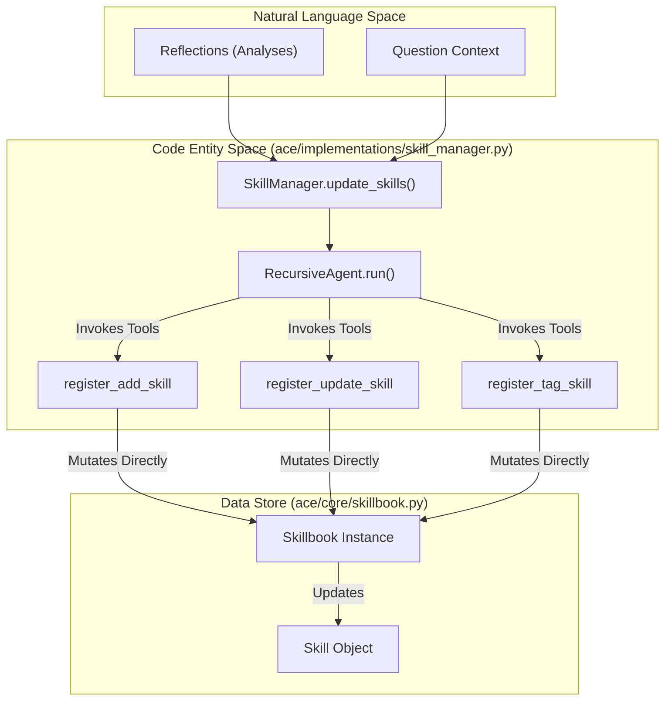
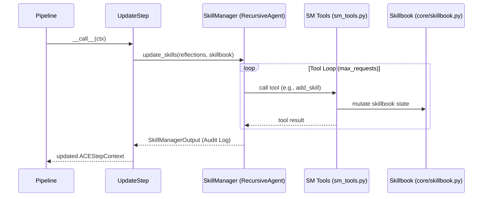

<!-- source: DeepWiki mcp.deepwiki.com · repo kayba-ai/agentic-context-engine · page 9.1 Update Operations · fetched 2026-10-26 -->

# Update Operations

<details>
<summary>Relevant source files</summary>

The following files were used as context for generating this wiki page:

- [ace/implementations/prompts.py](ace/implementations/prompts.py)
- [ace/implementations/skill_manager.py](ace/implementations/skill_manager.py)
- [docs/api/index.md](docs/api/index.md)
- [docs/concepts/skillbook.md](docs/concepts/skillbook.md)
- [docs/concepts/updates.md](docs/concepts/updates.md)
- [docs/design/SKILLBOOK_V2_PLAN.md](docs/design/SKILLBOOK_V2_PLAN.md)
- [docs/guides/composing-pipelines.md](docs/guides/composing-pipelines.md)
- [docs/guides/prompts.md](docs/guides/prompts.md)

</details>


## Purpose and Scope

This page explains **UpdateBatch** operations, the incremental modification primitives that ACE uses to evolve Skillbooks without context collapse. Update operations enable precise, granular changes to the Skillbook's skill collection through five primary operation types: ADD, UPDATE, TAG, REMOVE, and CONSOLIDATE.

In the ACE v2 architecture, the **SkillManager** functions as a `RecursiveAgent` that mutates the skillbook directly via atomic tool calls. The resulting `SkillManagerOutput` serves as a post-hoc audit log of these operations.

**Sources:** [ace/implementations/skill_manager.py:1-14](), [docs/concepts/updates.py:1-13]()

---

## The Brevity Bias Problem

A critical insight from the ACE framework design: **LLMs exhibit brevity bias when asked to rewrite context.** When prompted to regenerate or revise large text blocks, language models tend to compress information, losing crucial details and nuance.

ACE solves this through **incremental update operations**—discrete modifications that never ask the LLM to regenerate entire contexts. Instead of regenerating the skillbook, the `SkillManager` uses atomic tools to target specific skills:

```python
# Atomic mutation tools used by SkillManager
register_add_skill,
register_update_skill,
register_remove_skill,
register_tag_skill
```

This preserves the exact wording and structure of existing skills while allowing targeted modifications and maintaining a structured audit trail in `skill.occurrences`.

**Sources:** [ace/implementations/skill_manager.py:31-39](), [docs/design/SKILLBOOK_V2_PLAN.md:8-15]()

---

## Operation Types

### Overview Table

ACE provides five operation types for modifying Skillbooks:

| Type | Description | Required Fields |
|------|-------------|----------------|
| `ADD` | Create a new skill | `section`, `issue`, `keywords` (`insight` required for `context`) |
| `UPDATE` | Modify an existing skill | `skill_id`, `issue` |
| `TAG` | Record helpful, harmful, or neutral feedback | `skill_id`, `metadata.delta` |
| `REMOVE` | Soft-remove a skill (sets `active=False`) | `skill_id` |
| `CONSOLIDATE`| Merge or deduplicate similar skills | `skill_ids`, `target_id` |

**Sources:** [docs/concepts/updates.md:7-12](), [docs/design/SKILLBOOK_V2_PLAN.md:63-72]()

---

### ADD Operation
Adds a new strategy learned from experience. In the v2 schema, `issue` is always required. `insight` (the imperative action) is mandatory for the `context` section but optional for the `harness` section.

**Example:**
```json
{
  "type": "ADD",
  "section": "context",
  "keywords": ["math", "decomposition"],
  "issue": "Complex arithmetic questions are easier to solve when the work is decomposed.",
  "insight": "Break complex problems into smaller steps before computing."
}
```
**Sources:** [docs/concepts/updates.md:16-28](), [docs/design/SKILLBOOK_V2_PLAN.md:42-47]()

---

### UPDATE Operation
Refines an existing strategy. This operation is used when the `SkillManager` widens the scope of an issue or clarifies an insight based on new evidence. Any mutation to `issue`, `insight`, or `keywords` invalidates the skill's embedding.

**Sources:** [docs/concepts/updates.md:30-43](), [docs/design/SKILLBOOK_V2_PLAN.md:47-47]()

---

### TAG Operation
Records skill effectiveness. The `Reflector` analyzes the outcome and the `SkillManager` (or `ACE` runner) applies a `delta` to the skill's counters:
* `1` → increment `helpful_count`
* `-1` → increment `harmful_count`
* `0` → increment `neutral_count`

**Sources:** [docs/concepts/updates.md:45-56](), [docs/concepts/updates.md:100-108]()

---

### REMOVE Operation
Performs a **soft-remove** by setting `active=False`. This prunes the strategy from the active prompt context while preserving the historical audit chain and occurrences for future analysis.

**Sources:** [docs/concepts/updates.md:58-69](), [docs/design/SKILLBOOK_V2_PLAN.md:69-69]()

---

## Update Logic and Data Flow

### From Reflection to Mutation
The `SkillManager` receives a tuple of reflections and uses them to drive tool calls. Unlike legacy versions, the v2 `SkillManager` mutates the `Skillbook` instance **immediately** as tools fire.

**SkillManager Tool Execution Flow**



**Sources:** [ace/implementations/skill_manager.py:58-93](), [ace/implementations/skill_manager.py:147-169]()

---

### Update Batches and Audit Logs
The `UpdateBatch` returned by `SkillManager.update_skills` is a post-hoc **audit log**. In the pipeline engine, the `UpdateStep` is the sole invocation point; there is no downstream "ApplyStep" because the mutation has already occurred.

**Pipeline Update Sequence**



**Sources:** [ace/implementations/skill_manager.py:1-14](), [docs/guides/composing-pipelines.md:20-29]()

---

## Provenance and Insight Sources

Every mutation (ADD, UPDATE, TAG) auto-appends an `InsightSource` to the skill's `occurrences` list. This ensures that every update operation can be traced back to the specific execution trace and reflection that triggered it.

**InsightSource Fields:**
* `trace_uid`: Stable identity of the trace.
* `learning_text`: The specific lesson extracted (e.g., "Check for a next-page token").
* `trace_refs`: Best-effort anchors (JSON paths, step indices) into the original trace.

**Sources:** [docs/concepts/skillbook.md:135-171](), [docs/design/SKILLBOOK_V2_PLAN.md:80-91]()

---

## Key Implementation Classes

| Class | File Path | Role |
|-------|-----------|------|
| `UpdateOperation` | [ace/core/skillbook.py]() | Represents a single atomic change (ADD, UPDATE, etc.) |
| `UpdateBatch` | [ace/core/skillbook.py]() | A collection of operations representing one learning cycle. |
| `SkillManager` | [ace/implementations/skill_manager.py:58-93]() | The agentic role that decides and executes operations. |
| `SMDeps` | [ace/implementations/sm_tools.py]() | Dependency container for SkillManager tools, holding the active `Skillbook`. |

**Sources:** [ace/implementations/skill_manager.py:31-39](), [ace/core/outputs.py]()

---

