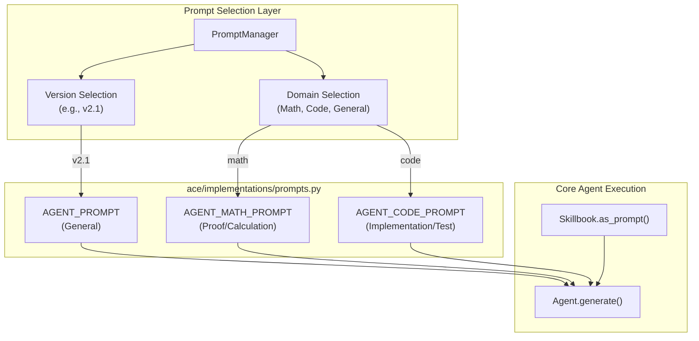
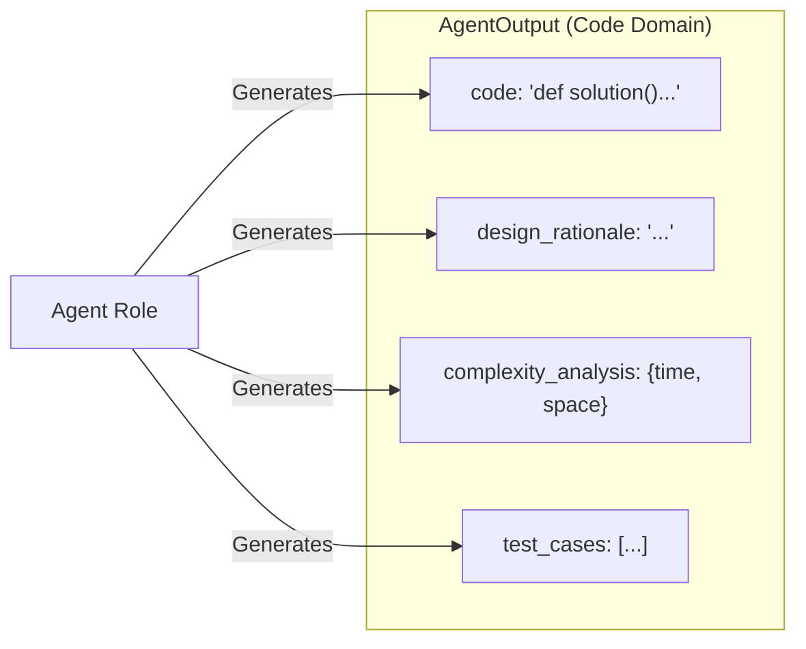
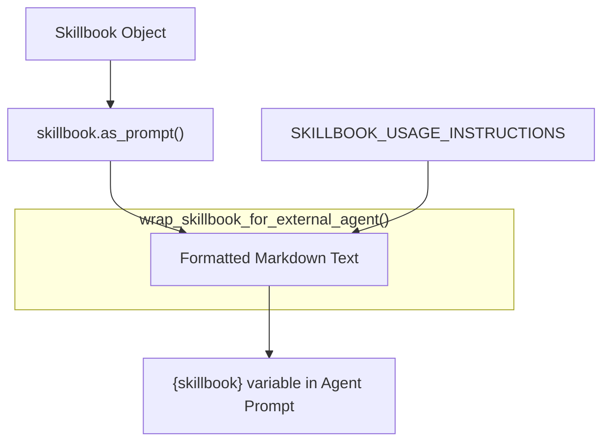

<!-- source: DeepWiki mcp.deepwiki.com · repo kayba-ai/agentic-context-engine · page 9.3 Domain-Specific Prompts · fetched 2026-10-26 -->

# Domain-Specific Prompts

<details>
<summary>Relevant source files</summary>

The following files were used as context for generating this wiki page:

- [ace/implementations/prompts.py](ace/implementations/prompts.py)
- [ace/implementations/skill_manager.py](ace/implementations/skill_manager.py)
- [docs/api/index.md](docs/api/index.md)
- [docs/concepts/skillbook.md](docs/concepts/skillbook.md)
- [docs/concepts/updates.md](docs/concepts/updates.md)
- [docs/design/SKILLBOOK_V2_PLAN.md](docs/design/SKILLBOOK_V2_PLAN.md)
- [docs/guides/composing-pipelines.md](docs/guides/composing-pipelines.md)
- [docs/guides/prompts.md](docs/guides/prompts.md)

</details>


This page documents the domain-specific variants of ACE role prompts, focusing on how the framework optimizes instructions for specialized tasks like mathematical reasoning and software development. In the ACE Framework, domain specialization primarily occurs at the **Agent** (formerly Generator) level, while the **Reflector** and **SkillManager** maintain a generalized analysis posture to ensure learning consistency across domains.

## Overview

Domain-specific prompts are specialized variants of the core role templates. They extend the base instructions with additional protocols, requirements, and output schemas tailored to a specific field's unique constraints. The ACE framework provides built-in support for general, mathematical, and coding domains.

| Domain | Prompt Template | Purpose |
|--------|-----------------|---------|
| **General** | `AGENT_PROMPT` | Standard problem-solving with skillbook application |
| **Math** | Specialized Variant | Rigorous mathematical problem-solving with verification protocols |
| **Code** | Specialized Variant | Production-quality code generation with testing and complexity analysis |

**Sources:** [ace/implementations/prompts.py:68-176](), [ace/implementations/prompts.py:180-202]()

## Prompt Selection and Data Flow

The `PromptManager` (and internal role logic) selects templates based on the version and domain parameters. The following diagram illustrates how a domain-specific request flows from the `PromptManager` to the `Agent` role.

### Domain Prompt Selection Flow



**Sources:** [ace/implementations/prompts.py:68-75](), [docs/guides/prompts.py:12-22]()

## Mathematics Domain Prompt

The mathematics-specific prompt variant adds rigorous calculation and verification protocols. It is designed to minimize "hallucinated" arithmetic by forcing the model to show every intermediate step.

### Key Mathematical Enhancements
*   **Verification Phase:** Mandatory step to check the final answer against the original question (e.g., by substitution).
*   **Calculation Transparency:** Requirement to show ALL intermediate calculations rather than just the final result.
*   **Variable Tracking:** Explicit definition of variables and their units.

### Mathematical Output Schema
The math-specific prompt often requires an extended JSON structure to capture the proof process:

| Field | Description |
|-------|-------------|
| `calculations` | List of discrete arithmetic steps taken |
| `verification` | Description of how the answer was validated |
| `method_selected` | The mathematical approach used (e.g., "Quadratic Formula") |

**Sources:** [ace/implementations/prompts.py:164-176](), [ace/implementations/prompts.py:187-202]()

## Code Domain Prompt

The code-specific prompt variant incorporates software engineering best practices, including type safety, error handling, and complexity analysis.

### Key Code Enhancements
*   **Implementation Workflow:** Forces a "Design → Implement → Test" sequence.
*   **Quality Standards:** Requirements for type hints (Python/TypeScript), docstrings, and specific exception handling.
*   **Complexity Analysis:** Mandatory O(n) time/space complexity evaluation.

### Code Output Schema
When using the code domain, the `Agent` output includes implementation-specific metadata:



**Sources:** [ace/implementations/prompts.py:164-176](), [docs/api/index.md:140-148]()

## Role-Specific Prompt Variables

Regardless of the domain, each ACE role requires specific template variables to be present in the prompt string. If you provide a custom domain prompt, you must include these placeholders.

### Template Variable Requirements

| Role | Required Variables | File Reference |
|------|--------------------|----------------|
| **Agent** | `{skillbook}`, `{question}`, `{context}`, `{reflection}` | [ace/implementations/prompts.py:91-98]() |
| **Reflector** | `{skillbook}`, `{question}`, `{agent_output}`, `{ground_truth}`, `{feedback}` | [docs/guides/prompts.md:37-43]() |
| **SkillManager** | `{skillbook}`, `{reflection}`, `{question_context}`, `{progress}` | [ace/implementations/skill_manager.py:181-188]() |

**Sources:** [ace/implementations/prompts.py:91-98](), [ace/implementations/skill_manager.py:181-188](), [docs/guides/prompts.md:27-53]()

## Overriding Prompts for Custom Domains

Users can inject domain-specific instructions by passing a `prompt_template` to the role constructors. This is the standard way to specialize ACE for a new industry or technical field.

```python
from ace import Agent

# Custom domain prompt for Medical Diagnosis
medical_prompt = """
# Identity
You are a Medical Diagnostic Agent. 
...
## Skillbook Application
{skillbook}

## Patient Data
{question}
{context}

## Previous Analysis
{reflection}

Return JSON with "reasoning", "final_answer", and "skill_ids".
"""

agent = Agent("gpt-4o", prompt_template=medical_prompt)
```

**Sources:** [docs/guides/prompts.md:12-22](), [docs/guides/prompts.md:58-71]()

## Skillbook Injection in Domain Prompts

A critical component of all domain prompts is the `skillbook` variable. The `wrap_skillbook_for_external_agent` function is the canonical way to format learned strategies for consumption by the agent, ensuring that citations are used correctly regardless of the domain.

### Skillbook Formatting Logic



**Sources:** [ace/implementations/prompts.py:15-28](), [ace/implementations/prompts.py:31-59]()

## Implementation Details

### SkillManager Domain Context
The `SkillManager` receives a `question_context` string (e.g., "Mathematics", "Python Web Backend") via its `update_skills` method. It uses this to determine if a new skill is domain-specific or a general strategy.

### Recursive Reflector (RR) Domain Adaptation
The `RRStep` (Recursive Reflector) adapts to domains by providing a `TraceSandbox` where code can be executed to verify traces. In the "Code" domain, the RR can run generated code snippets to identify root causes of failures.

**Sources:** [ace/implementations/skill_manager.py:141-144](), [docs/guides/composing-pipelines.md:208-235]()

---

