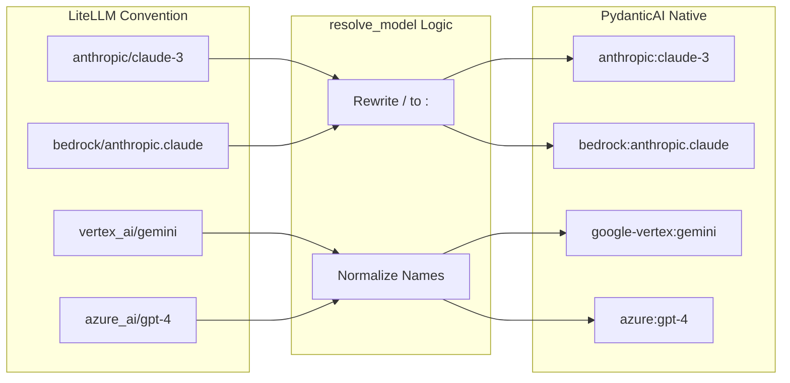
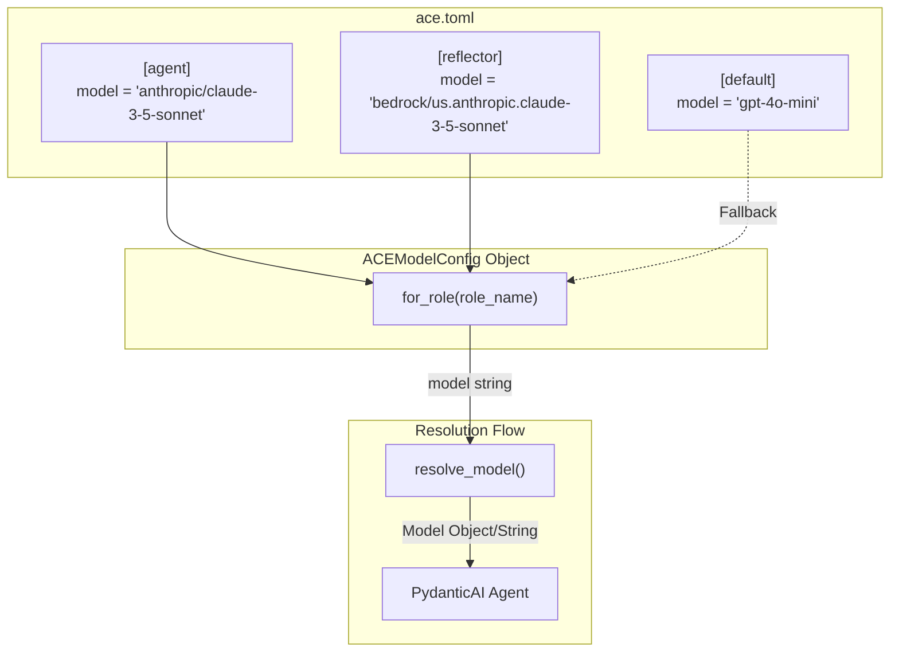
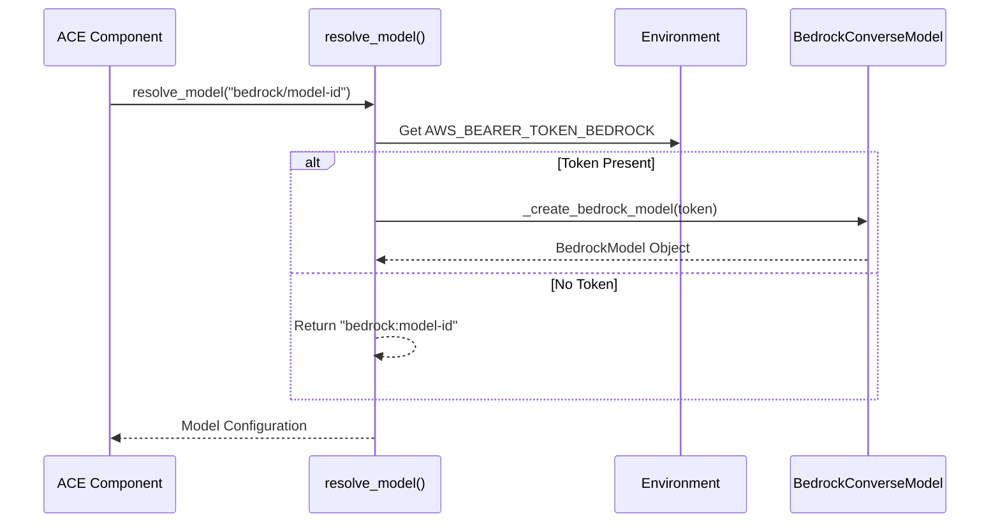

<!-- source: DeepWiki mcp.deepwiki.com · repo kayba-ai/agentic-context-engine · page 9.5 Router and Fallbacks · fetched 2026-10-26 -->

# Router and Fallbacks

Relevant source files

The following files were used as context for generating this wiki page:

- [ace/providers/config.py](ace/providers/config.py)
- [ace/providers/pydantic_ai.py](ace/providers/pydantic_ai.py)

This page documents the model configuration and routing system used in the ACE Framework. ACE leverages **PydanticAI** to manage model resolution, providing a robust abstraction layer for model fallbacks, provider-specific routing, and redundancy across 100+ LLM providers.

**Scope**: This page covers the transition from LiteLLM-style model identifiers to PydanticAI model objects, explicit provider routing (e.g., Bedrock bearer tokens), and how role-specific configurations are managed via `ace.toml`.

---

## Model Resolution Strategy

ACE uses a multi-path resolution strategy to convert string identifiers (following LiteLLM conventions) into PydanticAI model strings or provider objects. This allows the framework to support native provider SDKs (Anthropic, OpenAI, Bedrock) while falling back to LiteLLM's proxy for long-tail providers.

### Resolution Paths

The `resolve_model` function in `ace/providers/pydantic_ai.py` implements four primary resolution paths:

| Path | Condition | Result |
| :--- | :--- | :--- |
| **1. Native PydanticAI** | Identifier contains `:` and matches a known provider (e.g., `openai:gpt-4o`) | Passed through unchanged to PydanticAI. |
| **2. Bedrock Bearer Auth** | Starts with `bedrock/` and `AWS_BEARER_TOKEN_BEDROCK` is set | Returns a `BedrockModel` configured with explicit bearer-token auth. |
| **3. LiteLLM-to-Native Rewrite** | Starts with a LiteLLM prefix that has a native PydanticAI equivalent (e.g., `anthropic/`) | Rewrites `/` to `:` (e.g., `anthropic:claude-3-5-sonnet`) to use PydanticAI native SDKs. |
| **4. LiteLLM Fallback** | No recognized prefix or specific auth requirements | Prepends `litellm:` to route the request through the LiteLLM proxy provider. |

**Sources**: [ace/providers/pydantic_ai.py:1-50](), [ace/providers/pydantic_ai.py:107-178]()

### Provider Mapping

ACE maps LiteLLM-style prefixes to PydanticAI native providers to ensure optimal performance and authentication (e.g., using SigV4 for Bedrock or native headers for Anthropic).

**Sources**: [ace/providers/pydantic_ai.py:91-104](), [ace/providers/pydantic_ai.py:165-175]()

---

## Configuration and Routing

ACE organizes model selection through a secrets-free configuration system. This allows developers to commit model choices to version control while keeping API keys in environment variables.

### Role-Based Model Selection

The `ACEModelConfig` class manages model assignments for the three core ACE roles: **Agent**, **Reflector**, and **SkillManager**. If a specific role is not configured, it falls back to a `default` model.

**Sources**: [ace/providers/config.py:63-78](), [ace/providers/config.py:110-127]()

### Configuration Schema

The `ModelConfig` dataclass defines the parameters for a single role:

| Field | Type | Default | Description |
| :--- | :--- | :--- | :--- |
| `model` | `str` | (Required) | The model identifier (LiteLLM or PydanticAI format). |
| `temperature` | `float` | `0.0` | Sampling temperature. |
| `max_tokens` | `int` | `2048` | Maximum output length. |
| `extra_params` | `dict` | `None` | Provider-specific parameters (e.g., top_p, frequency_penalty). |

**Sources**: [ace/providers/config.py:32-50]()

---

## Bedrock Specific Routing

ACE provides specialized handling for AWS Bedrock to support both standard Boto3 (SigV4) authentication and Bearer Token authentication.

### Bearer Token Failover

If the environment variable `AWS_BEARER_TOKEN_BEDROCK` is detected, ACE bypasses standard AWS credential resolution and instantiates a `BedrockConverseModel` with explicit bearer auth.

**Sources**: [ace/providers/pydantic_ai.py:157-163](), [ace/providers/pydantic_ai.py:181-195]()

---

## Implementation Details

### Persistence

Configurations are typically stored in `ace.toml` at the project root. The framework provides utility functions to locate and load these files by walking up the directory tree.

- `load_config(directory)`: Loads the `ace.toml` from a specific path. [ace/providers/config.py:151-164]()
- `find_config(start)`: Recursively searches parent directories for `ace.toml`. [ace/providers/config.py:167-174]()
- `save_config(config, directory)`: Serializes the current configuration back to TOML format. [ace/providers/config.py:143-148]()

### Environment Integration

While model choices are in `ace.toml`, secrets are managed via `.env` files. ACE includes a helper `load_dotenv()` to integrate with `python-dotenv` if available.

**Sources**: [ace/providers/config.py:182-190](), [ace/providers/config.py:192-209]()

### Provider Requirements

To minimize dependency bloat, ACE uses `pydantic-ai-slim`. Users must install the specific provider extras to use native SDKs:

- **Anthropic**: `pip install pydantic-ai-slim[anthropic]`
- **OpenAI**: `pip install pydantic-ai-slim[openai]`
- **Bedrock**: `pip install pydantic-ai-slim[bedrock]`
- **Google**: `pip install pydantic-ai-slim[google]`

If an extra is missing for a native prefix (e.g., `anthropic:`), the call will fail at runtime. If the model is routed via `litellm:`, the LiteLLM proxy must be installed.

**Sources**: [ace/providers/pydantic_ai.py:20-42]()

---

