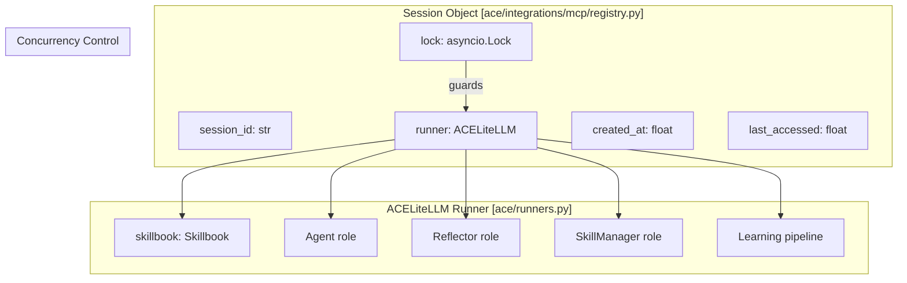
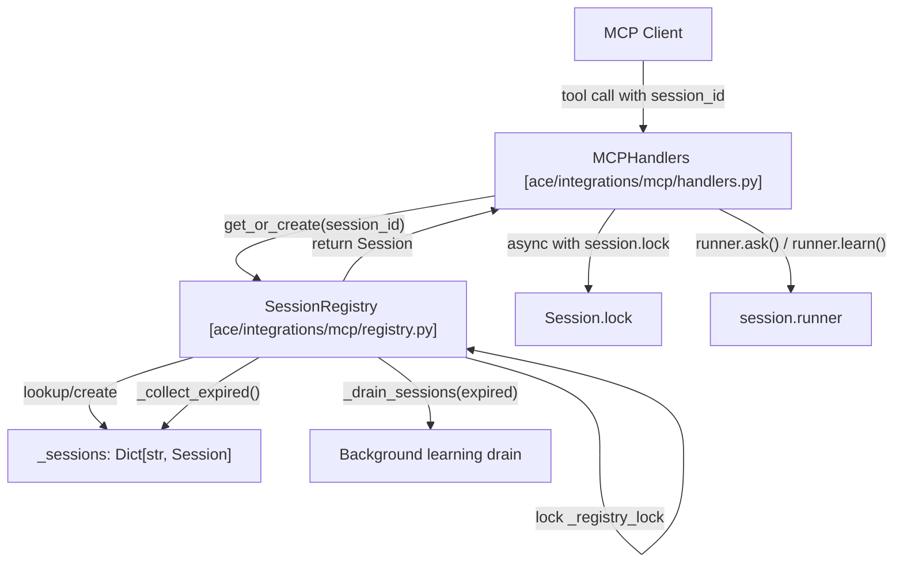
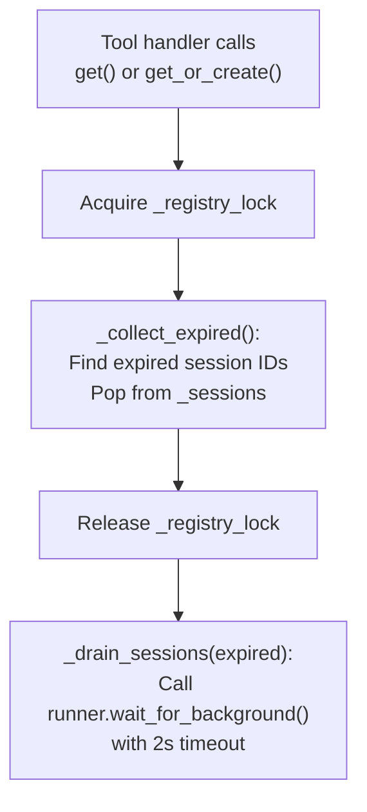
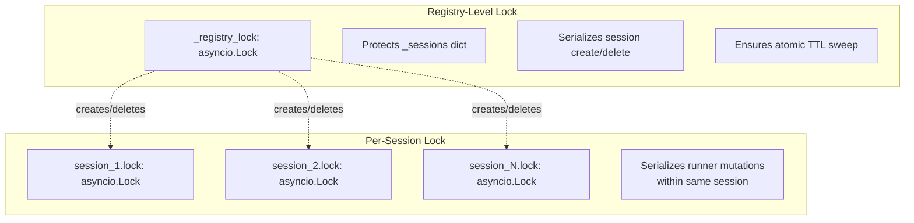
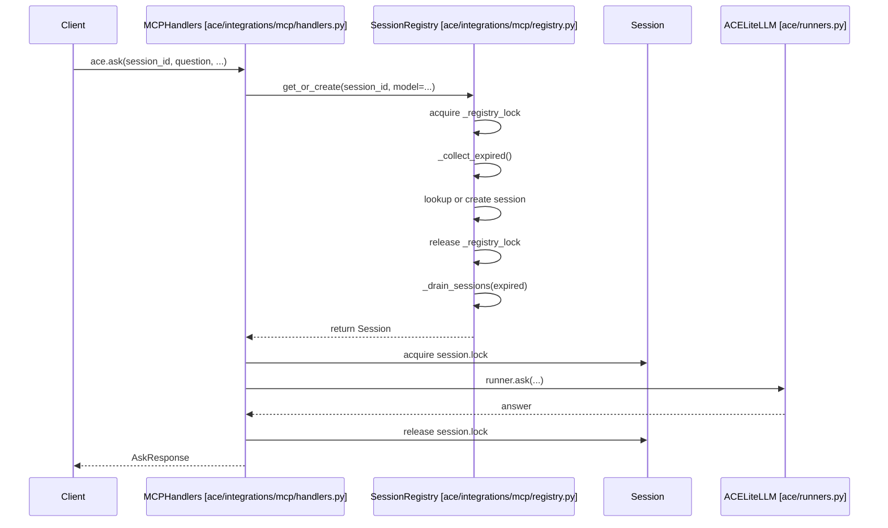
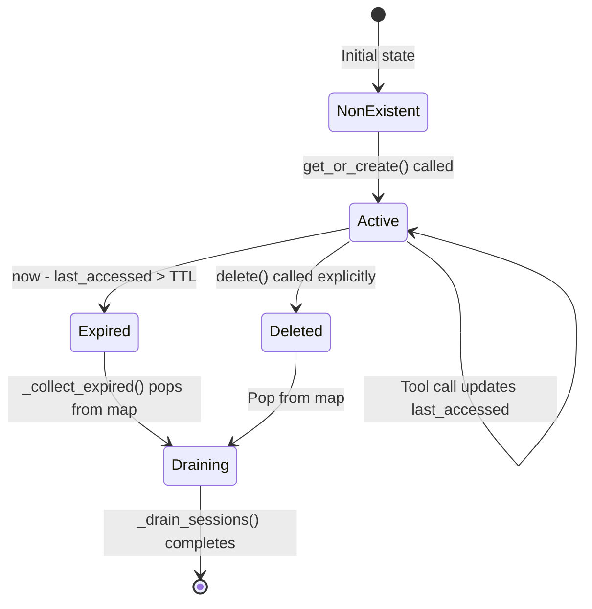

<!-- source: DeepWiki mcp.deepwiki.com · repo kayba-ai/agentic-context-engine · page 9.7 Session Management (MCP) · fetched 2026-10-26 -->

# Session Management (MCP)

<details>
<summary>Relevant source files</summary>

The following files were used as context for generating this wiki page:

- [ace/integrations/mcp/config.py](ace/integrations/mcp/config.py)
- [ace/integrations/mcp/registry.py](ace/integrations/mcp/registry.py)
- [docs/integrations/index.md](docs/integrations/index.md)
- [docs/integrations/mcp-client-setup.md](docs/integrations/mcp-client-setup.md)
- [docs/integrations/mcp.md](docs/integrations/mcp.md)
- [mkdocs.yml](mkdocs.yml)
- [specs/002-ace-mcp-server/contracts/tool-schemas.md](specs/002-ace-mcp-server/contracts/tool-schemas.md)
- [specs/002-ace-mcp-server/spec.md](specs/002-ace-mcp-server/spec.md)
- [tests/test_ace_mcp_compatibility.py](tests/test_ace_mcp_compatibility.py)

</details>


This document describes the session management system used by the ACE MCP Server to isolate state across concurrent client requests. It covers session lifecycle, concurrency control, TTL-based garbage collection, and integration with tool handlers.

For the overall MCP server architecture and tool definitions, see [7.7 MCP Server Integration](). For handler implementations, see [12.10 MCP Server APIs]().

---

## Overview

The MCP server uses session-based state isolation to allow multiple clients (or multiple conversations within a single client) to maintain independent `ACELiteLLM` runner instances and skillbooks. Each session is identified by a client-provided `session_id` string and exists as long as it remains active within the configured TTL window.

**Key Properties:**
- **Session isolation**: Each `session_id` maps to an independent `ACELiteLLM` runner with its own skillbook [ace/integrations/mcp/registry.py:42-45]().
- **Lazy initialization**: Sessions are created on first access with model configuration from the request [ace/integrations/mcp/registry.py:40-46]().
- **TTL-based expiry**: Idle sessions are garbage-collected after `session_ttl_seconds` [ace/integrations/mcp/config.py:12]().
- **Concurrency safety**: Per-session locks serialize mutations; registry lock protects the session map [ace/integrations/mcp/registry.py:20-27]().
- **Background learning drain**: Expired sessions wait briefly for in-progress async learning before removal [ace/integrations/mcp/registry.py:92-100]().

Sources: [ace/integrations/mcp/registry.py:1-101](), [docs/integrations/mcp.md:133-140](), [specs/002-ace-mcp-server/spec.md:137-143]()

---

## Session Data Model

### Session Dataclass

Each session is represented by a `Session` dataclass containing the following fields:

| Field | Type | Purpose |
|-------|------|---------|
| `session_id` | `str` | Unique identifier provided by the client [ace/integrations/mcp/registry.py:16](). |
| `runner` | `ACELiteLLM` | Session-scoped ACE runner with isolated skillbook [ace/integrations/mcp/registry.py:17](). |
| `created_at` | `float` | Unix timestamp of session creation [ace/integrations/mcp/registry.py:18](). |
| `last_accessed` | `float` | Unix timestamp of most recent access (for TTL) [ace/integrations/mcp/registry.py:19](). |
| `lock` | `asyncio.Lock` | Per-session lock for serializing mutations [ace/integrations/mcp/registry.py:20](). |

Sources: [ace/integrations/mcp/registry.py:14-20]()

### Session Diagram



Sources: [ace/integrations/mcp/registry.py:14-20](), [ace/runners.py:7]()

---

## SessionRegistry Architecture

The `SessionRegistry` class manages the mapping from `session_id` to `Session` objects and implements lifecycle operations.

### Core Components

| Component | Type | Purpose |
|-----------|------|---------|
| `config` | `MCPServerConfig` | Configuration including `session_ttl_seconds` and `default_model` [ace/integrations/mcp/registry.py:24](). |
| `_sessions` | `Dict[str, Session]` | In-memory mapping of active sessions [ace/integrations/mcp/registry.py:26](). |
| `_registry_lock` | `asyncio.Lock` | Registry-level lock protecting the session map [ace/integrations/mcp/registry.py:27](). |

Sources: [ace/integrations/mcp/registry.py:23-27]()

### SessionRegistry Operations



Sources: [ace/integrations/mcp/registry.py:29-75](), [ace/integrations/mcp/handlers.py:20]()

---

## Session Lifecycle

### Creation

Sessions are created lazily via `get_or_create()` when a tool request specifies a `session_id` that does not exist:

1. Acquire `_registry_lock` [ace/integrations/mcp/registry.py:33]().
2. Check if `session_id` exists in `_sessions` [ace/integrations/mcp/registry.py:36]().
3. If not found:
   - Determine model: use provided `model` or `config.default_model` [ace/integrations/mcp/registry.py:42]().
   - Call `ACELiteLLM.from_model(target_model, **runner_kwargs)` to create runner [ace/integrations/mcp/registry.py:43]().
   - Create `Session(session_id, runner)` [ace/integrations/mcp/registry.py:44]().
   - Insert into `_sessions` map [ace/integrations/mcp/registry.py:45]().
4. Update `last_accessed` timestamp [ace/integrations/mcp/registry.py:38]().
5. Release `_registry_lock`.
6. Sweep and drain expired sessions outside the lock [ace/integrations/mcp/registry.py:49-50]().

Sources: [ace/integrations/mcp/registry.py:29-50]()

### Access

Existing sessions are retrieved via `get()` or `get_or_create()`:

- `get(session_id)`: Returns existing session or raises `SessionNotFoundError` [ace/integrations/mcp/registry.py:52-66]().
- `get_or_create(session_id, ...)`: Returns existing or creates new [ace/integrations/mcp/registry.py:29-50]().

Both methods:
1. Acquire `_registry_lock`.
2. Sweep expired sessions via `_collect_expired()`.
3. Lookup `session_id` in `_sessions`.
4. Update `last_accessed = time.time()` on hit.
5. Release `_registry_lock`.
6. Drain expired sessions outside the lock.

Sources: [ace/integrations/mcp/registry.py:29-66]()

### Expiry and Garbage Collection

Sessions expire when `now - last_accessed > session_ttl_seconds` (default 3600s = 1 hour) [ace/integrations/mcp/config.py:12]().

#### Collection Strategy



Sources: [ace/integrations/mcp/registry.py:29-50](), [ace/integrations/mcp/registry.py:76-101]()

#### Collection Implementation

The `_collect_expired()` method runs while holding `_registry_lock` [ace/integrations/mcp/registry.py:76-89]():

```python
def _collect_expired(self) -> list[Session]:
    now = time.time()
    ttl = self.config.session_ttl_seconds

    expired_ids = [
        sid
        for sid, session in self._sessions.items()
        if now - session.last_accessed > ttl
    ]
    return [self._sessions.pop(sid) for sid in expired_ids]
```

Sources: [ace/integrations/mcp/registry.py:76-89]()

#### Background Learning Drain

The `_drain_sessions()` static method waits for in-progress background learning before fully releasing sessions [ace/integrations/mcp/registry.py:92-101]():

```python
@staticmethod
def _drain_sessions(sessions: list[Session]) -> None:
    for session in sessions:
        try:
            session.runner.wait_for_background(timeout=2.0)
        except Exception:
            logger.debug(
                "Failed to drain session %s", session.session_id, exc_info=True
            )
```

This prevents data loss when learning operations are queued in the pipeline's background executor. The 2-second timeout ensures garbage collection does not block indefinitely.

Sources: [ace/integrations/mcp/registry.py:92-101]()

---

## Concurrency Control

The MCP server uses two levels of locking to ensure thread-safe session operations.

### Lock Hierarchy



Sources: [ace/integrations/mcp/registry.py:20](), [ace/integrations/mcp/registry.py:27](), [docs/integrations/mcp.md:137]()

### Registry Lock

**Purpose**: Protects the `_sessions` dictionary during map operations [ace/integrations/mcp/registry.py:27]().

**Scope**: Held only during:
- Session lookup/creation in `get_or_create()` and `get()` [ace/integrations/mcp/registry.py:33](), [ace/integrations/mcp/registry.py:54]().
- Explicit deletion in `delete()` [ace/integrations/mcp/registry.py:70]().
- Expired session collection in `_collect_expired()` [ace/integrations/mcp/registry.py:34]().

**Not held during**: Background learning drain, tool execution, runner operations.

Sources: [ace/integrations/mcp/registry.py:29-75]()

### Per-Session Lock

**Purpose**: Serializes concurrent tool calls targeting the same `session_id` [docs/integrations/mcp.md:137]().

**Scope**: Held by handlers during runner operations. This prevents:
- Concurrent `learn()` calls racing on skillbook mutations.
- Interleaved `ask()` and `learn()` operations corrupting state.
- Concurrent `save()`/`load()` operations during learning.

Sources: [ace/integrations/mcp/registry.py:20](), [docs/integrations/mcp.md:137]()

### Lock Ordering

To prevent deadlocks, the system follows this acquisition order:

1. **Registry lock** (`_registry_lock`) — acquired first in registry methods [ace/integrations/mcp/registry.py:33]().
2. **Session lock** (`session.lock`) — acquired second by handlers after registry returns the session.

The registry lock is **always released** before any per-session lock is acquired. This eliminates circular wait conditions.

Sources: [ace/integrations/mcp/registry.py:29-75](), [tests/test_ace_mcp_compatibility.py:105-132]()

---

## Handler Integration

Tool handlers in `MCPHandlers` use the registry via a standard pattern.

### Access Pattern



Sources: [ace/integrations/mcp/handlers.py:20](), [ace/integrations/mcp/registry.py:29-50](), [tests/test_ace_mcp_compatibility.py:105-132]()

### Handler Responsibilities

| Responsibility | Implementation |
|----------------|----------------|
| **Session creation** | Call `registry.get_or_create()` with model override [ace/integrations/mcp/registry.py:29](). |
| **Session retrieval** | Call `registry.get()` for read-only tools or `get_or_create()` for mutations [ace/integrations/mcp/registry.py:52](). |
| **Concurrency** | Use `async with session.lock:` around all runner operations [ace/integrations/mcp/registry.py:20](). |
| **TTL update** | Implicit — registry updates `last_accessed` on every access [ace/integrations/mcp/registry.py:38](). |

Sources: [ace/integrations/mcp/handlers.py:20](), [ace/integrations/mcp/registry.py:29-75]()

---

## Configuration

Session behavior is controlled via `MCPServerConfig` [ace/integrations/mcp/config.py:5]():

| Setting | Default | Purpose |
|---------|---------|---------|
| `default_model` | `"gpt-4o-mini"` | Model used when `session_config.model` is not provided [ace/integrations/mcp/config.py:8](). |
| `session_ttl_seconds` | `3600` | Idle time before session expiry (1 hour) [ace/integrations/mcp/config.py:12](). |

Additional config affecting sessions:

| Setting | Default | Impact on Sessions |
|---------|---------|-------------------|
| `learn_timeout_seconds` | `300` | Maximum time for `learn()` calls before timeout [ace/integrations/mcp/config.py:14](). |
| `max_samples_per_call` | `25` | Limits learning workload per request [ace/integrations/mcp/config.py:10](). |

Sources: [ace/integrations/mcp/config.py:5-16](), [docs/integrations/mcp.md:35-45]()

### Environment Variables

All settings are read from environment variables with the `ACE_MCP_` prefix [ace/integrations/mcp/config.py:19]():

```bash
# Session lifecycle
export ACE_MCP_SESSION_TTL_SECONDS=3600

# Session initialization
export ACE_MCP_DEFAULT_MODEL=gpt-4o-mini

# Timeout to prevent indefinite lock hold during learning
export ACE_MCP_LEARN_TIMEOUT_SECONDS=300
```

Sources: [ace/integrations/mcp/config.py:18-21](), [docs/integrations/mcp.md:35-45]()

---

## Session Lifecycle State Machine



Sources: [ace/integrations/mcp/registry.py:29-95]()

---

## Key Implementation Details

### Sweep-on-Access Pattern

The registry does not use a background thread for TTL enforcement. Instead, expiry checking is lazy:
- Every `get()` or `get_or_create()` call triggers `_collect_expired()` [ace/integrations/mcp/registry.py:34](), [ace/integrations/mcp/registry.py:55]().
- Expired sessions are removed synchronously while holding `_registry_lock` [ace/integrations/mcp/registry.py:89]().
- Draining happens **outside** the lock to avoid blocking other callers [ace/integrations/mcp/registry.py:49-50]().

### TTL Update on Read

Both `get()` and `get_or_create()` update `last_accessed` even for read-only operations like `ace.ask` [ace/integrations/mcp/registry.py:38](), [ace/integrations/mcp/registry.py:63](). This ensures sessions remain alive as long as they receive any tool call within the TTL window.

Sources: [ace/integrations/mcp/registry.py:29-66]()

---

