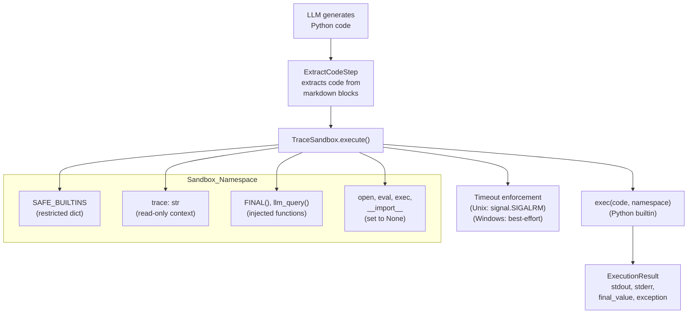
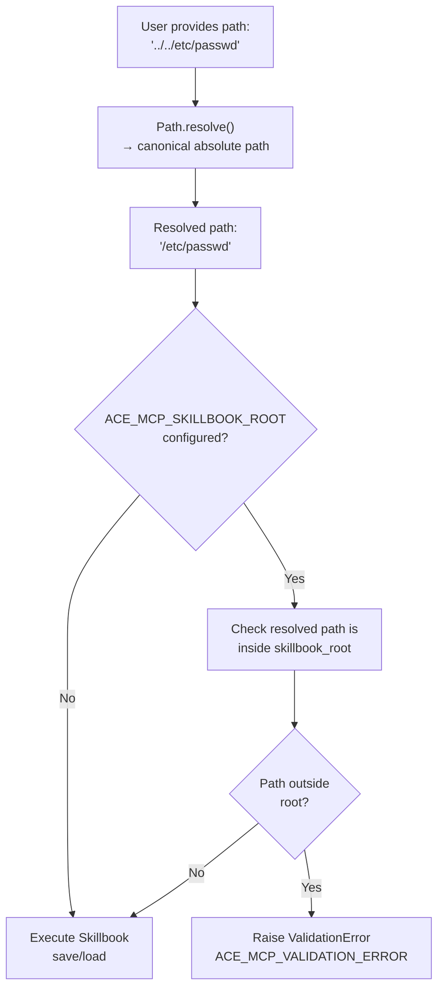

<!-- source: DeepWiki mcp.deepwiki.com · repo kayba-ai/agentic-context-engine · page 9.8 Safety and Security · fetched 2026-10-26 -->

# Safety and Security

Relevant source files

The following files were used as context for generating this wiki page:

- [ace/core/sandbox.py](ace/core/sandbox.py)
- [ace/integrations/mcp/errors.py](ace/integrations/mcp/errors.py)
- [docs/integrations/index.md](docs/integrations/index.md)
- [docs/integrations/mcp-client-setup.md](docs/integrations/mcp-client-setup.md)
- [docs/integrations/mcp.md](docs/integrations/mcp.md)
- [mkdocs.yml](mkdocs.yml)
- [specs/002-ace-mcp-server/contracts/tool-schemas.md](specs/002-ace-mcp-server/contracts/tool-schemas.md)
- [specs/002-ace-mcp-server/spec.md](specs/002-ace-mcp-server/spec.md)
- [tests/test_ace_mcp_compatibility.py](tests/test_ace_mcp_compatibility.py)

This page documents the safety and security mechanisms in the ACE Framework, focusing on two critical attack surfaces: (1) **Recursive Reflector sandbox execution** where LLM-generated Python code runs in a controlled environment, and (2) **MCP server operations** where external clients can mutate skillbooks and execute learning pipelines.

For general MCP server architecture and configuration, see [7.7 MCP Server Integration](). For Recursive Reflector analysis strategy details, see [3.3.3 Six-Phase Analysis Strategy]().

---

## Threat Model and Scope

ACE Framework assumes **LLM-generated code is not adversarial**. The Recursive Reflector sandbox and MCP server implement **defense-in-depth controls** to prevent accidental damage and limit blast radius, but they are **not designed to resist determined escape attempts**.

| Component | Trust Boundary | Security Guarantees |
|-----------|---------------|---------------------|
| **Recursive Reflector** | LLM-generated Python code | Accidental protection only; cannot run user-provided code |
| **MCP Server** | Authenticated MCP clients | Session isolation, resource limits, optional safe mode |
| **Skillbook Persistence** | File system paths | Optional root-bound validation |

**Not in scope**: protection against malicious LLM providers, adversarial prompt injection targeting the LLM itself, or production deployment hardening (use containers/VMs for isolation).

Sources: [ace/core/sandbox.py:53-66](), [specs/002-ace-mcp-server/spec.md:144-156]()

---

## Recursive Reflector Sandbox

The `TraceSandbox` class in `ace/core/sandbox.py` executes LLM-generated Python code in a restricted environment. The sandbox uses `exec()` with a custom `__builtins__` dictionary and blocks dangerous operations.

### Sandbox Architecture

**Diagram: Recursive Reflector sandbox execution flow using `TraceSandbox`**

Sources: [ace/core/sandbox.py:53-171](), [ace/core/sandbox.py:209-245]()

### Restricted Builtins

The sandbox provides a curated set of safe builtins and blocks dangerous ones to prevent file system and network access:

| Category | Allowed | Blocked |
|----------|---------|---------|
| **I/O** | `print` | `open`, `input` |
| **Code execution** | — | `eval`, `exec`, `compile` |
| **Module loading** | stdlib (json, re, collections) | `__import__` |
| **Introspection** | `dir`, `vars`, `hasattr` | `globals`, `locals`, `breakpoint` |
| **Object access** | `safe_getattr` (blocks `_*`) | raw `getattr` |

The `SAFE_BUILTINS` dictionary is defined in `ace/core/sandbox.py`. Key restrictions:

- **File access**: `open` is explicitly set to `None` [ace/core/sandbox.py:161]().
- **Code injection**: `eval`, `exec`, and `compile` are blocked [ace/core/sandbox.py:163-165]().
- **Import blocking**: `__import__` is replaced with `_safe_import` which only allows a whitelist of modules: `json`, `re`, `collections`, `datetime`, `math`, `time` [ace/core/sandbox.py:248-262]().
- **Dunder access**: A custom `safe_getattr` is used to reject any attribute names starting with an underscore [ace/core/sandbox.py:264-274]().

Sources: [ace/core/sandbox.py:75-171](), [ace/core/sandbox.py:248-274]()

### Timeout Enforcement

Code execution is bounded by a configurable timeout to prevent CPU exhaustion:

- **Unix**: Uses `signal.SIGALRM` to raise an `ExecutionTimeoutError` if the code runs too long [ace/core/sandbox.py:323-343]().
- **Windows**: Timeout is not strictly enforced via signals due to OS limitations; it relies on best-effort thread management [ace/core/sandbox.py:318-321]().

When a timeout occurs, the `ExecutionResult` captures the failure, and the Recursive Reflector can provide feedback to the LLM to optimize its code.

Sources: [ace/core/sandbox.py:306-343](), [ace/core/sandbox.py:25-28]()

---

## MCP Server Safety Controls

The ACE MCP server exposes tools like `ace.ask` and `ace.learn.sample`. Because these can mutate state or read from the filesystem, multiple safety layers are implemented.

### Safe Mode and Access Control

The server supports a `SAFE_MODE` which restricts the toolset to read-only operations.

| Tool | Allowed in Safe Mode | Error Code |
|------|---------------------|------------|
| `ace.ask` | ✅ Yes | — |
| `ace.skillbook.get` | ✅ Yes | — |
| `ace.learn.sample` | ❌ No | `ACE_MCP_FORBIDDEN_IN_SAFE_MODE` |
| `ace.learn.feedback` | ❌ No | `ACE_MCP_FORBIDDEN_IN_SAFE_MODE` |
| `ace.skillbook.save` | ❌ No | `ACE_MCP_FORBIDDEN_IN_SAFE_MODE` |
| `ace.skillbook.load` | ❌ No | `ACE_MCP_FORBIDDEN_IN_SAFE_MODE` |

Configuration is managed via environment variables:
- `ACE_MCP_SAFE_MODE`: When `true`, blocks all mutating tools [docs/integrations/mcp.md:38]().
- `ACE_MCP_ALLOW_SAVE_LOAD`: When `false`, specifically disables disk I/O tools independently of safe mode [docs/integrations/mcp.md:39]().

Sources: [docs/integrations/mcp.md:33-45](), [ace/integrations/mcp/errors.py:25-40]()

### Path Enforcement

To prevent arbitrary file read/write, the MCP server can be restricted to a specific directory root.

**Diagram: Path enforcement logic for `ace.skillbook.save` and `ace.skillbook.load`**

The server resolves the user-provided path to a canonical absolute path (following symlinks and resolving `..`) before validation [docs/integrations/mcp.md:118](). If `ACE_MCP_SKILLBOOK_ROOT` is set, any path outside that directory is rejected [docs/integrations/mcp.md:44]().

Sources: [docs/integrations/mcp.md:107-132](), [specs/002-ace-mcp-server/contracts/tool-schemas.md:269-272]()

### Resource Limits

To prevent Denial of Service (DoS) or excessive API costs, the server enforces strict payload and execution limits:

- **Max Samples**: `ace.learn.sample` accepts a maximum of 25 samples per call [docs/integrations/mcp.md:40]().
- **Max Characters**: A total limit of 100,000 characters is enforced across question and context fields [docs/integrations/mcp.md:41]().
- **Operation Timeout**: Learning calls (`ace.learn.*`) are capped at 300 seconds by default [docs/integrations/mcp.md:43]().
- **Session TTL**: Idle sessions are garbage-collected after 3600 seconds (1 hour) to free memory [docs/integrations/mcp.md:42]().

Sources: [docs/integrations/mcp.md:33-45](), [specs/002-ace-mcp-server/spec.md:144-156]()

### Session Isolation and Concurrency

State is isolated by `session_id`. Each session maintains its own `ACELiteLLM` instance and `Skillbook`.

- **Isolation**: Requests with different `session_ids` cannot access each other's skillbooks or history [docs/integrations/mcp.md:135]().
- **Locking**: Per-session locks ensure that concurrent requests to the same `session_id` are serialized, preventing race conditions during skillbook updates [docs/integrations/mcp.md:137]().

Sources: [docs/integrations/mcp.md:133-140](), [specs/002-ace-mcp-server/spec.md:137-143]()

---

## Error Mapping

Internal ACE exceptions are mapped to stable MCP error codes to ensure clients can handle failures gracefully without exposing sensitive stack traces.

| Error Code | Triggering Condition |
|------------|----------------------|
| `ACE_MCP_VALIDATION_ERROR` | Invalid tool arguments or path violation |
| `ACE_MCP_SESSION_NOT_FOUND` | Accessing an expired or non-existent session |
| `ACE_MCP_FORBIDDEN_IN_SAFE_MODE` | Attempting to mutate state while `SAFE_MODE=true` |
| `ACE_MCP_SAVE_LOAD_DISABLED` | Attempting disk I/O when `allow_save_load=false` |
| `ACE_MCP_TIMEOUT` | Learning pipeline exceeded `LEARN_TIMEOUT_SECONDS` |

Sources: [ace/integrations/mcp/errors.py:1-65](), [specs/002-ace-mcp-server/spec.md:169-182]()

---

