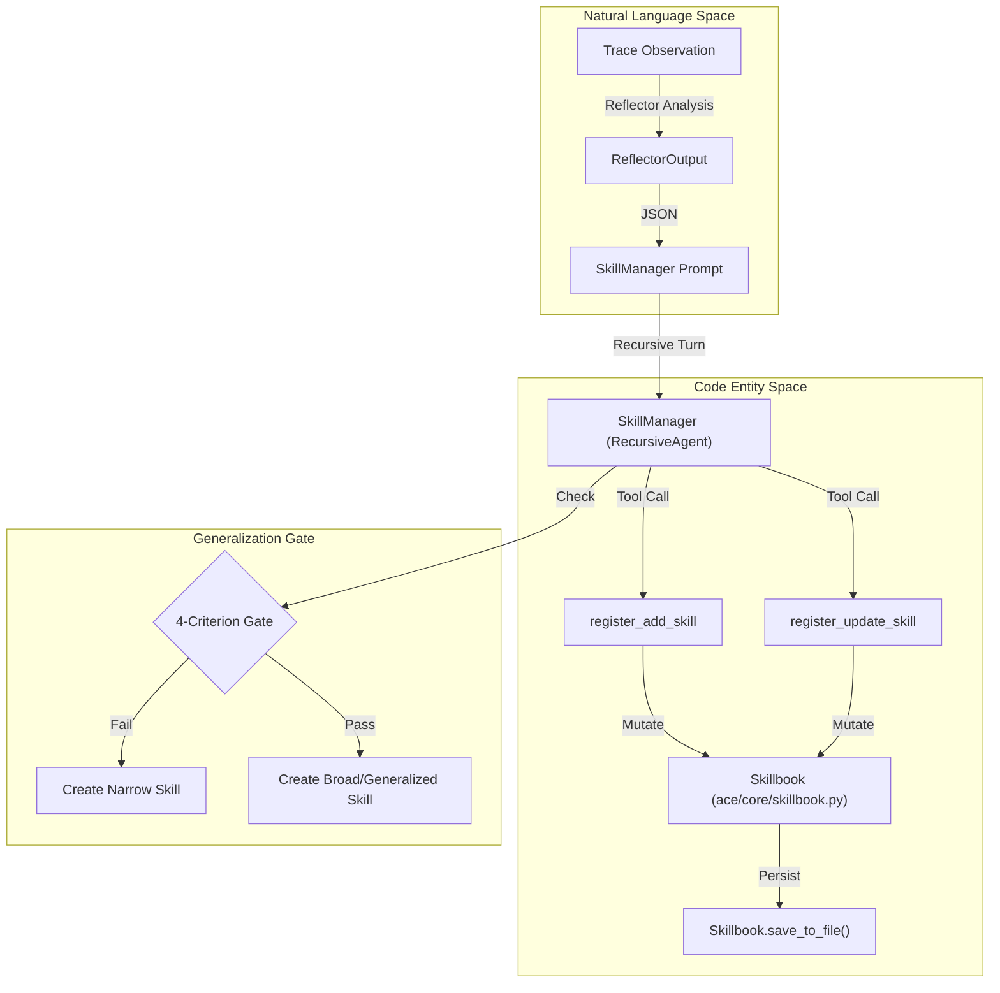
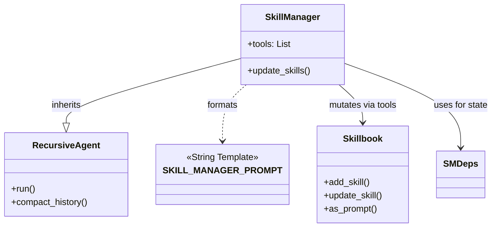

<!-- source: DeepWiki mcp.deepwiki.com · repo kayba-ai/agentic-context-engine · page 9.9 Cross-Trace Generalization · fetched 2026-10-26 -->

# Cross-Trace Generalization

Relevant source files

The following files were used as context for generating this wiki page:

- [CHANGELOG.md](CHANGELOG.md)
- [ace/implementations/prompts.py](ace/implementations/prompts.py)
- [ace/implementations/skill_manager.py](ace/implementations/skill_manager.py)
- [pyproject.toml](pyproject.toml)
- [uv.lock](uv.lock)

Cross-Trace Generalization is the set of logic gates and heuristic rules used by the `SkillManager` to determine when a specific observation from a single task execution should be broadened into a general strategy applicable across different domains and traces [CHANGELOG.md:13-17](). This system prevents "over-fitting" skills to specific API responses or transient data while ensuring that high-value structural patterns are captured for the `Skillbook`.

## The Four-Criterion Generalization Gate

The `SkillManager` [ace/implementations/skill_manager.py:58-68]() applies a strict four-criterion check before it is permitted to write or update a skill that subsumes multiple narrow observations. This gate is designed to ensure that the `Skillbook` remains a collection of strategic principles rather than a log of specific task instances.

| Criterion | Requirement | Purpose |
| :--- | :--- | :--- |
| **Instance Frequency** | $\ge 3$ instances across traces | Ensures the pattern is recurring and not a fluke. |
| **Domain Diversity** | $\ge 2$ distinct domains | Prevents domain-specific quirks from being treated as universal rules. |
| **Named Slotting** | Use of placeholders (e.g., `[tool]`) | Forces the agent to abstract the action from the specific entity. |
| **Verifiable Trigger** | Runtime-detectable condition | Ensures the `Agent` can actually recognize when to apply the skill. |

Sources: [CHANGELOG.md:13-17](), [ace/implementations/prompts.py:133-139]()

## Action-Equivalence and Atomicity

To maintain the integrity of the `Skillbook`, the `SkillManager` follows specific rules regarding how skills are decomposed and formatted.

### Action-Equivalence Rule
Within a single execution run, the `SkillManager` splits skills based on the **action performed**, not the surface text of the trigger [CHANGELOG.md:18-20](). If two different errors lead to the same structural correction, they are consolidated into a single skill with a broader `issue` description rather than creating duplicate skills [CHANGELOG.md:28-29]().

### Atomicity Constraints
The `SkillManager` enforces an "Atomic Insight" rule: **One Trigger + One Action** per skill [CHANGELOG.md:21-22](). 
*   **Imperative Voice:** Skills must be written in the imperative (e.g., "Extract the price" instead of "I should extract the price") [CHANGELOG.md:24-25]().
*   **Length Limits:** Insights are capped between 15-50 words to ensure they remain concise and retrievable via BM25 [CHANGELOG.md:23-25]().

Sources: [CHANGELOG.md:18-29](), [ace/implementations/skill_manager.py:170-180]()

## Data Flow: From Trace to Generalized Skill

The following diagram illustrates how raw execution traces are transformed into generalized skills through the `SkillManager` tool-calling loop.

**Trace Generalization Pipeline**

Sources: [ace/implementations/skill_manager.py:58-68](), [ace/implementations/skill_manager.py:121-128](), [ace/implementations/skill_manager.py:136-146]()

## Implementation Detail: SkillManager Tools

The `SkillManager` functions as a `RecursiveAgent` [ace/implementations/skill_manager.py:58-58]() that interacts with the `Skillbook` through atomic mutation tools. These tools are the primary enforcement point for generalization logic.

| Tool Name | File Reference | Responsibility |
| :--- | :--- | :--- |
| `register_add_skill` | [ace/implementations/sm_tools.py:33-33]() | Adds a new skill; applies the 15-50 word atomicity check. |
| `register_update_skill` | [ace/implementations/sm_tools.py:38-38]() | Broadens an existing skill if a new "Action-Equivalent" instance is found. |
| `register_tag_skill` | [ace/implementations/sm_tools.py:37-37]() | Marks skills as helpful/harmful based on reflection evidence. |
| `register_sm_search_skills` | [ace/implementations/sm_tools.py:36-36]() | Uses BM25 to find existing skills that might need broadening. |

### System Mapping: Role to Code
This diagram bridges the conceptual "Skill Manager" role to the actual Python classes and prompt templates that implement the generalization logic.

**SkillManager Component Mapping**

Sources: [ace/implementations/skill_manager.py:58-68](), [ace/implementations/skill_manager.py:104-134](), [ace/implementations/skill_manager.py:136-146]()

## Evidence-Only Tagging

A key part of the generalization process is the **Evidence-Only Tagging** rule. The `SkillManager` is prohibited from iterating over every skill in the `Skillbook`. It may only `tag_skill` or `update_skill` for those IDs that the `Reflector` has explicitly implicated in the current trace analysis [CHANGELOG.md:26-27](). This ensures that the metadata (helpful/harmful counts) reflects actual execution performance rather than agentic hallucinations [ace/implementations/skill_manager.py:184-186]().

Sources: [CHANGELOG.md:26-27](), [ace/implementations/skill_manager.py:184-186]()

---

