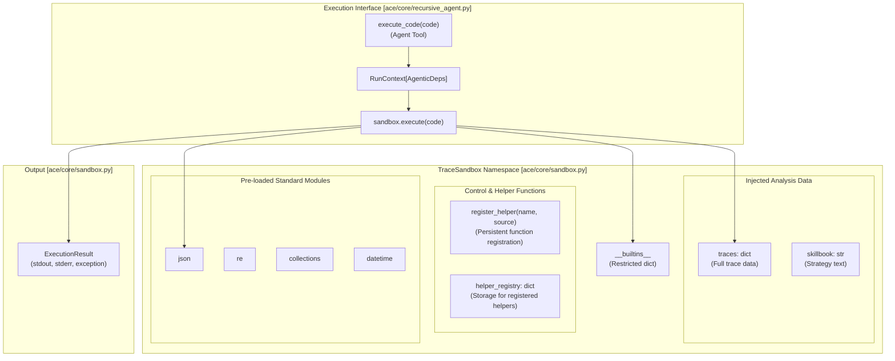
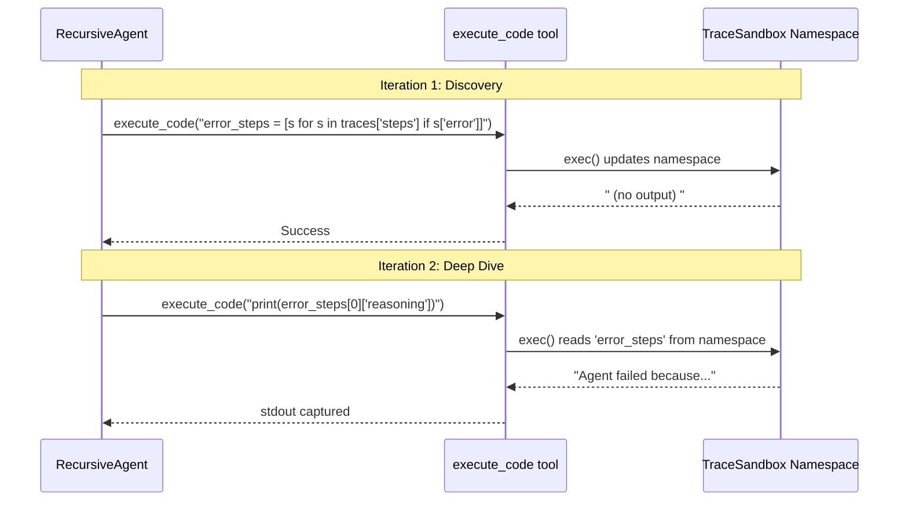

<!-- source: DeepWiki mcp.deepwiki.com · repo kayba-ai/agentic-context-engine · extra page Sandbox Environment · fetched 2026-10-26 -->

# Sandbox Environment

Relevant source files

The following files were used as context for generating this wiki page:

- [ace/core/recursive_agent.py](ace/core/recursive_agent.py)
- [ace/core/sandbox.py](ace/core/sandbox.py)
- [ace/implementations/rr/__init__.py](ace/implementations/rr/__init__.py)
- [ace/implementations/rr/config.py](ace/implementations/rr/config.py)
- [ace/implementations/rr/prompts.py](ace/implementations/rr/prompts.py)
- [ace/implementations/rr/tools.py](ace/implementations/rr/tools.py)
- [ace/steps/rr_step.py](ace/steps/rr_step.py)
- [examples/ace/rr_benchmark.py](examples/ace/rr_benchmark.py)
- [examples/agentic-system-prompting/recursive_agentic_system_prompting.py](examples/agentic-system-prompting/recursive_agentic_system_prompting.py)
- [test_rr_live.py](test_rr_live.py)
- [tests/test_rr_pipeline/test_rr_stress.py](tests/test_rr_pipeline/test_rr_stress.py)
- [tests/test_rr_pipeline/test_runner.py](tests/test_rr_pipeline/test_runner.py)

The Sandbox Environment is the restricted Python execution context where the Recursive Reflector's LLM-generated code runs. It provides a REPL-like environment with safe builtins, persistent variables across iterations, and specific guardrails to prevent file I/O and code injection while allowing the LLM to explore trace data programmatically via the `execute_code` tool.

## Overview

The `TraceSandbox` class implements a lightweight execution sandbox using Python's `exec()` with a restricted `__builtins__` dictionary. It is designed to be an evidence-gathering workbench where variables persist across tool calls, mimicking a stateful notebook or REPL.

**Key characteristics:**
- **Restricted Builtins**: Blocks `open()`, `__import__()`, `eval()`, `exec()`, and `input()`. [ace/core/sandbox.py:161-170]()
- **REPL Semantics**: Variables set in one `execute_code` call persist for the next. [tests/test_rr_pipeline/test_rr_stress.py:194-200]()
- **Injected Context**: Pre-loaded with `traces` and `skillbook` data. [ace/implementations/rr/prompts.py:35-40]()
- **Pre-loaded Modules**: Safe modules like `json`, `re`, `collections`, and `datetime` are available without imports. [ace/core/sandbox.py:93-101]()
- **Timeout Enforcement**: Configurable per-execution timeout (Unix only). [ace/core/sandbox.py:64-65]()

Sources: [ace/core/sandbox.py:53-72](), [ace/implementations/rr/prompts.py:9-23]()

## Sandbox Architecture

The following diagram bridges the Natural Language "Sandbox" concept to the `TraceSandbox` code entity and its internal namespace.

### Sandbox Entity Space

Sources: [ace/core/sandbox.py:173-220](), [ace/core/recursive_agent.py:82-115](), [ace/implementations/rr/prompts.py:35-53]()

## Safe Builtins and Security

The sandbox replaces Python's standard `__builtins__` with a curated set (`SAFE_BUILTINS`) to prevent unauthorized system access.

### Allowed Operations
The sandbox includes core types (`int`, `str`, `list`, `dict`), iteration helpers (`enumerate`, `zip`, `range`), math functions (`min`, `max`, `sum`), and object inspection (`dir`, `vars`, `id`). [ace/core/sandbox.py:75-130]()

### Blocked Operations
Security is enforced by setting sensitive builtins to `None`, which causes a `TypeError` if the LLM attempts to call them:
*   **File Access**: `open` is blocked. [ace/core/sandbox.py:161]()
*   **Dynamic Execution**: `eval`, `exec`, and `compile` are blocked. [ace/core/sandbox.py:163-165]()
*   **Module Loading**: `__import__` is replaced by a safe version that only allows pre-defined modules. [ace/core/sandbox.py:162]()

### Safe Attribute Access
To prevent dunder-style escapes (e.g., `obj.__class__.__base__`), the sandbox implements a `safe_getattr` that blocks any attribute starting with an underscore. [ace/core/sandbox.py:125-126]()

Sources: [ace/core/sandbox.py:75-171]()

## The execute_code Tool

The primary interface for the Recursive Reflector (RR) to interact with the sandbox is the `execute_code` tool. Unlike standard LLM code execution tools, this is specialized for evidence gathering.

### Tool Specialization
In `RRStep`, the generic `execute_code` tool description is overridden to emphasize its role as an "evidence workbench." [ace/steps/rr_step.py:129-148]()

*   **Data vs. Narration**: LLMs are instructed to use `execute_code` only for data extraction and printing compact structured artifacts (dicts, counts). [ace/implementations/rr/prompts.py:58-62]()
*   **Narration Routing**: Running commentary and observations are routed through the `think` tool to keep the sandbox output clean. [ace/implementations/rr/tools.py:100-107]()
*   **Final Output**: Conclusions must be returned in the structured `ReflectorOutput`, not merely printed in the sandbox. [ace/implementations/rr/prompts.py:19-20]()

Sources: [ace/steps/rr_step.py:129-161](), [ace/implementations/rr/prompts.py:46-62]()

## Data Flow and Persistence

The sandbox namespace is maintained throughout the life of a `RecursiveAgent` session. This allows the RR to perform multi-step analysis where data processed in iteration 1 is available in iteration 5.

### Variable Persistence Diagram

Sources: [ace/core/sandbox.py:194-200](), [ace/core/recursive_agent.py:107-115](), [tests/test_rr_pipeline/test_rr_stress.py:194-200]()

## Final Submission

In the RR implementation, the sandbox does not use a `FINAL()` function to exit. Instead, the `RecursiveAgent` continues iterating until the LLM provides a response that matches the `ReflectorOutput` Pydantic model. [ace/steps/rr_step.py:98-102]()

To ensure the agent actually uses the sandbox, an `output_validator` is registered. This validator raises a `ModelRetry` if the agent attempts to provide a final `ReflectorOutput` before calling `execute_code` at least once. [ace/implementations/rr/tools.py:55-63]()

Sources: [ace/implementations/rr/tools.py:52-63](), [ace/steps/rr_step.py:98-102]()

## Timeout Handling

The `TraceSandbox.execute` method accepts a `timeout` parameter. On Unix systems, this is enforced using `signal.SIGALRM`. [ace/core/sandbox.py:64-65]()

1.  **Signal Setup**: An alarm is set for the specified duration.
2.  **Execution**: `exec()` runs the LLM code.
3.  **Timeout**: If the code runs too long, the signal handler raises an `ExecutionTimeoutError`.
4.  **Capture**: The exception is caught, and the `ExecutionResult` is returned with the error message in `stderr`. [ace/core/sandbox.py:43-45]()

Sources: [ace/core/sandbox.py:25-50](), [ace/core/sandbox.py:112-115]()

---

