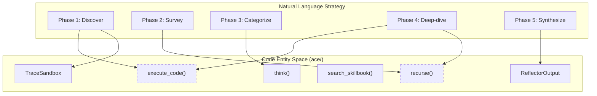
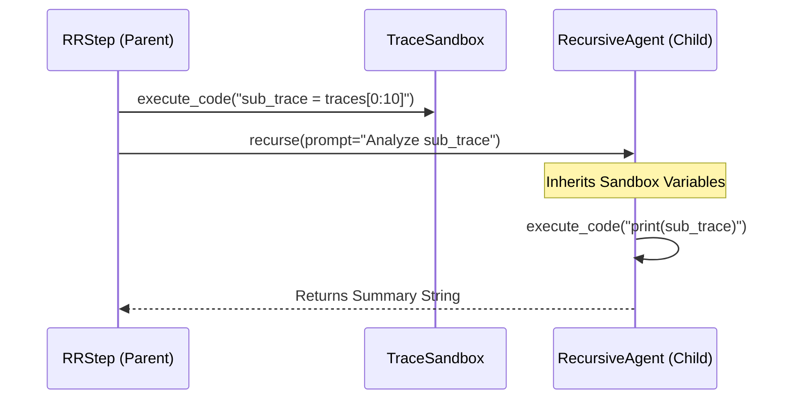

<!-- source: DeepWiki mcp.deepwiki.com · repo kayba-ai/agentic-context-engine · extra page Six-Phase Analysis Strategy · fetched 2026-10-26 -->

# Six-Phase Analysis Strategy

Relevant source files

The following files were used as context for generating this wiki page:

- [ace/core/recursive_agent.py](ace/core/recursive_agent.py)
- [ace/implementations/rr/__init__.py](ace/implementations/rr/__init__.py)
- [ace/implementations/rr/config.py](ace/implementations/rr/config.py)
- [ace/implementations/rr/prompts.py](ace/implementations/rr/prompts.py)
- [ace/implementations/rr/tools.py](ace/implementations/rr/tools.py)
- [ace/steps/rr_step.py](ace/steps/rr_step.py)
- [docs/design/ACE_ARCHITECTURE.md](docs/design/ACE_ARCHITECTURE.md)
- [docs/design/ACE_DECISIONS.md](docs/design/ACE_DECISIONS.md)
- [docs/design/ACE_REFERENCE.md](docs/design/ACE_REFERENCE.md)
- [docs/design/RR_DESIGN.md](docs/design/RR_DESIGN.md)

## Purpose and Scope

The **Six-Phase Analysis Strategy** is the core cognitive framework used by the **Recursive Reflector (RR)** to transform raw agent execution traces into structured strategies for the **Skillbook**. Unlike simple one-shot analysis, this strategy leverages the RR's ability to execute Python code in a sandboxed environment and spawn recursive sub-agents to explore data programmatically.

The strategy follows a structured workflow: **Discover → Adapt → Survey → Categorize → Deep-dive → Synthesize**. This ensures the agent balances broad coverage of all traces with high-fidelity verification of specific failures.

---

## Strategy Overview

The strategy is implemented primarily through the `REFLECTOR_RECURSIVE_PROMPT` [ace/implementations/rr/prompts.py:26-84]() and the `RecursiveAgent` base class [ace/core/recursive_agent.py:16-25](). It coordinates three primary tools: `execute_code`, `think`, and `recurse`.

### Natural Language Space to Code Entity Space

The following diagram maps the conceptual phases to the specific code entities and tools used within the `RRStep` [ace/steps/rr_step.py:51-72]().

**Sources:** [ace/implementations/rr/prompts.py:9-23](), [ace/steps/rr_step.py:51-120](), [ace/core/recursive_agent.py:82-106]()

---

## Phase 1: Discover

### Purpose
The agent uses `execute_code` to understand the schema of the provided `traces` variable [ace/implementations/rr/prompts.py:39](). The goal is to identify the structure (e.g., list of steps, nested tool calls, or raw logs) without performing deep analysis.

### Implementation Detail
- **Tool**: `execute_code(code)` [ace/core/recursive_agent.py:90-106]().
- **Action**: The agent typically prints `traces.keys()` or slices the first few elements to determine where "reasoning" and "actions" are stored.
- **Rule**: Minimize turns by batching schema discovery in a single `execute_code` call [ace/implementations/rr/prompts.py:20]().

**Sources:** [ace/implementations/rr/prompts.py:19-23](), [ace/core/recursive_agent.py:115-133]()

---

## Phase 2: Adapt (The "Criteria" Phase)

### Purpose
Based on the discovery, the agent determines how to evaluate the current trace. If the trace contains code, it adapts its strategy to look for syntax errors or logic bugs. If it is a conversational trace, it looks for tone or instruction following.

### Implementation Detail
- **Tool**: `think(thought)` [ace/implementations/rr/tools.py:110-114]().
- **Action**: The agent narrates its intended evaluation criteria before proceeding to the survey.
- **Context**: It checks the `skillbook` string [ace/implementations/rr/prompts.py:40]() to see if existing strategies already cover this domain.

**Sources:** [ace/implementations/rr/tools.py:115-137](), [ace/implementations/rr/prompts.py:87-89]()

---

## Phase 3: Survey

### Purpose
The agent performs a "breadth-first" scan of the trace data. For large traces, it uses the `recurse` tool to fan-out analysis of different segments to child agents [ace/implementations/rr/prompts.py:62]().

### Data Flow
The `TraceSandbox` [ace/core/sandbox.py:24]() facilitates this by allowing the agent to assign variables (e.g., `chunk1 = traces[:100]`) which are then inherited by children spawned via `recurse` [ace/core/recursive_agent.py:184-189]().

**Sources:** [ace/core/recursive_agent.py:151-174](), [ace/core/recursive_agent.py:182-189](), [ace/implementations/rr/prompts.py:21-22]()

---

## Phase 4: Categorize

### Purpose
The agent groups findings into "Helpful Patterns" or "Failure Modes." It uses `search_skillbook` [ace/implementations/rr/tools.py:149-152]() to see if these patterns are new or duplicates of existing skills.

### Key Function
- `register_search_skillbook`: Injects the ability to query the skillbook via embedding similarity [ace/implementations/rr/tools.py:140-146]().

**Sources:** [ace/implementations/rr/tools.py:149-176](), [ace/implementations/rr/prompts.py:52-53]()

---

## Phase 5: Deep-dive

### Purpose
The agent selects the most impactful failures or successes for "pinpoint" analysis. It uses `execute_code` to extract specific evidence (e.g., a specific tool output that misled the agent) [ace/implementations/rr/prompts.py:72-82]().

### Implementation Detail
- **Verification**: The `register_output_validator` ensures the agent does not jump to conclusions without at least one `execute_code` call [ace/implementations/rr/tools.py:52-63]().
- **Refinement**: If a child `recurse` call is used here, it is given a very specific `context_code` to focus on a single message index [ace/core/recursive_agent.py:154]().

**Sources:** [ace/implementations/rr/tools.py:55-63](), [ace/implementations/rr/prompts.py:58-60]()

---

## Phase 6: Synthesize

### Purpose
The final phase where all evidence gathered in the `TraceSandbox` and all child summaries from `recurse` are combined into a single `ReflectorOutput` [ace/core/outputs.py:19]().

### Data Consolidation
The agent must stop using tools and return the structured object. The `RRStep` specialized the `execute_code` description to remind the agent that final conclusions belong only in this output [ace/steps/rr_step.py:137-147]().

| Output Field | Source Phase | Description |
| :--- | :--- | :--- |
| `reasoning` | Categorize / Deep-dive | The "Why" behind the agent's behavior. |
| `key_insight` | Deep-dive | The single most important takeaway. |
| `extracted_learnings` | Synthesize | A list of new strategies to add to the Skillbook. |

**Sources:** [ace/steps/rr_step.py:137-161](), [ace/implementations/rr/prompts.py:58-62](), [ace/implementations/rr/tools.py:100-106]()

---

