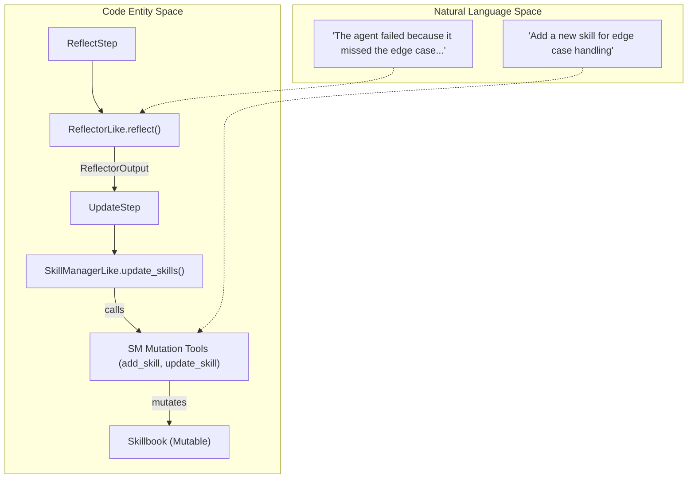
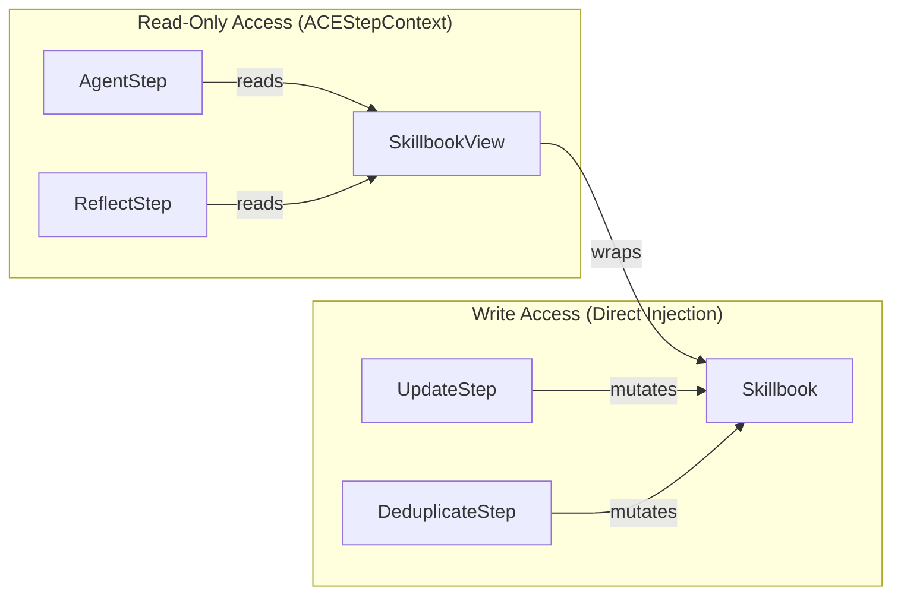

<!-- source: DeepWiki mcp.deepwiki.com · repo kayba-ai/agentic-context-engine · extra page Step System · fetched 2026-10-26 -->

# Step System

<details>
<summary>Relevant source files</summary>

The following files were used as context for generating this wiki page:

- [ace/implementations/helpers.py](ace/implementations/helpers.py)
- [ace/implementations/sm_tools.py](ace/implementations/sm_tools.py)
- [ace/steps/__init__.py](ace/steps/__init__.py)
- [ace/steps/evaluate.py](ace/steps/evaluate.py)
- [ace/steps/export_markdown.py](ace/steps/export_markdown.py)
- [ace/steps/update.py](ace/steps/update.py)
- [tests/test_ace_steps.py](tests/test_ace_steps.py)

</details>


## Purpose and Scope

This document covers the concrete step implementations in the ACE pipeline architecture. Steps are the fundamental building blocks that compose into pipelines. Each step performs a single focused operation on an `ACEStepContext` and returns an updated context.

The system is designed around a "Learning Tail" pattern: execution steps generate data (traces), which are then processed by a sequence of learning steps (Reflect, Update, Deduplicate, Persist) to improve the skillbook.

**Sources:** [ace/steps/__init__.py:1-40](), [ace/steps/update.py:1-23]()

---

## Step Protocol and Design Principles

### Protocol Contract

Every step satisfies `StepProtocol[ACEStepContext]` from the pipeline engine. The protocol requires class attributes for dependency validation and a call method for execution:

```python
class StepProtocol(Protocol[ACEStepContext]):
    requires: frozenset[str]    # Context fields the step reads
    provides: frozenset[str]    # Context fields the step writes
    def __call__(self, ctx: ACEStepContext) -> ACEStepContext: ...
```

**Stateless Design:** Steps are functions of their constructor arguments and the incoming context. For example, `UpdateStep` requires `reflections` and `skillbook` to be present on the context before it can execute [ace/steps/update.py:25-26]().

### Immutable Context Flow

Steps never mutate the incoming context. They use the `ctx.replace(**changes)` pattern to return a new context instance. This ensures that the data flow remains traceable and compatible with the pipeline's branching and merging logic.

**Sources:** [ace/steps/evaluate.py:46-46](), [ace/steps/update.py:80-80]()

---

## Core Step Implementations

### AgentStep
**Purpose:** Executes the agent logic to generate a response.
- **Requires:** `sample`, `skillbook`
- **Provides:** `agent_output`
- **Implementation:** Invokes the primary agent role, injecting the current skillbook context to guide its reasoning.

**Sources:** [ace/steps/__init__.py:29-29]()

### EvaluateStep
**Purpose:** Bridges execution to learning by bundling output into a trace and optionally scoring it.
- **Requires:** `sample`, `agent_output` [ace/steps/evaluate.py:20-20]()
- **Provides:** `trace` [ace/steps/evaluate.py:21-21]()
- **Behavior:** Constructs a `trace` dictionary containing the question, context, ground truth, reasoning, and cited `skill_ids` [ace/steps/evaluate.py:32-39](). If a `TaskEnvironment` is provided, it calls `environment.evaluate()` to append feedback to the trace [ace/steps/evaluate.py:40-45]().

**Sources:** [ace/steps/evaluate.py:9-47]()

### ReflectStep
**Purpose:** Analyzes a trace to extract insights.
- **Requires:** `trace`, `skillbook` [tests/test_ace_steps.py:169-170]()
- **Provides:** `reflections` [tests/test_ace_steps.py:171-171]()
- **Behavior:** Extracts structured data from the trace (question, answer, feedback) and passes it to a `Reflector` [tests/test_ace_steps.py:100-121](). It supports an `async_boundary` to allow the foreground execution to continue while reflection happens in the background [tests/test_ace_steps.py:172-172]().

**Sources:** [ace/steps/reflect.py:1-26](), [tests/test_ace_steps.py:94-174]()

### UpdateStep
**Purpose:** Mutates the skillbook based on reflections.
- **Requires:** `reflections`, `skillbook` [ace/steps/update.py:25-25]()
- **Provides:** `skill_manager_output` [ace/steps/update.py:26-26]()
- **Behavior:** Converts the reflection and trace into an `InsightSource` [ace/steps/update.py:61-70](). It then calls `skill_manager.update_skills()`, which uses tools to mutate the `Skillbook` directly [ace/steps/update.py:72-79]().
- **Concurrency:** `max_workers` is set to `1` to prevent race conditions during skillbook mutation [ace/steps/update.py:28-28]().

**Sources:** [ace/steps/update.py:11-81]()

### DeduplicateStep
**Purpose:** Consolidates similar skills to prevent redundancy.
- **Behavior:** Invokes a `DeduplicationManager` at a defined `interval` [ace/steps/__init__.py:82-82](). It uses embedding-based similarity to identify skills that should be merged or removed.

**Sources:** [ace/steps/deduplicate.py:1-19]()

### PersistStep / CheckpointStep
**Purpose:** Ensures the learned knowledge is saved to permanent storage.
- **Behavior:** Periodically writes the `Skillbook` state to a specified directory [ace/steps/__init__.py:83-86]().

**Sources:** [ace/steps/persist.py:1-24](), [ace/steps/checkpoint.py:1-18]()

---

## The learning_tail Composition

The `learning_tail` is a factory function that returns the standard sequence of learning steps. It is designed to be appended to any custom execution step.

**Composition Logic:**
1. **Reflect:** Adds a `ReflectStep` (or the reflector itself if it implements the protocol) [ace/steps/__init__.py:78-78]().
2. **Update:** Adds an `UpdateStep` to process reflections into skillbook changes [ace/steps/__init__.py:79-79]().
3. **Deduplicate (Optional):** Appends `DeduplicateStep` if a manager is provided [ace/steps/__init__.py:81-82]().
4. **Checkpoint (Optional):** Appends `CheckpointStep` for periodic disk persistence [ace/steps/__init__.py:83-86]().

**Sources:** [ace/steps/__init__.py:50-87]()

---

## Natural Language Space to Code Entity Space

### Learning Loop Data Flow
This diagram maps the conceptual "Learn" phase to the specific classes and methods that handle the data.


**Sources:** [ace/steps/update.py:72-79](), [ace/implementations/sm_tools.py:84-169](), [tests/test_ace_steps.py:39-58]()

### Step Execution and Skillbook Interaction
This diagram illustrates how steps interact with the `Skillbook` vs `SkillbookView`.


**Sources:** [ace/steps/update.py:30-32](), [ace/steps/evaluate.py:23-25](), [ace/steps/__init__.py:77-80]()

---

## Skill Manager Mutation Tools

The `UpdateStep` triggers the `SkillManager`, which operates on the `Skillbook` via specific mutation tools defined in `ace.implementations.sm_tools`.

| Tool | Code Entity | Purpose |
| :--- | :--- | :--- |
| **Add** | `register_add_skill` | Creates a new skill in a section with keywords and insights [ace/implementations/sm_tools.py:84-123](). |
| **Update** | `register_update_skill` | Modifies an existing skill's issue description or insight [ace/implementations/sm_tools.py:126-169](). |
| **Remove** | `register_remove_skill` | Deletes a skill from the skillbook [ace/implementations/sm_tools.py:172-203](). |
| **Tag** | `register_tag_skill` | Increments helpful/harmful counters for a skill [ace/implementations/sm_tools.py:206-214](). |

Every mutation performed by these tools appends an `UpdateOperation` to the dependency container, providing a post-hoc audit trail of what the step accomplished [ace/implementations/sm_tools.py:112-122]().

**Sources:** [ace/implementations/sm_tools.py:1-214](), [ace/steps/update.py:12-18]()

---

