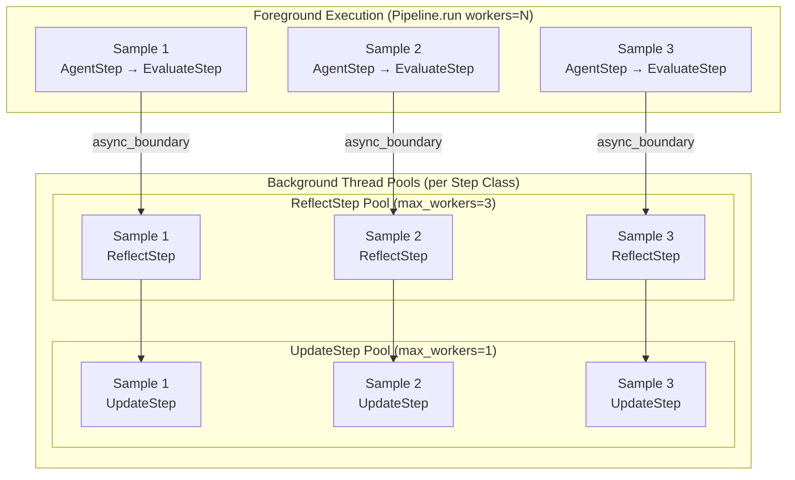
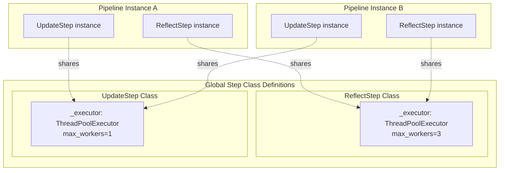

<!-- source: DeepWiki mcp.deepwiki.com · repo kayba-ai/agentic-context-engine · extra page Async Boundaries and Concurrency · fetched 2026-10-26 -->

# Async Boundaries and Concurrency

<details>
<summary>Relevant source files</summary>

The following files were used as context for generating this wiki page:

- [examples/pipeline_ex/pipeline_demo.ipynb](examples/pipeline_ex/pipeline_demo.ipynb)
- [examples/pipeline_ex/pipeline_demo.py](examples/pipeline_ex/pipeline_demo.py)
- [pipeline/branch.py](pipeline/branch.py)
- [pipeline/context.py](pipeline/context.py)
- [pipeline/pipeline.py](pipeline/pipeline.py)
- [tests/pipeline_engine/__init__.py](tests/pipeline_engine/__init__.py)
- [tests/pipeline_engine/conftest.py](tests/pipeline_engine/conftest.py)
- [tests/pipeline_engine/test_branch.py](tests/pipeline_engine/test_branch.py)
- [tests/pipeline_engine/test_context.py](tests/pipeline_engine/test_context.py)
- [tests/pipeline_engine/test_pipeline.py](tests/pipeline_engine/test_pipeline.py)
- [tests/pipeline_engine/test_pipeline_e2e.py](tests/pipeline_engine/test_pipeline_e2e.py)
- [tests/pipeline_engine/test_protocol.py](tests/pipeline_engine/test_protocol.py)

</details>


This document describes the concurrency model in the `pipeline/` architecture. It covers how the `async_boundary` marker enables background learning, how thread pools are managed per step class, and how multiple samples flow through the pipeline concurrently.

---

## Purpose and Scope

The ACE framework processes multiple samples through a multi-step learning pipeline. Reflection and skill management (LLM calls) are slow compared to agent execution. Without concurrency, the pipeline would wait for each sample to fully complete before starting the next, resulting in poor throughput.

The `async_boundary` mechanism solves this by splitting the pipeline into foreground (fast) and background (slow) stages. Samples move through foreground steps immediately, then hand off to background threads for learning. This allows the pipeline to process multiple samples concurrently at different stages.

**Sources:** [pipeline/pipeline.py:53-73](), [pipeline/pipeline.py:148-152]()

---

## Three Types of Async Behavior

The framework distinguishes three types of concurrency, each solving a different problem:

| Type | Level | Problem Solved | Mechanism |
|------|-------|----------------|-----------|
| **Async Steps** | Single step | Don't block thread during I/O | `async def __call__` coroutines |
| **Async Boundary** | Across samples | Start next sample before current finishes | `async_boundary = True` on step class |
| **Branch Parallelism** | Within one sample | Run independent work simultaneously | `Branch` primitive with `asyncio.gather` |

**Sources:** [pipeline/pipeline.py:255-265](), [pipeline/branch.py:114-127](), [tests/pipeline_engine/conftest.py:91-102]()

---

## Async Steps: Non-blocking I/O

Individual steps can be defined as coroutines to avoid blocking the thread during network calls. The pipeline detects this automatically using `asyncio.iscoroutinefunction` and handles both transparently.

Sync steps are executed in a thread pool via `asyncio.to_thread()` to keep the event loop responsive when running in an async context [pipeline/pipeline.py:255-265]().

**Sources:** [pipeline/pipeline.py:255-265](), [tests/pipeline_engine/test_branch.py:148-177]()

---

## Async Boundary: Background Learning

### The Solution

A step declares `async_boundary = True`. Everything from that step onwards runs in a background thread pool. The main pipeline loop does not wait — it moves immediately to the next sample.

```python
class ReflectStep:
    async_boundary = True   # hand off to background from here
    max_workers = 3         # up to 3 reflections running in parallel

class UpdateStep:
    max_workers = 1         # must serialize — writes to shared skillbook
```

**Sources:** [pipeline/pipeline.py:62-64](), [tests/pipeline_engine/conftest.py:120-126](), [tests/pipeline_engine/test_pipeline_e2e.py:73-80]()

### Execution Flow Diagram



**Sources:** [pipeline/pipeline.py:270-285](), [tests/pipeline_engine/test_pipeline_e2e.py:176-215]()

---

## Boundary Rules and Constraints

### Single Boundary Per Pipeline
Only the **first** step with `async_boundary = True` is honored. If multiple steps declare it, the pipeline raises `PipelineConfigError` at construction time [pipeline/pipeline.py:176-182]().

### Boundaries in Branch Children
`async_boundary = True` inside a `Branch` child pipeline raises `PipelineConfigError` [pipeline/pipeline.py:183-185]().

### Boundaries in Nested Pipelines
`async_boundary` inside a `Pipeline`-as-`Step` emits a **warning** at construction time [pipeline/pipeline.py:186-189](). When a pipeline is used as a step inside another pipeline, the boundary is ignored and it runs fully synchronously [pipeline/pipeline.py:236-240]().

**Sources:** [pipeline/pipeline.py:137-190](), [tests/pipeline_engine/test_pipeline.py:107-142]()

---

## Thread Pool Architecture

### Per-Step-Class Pools
Each step **class** has a single shared `ThreadPoolExecutor`. `ReflectStep.max_workers = 3` means one pool of 3 threads for **all** `ReflectStep` instances, regardless of how many pipelines are running [pipeline/pipeline.py:27-45]().

### Pool Lifecycle
The `ThreadPoolExecutor` for each step class is created lazily at first use and stored on the class itself [pipeline/pipeline.py:34-45]().

### Thread Pool Diagram



**Sources:** [pipeline/pipeline.py:27-45](), [tests/pipeline_engine/test_pipeline_e2e.py:204-215]()

---

## Workers vs Max Workers

Two independent thread pools control concurrency at different levels:

| Knob | Pool | Controls |
|------|------|----------|
| `pipeline.run(contexts, workers=N)` | Foreground pool | How many samples run through pre-boundary steps simultaneously |
| `StepClass.max_workers = K` | Background pool per step class | How many instances of that step run in background simultaneously |

**Sources:** [pipeline/pipeline.py:27-45](), [pipeline/pipeline.py:325-340]()

---

## Background Learning Control

### Draining Background Work
Call `wait_for_background()` to block until all background tasks complete for a specific pipeline instance. This is essential before persisting results or shutting down [pipeline/pipeline.py:302-315]().

### Monitoring Background Progress
The `bg_threads_count` property returns the number of currently active background threads for a pipeline instance [pipeline/pipeline.py:298-300]().

**Sources:** [pipeline/pipeline.py:298-315](), [tests/pipeline_engine/test_pipeline_e2e.py:195-202]()

---

## Error Handling

### Foreground Failures
Steps **before** the boundary: the runner catches exceptions per sample and records them in a `SampleResult`. The pipeline then moves to the next sample [pipeline/pipeline.py:350-365]().

### Background Failures
Steps **after** the boundary: exceptions are captured within the background thread and attached to the `SampleResult`. The `failed_at` field identifies which step class caused the failure [pipeline/pipeline.py:270-285]().

### Branch Failures
When a `Branch` step fails, `error` is a `BranchError` containing all exceptions from child pipelines. `Branch` ensures all branches complete even if one fails [pipeline/branch.py:125-127](), [pipeline/branch.py:174-175]().

**Sources:** [pipeline/pipeline.py:345-370](), [pipeline/branch.py:125-127](), [pipeline/protocol.py:31-52]()

---

## Branch Parallelism (Within-Sample Concurrency)

Branch parallelism runs multiple independent pipelines on the **same sample** simultaneously, then merges their outputs.

In sync contexts, `Branch` uses a `ThreadPoolExecutor` [pipeline/branch.py:158-173](). In async contexts, it uses `asyncio.gather` [pipeline/branch.py:183-205]().

**Sources:** [pipeline/branch.py:114-127](), [pipeline/branch.py:158-205](), [tests/pipeline_engine/test_branch.py:184-220]()

---

## Summary Table

| Concept | Unit | Purpose | Configuration |
|---------|------|---------|---------------|
| **Async Steps** | Single step I/O | Don't block thread during network calls | `async def __call__` |
| **Async Boundary** | Across samples | Process next sample while current is learning | `async_boundary = True` |
| **`max_workers`** | Per step class | Background concurrency for that step | Class attribute `max_workers` |
| **`workers`** | Foreground pool | Pre-boundary sample parallelism | `Pipeline.run(workers=N)` |
| **`Branch`** | Within one sample | Run independent work simultaneously | `Pipeline.branch(...)` |

**Sources:** [pipeline/pipeline.py:41-43](), [pipeline/pipeline.py:176-182](), [pipeline/branch.py:114-127]()

---

