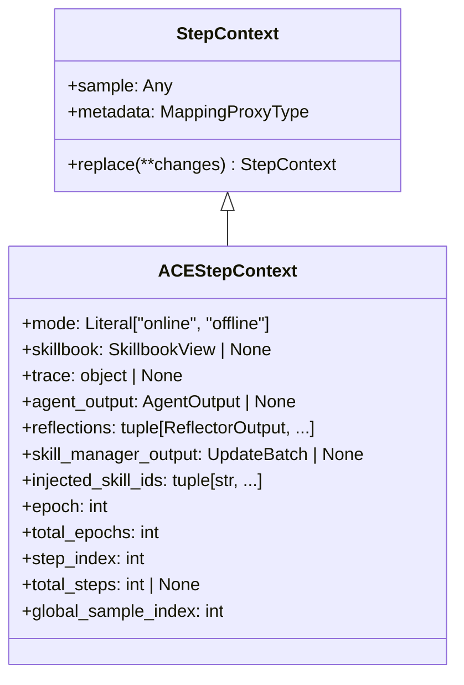
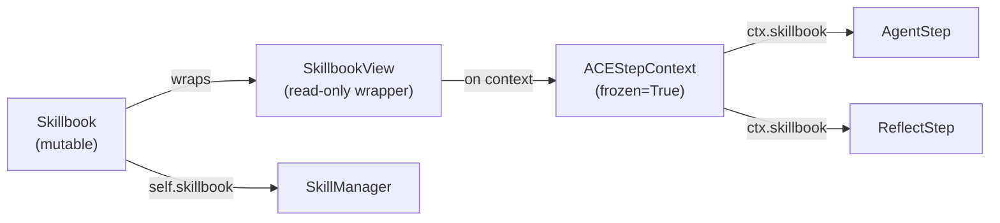
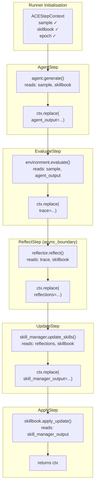

<!-- source: DeepWiki mcp.deepwiki.com · repo kayba-ai/agentic-context-engine · extra page Context and Data Flow · fetched 2026-10-26 -->

# Context and Data Flow

<details>
<summary>Relevant source files</summary>

The following files were used as context for generating this wiki page:

- [ace/core/context.py](ace/core/context.py)
- [ace/core/outputs.py](ace/core/outputs.py)
- [ace/implementations/reflector.py](ace/implementations/reflector.py)
- [ace/steps/observability.py](ace/steps/observability.py)
- [ace/steps/reflect.py](ace/steps/reflect.py)
- [examples/pipeline_ex/pipeline_demo.py](examples/pipeline_ex/pipeline_demo.py)
- [tests/pipeline_engine/conftest.py](tests/pipeline_engine/conftest.py)
- [tests/pipeline_engine/test_branch.py](tests/pipeline_engine/test_branch.py)
- [tests/pipeline_engine/test_context.py](tests/pipeline_engine/test_context.py)
- [tests/pipeline_engine/test_pipeline.py](tests/pipeline_engine/test_pipeline.py)
- [tests/pipeline_engine/test_pipeline_e2e.py](tests/pipeline_engine/test_pipeline_e2e.py)
- [tests/pipeline_engine/test_protocol.py](tests/pipeline_engine/test_protocol.py)

</details>


This document describes how data flows through the ACE pipeline via the `ACEStepContext` immutable carrier, the `SkillbookView` read-only projection, and the requires/provides validation system. For the generic pipeline engine's context system, see [Pipeline Engine (3.2.1)](). For how async boundaries affect context flow, see [Async Boundaries and Concurrency (3.2.5)]().

---

## ACEStepContext: The Immutable Data Carrier

`ACEStepContext` is a frozen dataclass that carries all step-to-step data through the ACE pipeline. It extends the generic `StepContext` from the pipeline engine with ACE-specific fields.

### Structure

Title: ACE Context Inheritance


**Sources:** [ace/core/context.py:95-132](), [pipeline/context.py:1-50]()

### Field Categories

| Category | Fields | Populated By | Read By |
|----------|--------|--------------|---------|
| **Input** | `sample`, `skillbook` | Runner (`_build_context`) | `AgentStep` |
| **Execution** | `agent_output`, `trace` | `AgentStep`, `EvaluateStep` | `ReflectStep` |
| **Learning** | `reflections`, `skill_manager_output` | `ReflectStep`, `UpdateStep` | `ObservabilityStep`, `ApplyStep` |
| **Progress** | `epoch`, `step_index`, `global_sample_index` | Runner (`_build_context`) | `CheckpointStep`, `DeduplicateStep` |

**Sources:** [ace/core/context.py:114-132](), [ace/steps/reflect.py:57-87](), [ace/steps/observability.py:23-35]()

### Immutability Contract

`ACEStepContext` is declared with `frozen=True` [ace/core/context.py:95](). Steps never mutate the incoming context — they return a new one via `.replace()` [pipeline/context.py:103-108]():

```python
# ✓ Correct — returns new context
def __call__(self, ctx: ACEStepContext) -> ACEStepContext:
    return ctx.replace(agent_output=result)

# ✗ Wrong — mutation raises FrozenInstanceError
def __call__(self, ctx: ACEStepContext) -> ACEStepContext:
    ctx.agent_output = result  # raises!
    return ctx
```

This makes context flow safe for concurrent execution — `Branch` can pass the same context to multiple pipelines without deep copying [tests/pipeline_engine/test_branch.py:11-15](), and background steps can read from the context while foreground steps write to new instances.

**Sources:** [ace/core/context.py:95-132](), [pipeline/context.py:57-130](), [tests/pipeline_engine/test_context.py:58-77]()

---

## SkillbookView: Read-Only Projection

The `Skillbook` is mutable — steps add, tag, and remove skills. Placing it directly on a `frozen=True` context would allow mutation through the reference. `SkillbookView` solves this by exposing only read methods.

### Design

Title: Skillbook Access Control


**Sources:** [ace/core/context.py:45-89](), [ace/implementations/reflector.py:77-104]()

### Interface

`SkillbookView` exposes only query methods [ace/core/context.py:64-81]():

| Method | Returns | Purpose |
|--------|---------|---------|
| `as_prompt()` | `str` | Formatted skillbook for LLM prompts |
| `get_skill(skill_id)` | `Skill \| None` | Single skill lookup |
| `skills(include_invalid)` | `list[Skill]` | All skills (filter by validity) |
| `stats()` | `dict[str, object]` | Skillbook statistics |
| `__len__()` | `int` | Skill count |
| `__iter__()` | `Iterator[Skill]` | Iteration support |

Write methods are absent — calling them raises `AttributeError` at runtime and type errors at check time [ace/core/context.py:48-50]().

**Sources:** [ace/core/context.py:45-89]()

---

## Data Flow Through Steps

Context flows through a pipeline as an immutable chain of transformations. Each step receives a context, performs work, and returns a new context with additional fields populated.

### Full ACE Pipeline Flow

Title: ACE Standard Pipeline Data Flow


**Sources:** [tests/pipeline_engine/test_pipeline_e2e.py:47-105](), [ace/steps/reflect.py:57-87](), [ace/core/context.py:114-132]()

---

## Requires/Provides Contract

The pipeline engine validates data flow at construction time using `requires` and `provides` declarations on each step [pipeline/protocol.py:13-29]().

### Example: ReflectStep

```python
class ReflectStep:
    requires = frozenset({"trace", "skillbook"})
    provides = frozenset({"reflections"})
    
    async_boundary = True
    max_workers = 3

    def __call__(self, ctx: ACEStepContext) -> ACEStepContext:
        # ... logic to call reflector ...
        return ctx.replace(reflections=(reflection,))
```

**Sources:** [ace/steps/reflect.py:30-87]()

### Validation Rules

The pipeline constructor validates that [pipeline/pipeline.py:1-100]():

1. **Chain validity:** Each step's `requires` is a subset of fields available from previous steps' `provides` plus the initial context [tests/pipeline_engine/test_pipeline.py:64-72]().
2. **Order Check:** If a step needs a field that a *later* step provides, a `PipelineOrderError` is raised [tests/pipeline_engine/test_pipeline.py:93-99]().
3. **External Inputs:** Fields not provided by any step are treated as external requirements [tests/pipeline_engine/test_pipeline.py:101-106]().

**Sources:** [tests/pipeline_engine/test_pipeline.py:40-157](), [pipeline/pipeline.py:1-100]()

---

## Trace as Universal Learning Input

The learning tail's entry point (`ReflectStep`) requires only `trace` and `skillbook` from the context. This design makes the learning pipeline agnostic to trace format [ace/steps/reflect.py:14-28]().

### Structured vs Raw Traces

| Trace Type | Source | Format | Reflector Behaviour |
|------------|--------|--------|---------------------|
| **Structured** | `EvaluateStep` | `dict` with known keys | Extracts `reasoning`, `answer`, `feedback` [ace/steps/reflect.py:62-74]() |
| **Raw** | `TraceAnalyser`, integrations | Any object | Passes as-is via `trace=` kwarg [ace/steps/reflect.py:78-85]() |

**Sources:** [ace/steps/reflect.py:40-87](), [ace/core/context.py:106-111]()

---

## Summary

| Component | Purpose | Mutability | Lifetime |
|-----------|---------|------------|----------|
| `ACEStepContext` | Immutable data carrier through pipeline | Frozen | Per-sample |
| `SkillbookView` | Read-only skillbook projection | Read-only wrapper | Per-sample |
| `requires`/`provides` | Data flow validation contract | Static | Construction-time |
| `trace` | Universal learning input | Any type | Per-sample |

**Sources:** [ace/core/context.py:1-132](), [pipeline/protocol.py:1-50](), [tests/pipeline_engine/test_context.py:1-200]()

---

