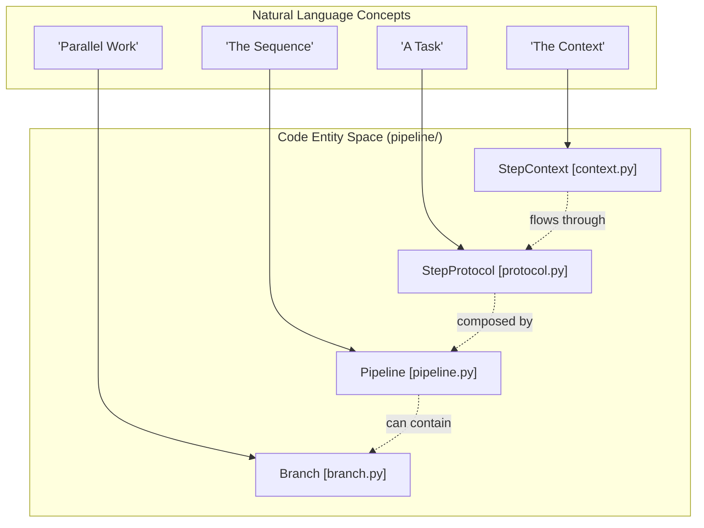
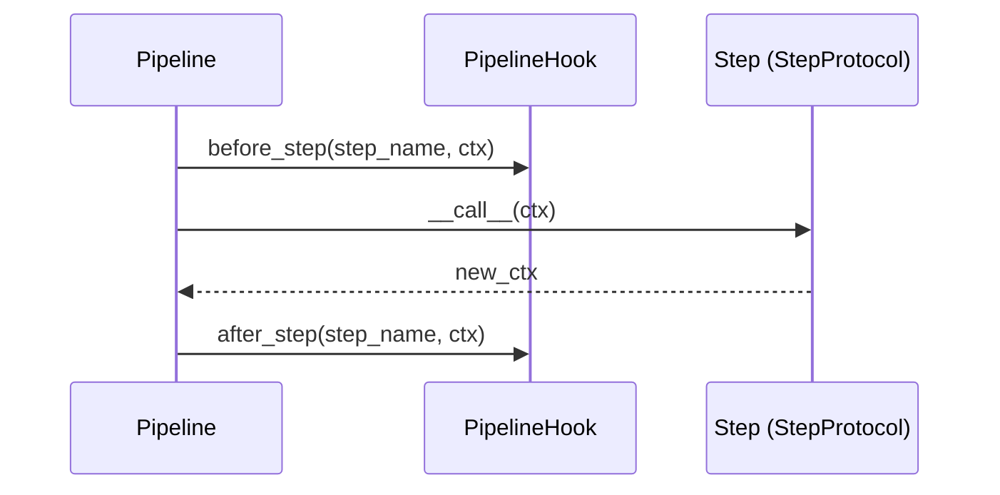

<!-- source: DeepWiki mcp.deepwiki.com · repo kayba-ai/agentic-context-engine · extra page Pipeline Primitives · fetched 2026-10-26 -->

# Pipeline Primitives

<details>
<summary>Relevant source files</summary>

The following files were used as context for generating this wiki page:

- [examples/pipeline_ex/pipeline_demo.ipynb](examples/pipeline_ex/pipeline_demo.ipynb)
- [examples/pipeline_ex/pipeline_demo.py](examples/pipeline_ex/pipeline_demo.py)
- [pipeline/__init__.py](pipeline/__init__.py)
- [pipeline/branch.py](pipeline/branch.py)
- [pipeline/context.py](pipeline/context.py)
- [pipeline/errors.py](pipeline/errors.py)
- [pipeline/pipeline.py](pipeline/pipeline.py)
- [pipeline/protocol.py](pipeline/protocol.py)
- [tests/pipeline_engine/__init__.py](tests/pipeline_engine/__init__.py)
- [tests/pipeline_engine/conftest.py](tests/pipeline_engine/conftest.py)
- [tests/pipeline_engine/test_branch.py](tests/pipeline_engine/test_branch.py)
- [tests/pipeline_engine/test_context.py](tests/pipeline_engine/test_context.py)
- [tests/pipeline_engine/test_pipeline.py](tests/pipeline_engine/test_pipeline.py)
- [tests/pipeline_engine/test_pipeline_e2e.py](tests/pipeline_engine/test_pipeline_e2e.py)
- [tests/pipeline_engine/test_protocol.py](tests/pipeline_engine/test_protocol.py)
- [tests/test_pipeline_hooks.py](tests/test_pipeline_hooks.py)

</details>


## Purpose and Scope

The Pipeline Engine is a generic, composable task execution framework that forms the foundation of the ACE Framework's architecture. It provides primitives for building sequential and parallel processing pipelines with declarative dependency validation, flexible concurrency models, and robust error isolation.

This page documents the **generic engine primitives**: `StepProtocol`, `Pipeline`, `Branch`, `MergeStrategy`, and `StepContext`. These building blocks allow for the construction of complex agentic workflows while maintaining strict data flow guarantees.

**Sources:** [pipeline/__init__.py:1-20](), [pipeline/pipeline.py:53-73]()

---

## Core Architecture

### Design Philosophy

The pipeline engine is domain-agnostic. It knows nothing about agents, reflectors, or skillbooks—only about steps that consume and produce data via an immutable context. Domain logic lives in concrete step implementations; the engine provides the plumbing.

### System Mapping: Natural Language to Code Entities

The following diagram maps high-level pipeline concepts to their specific implementations within the `pipeline/` directory.



**Sources:** [pipeline/context.py:12-25](), [pipeline/protocol.py:33-47](), [pipeline/pipeline.py:53-73](), [pipeline/branch.py:114-127]()

---

## StepContext — Immutable Data Carrier

The `StepContext` is a frozen dataclass that flows from step to step. To ensure data integrity, steps never mutate the context; they return a new instance using the `.replace()` method.

### Implementation Detail

```python
@dataclass(frozen=True)
class StepContext:
    sample: Any = None
    metadata: MappingProxyType = field(default_factory=lambda: MappingProxyType({}))

    def __post_init__(self) -> None:
        if not isinstance(self.metadata, MappingProxyType):
            object.__setattr__(self, "metadata", MappingProxyType(self.metadata))

    def replace(self, **changes: Any) -> Self:
        return dataclasses.replace(self, **changes)
```

| Feature | Implementation | Purpose |
| :--- | :--- | :--- |
| **Immutability** | `frozen=True` | Prevents accidental in-place modification of fields [pipeline/context.py:11](). |
| **Metadata Protection** | `MappingProxyType` | Wraps dictionaries to prevent item assignment/deletion [pipeline/context.py:31-33](). |
| **Evolution** | `.replace()` | Uses `dataclasses.replace` to create a shallow copy with updated fields [pipeline/context.py:35-37](). |

**Sources:** [pipeline/context.py:11-38](), [tests/pipeline_engine/test_context.py:58-77]()

---

## StepProtocol

All functional units in the pipeline must satisfy the `StepProtocol`. This structural protocol ensures that the pipeline can validate data dependencies before execution begins.

```python
@runtime_checkable
class StepProtocol(Protocol[Ctx]):
    requires: frozenset[str]
    provides: frozenset[str]

    def __call__(self, ctx: Ctx) -> Ctx: ...
```

- **`requires`**: A set of keys that must exist in the context (either in named fields or metadata) before the step runs [pipeline/protocol.py:44]().
- **`provides`**: A set of keys that the step guarantees it will add or update in the context [pipeline/protocol.py:45]().
- **`__call__`**: The execution logic. It can be synchronous or asynchronous [pipeline/protocol.py:47]().

**Sources:** [pipeline/protocol.py:33-47](), [tests/pipeline_engine/test_protocol.py:65-90]()

---

## Pipeline — Sequential Composition

The `Pipeline` class manages an ordered sequence of steps. It automatically infers its own `requires` and `provides` contracts by analyzing the chain of internal steps.

### Contract Inference and Validation

The pipeline performs "wiring" validation at construction time:
1. **Order Check**: If Step B requires field `X`, but Step A (which provides `X`) is placed after Step B, the pipeline raises a `PipelineOrderError` [pipeline/pipeline.py:167-171]().
2. **Contract Aggregation**: The pipeline's total `requires` are those fields needed by steps that are not provided by any *prior* step in the chain [pipeline/pipeline.py:125-131]().

### Execution Flow



**Sources:** [pipeline/pipeline.py:93-131](), [pipeline/pipeline.py:161-182](), [tests/pipeline_engine/test_pipeline.py:41-72]()

---

## Branch — Parallel Execution

The `Branch` primitive allows multiple pipelines to run in parallel on the same input context.

### Concurrency Implementation
- **Synchronous**: Uses a `ThreadPoolExecutor` to run child pipelines across multiple threads [pipeline/branch.py:164-173]().
- **Asynchronous**: Uses `asyncio.gather` with `return_exceptions=True` to ensure all branches finish even if one fails [pipeline/branch.py:183-200]().

### Merge Strategies
Because branches fork the context, their results must be merged back into a single `StepContext`.

| Strategy | Logic |
| :--- | :--- |
| `RAISE_ON_CONFLICT` | Default. Raises `ValueError` if two branches wrote different values to the same named field [pipeline/branch.py:29-58](). |
| `LAST_WRITE_WINS` | The value from the last pipeline in the branch list overwrites others [pipeline/branch.py:61-88](). |
| `NAMESPACED` | Moves each branch's entire output context into `metadata["branch_N"]` [pipeline/branch.py:90-99](). |

**Sources:** [pipeline/branch.py:16-21](), [pipeline/branch.py:114-177](), [tests/pipeline_engine/test_branch.py:184-219]()

---

## Data Flow and Concurrency Control

### Async Boundaries
A step can mark itself with `async_boundary = True`. When the `Pipeline` encounters such a step during `run()`, it hands off execution of that step and all subsequent steps to a background thread pool [pipeline/pipeline.py:176-182](). This allows the main execution thread to return results for the "foreground" part of the pipeline immediately.

### Per-Step Class Executors
The engine maintains a registry of `ThreadPoolExecutor` instances mapped to step classes. This allows fine-grained control over concurrency (e.g., limiting database update steps to `max_workers=1` to prevent race conditions) [pipeline/pipeline.py:27-45]().

```python
def _get_class_executor(step_cls: type) -> ThreadPoolExecutor:
    # ... lazily creates executor based on step_cls.max_workers
```

**Sources:** [pipeline/pipeline.py:27-45](), [tests/pipeline_engine/test_pipeline_e2e.py:176-210]()

---

