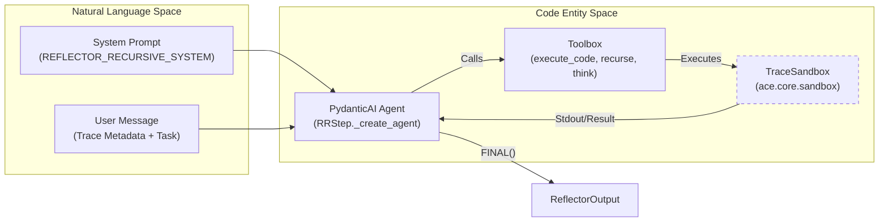
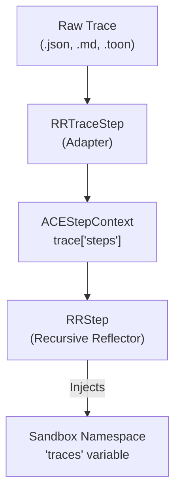

<!-- source: DeepWiki mcp.deepwiki.com · repo kayba-ai/agentic-context-engine · extra page RR Architecture and Pipeline · fetched 2026-10-26 -->

# RR Architecture and Pipeline

<details>
<summary>Relevant source files</summary>

The following files were used as context for generating this wiki page:

- [ace/core/recursive_agent.py](ace/core/recursive_agent.py)
- [ace/implementations/rr/__init__.py](ace/implementations/rr/__init__.py)
- [ace/implementations/rr/config.py](ace/implementations/rr/config.py)
- [ace/implementations/rr/prompts.py](ace/implementations/rr/prompts.py)
- [ace/implementations/rr/tools.py](ace/implementations/rr/tools.py)
- [ace/steps/rr_step.py](ace/steps/rr_step.py)
- [examples/ace/rr_benchmark.py](examples/ace/rr_benchmark.py)
- [examples/agentic-system-prompting/recursive_agentic_system_prompting.py](examples/agentic-system-prompting/recursive_agentic_system_prompting.py)
- [test_rr_live.py](test_rr_live.py)
- [tests/test_rr_pipeline/test_rr_stress.py](tests/test_rr_pipeline/test_rr_stress.py)
- [tests/test_rr_pipeline/test_runner.py](tests/test_rr_pipeline/test_runner.py)

</details>


## Purpose and Scope

This document describes the architecture and pipeline implementation of the Recursive Reflector (RR) system. It covers how `RRStep` implements the `RecursiveAgent` pattern to create an iterative REPL loop for trace analysis, the inner execution flow (LLMCall → ExtractCode → SandboxExec → CheckResult), and how the system integrates with the broader ACE pipeline.

The RR system transitions from simple prompt-based reflection to an **agentic code-based analysis** environment where an LLM uses a Python sandbox to verify hypotheses about agent performance.

---

## RR Architecture Overview

The RR system is built upon the `RecursiveAgent` base class, which provides shared infrastructure for multi-turn reasoning, budget management, and recursion.

### Core Class Hierarchy

```mermaid
graph TD
    subgraph "Base Layer"
        RA["RecursiveAgent<br/>(ace.core.recursive_agent)"]
        AC["AgenticConfig<br/>(ace.core.recursive_agent)"]
    end
    
    subgraph "RR Implementation"
        RRStep["RRStep<br/>(ace.steps.rr_step)"]
        RRConfig["RRConfig<br/>(ace.implementations.rr.config)"]
    end
    
    subgraph "Protocols"
        SP["StepProtocol<br/>requires: {trace, skillbook}<br/>provides: {reflections}"]
        RL["ReflectorLike<br/>reflect() method"]
    end
    
    RA <|-- RRStep
    AC <|-- RRConfig
    RRStep -.implements.-> SP
    RRStep -.implements.-> RL
    
    style RRStep fill:#f9f9f9
    style RA fill:#ffffff
```

**Sources:** [ace/steps/rr_step.py:51-72](), [ace/core/recursive_agent.py:16-25](), [ace/implementations/rr/config.py:9-15]()

### Protocol Satisfaction
`RRStep` satisfies two primary interfaces:
1.  **StepProtocol**: Allows it to be used as a node in a `pipeline.Pipeline`. It requires a `trace` and `skillbook` and provides `reflections` [ace/steps/rr_step.py:71-72]().
2.  **ReflectorLike**: Provides a `reflect()` method, allowing it to act as a drop-in replacement for standard reflectors [ace/steps/rr_step.py:201-223]().

---

## The RR Pipeline (Inner Loop)

The RR system operates as a REPL (Read-Eval-Print Loop). Unlike standard agents that output text, the RR agent primarily outputs Python code to be executed against the trace data.

### Iteration Data Flow



**Sources:** [ace/steps/rr_step.py:96-120](), [ace/implementations/rr/prompts.py:9-23](), [ace/core/recursive_agent.py:82-140]()

### Inner Pipeline Steps

| Step | Implementation | Role |
| :--- | :--- | :--- |
| **LLM Call** | `PydanticAgent.run` | Generates the next reasoning step and tool calls [ace/core/recursive_agent.py:241-245](). |
| **Extract Code** | `execute_code` tool | Receives Python strings from the LLM for execution [ace/core/recursive_agent.py:89-106](). |
| **Sandbox Exec** | `TraceSandbox.execute` | Runs code in an isolated environment with access to `traces` and `skillbook` variables [ace/core/sandbox.py:65-80](). |
| **Check Result** | `validate_output` | Ensures the agent has performed at least one iteration of data exploration before allowing a final answer [ace/implementations/rr/tools.py:52-63](). |

---

## Recursive Reflector Components

### 1. RRStep Implementation
The `RRStep` class orchestrates the lifecycle of a reflection task. It initializes the `TraceSandbox`, injects the `trace` data into the sandbox namespace as the `traces` variable, and manages the transition from raw trace data to a structured `ReflectorOutput` [ace/steps/rr_step.py:167-195]().

### 2. The Toolset
The RR agent is equipped with specific tools defined in `ace.implementations.rr.tools`:
*   `execute_code`: The primary evidence-gathering tool. It allows the agent to slice, filter, and analyze the trace [ace/core/recursive_agent.py:82-106]().
*   `think`: A prose-only channel for internal monologue, keeping the sandbox `stdout` clean for data [ace/implementations/rr/tools.py:97-137]().
*   `search_skillbook` / `read_skill`: Tools to inspect the existing skillbook for context [ace/implementations/rr/tools.py:66-94](), [ace/implementations/rr/tools.py:140-176]().
*   `recurse`: Spawns a sub-agent to handle complex sub-tasks (e.g., "Analyze these 100 turns in parallel") [ace/core/recursive_agent.py:143-174]().

### 3. Iteration Loop and Budgeting
The loop continues until the LLM provides a structured `ReflectorOutput` or the `BudgetExhausted` exception is raised [ace/steps/rr_step.py:21-23](). Budgeting is managed via `UsageLimits`, capping both total tokens and the number of LLM requests [ace/implementations/rr/config.py:146-158]().

---

## Data Normalization and Adaptation

To allow the RR to analyze various trace formats, an adapter pattern is often used.

### Trace Normalization Diagram



**Sources:** [examples/agentic-system-prompting/recursive_agentic_system_prompting.py:67-93](), [ace/steps/rr_step.py:167-175]()

In the `RRTraceStep` adapter, incoming traces are wrapped into a standard dictionary format where the sandbox can access them via `traces["steps"]` [examples/agentic-system-prompting/recursive_agentic_system_prompting.py:81-93]().

---

## Configuration and Tuning

The `RRConfig` class (extending `AgenticConfig`) controls the intensity of the analysis:

| Parameter | Default | Description |
| :--- | :--- | :--- |
| `max_requests` | 20 | Maximum number of LLM calls per reflection [ace/core/recursive_agent.py:20](). |
| `max_output_chars` | 50,000 | Maximum size of `stdout` captured from the sandbox [ace/implementations/rr/config.py:17](). |
| `timeout` | 30.0 | Seconds allowed for a single Python execution [ace/core/recursive_agent.py:112-115](). |
| `temperature` | 0.0 | Set to 0.0 by default for deterministic analysis [ace/steps/rr_step.py:88](). |

**Sources:** [ace/implementations/rr/config.py:9-20](), [ace/steps/rr_step.py:83-92]()

---

**Sources:**
- `ace/steps/rr_step.py` [1-270]()
- `ace/core/recursive_agent.py` [1-200]()
- `ace/implementations/rr/tools.py` [1-176]()
- `ace/implementations/rr/prompts.py` [1-85]()
- `examples/agentic-system-prompting/recursive_agentic_system_prompting.py` [67-130]()

---

