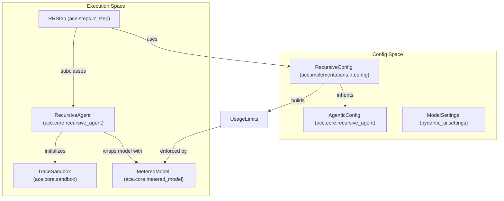
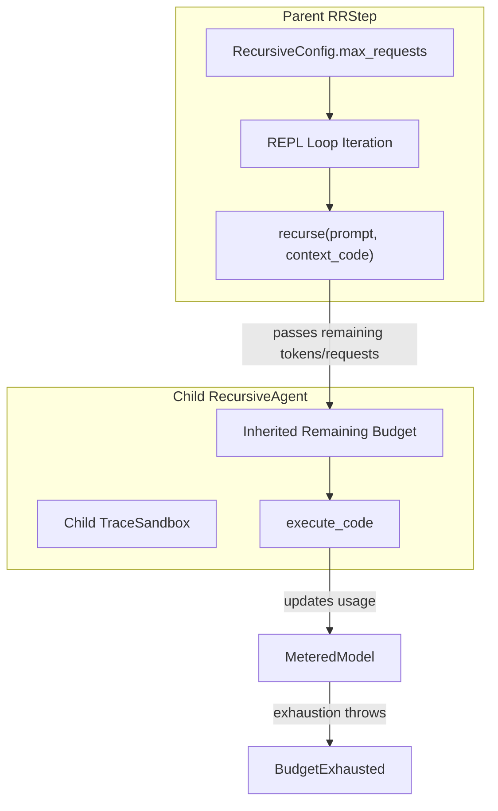

<!-- source: DeepWiki mcp.deepwiki.com · repo kayba-ai/agentic-context-engine · extra page RR Configuration · fetched 2026-10-26 -->

# RR Configuration

<details>
<summary>Relevant source files</summary>

The following files were used as context for generating this wiki page:

- [ace/core/recursive_agent.py](ace/core/recursive_agent.py)
- [ace/implementations/rr/__init__.py](ace/implementations/rr/__init__.py)
- [ace/implementations/rr/config.py](ace/implementations/rr/config.py)
- [ace/implementations/rr/prompts.py](ace/implementations/rr/prompts.py)
- [ace/implementations/rr/tools.py](ace/implementations/rr/tools.py)
- [ace/steps/rr_step.py](ace/steps/rr_step.py)
- [examples/ace/rr_benchmark.py](examples/ace/rr_benchmark.py)
- [examples/agentic-system-prompting/recursive_agentic_system_prompting.py](examples/agentic-system-prompting/recursive_agentic_system_prompting.py)
- [test_rr_live.py](test_rr_live.py)
- [tests/test_rr_pipeline/test_rr_stress.py](tests/test_rr_pipeline/test_rr_stress.py)
- [tests/test_rr_pipeline/test_runner.py](tests/test_rr_pipeline/test_runner.py)

</details>


The Recursive Reflector (RR) configuration system governs the behavior of iterative, code-based trace analysis. Configuration is primarily handled through the `RecursiveConfig` class (aliased as `RRConfig` in the pipeline), which extends base agentic settings to control sandboxed execution, recursion depth, and resource budgets.

## Overview

The configuration layer bridges the high-level analysis strategy with the low-level execution constraints of the `RecursiveAgent`. It defines limits for the REPL loop where the LLM writes Python code to inspect traces, spawns sub-agents for parallel analysis, and synthesizes final insights.

Key configuration areas include:
- **Execution Limits**: Iteration counts and sandbox timeouts.
- **Budget Management**: Token and request limits shared across recursive calls.
- **Sub-agent Control**: Settings for children spawned via the `recurse` tool.
- **Context Hygiene**: Two-tier compaction and output truncation.

**Sources:** [ace/implementations/rr/config.py:1-20](), [ace/steps/rr_step.py:51-120]()

## Configuration Entity Space

The following diagram maps configuration classes to the code entities that consume them during the RR lifecycle.



**Sources:** [ace/implementations/rr/config.py:9-10](), [ace/steps/rr_step.py:51-73](), [ace/core/recursive_agent.py:16-25]()

## Core Configuration Parameters

### RecursiveConfig (RRConfig)
The `RecursiveConfig` class provides specific overrides for the Reflector's workbench environment.

| Parameter | Type | Default | Description |
| :--- | :--- | :--- | :--- |
| `max_requests` | `int` | 20 | Max LLM turns in the REPL loop. |
| `max_tokens` | `int` | 100,000 | Total token budget for the entire analysis. |
| `timeout` | `float` | 30.0 | Max seconds for a single `execute_code` call. |
| `max_output_chars`| `int` | 50,000 | Max stdout length returned to LLM from sandbox. |
| `cache_prompts` | `bool` | True | Enables prompt caching (e.g., Anthropic headers). |

**Sources:** [ace/implementations/rr/config.py:9-20](), [ace/core/recursive_agent.py:82-141]()

### Model Settings
`RRStep` defaults to optimized settings for high-reasoning models (like Claude 3.5 Sonnet) to support the complex tool-use required for trace analysis.

- **Temperature**: Defaulted to `0.0` for deterministic analysis [ace/steps/rr_step.py:88]().
- **Caching**: `bedrock_cache_messages` and `bedrock_cache_tool_definitions` are enabled by default to reduce latency across iterations [ace/steps/rr_step.py:89-91]().

## Iteration and Budget Flow

The RR system uses a shared budget managed by `RecursiveAgent`. When a sub-agent is spawned via `recurse`, it inherits the remaining budget from the parent.



**Sources:** [ace/core/recursive_agent.py:150-205](), [ace/core/recursive_agent.py:214-230]()

### Budget Exhaustion & Fallbacks
If the LLM call limit (`max_requests`) or token limit is reached before the agent calls `FINAL`, the system triggers a fallback mechanism:
1. **BudgetExhausted Exception**: Caught by `RRStep` [ace/steps/rr_step.py:21]().
2. **Safe Output Generation**: The system produces a `ReflectorOutput` with a reasoning field indicating a "budget limit" or "timeout" occurred [ace/steps/rr_step.py:194-210]().
3. **Ground Truth Check**: If `ground_truth` is available in the trace, the fallback logic performs a simple string comparison to determine if the original agent was correct despite the reflector timing out [tests/test_rr_pipeline/test_runner.py:167-182]().

## Context Management: Two-Tier Compaction

To prevent context window overflow during long analyses, the configuration supports two types of compaction:

1.  **Micro-compaction**: Replaces bulky tool outputs (like raw trace dumps) with placeholders once they are stored in the sandbox variables [ace/steps/rr_step.py:115-118]().
2.  **Full Summarization**: When the message history exceeds the limit, the `RecursiveAgent` uses a `compaction_summary_prompt` to condense the conversation into a single summary message while preserving the Python sandbox state [ace/steps/rr_step.py:109-114]().

**Sources:** [ace/core/recursive_agent.py:270-310](), [ace/steps/rr_step.py:108-120]()

## Sub-agent Settings (Recurse Tool)

The `recurse` tool is configured to allow the reflector to "fan out" analysis.
- **Parallelism**: Multiple `recurse` calls in a single LLM turn are dispatched in parallel using `asyncio.gather` [ace/implementations/rr/prompts.py:62]().
- **Variable Inheritance**: Children inherit a copy of the parent's sandbox variables (lists, dicts, strings) but not the full conversation history [ace/core/recursive_agent.py:184-189]().
- **Helper Injection**: Functions registered via `register_helper` in the parent sandbox are automatically injected into child sandboxes [ace/core/recursive_agent.py:190-205]().

**Sources:** [ace/core/recursive_agent.py:143-205](), [ace/implementations/rr/prompts.py:15]()

## Sandbox Instrumentation

For debugging, the `TraceSandbox` can be instrumented to log every code execution and output. This is used in the `test_rr_live.py` utility to provide visibility into the RR's thought process.

```python
# Example of instrumented execution monitoring
def _instrumented_execute(self, code: str, timeout: float = 30.0):
    print(f"EXECUTE_CODE: {code}")
    result = original_execute(self, code, timeout)
    print(f"STDOUT: {result.stdout}")
    return result
```

**Sources:** [test_rr_live.py:58-96](), [ace/core/sandbox.py:22-25]()

---

