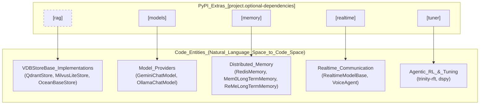
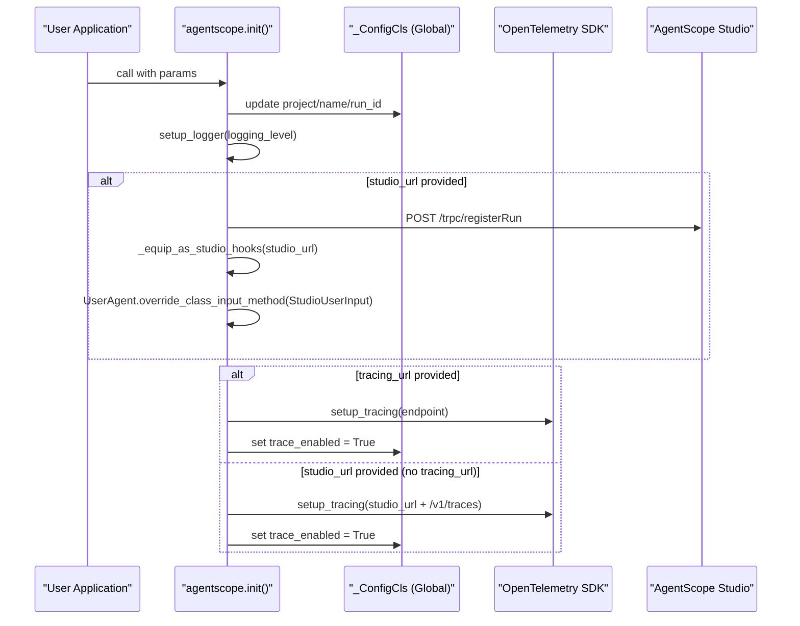

<!-- source: DeepWiki mcp.deepwiki.com · repo modelscope/agentscope · page 1.1 Installation and Setup · fetched 2026-10-26 -->

# Installation and Setup

<details>
<summary>Relevant source files</summary>

The following files were used as context for generating this wiki page:

- [.github/workflows/unittest.yml](.github/workflows/unittest.yml)
- [.pre-commit-config.yaml](.pre-commit-config.yaml)
- [examples/agent/voice_agent/README.md](examples/agent/voice_agent/README.md)
- [examples/functionality/vector_store/oceanbase/README.md](examples/functionality/vector_store/oceanbase/README.md)
- [examples/functionality/vector_store/oceanbase/main.py](examples/functionality/vector_store/oceanbase/main.py)
- [pyproject.toml](pyproject.toml)
- [src/agentscope/__init__.py](src/agentscope/__init__.py)
- [src/agentscope/_run_config.py](src/agentscope/_run_config.py)
- [src/agentscope/model/_model_base.py](src/agentscope/model/_model_base.py)
- [src/agentscope/model/_model_response.py](src/agentscope/model/_model_response.py)
- [src/agentscope/rag/__init__.py](src/agentscope/rag/__init__.py)
- [src/agentscope/rag/_store/__init__.py](src/agentscope/rag/_store/__init__.py)
- [src/agentscope/rag/_store/_oceanbase_store.py](src/agentscope/rag/_store/_oceanbase_store.py)
- [tests/config_test.py](tests/config_test.py)
- [tests/rag_knowledge_test.py](tests/rag_knowledge_test.py)
- [tests/rag_store_test.py](tests/rag_store_test.py)

</details>


This document provides a technical guide to installing AgentScope, configuring its modular dependency system, and initializing the framework for local development or production environments.

---

## Prerequisites

AgentScope requires **Python 3.10** or higher [pyproject.toml:21](). The framework is tested across multiple operating systems (Ubuntu, Windows, macOS) and Python versions (3.10, 3.11, 3.12) [.github/workflows/unittest.yml:11-12]().

**System Requirements:**
- Python 3.10, 3.11, or 3.12
- `pip` (version >= 78.1.1 recommended) or `uv` package manager [.github/workflows/unittest.yml:23]()
- C++ build tools (required for some optional dependencies like `llama-cpp-python` or certain vector stores)

---

## Installation Methods

### Standard Installation via PyPI

The core package includes essential abstractions for agents, models, and messaging.

```bash
pip install agentscope
```

This installs the base requirements defined in `dependencies`, including `openai`, `dashscope`, `anthropic`, `opentelemetry-sdk`, `mcp`, and `sqlalchemy` [pyproject.toml:22-45]().

### Installation from Source

For development or access to the latest features:

```bash
git clone https://github.com/modelscope/agentscope.git
cd agentscope
pip install -e .
```

The `-e` flag performs an editable install, mapping the `src` directory to your environment [pyproject.toml:196]().

---

## Optional Dependencies

AgentScope uses `optional-dependencies` to keep the core footprint small. Users must install specific "extras" based on their use case [pyproject.toml:47-165]().

### Dependency Architecture

The following diagram maps the installation "extras" to the code entities they enable.

**Installation to Code Entity Mapping:**



### Common Installation Commands

| Feature Group | Command | Key Enabled Components |
| :--- | :--- | :--- |
| **RAG** | `pip install agentscope[rag]` | `PDFReader`, `QdrantStore`, `MilvusLiteStore`, `OceanBaseStore` [pyproject.toml:121-137]() |
| **Models** | `pip install agentscope[models]` | `GeminiChatModel`, `OllamaChatModel` [pyproject.toml:60-65]() |
| **Memory** | `pip install agentscope[memory]` | `RedisMemory`, `Mem0LongTermMemory`, `ReMeLongTermMemory` [pyproject.toml:75-86]() |
| **Tuner** | `pip install agentscope[tuner]` | `DSPy` integration, `trinity-rft` (RL fine-tuning) [pyproject.toml:143-154]() |
| **Full** | `pip install agentscope[full]` | All optional features excluding dev tools [pyproject.toml:157-165]() |

**Sources:** [pyproject.toml:47-165](), [src/agentscope/rag/__init__.py:8-26]()

---

## Framework Initialization

The `agentscope.init()` function is the entry point for configuring the global runtime state. It populates a thread-safe `_config` object which utilizes `ContextVar` for async safety [src/agentscope/__init__.py:22-41]().

### The init() Function

```python
import agentscope

agentscope.init(
    project="MyProject",
    name="ExperimentalRun",
    logging_level="INFO",
    tracing_url="http://localhost:4318"
)
```

**Key Parameters:**
- `project`: Sets the global project name [src/agentscope/__init__.py:106-107]().
- `name`: Sets the run name (defaults to timestamp) [src/agentscope/__init__.py:109-110]().
- `run_id`: A unique identifier for the execution instance [src/agentscope/__init__.py:112-113]().
- `tracing_url`: The OTLP endpoint for OpenTelemetry traces [src/agentscope/__init__.py:147-151]().
- `studio_url`: Connects the run to AgentScope Studio for monitoring and human-in-the-loop input [src/agentscope/__init__.py:117-145]().

### Data Flow during Initialization

When `init()` is called, it synchronizes the configuration and prepares observability hooks.

**Initialization Sequence:**



**Sources:** [src/agentscope/__init__.py:72-157](), [src/agentscope/_run_config.py:1-41]()

---

## Observability and Tracing Setup

AgentScope integrates with OpenTelemetry to provide deep visibility into agent execution, model usage, and message flow.

### Tracing Backends

Tracing is enabled by passing an endpoint to `agentscope.init()`.

1.  **AgentScope Studio**: If `studio_url` is provided, AgentScope automatically derives the trace endpoint as `{studio_url}/v1/traces` [src/agentscope/__init__.py:150]().
2.  **Custom OTLP Backends**: If `tracing_url` is provided, it takes precedence [src/agentscope/__init__.py:147-148](). This allows connection to:
    *   **Arize Phoenix**: Use the local or cloud OTLP endpoint.
    *   **Langfuse**: Use the OTLP-compatible ingestion URL.
    *   **CloudMonitor**: Alibaba Cloud monitoring.

### Tracing Implementation

Tracing is implemented via decorators that wrap core methods and export data as `ChatResponse` objects or spans [src/agentscope/model/_model_response.py:20-43]().

- `@trace_llm`: Captures model inputs and `ChatResponse` content blocks including `TextBlock`, `ToolUseBlock`, `ThinkingBlock`, and `AudioBlock` [src/agentscope/model/_model_response.py:23-25]().
- `@trace_reply`: Captures agent `reply()` calls and message exchanges.

When `trace_enabled` is set to `True` in `_config`, the `setup_tracing` function initializes the OpenTelemetry SDK to start exporting spans [src/agentscope/__init__.py:153-157]().

**Sources:** [src/agentscope/__init__.py:147-157](), [src/agentscope/model/_model_response.py:20-43]()

---

## Verification and Testing

### Sanity Check

```python
import agentscope
from agentscope.rag import QdrantStore

print(f"AgentScope Version: {agentscope.__version__}")
# If [rag] is installed, this will initialize a memory-resident store
store = QdrantStore(location=":memory:", collection_name="test", dimensions=3)
print("RAG Store initialized successfully.")
```

### Running Unit Tests

If you installed with `[dev]`, you can run the test suite to verify specific components like RAG stores [pyproject.toml:168-188]().

```bash
pip install -e .[dev]
# Test RAG store implementations (Qdrant, MilvusLite, OceanBase, etc.)
pytest tests/rag_store_test.py
```

The test suite validates vector stores like `OceanBaseStore` using either real instances or mocks provided by `pyobvector` [tests/rag_store_test.py:138-184]().

**Sources:** [pyproject.toml:157-188](), [tests/rag_store_test.py:1-20](), [src/agentscope/_version.py:1-4]()

---

