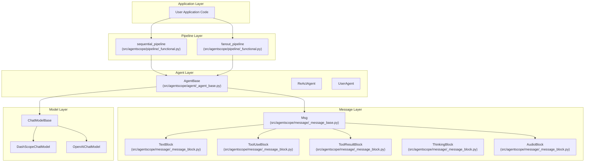
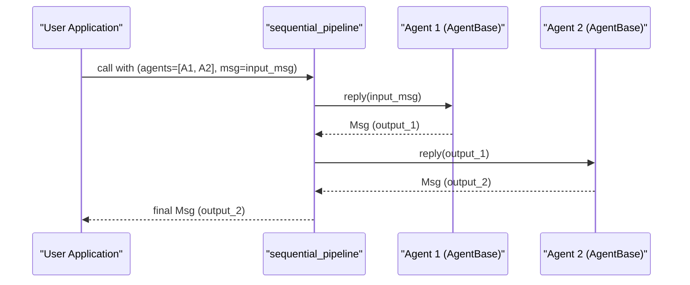
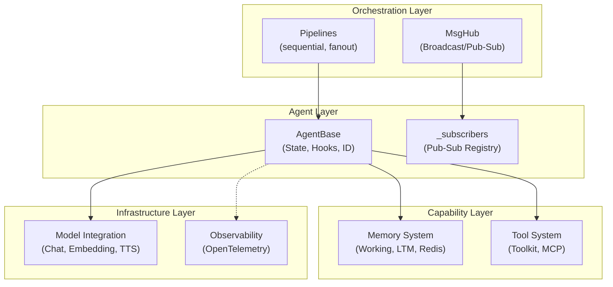

<!-- source: DeepWiki mcp.deepwiki.com · repo modelscope/agentscope · page 1.2 Core Concepts and Architecture · fetched 2026-10-26 -->

# Core Concepts and Architecture

Relevant source files

The following files were used as context for generating this wiki page:

- [README.md](README.md)
- [README_zh.md](README_zh.md)
- [assets/images/agentscope.png](assets/images/agentscope.png)
- [docs/tutorial/en/src/task_tracing.py](docs/tutorial/en/src/task_tracing.py)
- [docs/tutorial/zh_CN/src/task_tracing.py](docs/tutorial/zh_CN/src/task_tracing.py)
- [examples/game/werewolves/structured_model.py](examples/game/werewolves/structured_model.py)
- [src/agentscope/agent/_agent_base.py](src/agentscope/agent/_agent_base.py)
- [src/agentscope/message/_message_base.py](src/agentscope/message/_message_base.py)
- [src/agentscope/message/_message_block.py](src/agentscope/message/_message_block.py)
- [src/agentscope/pipeline/__init__.py](src/agentscope/pipeline/__init__.py)
- [src/agentscope/pipeline/_functional.py](src/agentscope/pipeline/_functional.py)
- [tests/formatter_a2a_test.py](tests/formatter_a2a_test.py)
- [tests/pipeline_test.py](tests/pipeline_test.py)

This page explains the fundamental building blocks of AgentScope and how they work together to create agent applications. You'll learn about the core abstractions—agents, models, tools, memory, and messages—and understand the architectural patterns that enable flexibility and production-readiness.

For installation and basic setup, see [1.1 Installation and Setup](). For detailed implementation guides on specific components, see [2. Agent System](), [3. Model Integration](), [4. Tool System](), and [5. Memory and Knowledge Systems]().

---

## Core Building Blocks

AgentScope is built around five primary abstractions that work together to create agent applications:

### Agents

Agents are the orchestrators that coordinate models, tools, and memory to accomplish tasks. The framework provides:

- **`AgentBase`** - Base class for asynchronous agents, inheriting from `StateModule` [src/agentscope/agent/_agent_base.py:30-31]().
- **`ReActAgent`** - Production-ready implementation using the Reasoning-Acting paradigm [README.md:68]().
- **`UserAgent`** - Special agent for human interaction [README_zh.md:172]().

The `AgentBase` class manages a unique `id` generated via `shortuuid` [src/agentscope/agent/_agent_base.py:144](), instance-level hooks for lifecycle management [src/agentscope/agent/_agent_base.py:150-158](), and a subscriber system for message broadcasting [src/agentscope/agent/_agent_base.py:168]().

**Core Interface**:
- `reply(*args, **kwargs)` - The main logic of the agent, generating a reply based on state [src/agentscope/agent/_agent_base.py:197-203]().
- `observe(msg)` - Receives messages without generating a reply [src/agentscope/agent/_agent_base.py:185-195]().
- `print(msg)` - Handles console output and streaming for the agent [src/agentscope/agent/_agent_base.py:205-210]().

Sources: [src/agentscope/agent/_agent_base.py](), [README.md:68]()

### Models

Models provide the language understanding and generation capabilities. AgentScope abstracts LLM providers behind a unified interface:

- **`ChatModelBase`** - Abstract base class for all chat models [docs/tutorial/en/src/task_tracing.py:113]().
- **`ChatResponse`** - Standardized response format containing content blocks [docs/tutorial/en/src/task_tracing.py:140]().
- **Provider implementations**: `DashScopeChatModel` [README_zh.md:173](), `OpenAIChatModel`, `AnthropicChatModel`, `GeminiChatModel`, `OllamaChatModel`.

All models implement a consistent calling pattern, often traced via `@trace_llm` to monitor execution [docs/tutorial/en/src/task_tracing.py:113-142]().

Sources: [README_zh.md:173](), [docs/tutorial/en/src/task_tracing.py]()

### Messages

Messages (`Msg`) are the fundamental communication units. They carry information between agents, users, and the system [src/agentscope/message/_message_base.py:21-22]().

**Structure**:
A `Msg` object includes `name`, `content`, `role` (user, assistant, or system), and optional `metadata` [src/agentscope/message/_message_base.py:24-50](). It also automatically generates a unique `id` and `timestamp` [src/agentscope/message/_message_base.py:66-72]().

**Content Blocks** - Messages can contain a sequence of typed `ContentBlock` objects [src/agentscope/message/_message_base.py:27]():
- `TextBlock` - Plain text content [src/agentscope/message/_message_block.py:9-16]().
- `ToolUseBlock` - Tool invocation requests [src/agentscope/message/_message_block.py:79-92]().
- `ToolResultBlock` - Tool execution results [src/agentscope/message/_message_block.py:94-107]().
- `ThinkingBlock` - Model reasoning traces [src/agentscope/message/_message_block.py:18-24]().
- `AudioBlock`, `ImageBlock`, `VideoBlock` - Multimodal content [src/agentscope/message/_message_block.py:49-77]().

Sources: [src/agentscope/message/_message_base.py](), [src/agentscope/message/_message_block.py](), [src/agentscope/agent/_agent_base.py:19-26]()

### Tools

The tool system enables agents to take actions in the external world. Tools are registered as Python callables and can be grouped into toolkits.
- **Toolkit** - Manages tool registration and schema generation.
- **Middleware** - Provides an onion-style execution model for logging or authentication.
- **MCP Integration** - Support for Model Context Protocol to connect to external services [README.md:69]().

Sources: [README.md:69](), [README_zh.md:67]()

### Memory

AgentScope provides a multi-tiered memory architecture:

- **Working Memory**: Short-term storage for the current session. Default implementations include `InMemoryMemory`.
- **Persistent Storage**: Support for database-backed memory (e.g., Redis, SQL) [README.md:84]().
- **Memory Compression**: Automatically compresses history when token limits are reached to maintain context within model constraints [README.md:84]().
- **Long-term Memory**: Enhanced storage using systems like `ReMe` or `Mem0` [README.md:90]().

Sources: [README.md:84-90](), [src/agentscope/agent/_agent_base.py:18]()

---

## Component Interaction Architecture

This diagram maps the natural language concepts to their actual code entities in AgentScope:

Title: AgentScope Core Entity Mapping

**Core Concepts to Code Entity Mapping**

| Concept | Primary Class | File Path |
|---------|--------------|-----------|
| Agent Base | `AgentBase` | [src/agentscope/agent/_agent_base.py:30]() |
| Message | `Msg` | [src/agentscope/message/_message_base.py:21]() |
| Sequential Flow | `sequential_pipeline` | [src/agentscope/pipeline/_functional.py:10]() |
| Parallel Flow | `fanout_pipeline` | [src/agentscope/pipeline/_functional.py:47]() |
| State Module | `StateModule` | [src/agentscope/module/__init__.py]() (imported in agent_base) |

Sources: [src/agentscope/agent/_agent_base.py](), [src/agentscope/message/_message_base.py](), [src/agentscope/pipeline/_functional.py](), [src/agentscope/message/_message_block.py]()

---

## Message Flow Through Pipelines

AgentScope uses pipelines to manage the flow of `Msg` objects between agents.

Title: Sequential Pipeline Message Flow

**Key Flow Patterns**:

1. **Sequential**: `sequential_pipeline` executes agents in order, passing the output of one as the input to the next [src/agentscope/pipeline/_functional.py:10-44]().
2. **Fanout**: `fanout_pipeline` distributes the same input to multiple agents concurrently (using `asyncio.gather`) or sequentially [src/agentscope/pipeline/_functional.py:47-104]().
3. **Streaming**: `stream_printing_messages` captures intermediate `print` calls from agents and yields them via an `asyncio.Queue` [src/agentscope/pipeline/_functional.py:107-193]().

Sources: [src/agentscope/pipeline/_functional.py]()

---

## Architecture Layers

AgentScope follows a layered architecture with clear separation of concerns:

Title: AgentScope Layered Architecture

**Layer Responsibilities**:

| Layer | Components | Purpose |
|-------|-----------|---------|
| Orchestration | `sequential_pipeline`, `MsgHub` | Manage multi-agent interaction patterns. |
| Agent | `AgentBase`, `ReActAgent` | Encapsulate state, logic, and lifecycle hooks. |
| Capability | `MemoryBase`, `Toolkit` | Provide agents with tools and context. |
| Infrastructure | `ChatModelBase`, OTel Tracing | Abstract hardware/API dependencies and provide monitoring. |

Sources: [src/agentscope/agent/_agent_base.py](), [src/agentscope/pipeline/_functional.py](), [README.md:60-70]()

---

## Key Architectural Patterns

### Lifecycle Hooks
`AgentBase` implements a comprehensive hook system allowing developers to intercept and modify behavior at specific points: `pre_reply`, `post_reply`, `pre_print`, `post_print`, `pre_observe`, and `post_observe` [src/agentscope/agent/_agent_base.py:36-43](). Hooks can be defined at the class level [src/agentscope/agent/_agent_base.py:46-138]() or instance level [src/agentscope/agent/_agent_base.py:151-158]().

### Publish-Subscribe Communication
Beyond direct pipelines, agents can use a pub-sub model. The `_subscribers` dictionary in `AgentBase` tracks agents that should automatically `observe` the current agent's replies [src/agentscope/agent/_agent_base.py:168]().

### State Management
Agents inherit from `StateModule`, meaning they support `state_dict()` and `load_state_dict()` methods [src/agentscope/agent/_agent_base.py:30](). This is critical for production scenarios requiring session persistence or checkpointing.

### Observability
AgentScope is designed with native OpenTelemetry support. Using decorators like `@trace_llm`, `@trace_reply`, and `@trace_format`, the framework automatically captures execution traces that can be exported to AgentScope Studio or third-party platforms like Langfuse or Arize-Phoenix [docs/tutorial/en/src/task_tracing.py:104-117]().

Sources: [src/agentscope/agent/_agent_base.py](), [docs/tutorial/en/src/task_tracing.py]()

---

