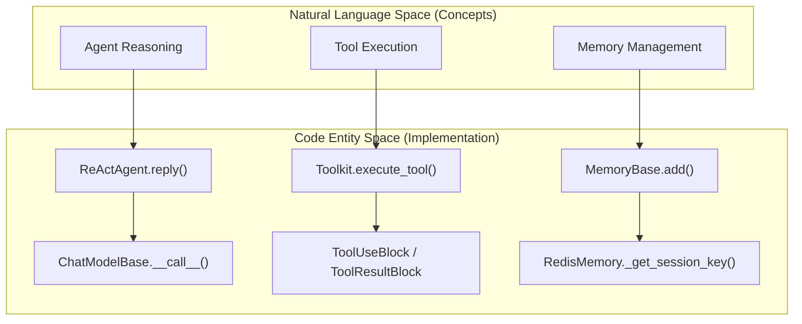
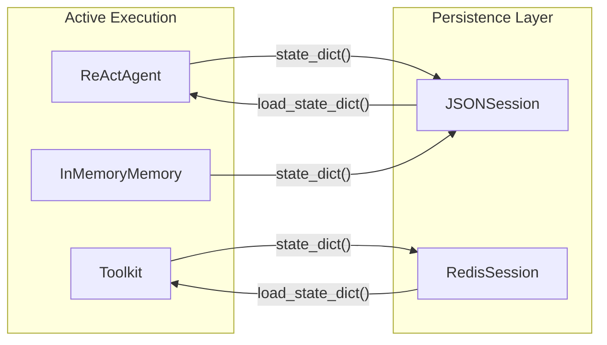

<!-- source: DeepWiki mcp.deepwiki.com · repo modelscope/agentscope · page 10 Glossary · fetched 2026-10-26 -->

# Glossary

Relevant source files

The following files were used as context for generating this wiki page:

- [.gemini/styleguide.md](.gemini/styleguide.md)
- [.github/copilot-instructions.md](.github/copilot-instructions.md)
- [README.md](README.md)
- [README_zh.md](README_zh.md)
- [assets/images/agentscope.png](assets/images/agentscope.png)
- [docs/tutorial/en/src/task_tracing.py](docs/tutorial/en/src/task_tracing.py)
- [docs/tutorial/zh_CN/src/task_tracing.py](docs/tutorial/zh_CN/src/task_tracing.py)
- [examples/functionality/vector_store/oceanbase/README.md](examples/functionality/vector_store/oceanbase/README.md)
- [examples/functionality/vector_store/oceanbase/main.py](examples/functionality/vector_store/oceanbase/main.py)
- [pyproject.toml](pyproject.toml)
- [src/agentscope/_utils/_common.py](src/agentscope/_utils/_common.py)
- [src/agentscope/_version.py](src/agentscope/_version.py)
- [src/agentscope/agent/_react_agent.py](src/agentscope/agent/_react_agent.py)
- [src/agentscope/formatter/_gemini_formatter.py](src/agentscope/formatter/_gemini_formatter.py)
- [src/agentscope/memory/_working_memory/_redis_memory.py](src/agentscope/memory/_working_memory/_redis_memory.py)
- [src/agentscope/model/_anthropic_model.py](src/agentscope/model/_anthropic_model.py)
- [src/agentscope/model/_dashscope_model.py](src/agentscope/model/_dashscope_model.py)
- [src/agentscope/model/_gemini_model.py](src/agentscope/model/_gemini_model.py)
- [src/agentscope/model/_model_usage.py](src/agentscope/model/_model_usage.py)
- [src/agentscope/model/_ollama_model.py](src/agentscope/model/_ollama_model.py)
- [src/agentscope/model/_openai_model.py](src/agentscope/model/_openai_model.py)
- [src/agentscope/rag/__init__.py](src/agentscope/rag/__init__.py)
- [src/agentscope/rag/_store/__init__.py](src/agentscope/rag/_store/__init__.py)
- [src/agentscope/rag/_store/_oceanbase_store.py](src/agentscope/rag/_store/_oceanbase_store.py)
- [src/agentscope/session/__init__.py](src/agentscope/session/__init__.py)
- [src/agentscope/session/_json_session.py](src/agentscope/session/_json_session.py)
- [src/agentscope/session/_redis_session.py](src/agentscope/session/_redis_session.py)
- [src/agentscope/session/_session_base.py](src/agentscope/session/_session_base.py)
- [src/agentscope/tool/_toolkit.py](src/agentscope/tool/_toolkit.py)
- [src/agentscope/tool/_types.py](src/agentscope/tool/_types.py)
- [tests/formatter_anthropic_test.py](tests/formatter_anthropic_test.py)
- [tests/formatter_deepseek_test.py](tests/formatter_deepseek_test.py)
- [tests/formatter_gemini_test.py](tests/formatter_gemini_test.py)
- [tests/formatter_ollama_test.py](tests/formatter_ollama_test.py)
- [tests/memory_test.py](tests/memory_test.py)
- [tests/model_anthropic_test.py](tests/model_anthropic_test.py)
- [tests/model_dashscope_test.py](tests/model_dashscope_test.py)
- [tests/model_gemini_test.py](tests/model_gemini_test.py)
- [tests/model_ollama_test.py](tests/model_ollama_test.py)
- [tests/model_openai_test.py](tests/model_openai_test.py)
- [tests/rag_knowledge_test.py](tests/rag_knowledge_test.py)
- [tests/rag_store_test.py](tests/rag_store_test.py)
- [tests/session_test.py](tests/session_test.py)
- [tests/toolkit_async_execution_test.py](tests/toolkit_async_execution_test.py)

This page provides definitions and technical details for codebase-specific terms, jargon, and domain concepts used throughout AgentScope. It serves as a reference for onboarding engineers to understand the underlying implementation and data structures.

## Core Abstractions

### Msg (Message Object)
The fundamental unit of data exchange between agents. A `Msg` object encapsulates content, sender information, and metadata. It is designed to be JSON-serializable to support distributed environments and logging.
- **Implementation**: Defined in `src/agentscope/message/__init__.py` [src/agentscope/message/__init__.py:1-50]().
- **Structure**: Typically contains `name` (sender), `content` (text or blocks), and `role` (e.g., "user", "assistant", "system").

### Content Blocks
AgentScope uses a structured content protocol within messages to handle multimodal data and tool interactions.
- **TextBlock**: Represents standard text content [src/agentscope/message/__init__.py:21]().
- **ToolUseBlock**: Represents a request to execute a specific tool with arguments [src/agentscope/message/__init__.py:19]().
- **ToolResultBlock**: Contains the output/call response from a tool execution [src/agentscope/message/__init__.py:20]().
- **ThinkingBlock**: Used for models that support internal reasoning (e.g., DeepSeek-R1, Qwen-3) [src/agentscope/model/_dashscope_model.py:31](), [src/agentscope/model/_openai_model.py:30]().
- **Multimodal Blocks**: `AudioBlock`, `ImageBlock`, and `VideoBlock` for handling non-text media [src/agentscope/message/__init__.py:22-23]().

### StateModule
A base class that provides a unified interface for state serialization and restoration. Any component that needs to persist its state (like Memory or Toolkit) inherits from `StateModule`.
- **Key Methods**: `state_dict()` to export state and `load_state_dict()` to restore it.
- **Usage**: Used by `Toolkit` [src/agentscope/tool/_toolkit.py:117]() and various Memory implementations to facilitate checkpointing and multi-tenant isolation.

**Sources:** [src/agentscope/message/__init__.py:1-40](), [src/agentscope/tool/_toolkit.py:117-137](), [src/agentscope/model/_dashscope_model.py:31-35]()

---

## Memory Systems

### Working Memory
Short-term context management for agents.
- **InMemoryMemory**: A volatile, list-based storage for messages.
- **RedisMemory**: A persistent, multi-tenant memory backend using Redis. It uses specific key patterns to isolate users and sessions [src/agentscope/memory/_working_memory/_redis_memory.py:16-41]().

### Memory Marks
Labels applied to messages within the working memory to facilitate selective retrieval or deletion.
- **Implementation**: `_MemoryMark` defines standard marks like `HINT` (temporary messages) and `COMPRESSED` (summarized history) [src/agentscope/agent/_react_agent.py:88-95]().
- **Functions**: `add_mark`, `get_memory(mark=...)`, and `delete_by_mark`.

### Memory Compression
The process of summarizing old messages to stay within the LLM's context window.
- **CompressionConfig**: Configuration for triggering compression based on token thresholds, including `trigger_threshold` and `keep_recent` [src/agentscope/agent/_react_agent.py:107-171]().
- **SummarySchema**: A Pydantic model that guides the LLM to produce a structured summary including "Task Overview", "Current State", and "Next Steps" [src/agentscope/agent/_react_agent.py:43-86]().

**Sources:** [src/agentscope/memory/_working_memory/_redis_memory.py:43-63](), [src/agentscope/agent/_react_agent.py:43-171]()

---

## Tooling and Integration

### Toolkit
A manager for tool functions, MCP clients, and agent skills. It handles registration, schema generation, and execution [src/agentscope/tool/_toolkit.py:117-137]().

### MCP (Model Context Protocol)
A standard protocol for agents to interact with external tools and data sources.
- **MCPToolFunction**: A wrapper that allows calling MCP-hosted tools as if they were local functions [src/agentscope/tool/_toolkit.py:40]().
- **Stateful vs. Stateless Clients**: `StatefulClientBase` maintains a persistent connection/session with an MCP server [src/agentscope/tool/_toolkit.py:42]().

### Tool Group
A logical grouping of tools that can be activated or deactivated collectively. This allows agents to dynamically "equip" or "unequip" sets of capabilities based on the task [src/agentscope/tool/_toolkit.py:187-215]().

**Sources:** [src/agentscope/tool/_toolkit.py:1-215](), [src/agentscope/mcp/__init__.py:1-50]()

---

## System Architecture Diagrams

### From Natural Language Space to Code Entity Space

The following diagram illustrates how high-level agent concepts (Natural Language Space) map to specific Python classes and methods (Code Entity Space).

**Diagram: Agent Execution Mapping**

**Sources:** [src/agentscope/agent/_react_agent.py:98-106](), [src/agentscope/tool/_toolkit.py:117-137](), [src/agentscope/memory/_working_memory/_redis_memory.py:174-184]()

### Data Flow: Message and State Persistence

This diagram shows how data moves from an active conversation into persistent storage via the `StateModule` and `Session` abstractions.

**Diagram: State Persistence Flow**

**Sources:** [src/agentscope/session/_json_session.py:1-50](), [src/agentscope/tool/_toolkit.py:117](), [src/agentscope/memory/_working_memory/_redis_memory.py:16-41]()

---

## Table of Technical Terms

| Term | Code Pointer | Definition |
| :--- | :--- | :--- |
| **ReAct Loop** | [src/agentscope/agent/_react_agent.py:98]() | The "Reason-Act" cycle where the agent thinks, selects a tool, executes it, and observes the result. |
| **A2A** | [pyproject.toml:48]() | Agent-to-Agent protocol for standardized communication between different agent frameworks. |
| **VDB Store** | [pyproject.toml:118]() | Vector Database Store; abstraction for RAG backends like `Qdrant`, `Milvus`, or `OceanBase`. |
| **Middleware** | [src/agentscope/tool/_toolkit.py:57]() | Async decorators applied to tool execution for logging, validation, or transformation. |
| **TTL (Time To Live)** | [src/agentscope/memory/_working_memory/_redis_memory.py:102]() | Expiration policy for Redis-backed memory keys to manage storage costs and privacy. |
| **Knowledge Base** | [src/agentscope/rag/__init__.py:1-20]() | An abstraction for RAG that combines a `Reader` and a `VDBStore` to answer queries. |
| **Thinking Mode** | [src/agentscope/model/_dashscope_model.py:94]() | Support for models like Qwen-3 or DeepSeek-R1 to output reasoning thoughts via `ThinkingBlock`. |
| **Repair JSON** | [src/agentscope/_utils/_common.py:31]() | Utility to parse incomplete or malformed JSON strings during streaming tool calls. |

**Sources:** [src/agentscope/agent/_react_agent.py:1-106](), [src/agentscope/tool/_toolkit.py:1-137](), [src/agentscope/memory/_working_memory/_redis_memory.py:1-110](), [src/agentscope/model/_dashscope_model.py:78-100](), [pyproject.toml:1-165](), [src/agentscope/_utils/_common.py:31-70]()