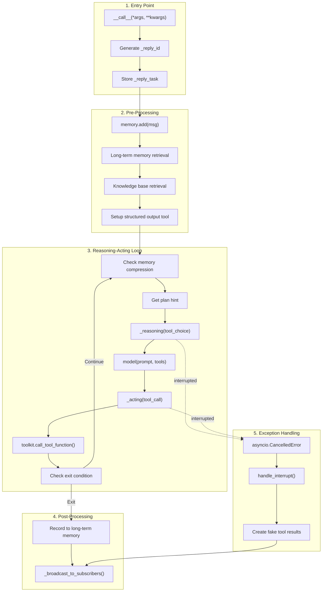

<!-- source: DeepWiki mcp.deepwiki.com · repo modelscope/agentscope · page 2 Agent System · fetched 2026-10-26 -->

# Agent System

<details>
<summary>Relevant source files</summary>

The following files were used as context for generating this wiki page:

- [src/agentscope/_utils/_common.py](src/agentscope/_utils/_common.py)
- [src/agentscope/agent/_agent_base.py](src/agentscope/agent/_agent_base.py)
- [src/agentscope/agent/_react_agent.py](src/agentscope/agent/_react_agent.py)
- [src/agentscope/model/_anthropic_model.py](src/agentscope/model/_anthropic_model.py)
- [src/agentscope/model/_dashscope_model.py](src/agentscope/model/_dashscope_model.py)
- [src/agentscope/model/_gemini_model.py](src/agentscope/model/_gemini_model.py)
- [src/agentscope/model/_model_usage.py](src/agentscope/model/_model_usage.py)
- [src/agentscope/model/_ollama_model.py](src/agentscope/model/_ollama_model.py)
- [src/agentscope/model/_openai_model.py](src/agentscope/model/_openai_model.py)
- [src/agentscope/pipeline/__init__.py](src/agentscope/pipeline/__init__.py)
- [src/agentscope/pipeline/_functional.py](src/agentscope/pipeline/_functional.py)
- [tests/model_anthropic_test.py](tests/model_anthropic_test.py)
- [tests/model_dashscope_test.py](tests/model_dashscope_test.py)
- [tests/model_ollama_test.py](tests/model_ollama_test.py)
- [tests/model_openai_test.py](tests/model_openai_test.py)
- [tests/pipeline_test.py](tests/pipeline_test.py)

</details>


## Overview

The Agent System is the core execution layer of AgentScope, providing the abstractions and implementations for autonomous agents that can reason, act, and communicate. At its foundation is the `AgentBase` class, which defines the universal interface for all agents. The primary concrete implementation is `ReActAgent`, which implements the Reasoning-Acting paradigm with tool calling, memory management, and structured output generation.

This page provides an architectural overview of the agent system. For detailed documentation on specific components, see:
- [AgentBase Foundation](#2.1) — Document the `AgentBase` class, its lifecycle methods (`observe`, `reply`, `print`), asynchronous execution model, and subscriber broadcasting.
- [ReActAgent Implementation](#2.2) — Detail the `ReActAgent` class including initialization parameters, ReAct loop execution, tool integration, and structured output support.
- [Agent Lifecycle and Hooks](#2.3) — Explain the agent execution flow, hook system (`pre_reply`, `post_reply`, etc.), and how to extend agent behavior.
- [Message Protocol and Content Blocks](#2.4) — Document the `Msg` structure, content block types (`TextBlock`, `ImageBlock`, `AudioBlock`, `VideoBlock`, `ToolUseBlock`, `ToolResultBlock`, `ThinkingBlock`), and source types.
- [Planning System with PlanNotebook](#2.5) — Explain the `PlanNotebook`, `Plan` and `SubTask` models, plan tools, state machine, and hint generation.
- [Realtime and UserAgent](#2.6) — Document the `RealtimeAgent` class for voice/realtime interaction scenarios and the `UserAgent` class for human-in-the-loop input.

For related systems, see:
- [Model Integration](#3) — LLM providers and formatters used by agents.
- [Tool System](#4) — Tool registration and execution.
- [Memory and Knowledge Systems](#5) — Working memory, long-term memory, and RAG.
- [Multi-Agent Orchestration](#6) — `MsgHub` and pipeline patterns.

---

## System Architecture

The agent system integrates multiple subsystems to enable autonomous behavior:

**Agent System Architecture**

```mermaid
graph TB
    subgraph "Agent Layer"
        AgentBase["AgentBase<br/>Abstract interface"]
        ReActAgent["ReActAgent<br/>Reasoning-Acting implementation"]
        UserAgent["UserAgent<br/>Human-in-the-loop"]
        RealtimeAgent["RealtimeAgent<br/>Voice interaction"]
    end
    
    subgraph "Core Methods"
        Reply["reply(*args, **kwargs)<br/>Main agent logic"]
        Observe["observe(msg)<br/>Passive listening"]
        HandleInterrupt["handle_interrupt()<br/>Cancellation handling"]
        Print["print(msg, last, speech)<br/>Output display"]
    end
    
    subgraph "Integration Points"
        Model["ChatModelBase<br/>LLM reasoning"]
        Formatter["FormatterBase<br/>Message formatting"]
        Toolkit["Toolkit<br/>Tool execution"]
        Memory["MemoryBase<br/>Conversation history"]
        LongTermMemory["LongTermMemoryBase<br/>Semantic memory"]
        Knowledge["KnowledgeBase<br/>RAG retrieval"]
        PlanNotebook["PlanNotebook<br/>Task decomposition"]
        TTS["TTSModelBase<br/>Speech synthesis"]
    end
    
    subgraph "Cross-Cutting Concerns"
        Hooks["Hook System<br/>pre/post callbacks"]
        Subscribers["Subscriber Pattern<br/>Message broadcasting"]
        StateModule["StateModule<br/>Serialization"]
        Tracing["@trace_reply<br/>Observability"]
    end
    
    AgentBase --> Reply
    AgentBase --> Observe
    AgentBase --> HandleInterrupt
    AgentBase --> Print
    
    ReActAgent --|extends| AgentBase
    UserAgent --|extends| AgentBase
    RealtimeAgent --|extends| AgentBase
    
    ReActAgent --> Model
    ReActAgent --> Formatter
    ReActAgent --> Toolkit
    ReActAgent --> Memory
    ReActAgent --> LongTermMemory
    ReActAgent --> Knowledge
    ReActAgent --> PlanNotebook
    ReActAgent --> TTS
    
    AgentBase --> Hooks
    AgentBase --> Subscribers
    AgentBase --> StateModule
    AgentBase --> Tracing
```

**Sources:** [src/agentscope/agent/_agent_base.py:30-210](), [src/agentscope/agent/_react_agent.py:98-362]()

---

## Agent Types

### AgentBase

`AgentBase` is the abstract foundation defining the core interface:

| Method | Purpose | Implementation Requirement |
|--------|---------|---------------------------|
| `reply()` | Main agent logic | **Required** - Subclasses must implement [src/agentscope/agent/_agent_base.py:197-203]() |
| `observe()` | Receive messages passively | **Required** - Subclasses must implement [src/agentscope/agent/_agent_base.py:185-195]() |
| `handle_interrupt()` | Handle cancellation | **Required** - Subclasses must implement [src/agentscope/agent/_agent_base.py:246-258]() |
| `print()` | Display messages | **Provided** - Terminal output with streaming [src/agentscope/agent/_agent_base.py:205-210]() |
| `__call__()` | Entry point wrapper | **Provided** - Coordinates execution flow [src/agentscope/agent/_agent_base.py:448-467]() |

**Key Features:**

- **Hook System**: Class-level and instance-level hooks for `pre_reply`, `post_reply`, `pre_observe`, `post_observe`, `pre_print`, and `post_print` [src/agentscope/agent/_agent_base.py:36-138]().
- **Subscriber Pattern**: Broadcast outputs to other agents via `_subscribers` and `_broadcast_to_subscribers()` [src/agentscope/agent/_agent_base.py:168-169]().
- **Message Queue**: Optional `asyncio.Queue` for streaming outputs via `set_msg_queue_enabled()` [src/agentscope/agent/_agent_base.py:182-183]().
- **Interruption Support**: Graceful cancellation via `interrupt()` and `handle_interrupt()` [src/agentscope/agent/_agent_base.py:228-258]().
- **State Serialization**: Implements `StateModule` for `state_dict` and `load_state_dict` patterns [src/agentscope/agent/_agent_base.py:30-30]().

**Sources:** [src/agentscope/agent/_agent_base.py:30-258]()

### ReActAgent

`ReActAgent` is the primary agent implementation, following the Reasoning-Acting paradigm:

**ReActAgent Components**

```mermaid
graph TB
    subgraph "ReActAgent Core"
        RA["ReActAgent"]
        SysPrompt["sys_prompt: str"]
        MaxIters["max_iters: int"]
    end
    
    subgraph "Model & Formatting"
        Model["model: ChatModelBase"]
        Formatter["formatter: FormatterBase"]
    end
    
    subgraph "Tool Management"
        Toolkit["toolkit: Toolkit"]
        EnableMeta["enable_meta_tool: bool"]
        ParallelTools["parallel_tool_calls: bool"]
    end
    
    subgraph "Memory Systems"
        Memory["memory: MemoryBase"]
        LTM["long_term_memory: LongTermMemoryBase"]
        LTMMode["long_term_memory_mode:<br/>agent_control | static_control | both"]
        Compression["compression_config: CompressionConfig"]
    end
    
    subgraph "Knowledge & Planning"
        Knowledge["knowledge: list[KnowledgeBase]"]
        EnableRewrite["enable_rewrite_query: bool"]
        PlanNotebook["plan_notebook: PlanNotebook"]
    end
    
    subgraph "Output"
        TTS["tts_model: TTSModelBase"]
        StructuredModel["structured_model parameter"]
    end
    
    RA --> SysPrompt
    RA --> MaxIters
    RA --> Model
    RA --> Formatter
    RA --> Toolkit
    RA --> EnableMeta
    RA --> ParallelTools
    RA --> Memory
    RA --> LTM
    RA --> LTMMode
    RA --> Compression
    RA --> Knowledge
    RA --> EnableRewrite
    RA --> PlanNotebook
    RA --> TTS
    RA --> StructuredModel
```



**Key Capabilities:**

- **Reasoning-Acting Loop**: Iterative reasoning with tool calls (up to `max_iters` iterations) [src/agentscope/agent/_react_agent.py:432-518]().
- **Tool Integration**: Automatic tool schema generation and support for parallel tool calls [src/agentscope/agent/_react_agent.py:298-315]().
- **Memory Management**: Short-term (working memory), long-term (semantic), and automatic compression via `CompressionConfig` [src/agentscope/agent/_react_agent.py:107-171](), [src/agentscope/agent/_react_agent.py:280-296]().
- **RAG Support**: Multiple knowledge bases with optional query rewriting [src/agentscope/agent/_react_agent.py:317-322]().
- **Planning**: Complex task decomposition via `PlanNotebook` [src/agentscope/agent/_react_agent.py:324-354]().
- **Structured Output**: Pydantic model validation via `generate_response` tool [src/agentscope/agent/_react_agent.py:173-175](), [src/agentscope/agent/_react_agent.py:356-362]().
- **Multimodal**: Speech synthesis via `TTSModelBase` [src/agentscope/agent/_react_agent.py:245-246]().

**Sources:** [src/agentscope/agent/_react_agent.py:98-537]()

---

## Agent Lifecycle

The agent lifecycle consists of several distinct phases:

**Agent Lifecycle Phases**



**Sources:** [src/agentscope/agent/_agent_base.py:448-467](), [src/agentscope/agent/_react_agent.py:376-537]()

### Phase 1: Entry Point (`__call__`)

The `__call__` method serves as the entry point and coordination layer:
1. Generate unique `_reply_id` for tracking [src/agentscope/agent/_agent_base.py:450-450]().
2. Store current task in `_reply_task` for interruption support [src/agentscope/agent/_agent_base.py:454-454]().
3. Execute `reply()` within try-except block [src/agentscope/agent/_agent_base.py:456-456]().
4. Catch `asyncio.CancelledError` and call `handle_interrupt()` [src/agentscope/agent/_agent_base.py:458-459]().
5. Broadcast final message to subscribers [src/agentscope/agent/_agent_base.py:463-464]().

### Phase 2: Pre-Processing

Before the reasoning-acting loop in `ReActAgent`:
- **Memory Management**: Add input messages to working memory [src/agentscope/agent/_react_agent.py:396-398]().
- **Long-Term Memory**: Retrieve relevant memories based on `long_term_memory_mode` [src/agentscope/agent/_react_agent.py:400-406]().
- **Knowledge Retrieval**: Query knowledge bases with optional query rewriting [src/agentscope/agent/_react_agent.py:408-418]().
- **Structured Output Setup**: Register `generate_response` tool if `structured_model` is provided [src/agentscope/agent/_react_agent.py:420-427]().

### Phase 3: Reasoning-Acting Loop

The core iterative process in `ReActAgent` (up to `max_iters` iterations):
1. **Memory Compression**: Compress old messages if token count exceeds `trigger_threshold` [src/agentscope/agent/_react_agent.py:433-437]().
2. **Plan Hint**: Get contextual hint from `PlanNotebook` [src/agentscope/agent/_react_agent.py:439-445]().
3. **Reasoning**: Call LLM via `_reasoning()` to generate next action [src/agentscope/agent/_react_agent.py:452-452]().
4. **Acting**: Execute tool calls via `_acting()`, supporting parallel execution [src/agentscope/agent/_react_agent.py:488-490]().
5. **Exit Check**: Stop if the agent calls the finish function or generates a plain text response [src/agentscope/agent/_react_agent.py:513-518]().

### Phase 4: Post-Processing

After the loop completes:
- **Long-Term Memory Recording**: Store conversation results [src/agentscope/agent/_react_agent.py:527-531]().
- **Subscriber Broadcast**: Send final message to all subscribers [src/agentscope/agent/_agent_base.py:463-464]().

### Phase 5: Exception Handling

If interrupted via `agent.interrupt()`:
1. **CancelledError Raised**: Current task raises `asyncio.CancelledError` [src/agentscope/agent/_agent_base.py:458-458]().
2. **Handle Interrupt**: Call `handle_interrupt()` to generate an interruption message [src/agentscope/agent/_react_agent.py:795-823]().
3. **Cleanup**: Create fake tool results for pending tool calls to maintain state consistency [src/agentscope/agent/_react_agent.py:814-818]().

---

## Message Protocol

Agents communicate using structured `Msg` objects with typed content blocks.

**Key Message Components:**
- `Msg.name`: Agent identifier [src/agentscope/message/msg.py:24-24]().
- `Msg.role`: Conversation role (user, assistant, system) [src/agentscope/message/msg.py:25-25]().
- `Msg.content`: Text string or list of typed content blocks [src/agentscope/message/msg.py:26-26]().

**Content Block Types:**
- **TextBlock**: Regular text responses [src/agentscope/message/msg.py:50-50]().
- **ThinkingBlock**: Extended reasoning traces [src/agentscope/message/msg.py:148-148]().
- **ToolUseBlock**: Tool call requests [src/agentscope/message/msg.py:90-90]().
- **ToolResultBlock**: Tool execution results [src/agentscope/message/msg.py:108-108]().

**Sources:** [src/agentscope/message/msg.py:22-160]()

---

## Multi-Agent Communication

Agents support collaboration via subscribers and functional pipelines:

- **Subscriber Pattern**: Broadcast outputs to other agents using `_broadcast_to_subscribers` [src/agentscope/agent/_agent_base.py:469-477]().
- **Sequential Pipeline**: Chain agents in sequence where output of one is input to the next [src/agentscope/pipeline/_functional.py:10-44]().
- **Fanout Pipeline**: Distribute the same input to multiple agents concurrently or sequentially [src/agentscope/pipeline/_functional.py:47-105]().
- **Message Queue**: Capture intermediate outputs for streaming via `stream_printing_messages` [src/agentscope/pipeline/_functional.py:107-193]().

**Sources:** [src/agentscope/agent/_agent_base.py:469-477](), [src/agentscope/pipeline/_functional.py:10-193]()

---

