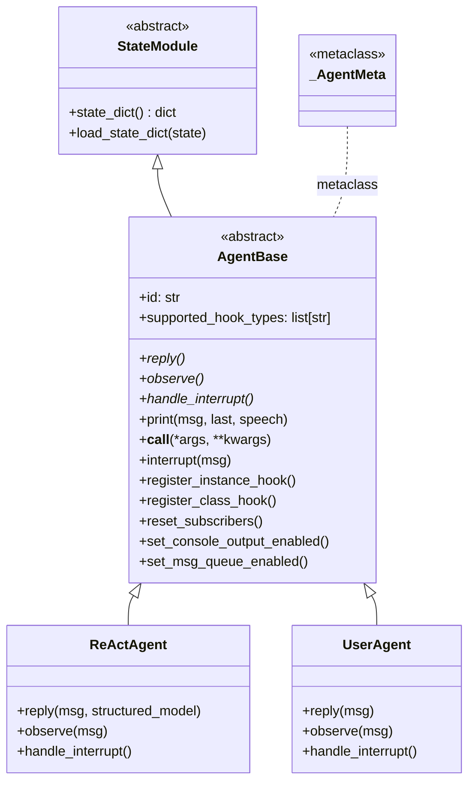
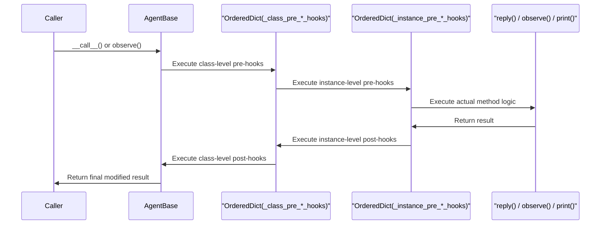
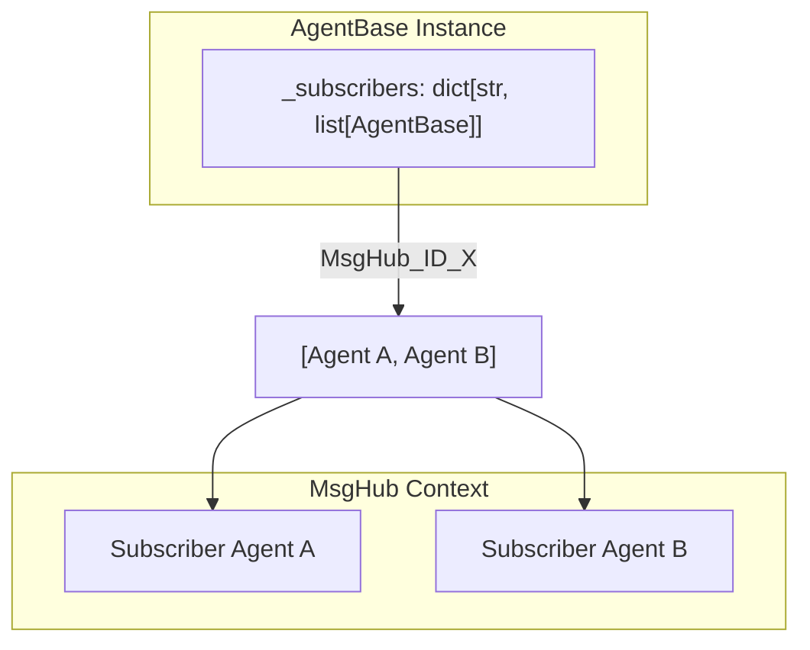
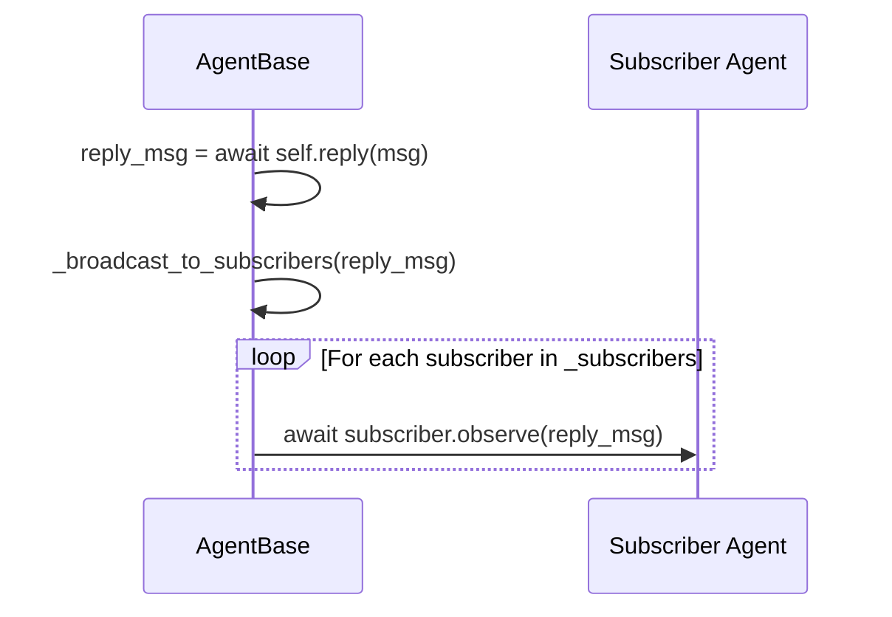
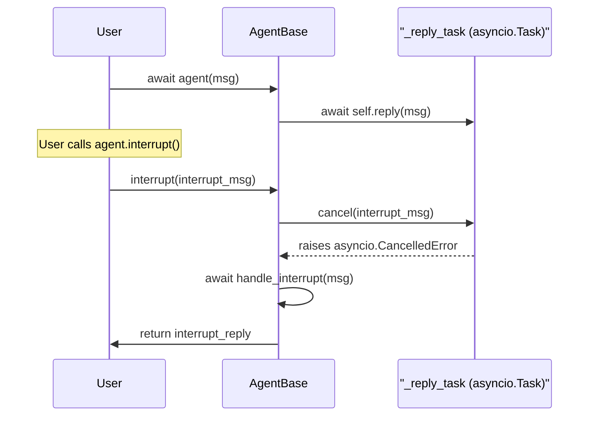

<!-- source: DeepWiki mcp.deepwiki.com · repo modelscope/agentscope · page 2.1 AgentBase Foundation · fetched 2026-10-26 -->

# AgentBase Foundation

<details>
<summary>Relevant source files</summary>

The following files were used as context for generating this wiki page:

- [src/agentscope/agent/_agent_base.py](src/agentscope/agent/_agent_base.py)
- [src/agentscope/pipeline/__init__.py](src/agentscope/pipeline/__init__.py)
- [src/agentscope/pipeline/_functional.py](src/agentscope/pipeline/_functional.py)
- [tests/pipeline_test.py](tests/pipeline_test.py)

</details>


This document describes the `AgentBase` class, which serves as the foundational abstract base class for all agents in AgentScope. It defines the core agent interface, provides the hook system for extensibility, implements the subscriber mechanism for multi-agent communication, and handles message printing and interruption.

For information about specific agent implementations like `ReActAgent`, see [ReActAgent Implementation](). For details on agent execution flow and lifecycle, see [Agent Lifecycle and Hooks]().

---

## Class Architecture

The `AgentBase` class is defined in [src/agentscope/agent/_agent_base.py:30-737]() and provides the abstract foundation for all agents in the framework. It inherits from `StateModule` to support state serialization and restoration.

### Inheritance Hierarchy



**Sources:** [src/agentscope/agent/_agent_base.py:30-30](), [src/agentscope/module/_state.py:1-40]()

### Key Attributes

The `AgentBase` class maintains several important instance attributes initialized in [src/agentscope/agent/_agent_base.py:140-184]():

| Attribute | Type | Purpose |
|-----------|------|---------|
| `id` | `str` | Unique agent identifier generated using `shortuuid.uuid()` [src/agentscope/agent/_agent_base.py:144-144]() |
| `_reply_task` | `Task \| None` | Current async reply task for interrupt handling [src/agentscope/agent/_agent_base.py:147-147]() |
| `_reply_id` | `str \| None` | Identifier for the current reply operation [src/agentscope/agent/_agent_base.py:148-148]() |
| `_subscribers` | `dict[str, list[AgentBase]]` | Subscribers indexed by MsgHub name [src/agentscope/agent/_agent_base.py:168-168]() |
| `_stream_prefix` | `dict` | Cached streaming data for text and audio blocks [src/agentscope/agent/_agent_base.py:163-163]() |
| `_disable_console_output` | `bool` | Controls whether to print messages to console [src/agentscope/agent/_agent_base.py:172-178]() |
| `_disable_msg_queue` | `bool` | Controls message queue for streaming [src/agentscope/agent/_agent_base.py:182-182]() |
| `msg_queue` | `Queue \| None` | Queue for exporting messages as a generator [src/agentscope/agent/_agent_base.py:183-183]() |

**Sources:** [src/agentscope/agent/_agent_base.py:140-184]()

---

## Core Abstract Methods

`AgentBase` defines three abstract methods that all agent implementations must override to participate in the framework's execution model.

### reply Method

The `reply` method contains the main logic of the agent, typically involving LLM calls or tool usage. It is defined at [src/agentscope/agent/_agent_base.py:197-203]():

```python
async def reply(self, *args: Any, **kwargs: Any) -> Msg:
    """The main logic of the agent, which generates a reply based on the
    current state and input arguments."""
    raise NotImplementedError(...)
```

**Sources:** [src/agentscope/agent/_agent_base.py:197-203]()

### observe Method

The `observe` method allows an agent to receive messages without generating a reply, often used to update internal memory. It is defined at [src/agentscope/agent/_agent_base.py:185-195]():

```python
async def observe(self, msg: Msg | list[Msg] | None) -> None:
    """Receive the given message(s) without generating a reply."""
    raise NotImplementedError(...)
```

**Sources:** [src/agentscope/agent/_agent_base.py:185-195]()

### handle_interrupt Method

This method handles post-processing when a reply is interrupted by the user or system. It is defined at [src/agentscope/agent/_agent_base.py:478-488]():

```python
async def handle_interrupt(self, *args: Any, **kwargs: Any) -> Msg:
    """The post-processing logic when the reply is interrupted."""
    raise NotImplementedError(...)
```

**Sources:** [src/agentscope/agent/_agent_base.py:478-488]()

---

## Hook System

`AgentBase` provides a comprehensive hook system allowing interception and modification of agent behavior at multiple points. The supported hook types are defined at [src/agentscope/agent/_agent_base.py:36-43]():

```python
supported_hook_types: list[str] = [
    "pre_reply", "post_reply", "pre_print", 
    "post_print", "pre_observe", "post_observe"
]
```

### Hook Architecture

Hooks are executed in a specific order: Class-level hooks first, followed by Instance-level hooks.



**Sources:** [src/agentscope/agent/_agent_base.py:36-138](), [src/agentscope/agent/_agent_base.py:150-158]()

### Hook Management

| Method | Scope | Purpose |
|--------|-------|---------|
| `register_class_hook()` | Class | Add a hook to all instances of the class [src/agentscope/agent/_agent_base.py:552-607]() |
| `register_instance_hook()` | Instance | Add a hook to a specific instance [src/agentscope/agent/_agent_base.py:495-550]() |
| `remove_class_hook()` | Class | Remove a class-level hook [src/agentscope/agent/_agent_base.py:609-623]() |
| `remove_instance_hook()` | Instance | Remove an instance-level hook [src/agentscope/agent/_agent_base.py:625-639]() |

**Sources:** [src/agentscope/agent/_agent_base.py:495-639]()

---

## Subscriber Mechanism

The subscriber mechanism enables the publish-subscribe pattern for multi-agent communication, allowing agents to automatically observe each other's replies within a shared context (e.g., a `MsgHub`).

### Subscriber Data Structure

The `_subscribers` dictionary at [src/agentscope/agent/_agent_base.py:165-168]() maps `MsgHub` identifiers to lists of agent instances that should receive broadcasted messages.



**Sources:** [src/agentscope/agent/_agent_base.py:165-168]()

### Broadcasting Flow

When an agent completes a reply, it automatically calls `_broadcast_to_subscribers` at [src/agentscope/agent/_agent_base.py:469-476](), which invokes the `observe` method of every registered subscriber.



**Sources:** [src/agentscope/agent/_agent_base.py:469-476]()

---

## Message Printing System

`AgentBase` implements a printing system that handles streaming messages, multimodal content (text, audio, thinking), and real-time display.

### print Method

The `print` method at [src/agentscope/agent/_agent_base.py:205-275]() handles message display. It supports streaming by using the `last` flag and can optionally play audio via the `speech` parameter.

| Parameter | Type | Purpose |
|-----------|------|---------|
| `msg` | `Msg` | The message object to be printed |
| `last` | `bool` | Whether this is the final chunk in a streaming message |
| `speech` | `AudioBlock \| list[AudioBlock] \| None` | Optional audio content for playback |

**Sources:** [src/agentscope/agent/_agent_base.py:205-275]()

### Streaming Cache

The `_stream_prefix` dictionary at [src/agentscope/agent/_agent_base.py:160-163]() caches partial streaming data (accumulated text and audio players) for each message ID to ensure smooth real-time updates.

**Sources:** [src/agentscope/agent/_agent_base.py:160-163]()

---

## Interrupt Handling

`AgentBase` supports interrupting ongoing agent replies, which is essential for human-in-the-loop intervention.

### interrupt Method

Defined at [src/agentscope/agent/_agent_base.py:490-493](), the `interrupt` method cancels the current `_reply_task` with an optional message.

```python
async def interrupt(self, msg: Msg | list[Msg] | None = None) -> None:
    """Interrupt the current reply process."""
    if self._reply_task and not self._reply_task.done():
        self._reply_task.cancel(msg)
```

**Sources:** [src/agentscope/agent/_agent_base.py:490-493]()

### Lifecycle of an Interruption

When a task is cancelled, `AgentBase.__call__` catches the `asyncio.CancelledError` and routes the execution to `handle_interrupt` at [src/agentscope/agent/_agent_base.py:448-467]().



**Sources:** [src/agentscope/agent/_agent_base.py:448-467]()

---

## Integration with Pipeline System

Agents are designed to be used within pipelines. The `__call__` method allows an agent instance to be invoked as an async function, which is the standard interface for all AgentScope pipelines.

### Functional Pipelines

The framework provides syntactic sugar for agent orchestration in [src/agentscope/pipeline/_functional.py]():

- **sequential_pipeline**: Executes agents in a chain where the output of one is the input to the next [src/agentscope/pipeline/_functional.py:10-44]().
- **fanout_pipeline**: Distributes the same message to multiple agents, executing them concurrently via `asyncio.gather` by default [src/agentscope/pipeline/_functional.py:47-104]().

### Stream Printing

The `stream_printing_messages` utility at [src/agentscope/pipeline/_functional.py:107-193]() enables real-time monitoring of agent execution by capturing messages sent to the agent's `msg_queue` (enabled via `set_msg_queue_enabled` [src/agentscope/agent/_agent_base.py:657-674]()).

**Sources:** [src/agentscope/pipeline/_functional.py:10-193](), [src/agentscope/agent/_agent_base.py:657-674]()

---

