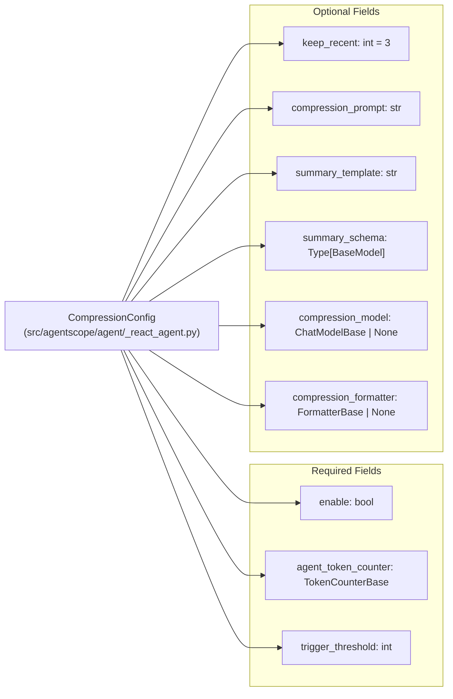
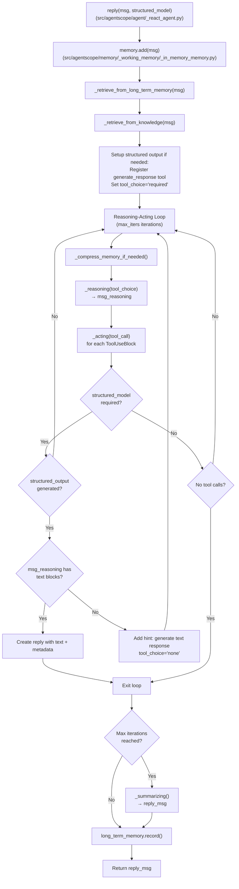
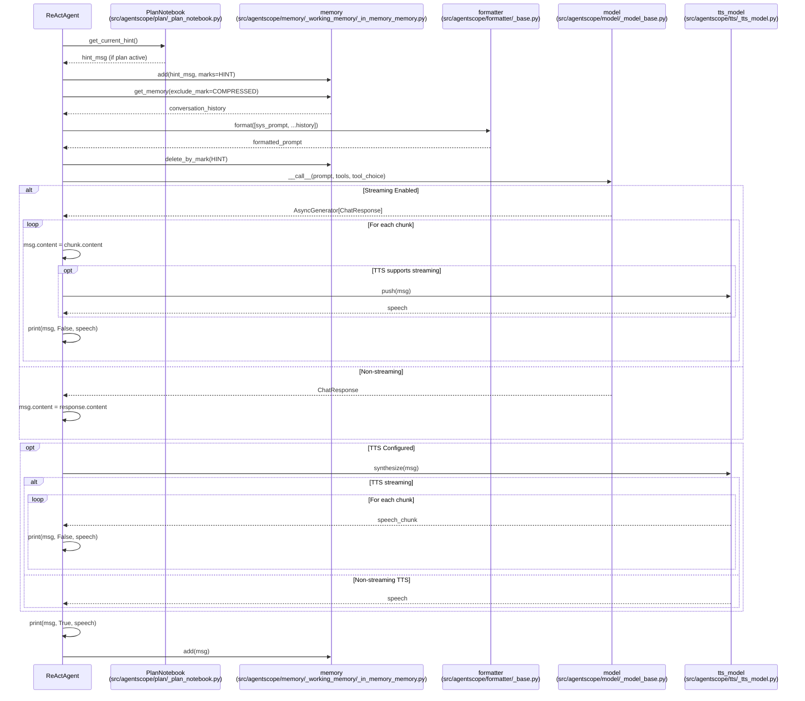
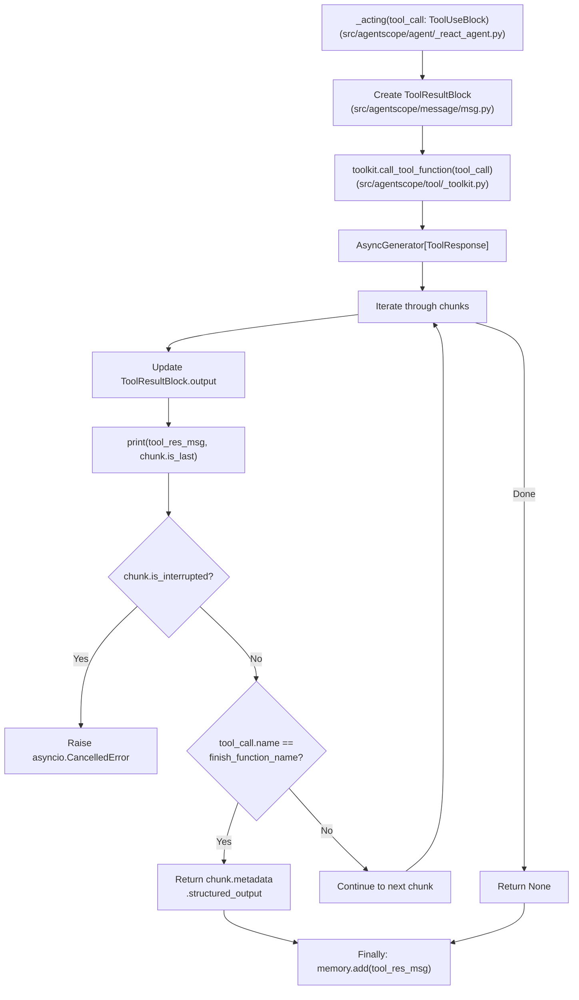
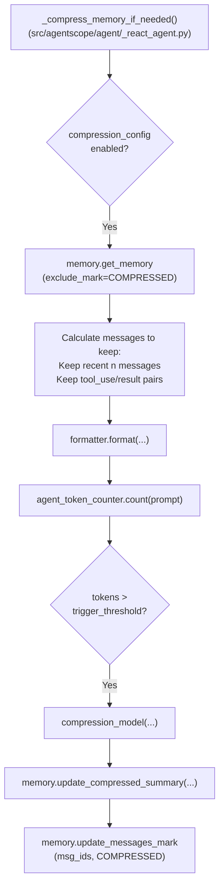

<!-- source: DeepWiki mcp.deepwiki.com · repo modelscope/agentscope · page 2.2 ReActAgent Implementation · fetched 2026-10-26 -->

# ReActAgent Implementation

<details>
<summary>Relevant source files</summary>

The following files were used as context for generating this wiki page:

- [src/agentscope/_utils/_common.py](src/agentscope/_utils/_common.py)
- [src/agentscope/agent/_react_agent.py](src/agentscope/agent/_react_agent.py)
- [src/agentscope/model/_anthropic_model.py](src/agentscope/model/_anthropic_model.py)
- [src/agentscope/model/_dashscope_model.py](src/agentscope/model/_dashscope_model.py)
- [src/agentscope/model/_gemini_model.py](src/agentscope/model/_gemini_model.py)
- [src/agentscope/model/_model_usage.py](src/agentscope/model/_model_usage.py)
- [src/agentscope/model/_ollama_model.py](src/agentscope/model/_ollama_model.py)
- [src/agentscope/model/_openai_model.py](src/agentscope/model/_openai_model.py)
- [tests/model_anthropic_test.py](tests/model_anthropic_test.py)
- [tests/model_dashscope_test.py](tests/model_dashscope_test.py)
- [tests/model_ollama_test.py](tests/model_ollama_test.py)
- [tests/model_openai_test.py](tests/model_openai_test.py)
- [tests/react_agent_test.py](tests/react_agent_test.py)

</details>


This page documents the `ReActAgent` class, the primary agent implementation in AgentScope that combines reasoning and acting in an iterative loop. `ReActAgent` integrates all major subsystems including tool calling, memory management, knowledge retrieval, planning, and structured output generation.

For the abstract agent interface, see [AgentBase Foundation](#2.1). For execution flow details, see [Agent Lifecycle and Hooks](#2.3). For memory systems used by ReActAgent, see [Working Memory Architecture](#5.1) and [Memory Compression](#5.2).

---

## Class Overview and Dependencies

`ReActAgent` is a comprehensive agent implementation that orchestrates multiple subsystems to implement the ReAct (Reasoning + Acting) pattern.

Title: ReActAgent Component Architecture
```mermaid
graph TB
    ReActAgent["ReActAgent<br/>(src/agentscope/agent/_react_agent.py)"]
    ReActAgentBase["ReActAgentBase<br/>(src/agentscope/agent/_react_agent_base.py)"]
    
    subgraph "Core Dependencies"
        ChatModelBase["ChatModelBase<br/>(src/agentscope/model/_model_base.py)"]
        FormatterBase["FormatterBase<br/>(src/agentscope/formatter/_base.py)"]
        MemoryBase["MemoryBase<br/>(src/agentscope/memory/_working_memory/_base.py)"]
        InMemoryMemory["InMemoryMemory<br/>(src/agentscope/memory/_working_memory/_in_memory_memory.py)"]
        Toolkit["Toolkit<br/>(src/agentscope/tool/_toolkit.py)"]
    end
    
    subgraph "Optional Dependencies"
        LongTermMemoryBase["LongTermMemoryBase<br/>(src/agentscope/memory/_long_term_memory/_base.py)"]
        KnowledgeBase["KnowledgeBase<br/>(src/agentscope/rag/_knowledge_base.py)"]
        PlanNotebook["PlanNotebook<br/>(src/agentscope/plan/_plan_notebook.py)"]
        TTSModelBase["TTSModelBase<br/>(src/agentscope/tts/_tts_model.py)"]
        CompressionConfig["ReActAgent.CompressionConfig<br/>(src/agentscope/agent/_react_agent.py)"]
    end
    
    ReActAgent -->|inherits| ReActAgentBase
    ReActAgent -->|uses| ChatModelBase
    ReActAgent -->|uses| FormatterBase
    ReActAgent -->|uses| Toolkit
    ReActAgent -->|uses| MemoryBase
    MemoryBase <|..|default| InMemoryMemory
    
    ReActAgent -.->|optional| LongTermMemoryBase
    ReActAgent -.->|optional| KnowledgeBase
    ReActAgent -.->|optional| PlanNotebook
    ReActAgent -.->|optional| TTSModelBase
    ReActAgent -.->|optional| CompressionConfig
```

**Sources:** [src/agentscope/agent/_react_agent.py:98-262](), [src/agentscope/agent/_react_agent_base.py:12-14]()

---

## Initialization Parameters

The `ReActAgent.__init__` method accepts a comprehensive set of parameters that configure all aspects of agent behavior.

### Core Parameters

| Parameter | Type | Default | Description |
|-----------|------|---------|-------------|
| `name` | `str` | Required | Agent identifier used in message attribution |
| `sys_prompt` | `str` | Required | System prompt defining agent behavior |
| `model` | `ChatModelBase` | Required | LLM for reasoning and response generation |
| `formatter` | `FormatterBase` | Required | Converts `Msg` objects to model-specific format |

### Tool and Memory Parameters

| Parameter | Type | Default | Description |
|-----------|------|---------|-------------|
| `toolkit` | `Toolkit \| None` | `None` | Tool registry; empty `Toolkit` created if not provided |
| `memory` | `MemoryBase \| None` | `None` | Short-term memory; `InMemoryMemory` created if not provided |
| `enable_meta_tool` | `bool` | `False` | Registers `reset_equipped_tools` for dynamic tool management |
| `parallel_tool_calls` | `bool` | `False` | Execute multiple tool calls concurrently vs. sequentially |

### Long-Term Memory Parameters

| Parameter | Type | Default | Description |
|-----------|------|---------|-------------|
| `long_term_memory` | `LongTermMemoryBase \| None` | `None` | Semantic memory across sessions |
| `long_term_memory_mode` | `Literal["agent_control", "static_control", "both"]` | `"both"` | Control mode for LTM operations |

**Long-term memory modes:**
- **`agent_control`**: Two tools (`retrieve_from_memory`, `record_to_memory`) registered for agent-driven memory management [src/agentscope/agent/_react_agent.py:293-296]()
- **`static_control`**: Automatic retrieval before each reply, recording after each reply [src/agentscope/agent/_react_agent.py:289-292]()
- **`both`**: Combines agent-controlled tools with automatic operations [src/agentscope/agent/_react_agent.py:286-288]()

### Knowledge and Planning Parameters

| Parameter | Type | Default | Description |
|-----------|------|---------|-------------|
| `knowledge` | `KnowledgeBase \| list[KnowledgeBase] \| None` | `None` | RAG knowledge bases for document retrieval |
| `enable_rewrite_query` | `bool` | `True` | LLM rewrites user queries before RAG retrieval |
| `plan_notebook` | `PlanNotebook \| None` | `None` | Task decomposition and plan management |

### Execution Control Parameters

| Parameter | Type | Default | Description |
|-----------|------|---------|-------------|
| `max_iters` | `int` | `10` | Maximum reasoning-acting loop iterations |
| `print_hint_msg` | `bool` | `False` | Display system hints (plan guidance, retrieval results) |

### Output and Compression Parameters

| Parameter | Type | Default | Description |
|-----------|------|---------|-------------|
| `tts_model` | `TTSModelBase \| None` | `None` | Text-to-speech model for audio generation |
| `compression_config` | `CompressionConfig \| None` | `None` | Automatic memory compression configuration |

**Sources:** [src/agentscope/agent/_react_agent.py:177-262]()

---

## CompressionConfig Structure

The nested `ReActAgent.CompressionConfig` class configures automatic memory compression to manage context window limits.

Title: CompressionConfig Data Structure


### Configuration Fields

| Field | Type | Description |
|-------|------|-------------|
| `enable` | `bool` | Master switch for compression feature |
| `agent_token_counter` | `TokenCounterBase` | Counts tokens to determine when to trigger compression [src/agentscope/agent/_react_agent.py:116-119]() |
| `trigger_threshold` | `int` | Token count threshold; compression activates when exceeded [src/agentscope/agent/_react_agent.py:120-123]() |
| `keep_recent` | `int` | Number of recent messages to preserve uncompressed (default: 3) [src/agentscope/agent/_react_agent.py:125-127]() |
| `compression_prompt` | `str` | Prompt instructing the LLM to generate summary [src/agentscope/agent/_react_agent.py:129-140]() |
| `summary_template` | `str` | String template formatting compressed summary [src/agentscope/agent/_react_agent.py:142-158]() |
| `summary_schema` | `Type[BaseModel]` | Pydantic model defining summary structure (default: `SummarySchema`) [src/agentscope/agent/_react_agent.py:160-162]() |
| `compression_model` | `ChatModelBase \| None` | Optional dedicated model for compression [src/agentscope/agent/_react_agent.py:164-166]() |
| `compression_formatter` | `FormatterBase \| None` | Formatter for compression model [src/agentscope/agent/_react_agent.py:168-171]() |

### Default SummarySchema

The default `SummarySchema` structures the compressed summary into five sections:

```python
class SummarySchema(BaseModel):
    task_overview: str          # User's core request, success criteria
    current_state: str          # What's completed, files modified, outputs
    important_discoveries: str  # Technical constraints, decisions, errors
    next_steps: str            # Specific actions needed, blockers
    context_to_preserve: str   # User preferences, domain details, promises
```

**Sources:** [src/agentscope/agent/_react_agent.py:107-172](), [src/agentscope/agent/_react_agent.py:43-86]()

---

## Reasoning-Acting Loop Architecture

The `reply` method implements the core ReAct loop that alternates between reasoning (LLM generation) and acting (tool execution).

Title: ReAct Execution Loop


### Loop Execution Flow

1. **Pre-Loop Setup** [src/agentscope/agent/_react_agent.py:396-426]()
   - Add input message(s) to memory.
   - Retrieve from long-term memory (if `static_control`).
   - Retrieve from knowledge bases (if configured).
   - Register `generate_response` tool if `structured_model` provided.

2. **Iteration Loop** [src/agentscope/agent/_react_agent.py:432-518]()
   - Compress memory if token threshold exceeded.
   - **Reasoning Phase**: Call LLM with formatted prompt and tool schemas.
   - **Acting Phase**: Execute tool calls (parallel or sequential based on `parallel_tool_calls`).
   - **Exit Conditions**:
     - Structured output satisfied with text response.
     - No structured output required and no tool calls made.

3. **Post-Loop Cleanup** [src/agentscope/agent/_react_agent.py:520-537]()
   - If max iterations reached, call `_summarizing` to generate final response.
   - Record conversation to long-term memory (if `static_control`).
   - Return final message with metadata.

**Sources:** [src/agentscope/agent/_react_agent.py:375-537]()

---

## Reasoning Phase Implementation

The `_reasoning` method handles LLM invocation with memory, planning hints, and tool schemas.

Title: Reasoning Phase Sequence


### Key Operations

1. **Planning Integration** [src/agentscope/agent/_react_agent.py:546-551]()
   - If `plan_notebook` configured, retrieves current hint message.
   - Hint provides contextual guidance based on plan state.
   - Added to memory with `_MemoryMark.HINT` and cleared after use.

2. **Memory Formatting** [src/agentscope/agent/_react_agent.py:554-566]()
   - Constructs prompt with system message and conversation history.
   - Excludes messages marked `COMPRESSED` if compression enabled.
   - Clears hint messages after formatting to prevent accumulation.

3. **Model Invocation** [src/agentscope/agent/_react_agent.py:568-572]()
   - Calls model with formatted prompt and tool schemas.
   - Passes `tool_choice` parameter to control tool calling behavior.

4. **Streaming and TTS** [src/agentscope/agent/_react_agent.py:578-622]()
   - Handles both streaming and non-streaming model responses.
   - Integrates TTS for audio generation if configured.
   - Extracts audio blocks from multimodal models.

5. **Interruption Handling** [src/agentscope/agent/_react_agent.py:623-652]()
   - Catches `asyncio.CancelledError` for user interruptions.
   - Ensures memory consistency even when interrupted.

**Sources:** [src/agentscope/agent/_react_agent.py:540-653]()

---

## Acting Phase Implementation

The `_acting` method executes individual tool calls and handles structured output validation.

Title: Acting Phase Execution


### Execution Details

1. **Tool Result Structure** [src/agentscope/agent/_react_agent.py:668-680]()
   - Creates `ToolResultBlock` with same `id` and `name` as tool call.

2. **Tool Execution** [src/agentscope/agent/_react_agent.py:682-693]()
   - Calls `toolkit.call_tool_function` which returns `AsyncGenerator[ToolResponse]`.
   - Each chunk updates the tool result output.

3. **Interruption Detection** [src/agentscope/agent/_react_agent.py:696-697]()
   - If `chunk.is_interrupted` is `True`, raises `asyncio.CancelledError`.

4. **Structured Output Extraction** [src/agentscope/agent/_react_agent.py:699-706]()
   - Checks if tool is `generate_response` (finish function).
   - Returns `structured_output` from metadata if validation succeeded.

5. **Memory Recording** [src/agentscope/agent/_react_agent.py:710-712]()
   - Tool result message added to memory in `finally` block.

**Sources:** [src/agentscope/agent/_react_agent.py:655-712]()

---

## Memory Compression System

The memory compression system automatically summarizes old conversation history when token limits approach.

Title: Memory Compression Workflow


### Compression Algorithm

1. **Recent Message Preservation** [src/agentscope/agent/_react_agent.py:1024-1049]()
   - Identifies `keep_recent` messages to exclude from compression.
   - Ensures paired tool_use/result messages are kept together.

2. **Token Counting** [src/agentscope/agent/_react_agent.py:1051-1062]()
   - Formats messages and counts tokens with `agent_token_counter`.
   - Compares against `trigger_threshold`.

3. **Summary Generation** [src/agentscope/agent/_react_agent.py:1072-1097]()
   - Uses `compression_model` and `summary_schema` to generate structured summary.

4. **Memory Update** [src/agentscope/agent/_react_agent.py:1108-1126]()
   - Updates `_compressed_summary` in memory.
   - Marks compressed messages with `_MemoryMark.COMPRESSED`.

**Sources:** [src/agentscope/agent/_react_agent.py:1011-1134](), [src/agentscope/agent/_react_agent.py:88-96]()

---

## Structured Output Generation

The `generate_response` method enables structured output through tool calling with Pydantic validation.

### Implementation Flow

1. **Tool Registration** [src/agentscope/agent/_react_agent.py:410-426]()
   - Registers `generate_response` method as a tool.
   - Calls `toolkit.set_extended_model` to associate the Pydantic model.
   - Sets `tool_choice="required"` to force the LLM to call a tool.

2. **Validation** [src/agentscope/agent/_react_agent.py:835-857]()
   - `generate_response` receives `**kwargs` from the tool call.
   - Calls `_required_structured_model.model_validate(kwargs)`.
   - Returns `ToolResponse` with `success=False` on `ValidationError`, including details for LLM correction.

3. **Output Extraction** [src/agentscope/agent/_react_agent.py:453-493]()
   - After successful validation, `_acting` returns the `structured_output`.
   - If reasoning message has text blocks, creates reply with metadata.

**Sources:** [src/agentscope/agent/_react_agent.py:825-876](), [src/agentscope/agent/_react_agent.py:173-175]()

---

## Knowledge Retrieval Integration

The `_retrieve_from_knowledge` method implements RAG (Retrieval-Augmented Generation) with optional query rewriting.

### Retrieval Process

1. **Query Extraction** [src/agentscope/agent/_react_agent.py:916-930]()
   - Extracts text content from input message(s).

2. **Query Rewriting** [src/agentscope/agent/_react_agent.py:932-972]()
   - If `enable_rewrite_query=True`, asks LLM to rewrite query using `_QueryRewriteModel`.

3. **Multi-KB Retrieval** [src/agentscope/agent/_react_agent.py:974-979]()
   - Calls `retrieve(query)` on each knowledge base.

4. **Result Formatting** [src/agentscope/agent/_react_agent.py:980-1009]()
   - Sorts documents by relevance score.
   - Creates message with `<retrieved_knowledge>` XML tags and adds to memory.

**Sources:** [src/agentscope/agent/_react_agent.py:904-1009](), [src/agentscope/agent/_react_agent.py:33-41]()

---

## State Management

`ReActAgent` implements the `StateModule` interface for serialization and checkpoint restoration.

### Registered State Variables

```python
self.register_state("name")
self.register_state("_sys_prompt")
```

Only `name` and `_sys_prompt` are registered as state variables. [src/agentscope/agent/_react_agent.py:362-374]()

### Dynamic sys_prompt Property

The `sys_prompt` property dynamically appends agent skill descriptions from the toolkit. [src/agentscope/agent/_react_agent.py:366-373]()

**Sources:** [src/agentscope/agent/_react_agent.py:362-374]()

---

