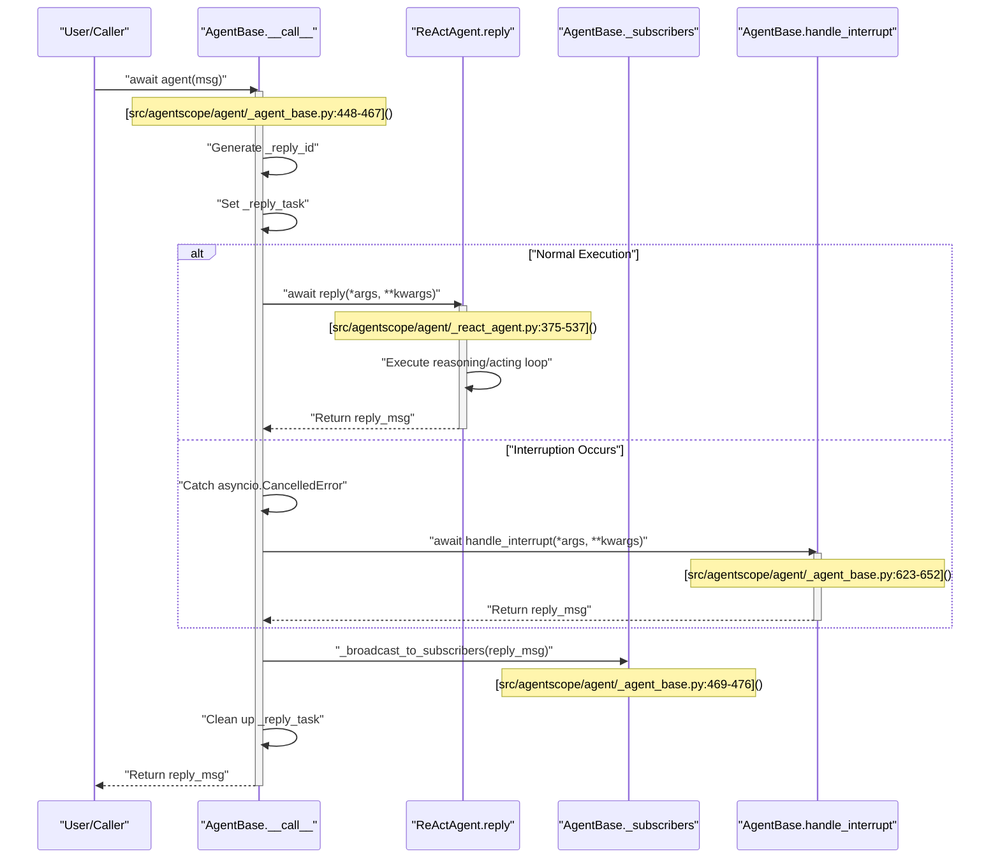
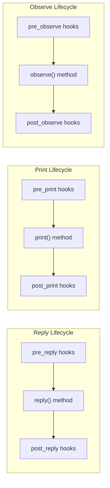
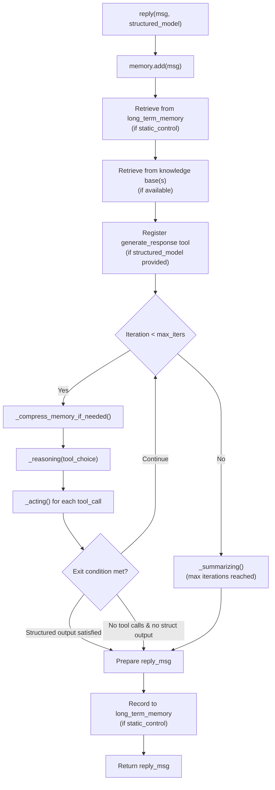
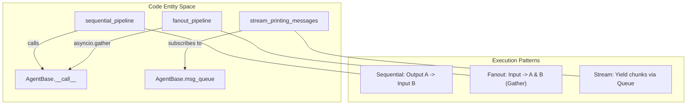

<!-- source: DeepWiki mcp.deepwiki.com · repo modelscope/agentscope · page 2.3 Agent Lifecycle and Hooks · fetched 2026-10-26 -->

# Agent Lifecycle and Hooks

Relevant source files

The following files were used as context for generating this wiki page:

- [docs/tutorial/en/src/task_embedding.py](docs/tutorial/en/src/task_embedding.py)
- [docs/tutorial/en/src/task_rag.py](docs/tutorial/en/src/task_rag.py)
- [docs/tutorial/zh_CN/src/task_embedding.py](docs/tutorial/zh_CN/src/task_embedding.py)
- [docs/tutorial/zh_CN/src/task_rag.py](docs/tutorial/zh_CN/src/task_rag.py)
- [examples/functionality/rag/README.md](examples/functionality/rag/README.md)
- [examples/functionality/rag/agentic_usage.py](examples/functionality/rag/agentic_usage.py)
- [examples/functionality/rag/basic_usage.py](examples/functionality/rag/basic_usage.py)
- [src/agentscope/agent/_agent_base.py](src/agentscope/agent/_agent_base.py)
- [src/agentscope/hooks/_studio_hooks.py](src/agentscope/hooks/_studio_hooks.py)
- [src/agentscope/pipeline/__init__.py](src/agentscope/pipeline/__init__.py)
- [src/agentscope/pipeline/_functional.py](src/agentscope/pipeline/_functional.py)
- [tests/pipeline_test.py](tests/pipeline_test.py)

This page documents the complete execution lifecycle of agents in AgentScope, from invocation through completion or interruption. It covers the asynchronous execution model, hook system, interrupt handling, message streaming, and the ReActAgent's reasoning-acting loop.

## Agent Invocation Pipeline

Every agent execution begins with the `__call__` method in `AgentBase`, which serves as the entry point for all agent interactions. This method orchestrates the complete lifecycle including task tracking, interrupt handling, and subscriber notification.

### Basic Execution Flow

The following diagram bridges the high-level agent invocation to the specific code entities involved in the lifecycle.

**Diagram: Agent Execution and Code Entity Mapping**

**Sources:** [src/agentscope/agent/_agent_base.py:448-467](), [src/agentscope/agent/_agent_base.py:140-184](), [src/agentscope/agent/_react_agent.py:375-537]()

### Agent State During Execution

| State Variable | Type | Purpose |
|---------------|------|---------|
| `id` | `str` | Unique identifier generated using `shortuuid` [src/agentscope/agent/_agent_base.py:144]() |
| `_reply_task` | `asyncio.Task \| None` | Current asyncio task being executed [src/agentscope/agent/_agent_base.py:147]() |
| `_reply_id` | `str \| None` | Unique identifier for the current reply session [src/agentscope/agent/_agent_base.py:148]() |
| `_stream_prefix` | `dict` | Tracks accumulated text and audio for streaming [src/agentscope/agent/_agent_base.py:163]() |
| `_subscribers` | `dict[str, list[AgentBase]]` | Subscribers grouped by MsgHub name [src/agentscope/agent/_agent_base.py:168]() |
| `msg_queue` | `asyncio.Queue \| None` | Queue for streaming message output [src/agentscope/agent/_agent_base.py:183]() |

**Sources:** [src/agentscope/agent/_agent_base.py:140-184]()

## Hook System Architecture

AgentScope provides a comprehensive hook system that allows interception and modification of agent behavior at critical execution points. Hooks exist at both class-level (affecting all instances) and instance-level (affecting only specific instances).

### Supported Hook Types

The `AgentBase` class defines six hook points in the execution lifecycle [src/agentscope/agent/_agent_base.py:36-43]():

**Sources:** [src/agentscope/agent/_agent_base.py:36-138]()

### Hook Execution Order

Hooks are executed in a specific order, with instance-level hooks running before class-level hooks. This is managed by the `register_class_hook` and `register_instance_hook` methods [src/agentscope/agent/_agent_base.py:495-607]().

| Hook Type | Execution Order | Input | Output |
|-----------|----------------|-------|--------|
| `pre_reply` | Instance → Class | `(self, kwargs_dict)` | Modified kwargs or None [src/agentscope/agent/_agent_base.py:46-61]() |
| `post_reply` | Instance → Class | `(self, kwargs, reply_msg)` | Modified reply_msg or None [src/agentscope/agent/_agent_base.py:63-79]() |
| `pre_print` | Instance → Class | `(self, kwargs_dict)` | Modified kwargs or None [src/agentscope/agent/_agent_base.py:81-93]() |
| `post_print` | Instance → Class | `(self, kwargs, output)` | Modified output or None [src/agentscope/agent/_agent_base.py:95-107]() |
| `pre_observe` | Instance → Class | `(self, kwargs_dict)` | Modified kwargs or None [src/agentscope/agent/_agent_base.py:109-124]() |
| `post_observe` | Instance → Class | `(self, kwargs, None)` | None [src/agentscope/agent/_agent_base.py:127-138]() |

### Studio Integration via Hooks

The `_studio_hooks.py` file demonstrates a practical use of hooks. For example, `as_studio_forward_message_pre_print_hook` intercepts the `print` call to forward messages to the AgentScope Studio UI via HTTP POST [src/agentscope/hooks/_studio_hooks.py:12-45](). It handles retries and graceful degradation if the Studio is unreachable [src/agentscope/hooks/_studio_hooks.py:47-58]().

**Sources:** [src/agentscope/agent/_agent_base.py:46-138](), [src/agentscope/hooks/_studio_hooks.py:12-59]()

## ReActAgent Reply Lifecycle

The `ReActAgent.reply` method implements the complete reasoning-acting loop pattern. It executes multiple phases in sequence: memory retrieval, reasoning, acting, and post-processing.

### Complete Reply Flow

**Sources:** [src/agentscope/agent/_react_agent.py:375-537]()

### Reasoning Phase (`_reasoning`)

In the `_reasoning` phase, the agent generates a response using its LLM. It includes inserting hints from the `PlanNotebook` [src/agentscope/agent/_react_agent.py:540-555](), retrieving memory while excluding compressed segments [src/agentscope/agent/_react_agent.py:557-562](), and calling the model with optional streaming [src/agentscope/agent/_react_agent.py:576-630]().

### Acting Phase (`_acting`)

The `_acting` phase handles tool execution. It creates a `ToolUseBlock` for the call and a `ToolResultBlock` for the output [src/agentscope/agent/_react_agent.py:657-662](). It executes the tool via the `toolkit` and processes results, which may include multimodal content [src/agentscope/agent/_react_agent.py:666-708]().

**Sources:** [src/agentscope/agent/_react_agent.py:540-712]()

## Interrupt Handling

Agents can be interrupted during their execution task. `AgentBase` captures `asyncio.CancelledError` and delegates to `handle_interrupt` [src/agentscope/agent/_agent_base.py:456-460]().

### Interrupt Mechanism

The `interrupt` method cancels the active `_reply_task` [src/agentscope/agent/_agent_base.py:490-493](). In `ReActAgent`, this triggers cleanup logic that ensures partial tool results are recorded to memory before the agent returns an interruption message [src/agentscope/agent/_react_agent.py:632-652]().

**Sources:** [src/agentscope/agent/_agent_base.py:490-493](), [src/agentscope/agent/_agent_base.py:623-652](), [src/agentscope/agent/_react_agent.py:795-823]()

## Pipeline Execution Flow

Pipelines provide structured ways to execute multiple agents, leveraging the underlying lifecycle hooks and message queues.

**Diagram: Pipeline to Code Entity Space**

### Stream Printing Messages

The `stream_printing_messages` utility allows consumers to asynchronously iterate over message chunks as they are generated [src/agentscope/pipeline/_functional.py:107-157](). It enables the message queue on participating agents via `set_msg_queue_enabled` and yields tuples containing the message and a boolean indicating if it is the last chunk [src/agentscope/pipeline/_functional.py:161-188]().

**Sources:** [src/agentscope/pipeline/_functional.py:10-193](), [tests/pipeline_test.py:147-240]()

---

