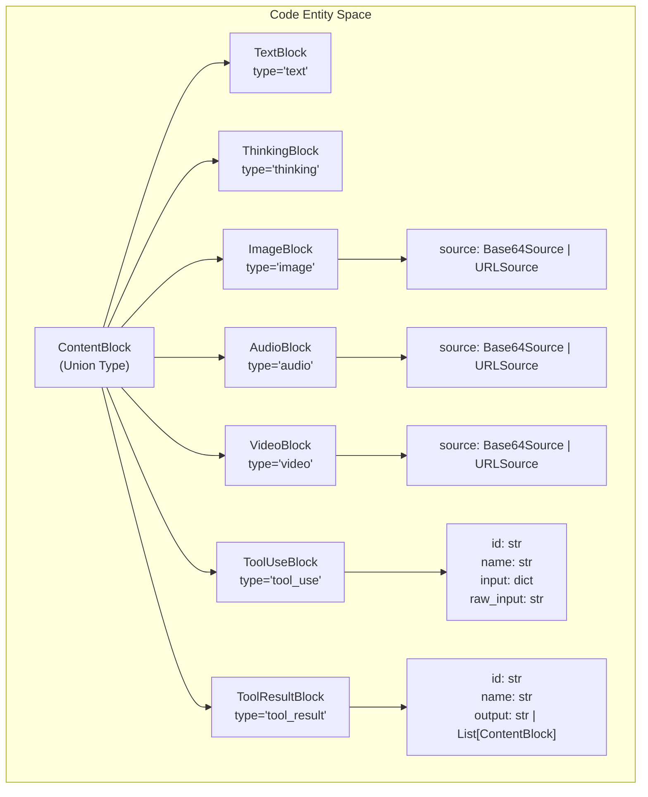
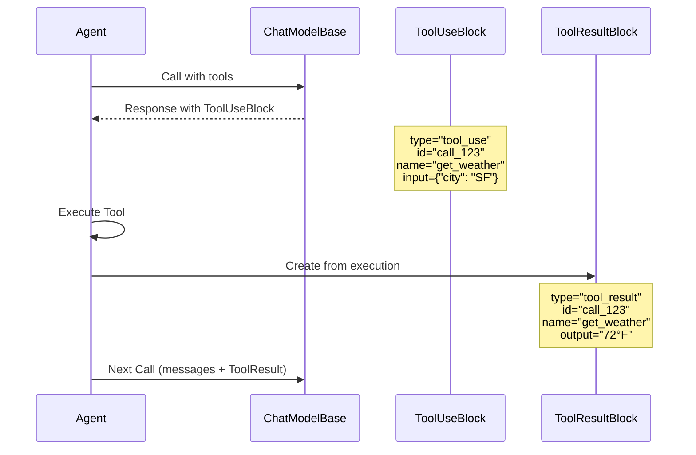
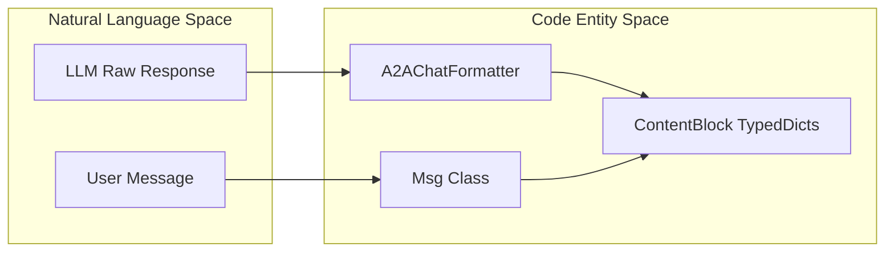

<!-- source: DeepWiki mcp.deepwiki.com · repo modelscope/agentscope · page 2.4 Message Protocol and Content Blocks · fetched 2026-10-26 -->

# Message Protocol and Content Blocks

Relevant source files

The following files were used as context for generating this wiki page:

- [examples/game/werewolves/structured_model.py](examples/game/werewolves/structured_model.py)
- [src/agentscope/message/_message_base.py](src/agentscope/message/_message_base.py)
- [src/agentscope/message/_message_block.py](src/agentscope/message/_message_block.py)
- [tests/formatter_a2a_test.py](tests/formatter_a2a_test.py)

This document describes the message protocol in AgentScope, focusing on the content block system that enables structured, multimodal communication between agents, models, and tools. Content blocks provide a unified internal representation for text, thinking/reasoning, images, audio, video, tool calls, and tool results.

## Overview

AgentScope uses a content block architecture to represent different types of message content in a structured, type-safe manner. Each content block is a `TypedDict` with a required `type` field that identifies its purpose. This design enables:

- **Multimodal support**: Seamless handling of text, images, audio, and video via standardized source types [src/agentscope/message/_message_block.py:49-77]().
- **Tool integration**: Structured representation of tool calls (`ToolUseBlock`) and results (`ToolResultBlock`) [src/agentscope/message/_message_block.py:79-107]().
- **Reasoning transparency**: Explicit tracking of model thinking/reasoning through `ThinkingBlock` [src/agentscope/message/_message_block.py:18-24]().
- **Provider abstraction**: Unified internal format across different LLM APIs.

All content blocks are defined in [src/agentscope/message/_message_block.py:1-129]().

**Sources**: [src/agentscope/message/_message_block.py:1-129]()

## Content Block Type System

**Content Block Type Hierarchy**

The `ContentBlock` union type [src/agentscope/message/_message_block.py:110-118]() encompasses all block types, and the `ContentBlockTypes` literal [src/agentscope/message/_message_block.py:120-128]() defines valid type strings. This type system enables static type checking while maintaining flexibility for multimodal content.

**Sources**: [src/agentscope/message/_message_block.py:110-128]()

## Text and Thinking Blocks

### TextBlock

The `TextBlock` represents standard textual content from users, agents, or models.

| Field | Type | Required | Description |
|-------|------|----------|-------------|
| `type` | `Literal["text"]` | Yes | Block type identifier |
| `text` | `str` | Yes | The text content |

**Sources**: [src/agentscope/message/_message_block.py:9-16]()

### ThinkingBlock

The `ThinkingBlock` captures internal reasoning or thinking processes from models that support this feature (e.g., Qwen, DeepSeek-R1, Gemini, Claude).

| Field | Type | Required | Description |
|-------|------|----------|-------------|
| `type` | `Literal["thinking"]` | Yes | Block type identifier |
| `thinking` | `str` | Yes | The reasoning content |

**Sources**: [src/agentscope/message/_message_block.py:18-24]()

## Media Source Types

Multimodal content blocks (images, audio, video) reference media through two source types:

### Base64Source

Inline base64-encoded media data following RFC 2397 format.

| Field | Type | Required | Description |
|-------|------|----------|-------------|
| `type` | `Literal["base64"]` | Yes | Source type identifier |
| `media_type` | `str` | Yes | MIME type (e.g., `"image/jpeg"`, `"audio/wav"`) |
| `data` | `str` | Yes | Base64-encoded data string |

**Sources**: [src/agentscope/message/_message_block.py:26-37]()

### URLSource

Reference to media stored at a URL (local file path or web URL).

| Field | Type | Required | Description |
|-------|------|----------|-------------|
| `type` | `Literal["url"]` | Yes | Source type identifier |
| `url` | `str` | Yes | File path or HTTP(S) URL |

**Sources**: [src/agentscope/message/_message_block.py:39-47]()

## Multimodal Content Blocks

### ImageBlock, AudioBlock, and VideoBlock

These blocks represent multimodal content in messages.

| Block Type | Required `type` | Field | Source Type |
|------------|-----------------|-------|-------------|
| `ImageBlock` | `"image"` | `source` | `Base64Source \| URLSource` |
| `AudioBlock` | `"audio"` | `source` | `Base64Source \| URLSource` |
| `VideoBlock` | `"video"` | `source` | `Base64Source \| URLSource` |

**Sources**: [src/agentscope/message/_message_block.py:49-77]()

## Tool Interaction Blocks

**Tool Call and Result Flow**

### ToolUseBlock

Represents a tool call request from a model.

| Field | Type | Required | Description |
|-------|------|----------|-------------|
| `type` | `Literal["tool_use"]` | Yes | Block type identifier |
| `id` | `str` | Yes | Unique identifier for the tool call |
| `name` | `str` | Yes | Name of the tool function |
| `input` | `dict[str, object]` | Yes | Parsed JSON arguments for the tool |
| `raw_input` | `str` | No | Original string from API |

**Sources**: [src/agentscope/message/_message_block.py:79-92]()

### ToolResultBlock

Represents the result of executing a tool function.

| Field | Type | Required | Description |
|-------|------|----------|-------------|
| `type` | `Literal["tool_result"]` | Yes | Block type identifier |
| `id` | `str` | Yes | Matches the `id` from corresponding `ToolUseBlock` |
| `name` | `str` | Yes | Name of the tool function |
| `output` | `str \| List[TextBlock \| ImageBlock \| AudioBlock \| VideoBlock]` | Yes | Tool execution result |

**Sources**: [src/agentscope/message/_message_block.py:94-107]()

## The Msg Object

The `Msg` class is the primary container for messages in AgentScope. It can contain a simple string or a sequence of `ContentBlock` objects.

| Method | Role | Citation |
|--------|------|----------|
| `__init__` | Initializes with name, role, and content (string or blocks) | [src/agentscope/message/_message_base.py:24-50]() |
| `to_dict` / `from_dict` | Serialization and deserialization of message objects | [src/agentscope/message/_message_base.py:75-99]() |
| `get_content_blocks` | Extracts specific block types from content | [src/agentscope/message/_message_base.py:198-230]() |
| `get_text_content` | Concatenates all `TextBlock` content into a single string | [src/agentscope/message/_message_base.py:123-147]() |
| `has_content_blocks` | Checks if specific block types exist in the message | [src/agentscope/message/_message_base.py:101-121]() |

**Sources**: [src/agentscope/message/_message_base.py:21-230]()

## Response Parsing Architecture

Each model wrapper and formatter is responsible for converting raw API responses into `Msg` objects or standardized structures containing `ContentBlock` instances. For example, the `A2AChatFormatter` maps various block types (Thinking, ToolUse, Image, etc.) between AgentScope and the A2A protocol [tests/formatter_a2a_test.py:41-96]().

**Sources**: [src/agentscope/message/_message_base.py:21-32](), [tests/formatter_a2a_test.py:41-96]()

---

