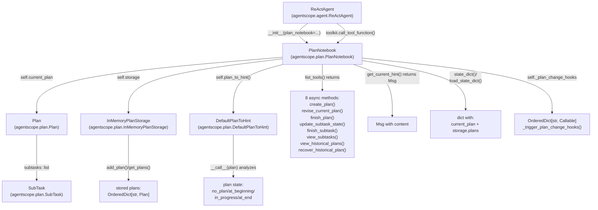
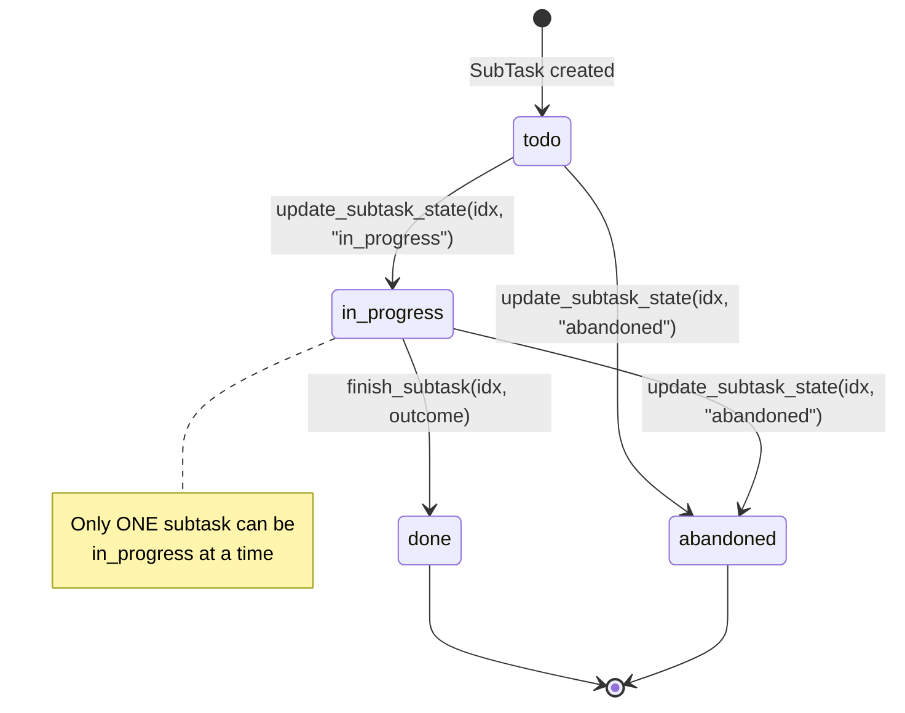
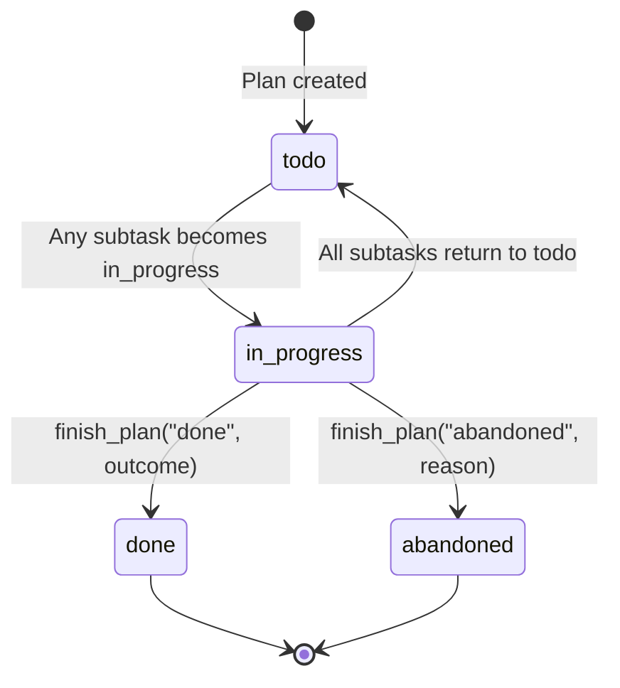
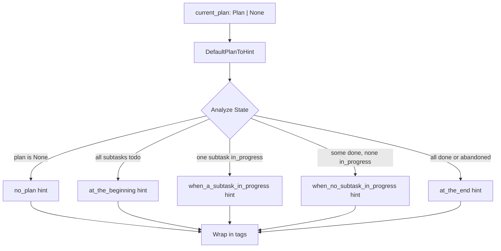

<!-- source: DeepWiki mcp.deepwiki.com · repo modelscope/agentscope · page 2.5 Planning System with PlanNotebook · fetched 2026-10-26 -->

# Planning System with PlanNotebook

<details>
<summary>Relevant source files</summary>

The following files were used as context for generating this wiki page:

- [docs/tutorial/_static/images/plan.png](docs/tutorial/_static/images/plan.png)
- [docs/tutorial/en/src/quickstart_agent.py](docs/tutorial/en/src/quickstart_agent.py)
- [docs/tutorial/en/src/task_plan.py](docs/tutorial/en/src/task_plan.py)
- [docs/tutorial/zh_CN/src/quickstart_agent.py](docs/tutorial/zh_CN/src/quickstart_agent.py)
- [docs/tutorial/zh_CN/src/task_plan.py](docs/tutorial/zh_CN/src/task_plan.py)
- [examples/functionality/plan/README.md](examples/functionality/plan/README.md)
- [examples/functionality/plan/main_agent_managed_plan.py](examples/functionality/plan/main_agent_managed_plan.py)
- [src/agentscope/plan/_in_memory_storage.py](src/agentscope/plan/_in_memory_storage.py)
- [src/agentscope/plan/_plan_model.py](src/agentscope/plan/_plan_model.py)
- [src/agentscope/plan/_plan_notebook.py](src/agentscope/plan/_plan_notebook.py)
- [tests/plan_test.py](tests/plan_test.py)
- [tests/toolkit_basic_test.py](tests/toolkit_basic_test.py)
- [tests/toolkit_meta_tool_test.py](tests/toolkit_meta_tool_test.py)

</details>


## Purpose and Scope

The Planning System provides task decomposition and plan management capabilities for agents tackling complex, multi-step tasks. It enables agents to break down high-level goals into manageable, sequential subtasks, track execution progress, and receive contextual guidance throughout the process.

This document covers the `PlanNotebook` class, which serves as the central management interface for plans, and its integration with agents (particularly `ReActAgent`).

**Key capabilities:**
- Structured task decomposition into sequential subtasks [src/agentscope/plan/_plan_model.py:11-130]().
- State tracking for plans and subtasks (todo, in_progress, done, abandoned) [src/agentscope/plan/_plan_model.py:38-41]().
- Tool functions for plan manipulation (create, revise, finish) [src/agentscope/plan/_plan_notebook.py:232-818]().
- Dynamic hint generation to guide agent execution [src/agentscope/plan/_plan_notebook.py:16-170]().
- Historical plan storage and recovery [src/agentscope/plan/_in_memory_storage.py:9-71]().
- Serializable state for checkpoint/restore via `StateModule` [src/agentscope/plan/_plan_notebook.py:172-193]().

Sources: [src/agentscope/plan/_plan_notebook.py:172-193](), [src/agentscope/plan/_plan_model.py:11-130](), [tests/plan_test.py:1-11]()

---

## Core Concepts

### Plan and SubTask Models

The planning system uses two primary data models defined as Pydantic `BaseModel` classes:

| Model | Description | Key Fields |
|-------|-------------|------------|
| `SubTask` | Individual executable step in a plan | `name`, `description`, `expected_outcome`, `state`, `outcome`, `created_at`, `finished_at` |
| `Plan` | Container for sequential subtasks | `id`, `name`, `description`, `expected_outcome`, `subtasks`, `state`, `created_at`, `finished_at`, `outcome` |

**State Values:**
- `"todo"`: Not yet started [src/agentscope/plan/_plan_model.py:40]().
- `"in_progress"`: Currently being executed [src/agentscope/plan/_plan_model.py:38]().
- `"done"`: Successfully completed [src/agentscope/plan/_plan_model.py:54]().
- `"abandoned"`: Discontinued or skipped [src/agentscope/plan/_plan_model.py:38]().

Title: Planning Data Models Structure

```mermaid
graph TB
    Plan["Plan<br/>BaseModel"]
    SubTask["SubTask<br/>BaseModel"]
    
    Plan -->|"contains list of"| SubTask
    
    subgraph "Plan Fields"
        PlanID["id: str"]
        PlanName["name: str"]
        PlanDesc["description: str"]
        PlanExpected["expected_outcome: str"]
        PlanSubtasks["subtasks: list[SubTask]"]
        PlanState["state: Literal"]
        PlanCreated["created_at: str"]
        PlanFinished["finished_at: str | None"]
        PlanOutcome["outcome: str | None"]
    end
    
    subgraph "SubTask Fields"
        SubName["name: str"]
        SubDesc["description: str"]
        SubExpected["expected_outcome: str"]
        SubOutcome["outcome: str | None"]
        SubState["state: Literal"]
        SubCreated["created_at: str"]
        SubFinished["finished_at: str | None"]
    end
    
    Plan -.-> PlanID
    Plan -.-> PlanName
    Plan -.-> PlanDesc
    Plan -.-> PlanExpected
    Plan -.-> PlanSubtasks
    Plan -.-> PlanState
    Plan -.-> PlanCreated
    Plan -.-> PlanFinished
    Plan -.-> PlanOutcome
    
    SubTask -.-> SubName
    SubTask -.-> SubDesc
    SubTask -.-> SubExpected
    SubTask -.-> SubOutcome
    SubTask -.-> SubState
    SubTask -.-> SubCreated
    SubTask -.-> SubFinished
```


Sources: [src/agentscope/plan/_plan_model.py:11-201]()

---

## Architecture Overview

The planning system consists of components that interact with agents through a tool-based interface.

Title: Planning System Code Entity Architecture


**Key code entity relationships:**
- `PlanNotebook` [src/agentscope/plan/_plan_notebook.py:172]() extends `StateModule` for `state_dict()`/`load_state_dict()` support.
- `ReActAgent` receives `PlanNotebook` instance in `__init__` and registers all 8 tool methods via `toolkit.register_tool_function()` [docs/tutorial/en/src/task_plan.py:146-151]().
- `DefaultPlanToHint.__call__()` [src/agentscope/plan/_plan_notebook.py:101]() generates contextual hints by analyzing `current_plan` state.
- `InMemoryPlanStorage` (default) stores plans in `self.plans: OrderedDict` with serialization via `StateModule` [src/agentscope/plan/_in_memory_storage.py:15-25]().
- `_trigger_plan_change_hooks()` [src/agentscope/plan/_plan_notebook.py:896]() executes registered hooks on every plan modification.

Sources: [src/agentscope/plan/_plan_notebook.py:172-224](), [src/agentscope/plan/_plan_model.py:11-201](), [src/agentscope/plan/_in_memory_storage.py:9-25](), [docs/tutorial/en/src/task_plan.py:146-151]()

---

## PlanNotebook Class

### Initialization Parameters

The `PlanNotebook` class is initialized with the following optional parameters [src/agentscope/plan/_plan_notebook.py:195-224]():

```python
PlanNotebook(
    max_subtasks: int | None = None,
    plan_to_hint: Callable[[Plan | None], str | None] | None = None,
    storage: PlanStorageBase | None = None,
)
```

| Parameter | Type | Default | Description |
|-----------|------|---------|-------------|
| `max_subtasks` | `int \| None` | `None` | Maximum number of subtasks allowed in a plan |
| `plan_to_hint` | `Callable` | `DefaultPlanToHint()` | Function to generate hints from current plan state |
| `storage` | `PlanStorageBase` | `InMemoryPlanStorage()` | Backend for storing historical plans |

Sources: [src/agentscope/plan/_plan_notebook.py:195-224]()

### Tool Functions Interface

`PlanNotebook` exposes eight async tool functions callable by LLMs through function calling [src/agentscope/plan/_plan_notebook.py:820-842]():

Title: PlanNotebook Tool Interface Methods

```mermaid
graph TB
    ListTools["PlanNotebook.list_tools()<br/>returns list of 8 callables"]
    
    subgraph "Plan Management"
        CreatePlan["async create_plan()<br/>[src/agentscope/plan/_plan_notebook.py:232]"]
        RevisePlan["async revise_current_plan()<br/>[src/agentscope/plan/_plan_notebook.py:303]"]
        FinishPlan["async finish_plan()<br/>[src/agentscope/plan/_plan_notebook.py:694]"]
    end
    
    subgraph "Subtask Operations"
        UpdateState["async update_subtask_state()<br/>[src/agentscope/plan/_plan_notebook.py:433]"]
        FinishSubtask["async finish_subtask()<br/>[src/agentscope/plan/_plan_notebook.py:548]"]
        ViewSubtasks["async view_subtasks()<br/>[src/agentscope/plan/_plan_notebook.py:653]"]
    end
    
    subgraph "Historical Plans"
        ViewHistory["async view_historical_plans()<br/>[src/agentscope/plan/_plan_notebook.py:739]"]
        RecoverPlan["async recover_historical_plan()<br/>[src/agentscope/plan/_plan_notebook.py:762]"]
    end
    
    ListTools --> CreatePlan
    ListTools --> RevisePlan
    ListTools --> FinishPlan
    ListTools --> UpdateState
    ListTools --> FinishSubtask
    ListTools --> ViewSubtasks
    ListTools --> ViewHistory
    ListTools --> RecoverPlan
```


Sources: [src/agentscope/plan/_plan_notebook.py:232-818](), [src/agentscope/plan/_plan_notebook.py:820-842](), [tests/plan_test.py:122-135]()

---

## Plan and SubTask State Transitions

### SubTask State Machine

Subtasks follow a sequential progression with validation constraints enforced in `update_subtask_state` [src/agentscope/plan/_plan_notebook.py:433-546]().

Title: SubTask State Machine


**Key constraints:**
1. **Sequential execution**: Cannot mark subtask N as `in_progress` if subtask N-1 is still `todo` or `in_progress` [src/agentscope/plan/_plan_notebook.py:469-480]().
2. **Single active subtask**: Only one subtask can be `in_progress` at any time [src/agentscope/plan/_plan_notebook.py:482-494]().
3. **Auto-activation**: When `finish_subtask()` is called, the next subtask is automatically set to `in_progress` [src/agentscope/plan/_plan_notebook.py:628-639]().

Sources: [src/agentscope/plan/_plan_notebook.py:433-651](), [tests/plan_test.py:242-276]()

### Plan State Management

Plan states are derived from subtask states via the `refresh_plan_state()` method [src/agentscope/plan/_plan_model.py:148-168]().

Title: Plan State Derivation Logic


Sources: [src/agentscope/plan/_plan_model.py:148-168](), [src/agentscope/plan/_plan_notebook.py:531-546]()

---

## Tool Functions in Detail

### Plan Creation and Revision

#### `create_plan(name, description, expected_outcome, subtasks)`
Creates a new plan or replaces the existing `current_plan` [src/agentscope/plan/_plan_notebook.py:232-293](). If `current_plan` exists, it is replaced and a warning is issued [src/agentscope/plan/_plan_notebook.py:270-275]().

#### `revise_current_plan(subtask_idx, action, subtask)`
Modifies the current plan via `"add"`, `"revise"`, or `"delete"` actions [src/agentscope/plan/_plan_notebook.py:303-431]().

### Subtask State Management

#### `update_subtask_state(subtask_idx, state)`
Updates subtask state with sequential execution validation [src/agentscope/plan/_plan_notebook.py:433-546]().

#### `finish_subtask(subtask_idx, subtask_outcome)`
Marks a subtask as done, records its outcome, and auto-activates the next subtask [src/agentscope/plan/_plan_notebook.py:548-651]().

Sources: [src/agentscope/plan/_plan_notebook.py:232-651](), [tests/plan_test.py:147-276]()

---

## Hint Generation System

### DefaultPlanToHint

The `DefaultPlanToHint` class generates contextual system hints wrapped in `<system-hint>` tags [src/agentscope/plan/_plan_notebook.py:16-170]().

Title: Hint Generation Logic


Sources: [src/agentscope/plan/_plan_notebook.py:16-170](), [src/agentscope/plan/_plan_notebook.py:844-863]()

---

## State Serialization

`PlanNotebook` extends `StateModule` to provide serialization support [src/agentscope/plan/_plan_notebook.py:172]().

**Serialized fields:**
- `storage`: Historical plans from `InMemoryPlanStorage` [src/agentscope/plan/_in_memory_storage.py:18-25]().
- `current_plan`: The active plan being executed [src/agentscope/plan/_plan_notebook.py:225-230]().

Sources: [src/agentscope/plan/_plan_notebook.py:225-230](), [src/agentscope/plan/_in_memory_storage.py:18-25](), [tests/plan_test.py:311-358]()

---

## Plan Change Hooks

`PlanNotebook` supports registering callbacks triggered on plan changes [src/agentscope/plan/_plan_notebook.py:176-183]().

- **Registration**: `register_plan_change_hook(hook_name, hook_func)` [src/agentscope/plan/_plan_notebook.py:865-885]().
- **Trigger**: `_trigger_plan_change_hooks()` is called in `create_plan`, `revise_current_plan`, `update_subtask_state`, `finish_subtask`, `finish_plan`, and `recover_historical_plan` [src/agentscope/plan/_plan_notebook.py:896-911]().

Sources: [src/agentscope/plan/_plan_notebook.py:176-183](), [src/agentscope/plan/_plan_notebook.py:865-911](), [tests/plan_test.py:767-784]()

---

