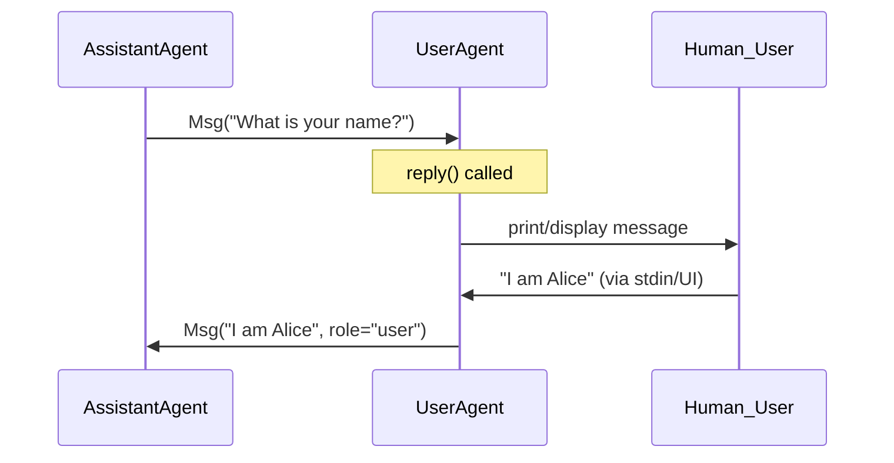

<!-- source: DeepWiki mcp.deepwiki.com · repo modelscope/agentscope · page 2.6 Realtime and UserAgent · fetched 2026-10-26 -->

# Realtime and UserAgent

<details>
<summary>Relevant source files</summary>

The following files were used as context for generating this wiki page:

- [docs/tutorial/en/build.sh](docs/tutorial/en/build.sh)
- [docs/tutorial/en/src/task_realtime.py](docs/tutorial/en/src/task_realtime.py)
- [docs/tutorial/zh_CN/build.sh](docs/tutorial/zh_CN/build.sh)
- [docs/tutorial/zh_CN/src/task_realtime.py](docs/tutorial/zh_CN/src/task_realtime.py)
- [examples/agent/realtime_voice_agent/README.md](examples/agent/realtime_voice_agent/README.md)
- [examples/agent/realtime_voice_agent/chatbot.html](examples/agent/realtime_voice_agent/chatbot.html)
- [examples/deployment/README.md](examples/deployment/README.md)
- [examples/deployment/planning_agent/README.md](examples/deployment/planning_agent/README.md)
- [examples/deployment/planning_agent/main.py](examples/deployment/planning_agent/main.py)
- [examples/deployment/planning_agent/test_post.py](examples/deployment/planning_agent/test_post.py)
- [src/agentscope/agent/_user_input.py](src/agentscope/agent/_user_input.py)
- [src/agentscope/realtime/_dashscope_realtime_model.py](src/agentscope/realtime/_dashscope_realtime_model.py)
- [src/agentscope/realtime/_events/_client_event.py](src/agentscope/realtime/_events/_client_event.py)
- [src/agentscope/realtime/_gemini_realtime_model.py](src/agentscope/realtime/_gemini_realtime_model.py)
- [src/agentscope/realtime/_openai_realtime_model.py](src/agentscope/realtime/_openai_realtime_model.py)
- [src/agentscope/tts/_openai_tts_model.py](src/agentscope/tts/_openai_tts_model.py)
- [tests/realtime_event_test.py](tests/realtime_event_test.py)

</details>


This page documents the components in AgentScope designed for low-latency, human-in-the-loop, and voice-based interactions. It covers the `RealtimeAgent` for streaming multimodal conversations and the `UserAgent` for standard human intervention in agentic workflows.

## Realtime Interaction System

The Realtime system in AgentScope is designed to handle bidirectional streaming of audio, text, and images. It bridges the gap between high-level agent logic and low-level WebSocket-based realtime model APIs (e.g., OpenAI Realtime, DashScope Omni, Gemini Live).

### RealtimeAgent Lifecycle and Data Flow

The `RealtimeAgent` acts as a stateful bridge. It manages a persistent WebSocket connection to a `RealtimeModelBase` implementation and translates between internal `ModelEvents` and external `ServerEvents`/`ClientEvents`.

**Key Responsibilities:**
- **Lifecycle Management**: Handling `start()` and `stop()` to initialize and teardown WebSocket connections [docs/tutorial/en/src/task_realtime.py:164-170]().
- **Event Translation**: Converting model-specific signals (like VAD start/end or audio deltas) into a unified protocol [docs/tutorial/en/src/task_realtime.py:175-178]().
- **Queue-based Handling**: Using an `outgoing_queue` (asyncio.Queue) to push events to the frontend or other agents without blocking the model connection [docs/tutorial/en/src/task_realtime.py:107-108]().

#### System Entity Mapping (Realtime)

The following diagram maps the conceptual interaction flow to the specific code entities involved in a Realtime session.

**Realtime Architecture Flow**
```mermaid
graph TD
    subgraph "Frontend (Web/App)"
        "chatbot.html" -- "ClientEvents" --> "FastAPI_Server"
    end

    subgraph "AgentScope Backend"
        "FastAPI_Server" -- "put()" --> "Incoming_Queue"
        "RealtimeAgent" -- "get()" --> "Incoming_Queue"
        "RealtimeAgent" -- "send()" --> "RealtimeModelBase"
        
        subgraph "Models"
            "RealtimeModelBase" <|-- "OpenAIRealtimeModel"
            "RealtimeModelBase" <|-- "DashScopeRealtimeModel"
            "RealtimeModelBase" <|-- "GeminiRealtimeModel"
        end
        
        "RealtimeModelBase" -- "ModelEvents" --> "Outgoing_Queue"
        "Outgoing_Queue" -- "ServerEvents" --> "FastAPI_Server"
    end

    subgraph "External API"
        "RealtimeModelBase" <== "WebSocket" ==> "Model_Provider_API"
    end
```
Sources: [src/agentscope/realtime/_base.py:19-21](), [docs/tutorial/en/src/task_realtime.py:23-30](), [examples/agent/realtime_voice_agent/chatbot.html:1-35]()

### Realtime Models and Protocols

AgentScope provides a unified interface for different realtime providers. While the underlying WebSocket protocols differ, they are abstracted into a common set of methods and events.

| Provider | Implementation Class | Supported Modalities | Tool Support |
| :--- | :--- | :--- | :--- |
| OpenAI | `OpenAIRealtimeModel` | Text, Audio | Yes |
| DashScope | `DashScopeRealtimeModel` | Text, Audio, Image | No |
| Gemini | `GeminiRealtimeModel` | Text, Audio, Image, Tool | Yes |

Sources: [docs/tutorial/en/src/task_realtime.py:42-61](), [src/agentscope/realtime/_openai_realtime_model.py:22-26](), [src/agentscope/realtime/_dashscope_realtime_model.py:23-28]()

#### Key Model Methods
- `connect(outgoing_queue, instructions, tools)`: Establishes the session and configures the model behavior [docs/tutorial/en/src/task_realtime.py:100-101]().
- `send(data)`: Transmits `AudioBlock`, `TextBlock`, or `ImageBlock` to the model [src/agentscope/realtime/_openai_realtime_model.py:151-160]().
- `parse_api_message(message)`: A provider-specific parser that turns raw WebSocket strings into `ModelEvents` [src/agentscope/realtime/_dashscope_realtime_model.py:209-212]().

### Event Protocols

The system uses three layers of events to maintain decoupling:

1.  **ModelEvents**: Internal events generated by the model wrappers (e.g., `ModelResponseAudioDeltaEvent`) [docs/tutorial/en/src/task_realtime.py:126-157]().
2.  **ServerEvents**: Events sent from the backend to the client (e.g., `AgentResponseAudioDeltaEvent`) [src/agentscope/realtime/_events/_server_event.py:1-20]().
3.  **ClientEvents**: Events sent from the client to the backend (e.g., `ClientAudioAppendEvent`, `ClientResponseCancelEvent`) [src/agentscope/realtime/_events/_client_event.py:12-43]().

Sources: [tests/realtime_event_test.py:20-46](), [src/agentscope/realtime/_events/_client_event.py:12-43]()

---

## UserAgent and Human-in-the-Loop

The `UserAgent` is a specialized agent class designed to represent a human user within a multi-agent conversation. Unlike autonomous agents, it blocks execution to wait for standard input or web-based input.

### Implementation and Behavior

The `UserAgent` overrides the `reply` method to facilitate human intervention.

**Execution Flow:**
1.  **Observation**: The agent receives messages from other agents via `observe()`.
2.  **Input Trigger**: When `reply()` is called, the agent prompts the user for input.
3.  **Content Construction**: The user's input is wrapped in a `Msg` object with the agent's name and the `user` role.

#### UserAgent Entity Interaction

Sources: [src/agentscope/agent/_user_input.py:1-20]() (Note: Class definition usually resides in `agentscope.agent.UserAgent`).

### Key Functions
- **`reply(x)`**: The primary entry point. It displays the message `x` to the user and waits for a response.
- **`input()`**: Depending on the environment (terminal vs. Studio), this captures the raw string or multimodal data from the human.

Sources: [src/agentscope/agent/_user_input.py:1-20]()

## Comparison: Realtime vs. UserAgent

| Feature | RealtimeAgent | UserAgent |
| :--- | :--- | :--- |
| **Interaction Mode** | Streaming (Full-duplex) | Turn-based (Request-Response) |
| **Input Source** | WebSocket / Audio Stream | Standard Input / Web UI |
| **Latency** | Low (Real-time) | High (Human speed) |
| **Modality** | Audio, Text, Image, Video | Primarily Text (Multimodal via Studio) |
| **Primary Use Case** | Voice assistants, Live chat | Human-in-the-loop, Debugging |

Sources: [docs/tutorial/en/src/task_realtime.py:8-15](), [examples/agent/realtime_voice_agent/README.md:1-4]()

---

