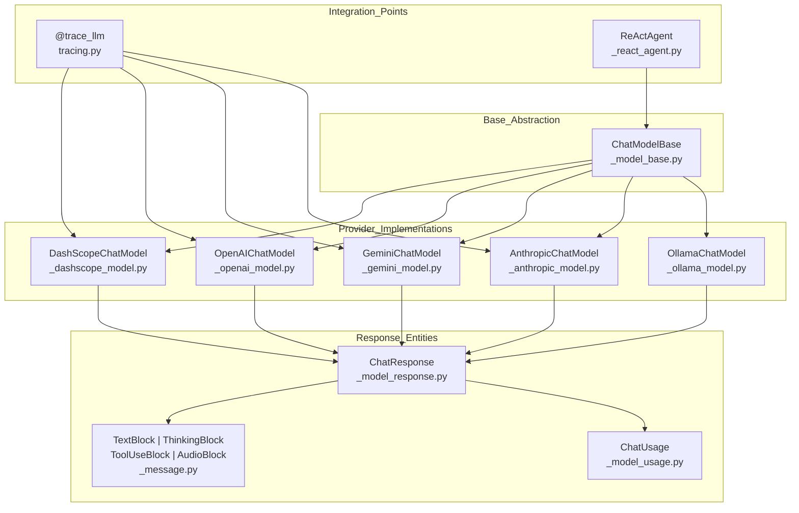
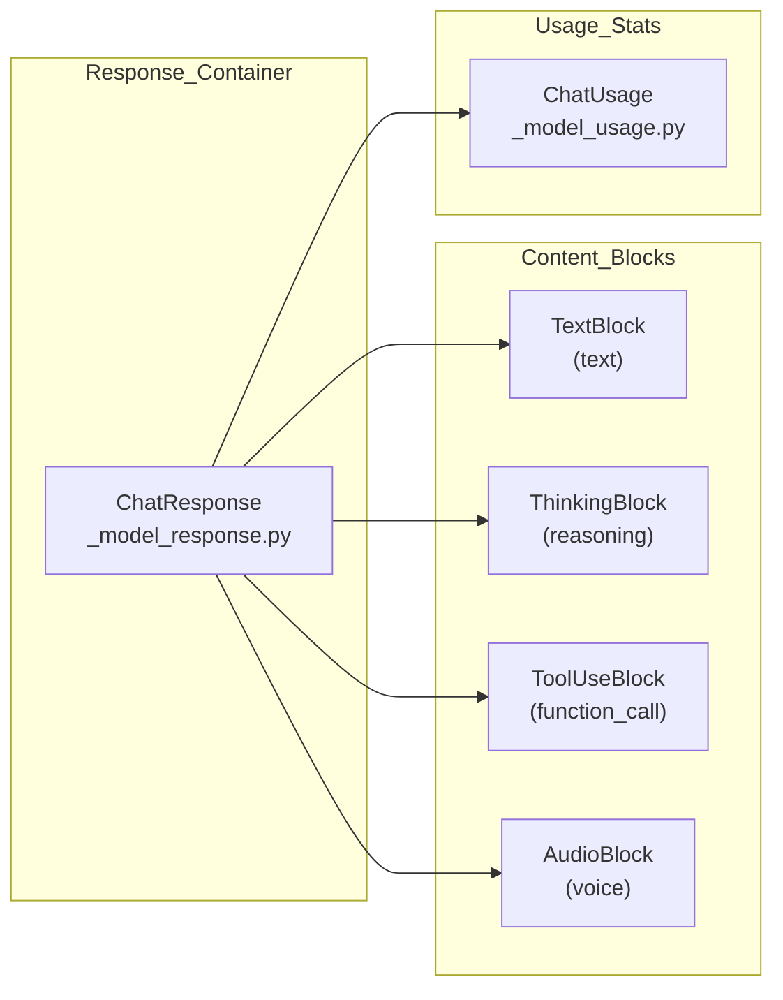

<!-- source: DeepWiki mcp.deepwiki.com · repo modelscope/agentscope · page 3 Model Integration · fetched 2026-10-26 -->

# Model Integration

Relevant source files

The following files were used as context for generating this wiki page:

- [src/agentscope/_utils/_common.py](src/agentscope/_utils/_common.py)
- [src/agentscope/agent/_react_agent.py](src/agentscope/agent/_react_agent.py)
- [src/agentscope/model/_anthropic_model.py](src/agentscope/model/_anthropic_model.py)
- [src/agentscope/model/_dashscope_model.py](src/agentscope/model/_dashscope_model.py)
- [src/agentscope/model/_gemini_model.py](src/agentscope/model/_gemini_model.py)
- [src/agentscope/model/_model_usage.py](src/agentscope/model/_model_usage.py)
- [src/agentscope/model/_ollama_model.py](src/agentscope/model/_ollama_model.py)
- [src/agentscope/model/_openai_model.py](src/agentscope/model/_openai_model.py)
- [tests/model_anthropic_test.py](tests/model_anthropic_test.py)
- [tests/model_dashscope_test.py](tests/model_dashscope_test.py)
- [tests/model_ollama_test.py](tests/model_ollama_test.py)
- [tests/model_openai_test.py](tests/model_openai_test.py)

## Purpose and Scope

This document describes AgentScope's model integration layer, which provides a unified interface for interacting with multiple Large Language Model (LLM) providers. The integration layer abstracts provider-specific API differences while exposing common capabilities like tool calling, streaming, structured output, and multimodal content.

For information about how agents use these models, see [Agent System](#2). For details on message formatting and content blocks, see [Message Protocol and Content Blocks](#2.4). For tool integration with models, see [Tool System](#4).

## Architecture Overview

AgentScope implements a provider abstraction pattern where all LLM integrations inherit from `ChatModelBase` and implement a unified `__call__` interface. Each provider handles its own API communication, response parsing, and feature mapping while presenting a consistent interface to agents.

### Core Model Hierarchy

The diagram below maps the relationship between the base abstraction and specific provider implementations.

**Sources:** [src/agentscope/model/_dashscope_model.py:51-51](), [src/agentscope/model/_openai_model.py:70-70](), [src/agentscope/model/_gemini_model.py:115-115](), [src/agentscope/model/_anthropic_model.py:40-40](), [src/agentscope/model/_ollama_model.py:33-33](), [src/agentscope/agent/_react_agent.py:181-181]()

### ChatModelBase Interface

All model implementations inherit from `ChatModelBase` and implement the following interface:

| Method | Signature | Description |
|--------|-----------|-------------|
| `__call__` | `async (messages, tools, tool_choice, structured_model, **kwargs)` | Core method for model invocation |
| `_format_tools_json_schemas` | `(tools: list[dict]) -> list[dict]` | Convert tools to provider format |
| `_format_tool_choice` | `(tool_choice: str) -> dict \| str \| None` | Convert tool_choice to provider format |

All `__call__` methods are decorated with `@trace_llm` for observability integration.

**Sources:** [src/agentscope/model/_dashscope_model.py:162-170](), [src/agentscope/model/_openai_model.py:173-181](), [src/agentscope/model/_gemini_model.py:201-209](), [src/agentscope/model/_anthropic_model.py:136-144]()

## Provider Implementations

### DashScope Integration

The `DashScopeChatModel` class provides integration with Alibaba's DashScope API, supporting both text-only (Generation API) and multimodal (MultiModalConversation API) endpoints.

**Key Features:**

- **Automatic API Selection**: When `multimodality=None` (default), the model automatically selects the appropriate API based on model name patterns (e.g., models with `-vl` suffix or starting with `qvq`) [src/agentscope/model/_dashscope_model.py:63-66]().
- **Thinking Mode**: Supports `enable_thinking` for models like Qwen3, QwQ, and DeepSeek-R1. When enabled, `stream` is automatically set to `True` [src/agentscope/model/_dashscope_model.py:123-128]().
- **Stream Tool Parsing**: When `stream_tool_parsing=True`, incomplete JSON is repaired in real-time during streaming using `_json_loads_with_repair` [src/agentscope/model/_dashscope_model.py:114-119]().

For details, see [DashScope Integration](#3.2).

**Sources:** [src/agentscope/model/_dashscope_model.py:51-122](), [tests/model_dashscope_test.py:33-56]()

### OpenAI and Compatible APIs

The `OpenAIChatModel` class provides integration with OpenAI's Chat Completions API and compatible APIs such as Azure, vLLM, Ollama, and DeepSeek.

**Key Features:**

- **Azure Support**: Set `client_type="azure"` to use `openai.AsyncAzureOpenAI` [src/agentscope/model/_openai_model.py:156-161]().
- **Reasoning Effort**: Supports `reasoning_effort` parameter for o1/o3 models [src/agentscope/model/_openai_model.py:96-101]().
- **Qwen-omni Compatibility**: Automatically formats audio data with `"data:;base64,"` prefix for Qwen-omni models [src/agentscope/model/_openai_model.py:45-69]().
- **Structured Output**: Support via `structured_model` parameter which maps to `response_format` in the OpenAI API [src/agentscope/model/_openai_model.py:179-179]().

For details, see [OpenAI and Compatible APIs](#3.3).

**Sources:** [src/agentscope/model/_openai_model.py:70-171](), [tests/model_openai_test.py:35-57]()

### Gemini Integration

The `GeminiChatModel` class integrates with Google's Gemini API using the `google-genai` SDK.

**Key Features:**

- **Schema Flattening**: Automatically resolves `$ref` and `$defs` in JSON schemas via `_flatten_json_schema` since Gemini doesn't support them natively [src/agentscope/model/_gemini_model.py:36-112]().
- **Thinking Support**: Configurable via `thinking_config` dict with `include_thoughts` and `thinking_budget` [src/agentscope/model/_gemini_model.py:137-148]().
- **Tool ID Handling**: Generates unique IDs for tool calls as Gemini API may return `None` for IDs in certain versions [src/agentscope/model/_gemini_model.py:392-397]().

For details, see [Gemini Integration](#3.4).

**Sources:** [src/agentscope/model/_gemini_model.py:116-159](), [src/agentscope/model/_gemini_model.py:36-112]()

### Anthropic and Other Providers

The `AnthropicChatModel` class integrates with Anthropic's Claude models via the Messages API.

**Key Features:**

- **System Message Extraction**: Automatically extracts system messages from the message list and passes them via the `system` parameter [src/agentscope/model/_anthropic_model.py:248-251]().
- **Thinking Mode**: Supports Claude's internal reasoning with the `thinking` parameter configuration [src/agentscope/model/_anthropic_model.py:66-75]().
- **Tool Schema Conversion**: Converts from standard JSON schemas to Anthropic's specific format [src/agentscope/model/_anthropic_model.py:534-559]().

For details, see [Anthropic and Other Providers](#3.5).

**Sources:** [src/agentscope/model/_anthropic_model.py:40-134](), [tests/model_anthropic_test.py:166-180]()

## Response and Message Structures

### ChatResponse and Content Blocks

All model providers return responses in a unified `ChatResponse` format containing content blocks and usage information.

**Sources:** [src/agentscope/model/_model_response.py:1-20](), [src/agentscope/message:17-33](), [src/agentscope/model/_model_usage.py:9-27]()

### Streaming and Response Handling

AgentScope supports streaming execution where models yield `ChatResponse` objects incrementally.

- **Streaming JSON Repair**: `_json_loads_with_repair` and `_parse_streaming_json_dict` handle partial JSON chunks during tool call streaming [src/agentscope/_utils/_common.py:31-95]().
- **Usage Tracking**: `ChatUsage` tracks input/output tokens and latency [src/agentscope/model/_model_usage.py:9-27]().

For details, see [Streaming and Response Handling](#3.7).

**Sources:** [src/agentscope/_utils/_common.py:31-95](), [src/agentscope/model/_model_usage.py:9-27]()

## Specialized Model Types

### Structured Output and Tool Calling

Models support structured output via Pydantic and tool calling using JSON schemas.

- **Structured Output**: Uses `structured_model` parameter (Type[BaseModel]) to force output into a specific schema [src/agentscope/model/_dashscope_model.py:168]().
- **Tool Choice**: Controls tool invocation with `"auto"`, `"none"`, or `"required"` [src/agentscope/model/_openai_model.py:178]().

For details, see [Structured Output and Tool Calling](#3.8).

**Sources:** [src/agentscope/model/_dashscope_model.py:162-170](), [src/agentscope/model/_openai_model.py:174-181]()

### Realtime, TTS, and Embedding Models

Beyond chat models, AgentScope supports specialized interfaces for multimodal interaction and RAG.

- **Realtime and TTS**: Supports streaming audio I/O and voice agent patterns using `TTSModelBase` [src/agentscope/agent/_react_agent.py:30-30]().
- **Embedding Models**: Provides base abstractions for vector generation and RAG pipelines.

For details, see [Realtime and TTS Models](#3.9) and [Embedding Models](#3.10).

**Sources:** [src/agentscope/agent/_react_agent.py:198-198]()

---

