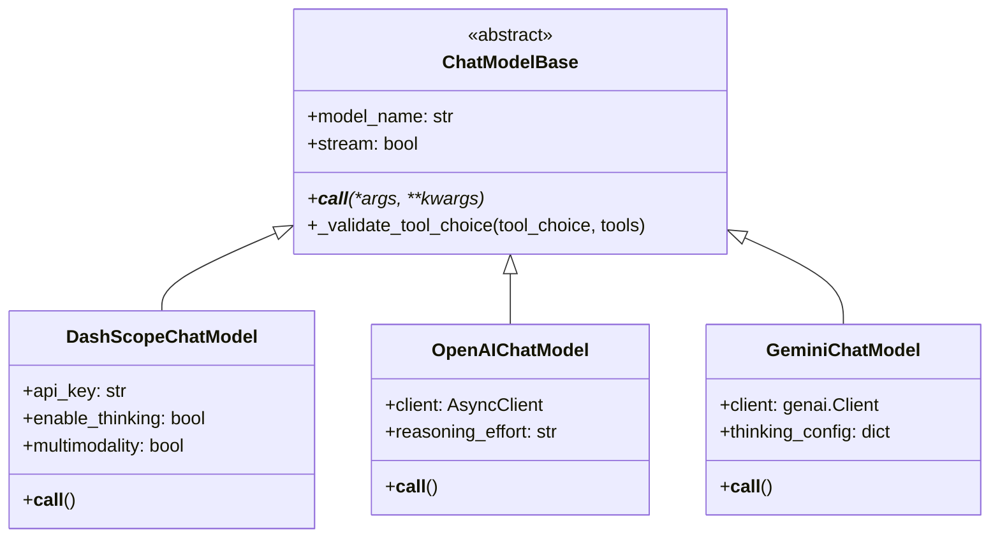
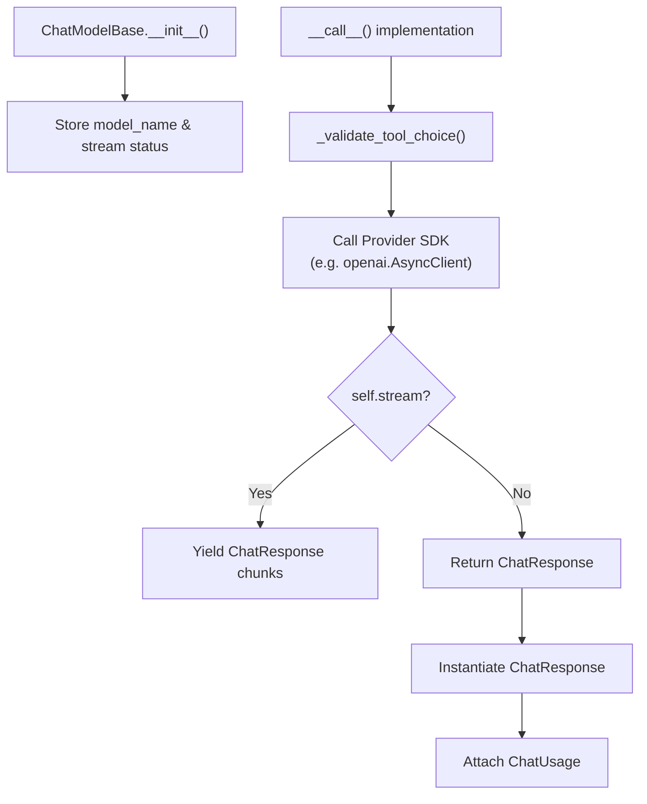

<!-- source: DeepWiki mcp.deepwiki.com · repo modelscope/agentscope · page 3.1 ChatModelBase and Provider Architecture · fetched 2026-10-26 -->

# ChatModelBase and Provider Architecture

Relevant source files

The following files were used as context for generating this wiki page:

- [.github/workflows/unittest.yml](.github/workflows/unittest.yml)
- [.pre-commit-config.yaml](.pre-commit-config.yaml)
- [examples/agent/voice_agent/README.md](examples/agent/voice_agent/README.md)
- [src/agentscope/__init__.py](src/agentscope/__init__.py)
- [src/agentscope/_run_config.py](src/agentscope/_run_config.py)
- [src/agentscope/model/_model_base.py](src/agentscope/model/_model_base.py)
- [src/agentscope/model/_model_response.py](src/agentscope/model/_model_response.py)
- [tests/config_test.py](tests/config_test.py)

This document describes the model integration layer of AgentScope, focusing on the `ChatModelBase` abstract interface and its provider-specific implementations. This architecture enables AgentScope to communicate with various LLM APIs (DashScope, OpenAI, Gemini, Anthropic, etc.) through a unified interface while handling provider-specific formatting, response parsing, and feature support.

## Overview

The model integration layer follows a two-tier abstraction pattern:

1. **ChatModelBase**: Defines the common interface all model providers must implement [src/agentscope/model/_model_base.py:13-14]().
2. **Provider Classes**: Concrete implementations for specific APIs (e.g., `DashScopeChatModel`, `OpenAIChatModel`).

Each provider handles API client initialization, request formatting, response parsing (both streaming and non-streaming), tool schema formatting, and usage tracking.

**ChatModelBase Class Hierarchy**

Sources: [src/agentscope/model/_model_base.py:13-44](), [src/agentscope/model/_model_response.py:20-43]()

## ChatModelBase Abstract Interface

The `ChatModelBase` class defines the contract that all provider implementations must fulfill [src/agentscope/model/_model_base.py:13-14]().

### Core Methods

| Method | Purpose | Return Type |
|--------|---------|-------------|
| `__call__` | Execute model inference with given messages and tools | `ChatResponse \| AsyncGenerator[ChatResponse, None]` |
| `_validate_tool_choice` | Validate `tool_choice` matches available tools | `None` (raises on invalid) |

The `__call__` method is marked as `@abstractmethod` [src/agentscope/model/_model_base.py:38-44](). The `_validate_tool_choice` method checks if the provided `tool_choice` is either a standard mode (`auto`, `none`, `required`) or a valid function name from the provided tools list [src/agentscope/model/_model_base.py:46-78]().

### Standard Parameters

All provider implementations generally accept these common parameters in their `__call__` method:
- **messages**: List of conversation messages in provider-specific format.
- **tools**: JSON schemas of available tool functions.
- **tool_choice**: Controls which tool (if any) the model should call.
- **kwargs**: Provider-specific generation parameters (temperature, max_tokens, etc.).

Sources: [src/agentscope/model/_model_base.py:22-44](), [src/agentscope/model/_model_base.py:46-78]()

## Provider Implementation Pattern

Each provider follows a consistent implementation pattern for initialization and execution.

**Model Provider Implementation Flow**

Sources: [src/agentscope/model/_model_base.py:22-44](), [src/agentscope/model/_model_response.py:20-43]()

### Initialization Pattern

All providers follow this initialization structure:
1. **Initialize parent**: Call `super().__init__(model_name, stream)` to set basic properties [src/agentscope/model/_model_base.py:35-36]().
2. **Create API client**: Instantiate provider SDK client (e.g., OpenAI's `AsyncClient`) with credentials.
3. **Store configuration**: Save generation parameters and provider-specific settings.

Sources: [src/agentscope/model/_model_base.py:22-37]()

## Response and Usage Objects

### ChatResponse

The `ChatResponse` dataclass is the standardized output format for all chat models [src/agentscope/model/_model_response.py:20-21]().

| Field | Type | Description |
|-------|------|-------------|
| `content` | `Sequence[...]` | List of `TextBlock`, `ToolUseBlock`, `ThinkingBlock`, or `AudioBlock` [src/agentscope/model/_model_response.py:23-25]() |
| `id` | `str` | Unique identifier (defaults to timestamp) [src/agentscope/model/_model_response.py:27-28]() |
| `usage` | `ChatUsage` | Token usage information [src/agentscope/model/_model_response.py:36-37]() |
| `metadata` | `dict` | Provider-specific metadata [src/agentscope/model/_model_response.py:39-42]() |

### ChatUsage

Usage tracking is standardized across providers to allow for monitoring and cost estimation.

**ChatUsage Fields**:
- `input_tokens`: Tokens in the prompt.
- `output_tokens`: Tokens generated.
- `total_tokens`: Sum of input and output.

Sources: [src/agentscope/model/_model_usage.py:7](), [src/agentscope/model/_model_response.py:36-37]()

## Observability Integration

The `agentscope.init` function sets up the global configuration which includes tracing settings used by model providers [src/agentscope/__init__.py:72-104]().

- **Tracing**: If `tracing_url` is provided, `setup_tracing` is called and `trace_enabled` is set to `True` [src/agentscope/__init__.py:147-156]().
- **Context Management**: Global settings like `run_id`, `project`, and `name` are managed via `ContextVar` in `_ConfigCls` to ensure thread and async safety [src/agentscope/_run_config.py:6-72]().

Sources: [src/agentscope/__init__.py:72-157](), [src/agentscope/_run_config.py:9-16](), [src/agentscope/__init__.py:22-41]()

## Content Block Types

Model responses are parsed into standardized content block types to support multi-modal and complex outputs [src/agentscope/model/_model_response.py:23-25]().

| Block Type | Description |
|------------|-------------|
| `TextBlock` | Standard text output from the model [src/agentscope/message/__init__.py]() |
| `ThinkingBlock` | Internal reasoning/thought process for reasoning models [src/agentscope/model/_model_response.py:13]() |
| `ToolUseBlock` | Structured information for a tool/function call [src/agentscope/model/_model_response.py:12]() |
| `AudioBlock` | Generated audio data (e.g., from GPT-4o Audio) [src/agentscope/model/_model_response.py:14]() |

Sources: [src/agentscope/model/_model_response.py:10-15](), [src/agentscope/model/_model_response.py:23-25]()

---

