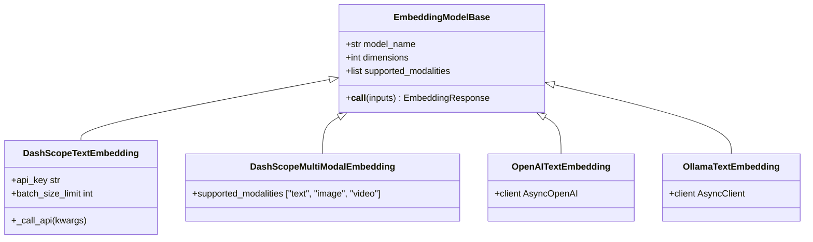
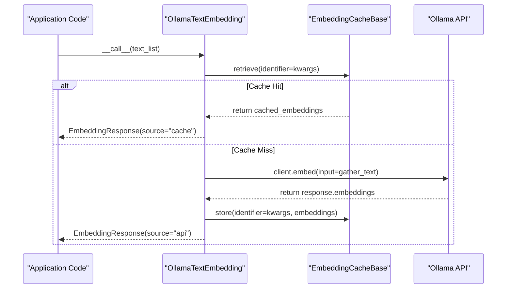
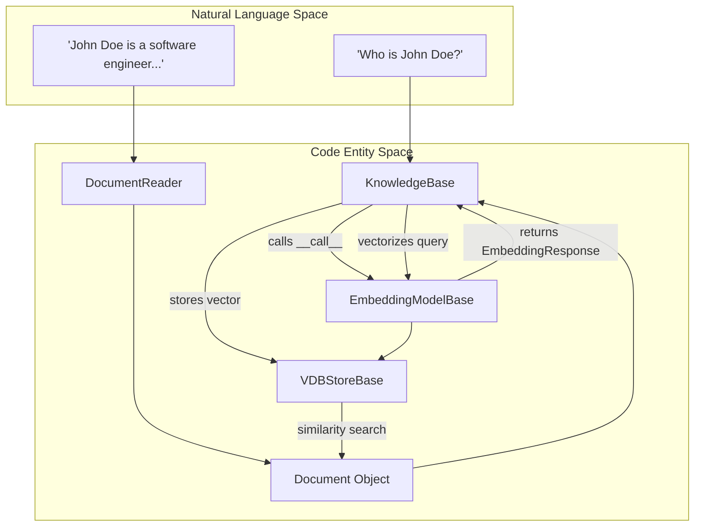

<!-- source: DeepWiki mcp.deepwiki.com · repo modelscope/agentscope · page 3.10 Embedding Models · fetched 2026-10-26 -->

# Embedding Models

Relevant source files

The following files were used as context for generating this wiki page:

- [src/agentscope/embedding/_dashscope_embedding.py](src/agentscope/embedding/_dashscope_embedding.py)
- [src/agentscope/embedding/_dashscope_multimodal_embedding.py](src/agentscope/embedding/_dashscope_multimodal_embedding.py)
- [src/agentscope/embedding/_ollama_embedding.py](src/agentscope/embedding/_ollama_embedding.py)

The embedding module in AgentScope provides a unified interface for generating vector representations of data. It abstracts different model providers, supports multimodal inputs (text, image, video), and implements a caching layer to optimize performance and reduce API costs. These models are fundamental to the Retrieval-Augmented Generation (RAG) capabilities within the framework.

## Architecture and Base Abstractions

All embedding implementations in AgentScope derive from a common base class, ensuring a consistent interface across different service providers.

### EmbeddingModelBase
`EmbeddingModelBase` defines the core contract for embedding models. It requires subclasses to implement the `__call__` method, which asynchronously processes input data and returns an `EmbeddingResponse`.
- **Key Attributes**: `model_name` (identifier for the API), `dimensions` (size of the resulting vector), and `supported_modalities` (e.g., `["text", "image", "video"]`) [src/agentscope/embedding/_embedding_base.py:9-17]().
- **Data Flow**: The `__call__` method typically accepts a list of input blocks (like `TextBlock`), checks against a cache if provided, calls the underlying provider API, stores the result in the cache, and returns the response [src/agentscope/embedding/_ollama_embedding.py:48-106]().

### EmbeddingResponse and Usage
The output of an embedding call is encapsulated in an `EmbeddingResponse` object, which contains:
- `embeddings`: A list of vectors (lists of floats) [src/agentscope/embedding/_embedding_response.py:10-10]().
- `usage`: An `EmbeddingUsage` object tracking token consumption and execution time [src/agentscope/embedding/_embedding_response.py:7-10]().
- `source`: A string indicating if the result came from the `"api"` or the `"cache"` [src/agentscope/embedding/_ollama_embedding.py:82-89]().

### Embedding Model Hierarchy
The following diagram illustrates the relationship between the base abstraction and specific provider implementations.

**Embedding Model Class Structure**

Sources: [src/agentscope/embedding/_embedding_base.py:9-17](), [src/agentscope/embedding/_dashscope_embedding.py:14-28](), [src/agentscope/embedding/_dashscope_multimodal_embedding.py:17-22](), [src/agentscope/embedding/_ollama_embedding.py:13-17]()

---

## Provider Implementations

AgentScope supports several major embedding providers with specific handling for their API constraints, such as batch size limits.

| Provider | Class | Supported Modalities | Notes |
| :--- | :--- | :--- | :--- |
| **DashScope** | `DashScopeTextEmbedding` | Text | Handles batching (e.g., limit of 10 for v4) [src/agentscope/embedding/_dashscope_embedding.py:14-58](). |
| **DashScope MM**| `DashScopeMultiModalEmbedding` | Text, Image, Video | Supports URL and Base64 for images; URL only for video [src/agentscope/embedding/_dashscope_multimodal_embedding.py:17-133](). |
| **OpenAI** | `OpenAITextEmbedding` | Text | Compatible with OpenAI and Azure OpenAI endpoints. |
| **Gemini** | `GeminiTextEmbedding` | Text | Integration with Google's Generative AI embedding services. |
| **Ollama** | `OllamaTextEmbedding` | Text | Supports local embedding models via the Ollama API [src/agentscope/embedding/_ollama_embedding.py:13-45](). |

### Multimodal Embeddings
`DashScopeMultiModalEmbedding` supports non-textual data by processing `ImageBlock` and `VideoBlock` objects [src/agentscope/embedding/_dashscope_multimodal_embedding.py:93-108](). 
- **Video**: Specifically requires a URL source; base64 is not supported for video [src/agentscope/embedding/_dashscope_multimodal_embedding.py:127-133](). 
- **Images**: Supports both `url` and `base64` formats [src/agentscope/embedding/_dashscope_multimodal_embedding.py:145-161](). 
- **Model Constraints**: It automatically maps model names to required dimensions (e.g., `tongyi-embedding-vision-plus` defaults to 1152) and enforces strict validation against official documentation [src/agentscope/embedding/_dashscope_multimodal_embedding.py:54-82]().

---

## Embedding Caching

To prevent redundant API calls for the same input, AgentScope provides a caching mechanism.

- **EmbeddingCacheBase**: The abstract base for all cache implementations defining `retrieve` and `store` methods [src/agentscope/embedding/_cache_base.py:9-35]().
- **Implementation**: Models like `OllamaTextEmbedding` and `DashScopeTextEmbedding` check the cache using the request parameters (the `identifier`) before making network calls [src/agentscope/embedding/_ollama_embedding.py:77-81](), [src/agentscope/embedding/_dashscope_embedding.py:63-67]().

**Embedding Execution Flow with Cache**

Sources: [src/agentscope/embedding/_ollama_embedding.py:77-106](), [src/agentscope/embedding/_dashscope_embedding.py:60-105]()

---

## Usage in RAG Pipelines

Embedding models are a critical dependency for the AgentScope RAG system, specifically for the `KnowledgeBase` and `VDBStoreBase` components.

### Integration with Knowledge Systems
The embedding model is used in two phases:
1.  **Indexing**: Converting document chunks into vectors before storage in a vector database.
2.  **Retrieval**: Converting a user's natural language query into a vector to perform a similarity search.

**RAG Data Flow: Text to Vector Space**

Sources: [src/agentscope/embedding/_embedding_base.py:9-17](), [src/agentscope/embedding/_dashscope_multimodal_embedding.py:91-108]()

### Batching and Efficiency
Providers like DashScope have strict batch size limits (e.g., 10 for text, 1 or 8 for multimodal) [src/agentscope/embedding/_dashscope_embedding.py:58-58](), [src/agentscope/embedding/_dashscope_multimodal_embedding.py:52-74](). AgentScope implementations handle this internally by splitting large input lists into multiple API calls and aggregating the results into a single `EmbeddingResponse` [src/agentscope/embedding/_dashscope_embedding.py:144-169](), [src/agentscope/embedding/_dashscope_multimodal_embedding.py:173-198]().

Sources: [src/agentscope/embedding/_dashscope_embedding.py:129-169](), [src/agentscope/embedding/_dashscope_multimodal_embedding.py:168-198]()

---

