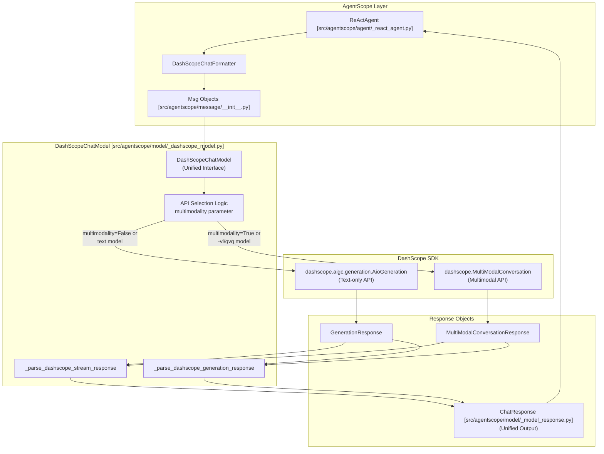
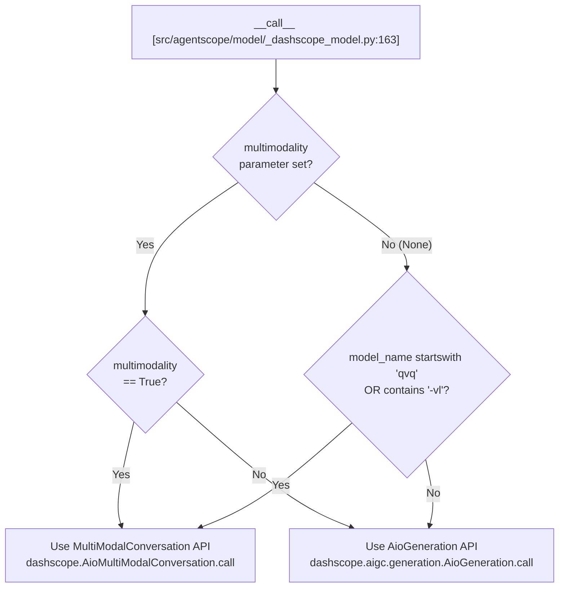
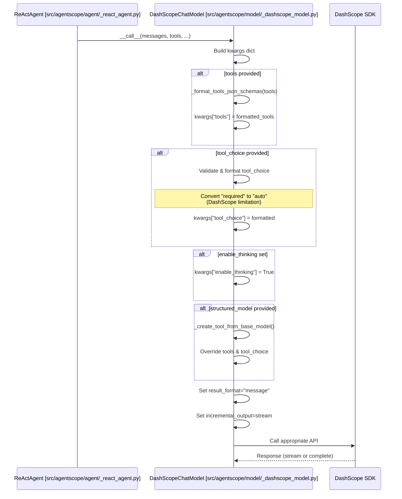
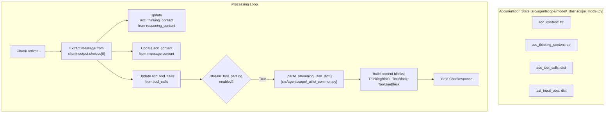

<!-- source: DeepWiki mcp.deepwiki.com · repo modelscope/agentscope · page 3.2 DashScope Integration · fetched 2026-10-26 -->

# DashScope Integration

<details>
<summary>Relevant source files</summary>

The following files were used as context for generating this wiki page:

- [src/agentscope/_utils/_common.py](src/agentscope/_utils/_common.py)
- [src/agentscope/agent/_react_agent.py](src/agentscope/agent/_react_agent.py)
- [src/agentscope/model/_anthropic_model.py](src/agentscope/model/_anthropic_model.py)
- [src/agentscope/model/_dashscope_model.py](src/agentscope/model/_dashscope_model.py)
- [src/agentscope/model/_gemini_model.py](src/agentscope/model/_gemini_model.py)
- [src/agentscope/model/_model_usage.py](src/agentscope/model/_model_usage.py)
- [src/agentscope/model/_ollama_model.py](src/agentscope/model/_ollama_model.py)
- [src/agentscope/model/_openai_model.py](src/agentscope/model/_openai_model.py)
- [tests/model_anthropic_test.py](tests/model_anthropic_test.py)
- [tests/model_dashscope_test.py](tests/model_dashscope_test.py)
- [tests/model_ollama_test.py](tests/model_ollama_test.py)
- [tests/model_openai_test.py](tests/model_openai_test.py)

</details>


This document covers the DashScope model adapter implementation, which provides integration with Alibaba Cloud's DashScope API. DashScope offers access to Qwen models and other LLMs through two APIs: the text-only Generation API and the multimodal MultiModalConversation API.

For information about the general model integration architecture and `ChatModelBase` interface, see [ChatModelBase and Provider Architecture](). For message formatting specifics, see [Message Formatters](). For tool calling mechanisms, see [Structured Output and Tool Calling]().

---

## Overview and Architecture

The `DashScopeChatModel` class ([src/agentscope/model/_dashscope_model.py:51-84]()) unifies DashScope's two distinct APIs into a single interface, automatically selecting the appropriate endpoint based on model capabilities. This design enables seamless switching between text-only and multimodal models without code changes.

### System Architecture Diagram

Title: DashScope Integration Architecture


**Sources:** [src/agentscope/model/_dashscope_model.py:51-122](), [src/agentscope/agent/_react_agent.py:98-105]()

---

## API Selection Logic

DashScope provides two distinct APIs with different capabilities. The `DashScopeChatModel` automatically selects the appropriate API based on the `multimodality` parameter and model name conventions.

### Selection Flow

Title: DashScope API Selection Logic


| Parameter Value | Model Name | API Used | Use Case |
|----------------|------------|----------|----------|
| `multimodality=True` | Any | MultiModalConversation | Force multimodal API for image/video inputs |
| `multimodality=False` | Any | Generation | Force text-only API |
| `multimodality=None` | `qwen-vl-*`, `qvq-*` | MultiModalConversation | Auto-detect based on model name |
| `multimodality=None` | Other models | Generation | Auto-detect: text-only models |

The selection logic is implemented within the `__call__` method ([src/agentscope/model/_dashscope_model.py:264-282]()).

**Sources:** [src/agentscope/model/_dashscope_model.py:51-71](), [src/agentscope/model/_dashscope_model.py:264-282]()

---

## Constructor Parameters

The `DashScopeChatModel.__init__` method ([src/agentscope/model/_dashscope_model.py:73-122]()) accepts the following parameters:

### Parameter Reference Table

| Parameter | Type | Default | Description |
|-----------|------|---------|-------------|
| `model_name` | `str` | Required | Model identifier (e.g., `qwen-turbo`, `qwen-vl-plus`) |
| `api_key` | `str` | Required | DashScope API key for authentication |
| `stream` | `bool` | `True` | Enable streaming responses |
| `enable_thinking` | `bool \| None` | `None` | Enable deep thinking mode (Qwen3, QwQ, DeepSeek-R1) |
| `multimodality` | `bool \| None` | `None` | Force API selection: `True`=multimodal, `False`=text, `None`=auto |
| `generate_kwargs` | `dict \| None` | `None` | Additional API parameters (temperature, seed, etc.) |
| `base_http_api_url` | `str \| None` | `None` | Custom base URL for API requests |
| `stream_tool_parsing` | `bool` | `True` | Parse incomplete JSON in streaming tool calls |

### Thinking Mode Enforcement

When `enable_thinking=True`, the constructor forces `stream=True` because DashScope's thinking mode requires streaming ([src/agentscope/model/_dashscope_model.py:123-128]()):

```python
if enable_thinking and not stream:
    logger.info(
        "In DashScope API, `stream` must be True when "
        "`enable_thinking` is True. ",
    )
    stream = True
```

### Custom Headers Configuration

The model supports custom HTTP headers via the `DASHSCOPE_API_HEADERS` environment variable, which are parsed and merged into `generate_kwargs` ([src/agentscope/model/_dashscope_model.py:144-160]()).

**Sources:** [src/agentscope/model/_dashscope_model.py:73-160]()

---

## Core API Method

The `__call__` method ([src/agentscope/model/_dashscope_model.py:163-297]()) serves as the main entry point for all API requests.

### Request Preparation Flow

Title: DashScope Call Sequence


### Tool Choice Conversion

DashScope only supports `"auto"` and `"none"` for `tool_choice`. The model automatically converts unsupported values like `"required"` or `"any"` to `"auto"` while issuing a warning ([src/agentscope/model/_dashscope_model.py:228-239]()).

### Structured Output Override

When `structured_model` (a Pydantic `BaseModel`) is provided, it overrides both `tools` and `tool_choice` ([src/agentscope/model/_dashscope_model.py:247-261]()) by creating a synthetic tool via `_create_tool_from_base_model` ([src/agentscope/_utils/_common.py:225-255]()).

**Sources:** [src/agentscope/model/_dashscope_model.py:163-297](), [src/agentscope/_utils/_common.py:225-255]()

---

## Streaming Response Processing

The `_parse_dashscope_stream_response` method ([src/agentscope/model/_dashscope_model.py:300-478]()) handles streaming responses for both text and multimodal APIs.

### Streaming Architecture

Title: DashScope Streaming Flow


### Stream Tool Parsing

When `stream_tool_parsing=True`, incomplete JSON in tool arguments is repaired in real-time using `_parse_streaming_json_dict` and `_json_loads_with_repair` ([src/agentscope/_utils/_common.py:31-94]()). This allows `ToolUseBlock` ([src/agentscope/message/__init__.py:19]()) to contain partially valid inputs for immediate consumption.

**Sources:** [src/agentscope/model/_dashscope_model.py:300-478](), [src/agentscope/_utils/_common.py:72-94](), [src/agentscope/message/__init__.py:17-23]()

---

## Thinking and Reasoning Mode

DashScope supports deep thinking mode (for models like Qwen3 or DeepSeek-R1) via the `enable_thinking` parameter ([src/agentscope/model/_dashscope_model.py:94-98]()).

### Thinking Content Extraction

In streaming mode, reasoning content is captured from the `reasoning_content` field of the API response and stored in a `ThinkingBlock` ([src/agentscope/message/__init__.py:31]()).

```python
# [src/agentscope/model/_dashscope_model.py:350-352]
if isinstance(message.get("reasoning_content"), str):
    acc_thinking_content += message["reasoning_content"]

# [src/agentscope/model/_dashscope_model.py:390-396]
if acc_thinking_content:
    content_blocks.append(
        ThinkingBlock(
            type="thinking",
            thinking=acc_thinking_content,
        ),
    )
```

**Sources:** [src/agentscope/model/_dashscope_model.py:350-396](), [src/agentscope/message/__init__.py:31]()

---

## Usage Tracking

Token usage is tracked using the `ChatUsage` class ([src/agentscope/model/_model_usage.py:10-27]()).

### Usage Extraction

Usage information is extracted from `response.usage` and includes `input_tokens`, `output_tokens`, and total `time` ([src/agentscope/model/_dashscope_model.py:566-573]()). This is mapped to the unified `ChatUsage` object for observability.

**Sources:** [src/agentscope/model/_dashscope_model.py:566-573](), [src/agentscope/model/_model_usage.py:10-27]()

---

