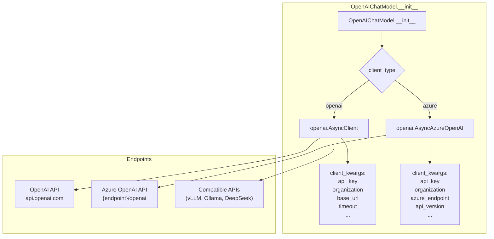
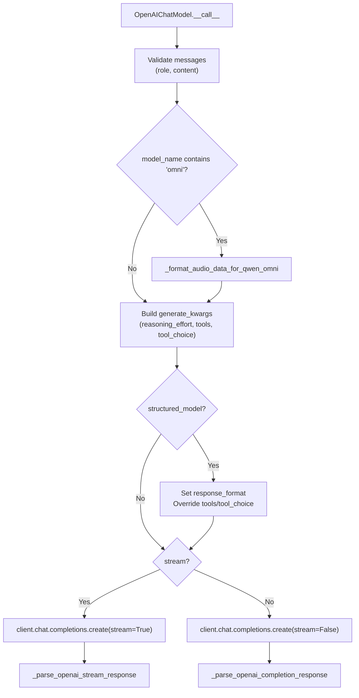

<!-- source: DeepWiki mcp.deepwiki.com · repo modelscope/agentscope · page 3.3 OpenAI and Compatible APIs · fetched 2026-10-26 -->

# OpenAI and Compatible APIs

<details>
<summary>Relevant source files</summary>

The following files were used as context for generating this wiki page:

- [src/agentscope/_utils/_common.py](src/agentscope/_utils/_common.py)
- [src/agentscope/agent/_react_agent.py](src/agentscope/agent/_react_agent.py)
- [src/agentscope/model/_anthropic_model.py](src/agentscope/model/_anthropic_model.py)
- [src/agentscope/model/_dashscope_model.py](src/agentscope/model/_dashscope_model.py)
- [src/agentscope/model/_gemini_model.py](src/agentscope/model/_gemini_model.py)
- [src/agentscope/model/_model_usage.py](src/agentscope/model/_model_usage.py)
- [src/agentscope/model/_ollama_model.py](src/agentscope/model/_ollama_model.py)
- [src/agentscope/model/_openai_model.py](src/agentscope/model/_openai_model.py)
- [tests/model_anthropic_test.py](tests/model_anthropic_test.py)
- [tests/model_dashscope_test.py](tests/model_dashscope_test.py)
- [tests/model_ollama_test.py](tests/model_ollama_test.py)
- [tests/model_openai_test.py](tests/model_openai_test.py)

</details>


This page documents the OpenAI model integration in AgentScope, including the `OpenAIChatModel` class, Azure OpenAI support, and compatibility with OpenAI-compatible services such as vLLM, Ollama, and DeepSeek. For information about the base model architecture, see [3.1 ChatModelBase and Provider Architecture](). For message formatting details, see [3.6 Message Formatters]().

## Overview

The OpenAI integration provides a unified interface for accessing OpenAI's chat completion APIs, including both standard OpenAI and Azure OpenAI services. The implementation supports features including streaming, tool calling, structured output, multimodal content (text, images, audio), and reasoning capabilities (o3, o4 models).

**Key Components:**

| Component | File Path | Purpose |
|-----------|-----------|---------|
| `OpenAIChatModel` | [src/agentscope/model/_openai_model.py:70-171]() | Main model wrapper class |
| `_format_audio_data_for_qwen_omni` | [src/agentscope/model/_openai_model.py:45-69]() | Helper for Qwen-omni specific audio formatting |
| `_json_loads_with_repair` | [src/agentscope/_utils/_common.py:31-70]() | Robust JSON parsing for streaming tool calls |

Sources: [src/agentscope/model/_openai_model.py:1-662](), [src/agentscope/_utils/_common.py:31-70]()

## OpenAIChatModel Initialization

### Basic Parameters

```python
from agentscope.model import OpenAIChatModel

model = OpenAIChatModel(
    model_name="gpt-4",
    api_key="sk-...",
    stream=True,
    reasoning_effort="medium",  # For o3/o4 models
    organization="org-...",
    stream_tool_parsing=True,
    client_type="openai",  # or "azure"
)
```

**Initialization Parameters:**

| Parameter | Type | Default | Description |
|-----------|------|---------|-------------|
| `model_name` | `str` | Required | Model identifier (e.g., "gpt-4", "gpt-4o") |
| `api_key` | `str \| None` | `None` | API key (reads from `OPENAI_API_KEY` env if not provided) |
| `stream` | `bool` | `True` | Enable streaming responses |
| `reasoning_effort` | `Literal["low", "medium", "high"] \| None` | `None` | Reasoning effort for o3/o4 models |
| `organization` | `str \| None` | `None` | Organization ID (reads from `OPENAI_ORGANIZATION` env if not provided) |
| `stream_tool_parsing` | `bool` | `True` | Parse incomplete tool JSON during streaming with auto-repair |
| `client_type` | `Literal["openai", "azure"]` | `"openai"` | Client type selection |
| `client_kwargs` | `dict \| None` | `None` | Additional arguments for client initialization (e.g., `base_url`) |
| `generate_kwargs` | `dict \| None` | `None` | Default generation parameters (temperature, max_tokens, etc.) |

Sources: [src/agentscope/model/_openai_model.py:73-122]()

### Client Type Architecture



**Client Initialization Logic:**

[src/agentscope/model/_openai_model.py:151-167]() implements the client selection:

- **OpenAI Client**: Used for standard OpenAI API and compatible services. It passes `api_key`, `organization`, and `client_kwargs` (which can include `base_url`) to the constructor.
- **Azure Client**: Used for Azure OpenAI deployments, initialized with `AsyncAzureOpenAI`.

Sources: [src/agentscope/model/_openai_model.py:151-167]()

### Reasoning Effort Configuration

The `reasoning_effort` parameter controls the computational resources allocated for reasoning models like `o3-mini`:

```python
model = OpenAIChatModel(
    model_name="o3-mini",
    reasoning_effort="high",  # "low", "medium", or "high"
)
```

When set, this parameter is automatically included in the API call payload at [src/agentscope/model/_openai_model.py:244-245]().

Sources: [src/agentscope/model/_openai_model.py:96-101](), [src/agentscope/model/_openai_model.py:244-245]()

## Compatible API Support

AgentScope supports a wide range of providers that adhere to the OpenAI API specification by utilizing the `client_kwargs` parameter to override the `base_url`.

### vLLM and Ollama Integration

For local or self-hosted services like vLLM or Ollama, set the `base_url` in `client_kwargs`:

```python
# vLLM Example
model = OpenAIChatModel(
    model_name="qwen2.5-7b",
    client_kwargs={"base_url": "http://localhost:8000/v1"}
)

# Ollama Example
model = OpenAIChatModel(
    model_name="llama3.2",
    client_kwargs={"base_url": "http://localhost:11434/v1"}
)
```

Sources: [src/agentscope/model/_openai_model.py:113-116](), [src/agentscope/model/_ollama_model.py:90-94]()

### DeepSeek Integration

DeepSeek models support reasoning content via a specific `reasoning_content` field in the API response. `OpenAIChatModel` automatically extracts this field and converts it into a `ThinkingBlock`.

- **Streaming**: [src/agentscope/model/_openai_model.py:377-387]() checks for `reasoning_content` or `reasoning` attributes in the stream delta.
- **Non-streaming**: [src/agentscope/model/_openai_model.py:549-561]() performs similar checks on the message object.

Sources: [src/agentscope/model/_openai_model.py:377-387](), [src/agentscope/model/_openai_model.py:549-561]()

### Qwen-omni Audio Format

Qwen-omni requires base64 audio data to be prefixed with `data:;base64,`. The `_format_audio_data_for_qwen_omni` function handles this transformation.

```python
# Internal check in OpenAIChatModel.__call__
if "omni" in self.model_name.lower():
    _format_audio_data_for_qwen_omni(messages)
```

Sources: [src/agentscope/model/_openai_model.py:45-69](), [src/agentscope/model/_openai_model.py:234-235]()

## API Call Flow

### Request Pipeline



Sources: [src/agentscope/model/_openai_model.py:174-305]()

## Response Parsing

### Streaming and Tool Parsing

AgentScope features robust streaming tool parsing that can repair incomplete JSON chunks. This allows agents to begin processing tool inputs before the model has finished generating them.

- **Auto-Repair**: Uses `_json_loads_with_repair` from [src/agentscope/_utils/_common.py:31-70]() to fix strings like `{"location": "Beij` into `{"location": "Beij"}`.
- **Regression Protection**: `_parse_streaming_json_dict` at [src/agentscope/_utils/_common.py:72-95]() ensures that if a repair results in a smaller structure than the previous chunk (e.g., due to a syntax error in the middle of a string), the previous valid state is preserved.

| Feature | Implementation | Line Reference |
|---------|----------------|----------------|
| Content Accumulation | Buffering text, reasoning, and audio chunks | [src/agentscope/model/_openai_model.py:337-417]() |
| Stream Tool Repair | Real-time JSON repair for `tool_use` arguments | [src/agentscope/model/_openai_model.py:460-471]() |
| Final Tool Parsing | Fallback parsing when streaming tool parsing is disabled | [src/agentscope/model/_openai_model.py:497-514]() |

Sources: [src/agentscope/model/_openai_model.py:307-514](), [src/agentscope/_utils/_common.py:31-95]()

### Structured Output Support

When a `structured_model` (Pydantic `BaseModel`) is provided, `OpenAIChatModel` utilizes OpenAI's native structured output feature:

1. It sets the `response_format` to `{"type": "json_schema", "json_schema": ...}` [src/agentscope/model/_openai_model.py:270-280]().
2. For non-streaming, it extracts the parsed object from `choice.message.parsed` [src/agentscope/model/_openai_model.py:614-617]().
3. For streaming, it utilizes the `openai.AsyncStream` helper [src/agentscope/model/_openai_model.py:321-325]().

Sources: [src/agentscope/model/_openai_model.py:262-280](), [src/agentscope/model/_openai_model.py:321-325](), [src/agentscope/model/_openai_model.py:614-617]()

## Usage with Other Providers

### OllamaChatModel

While `OpenAIChatModel` can connect to Ollama via `base_url`, AgentScope also provides a dedicated `OllamaChatModel` that interfaces directly with the `ollama` Python SDK.

- **Initialization**: Configures `host`, `options`, and `keep_alive` [src/agentscope/model/_ollama_model.py:36-99]().
- **Thinking Support**: Supports the `think` parameter for models like DeepSeek-R1 served via Ollama [src/agentscope/model/_ollama_model.py:144-145]().

Sources: [src/agentscope/model/_ollama_model.py:33-172]()

### DashScope Integration (Compatibility Note)

For models hosted on DashScope (like Qwen) that support OpenAI-compatible parameters (e.g., `enable_thinking`), the `DashScopeChatModel` is recommended as it handles specific API requirements such as forcing `stream=True` when thinking is enabled [src/agentscope/model/_dashscope_model.py:123-128]().

Sources: [src/agentscope/model/_dashscope_model.py:51-136]()

---

