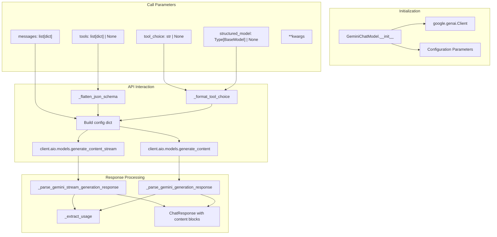
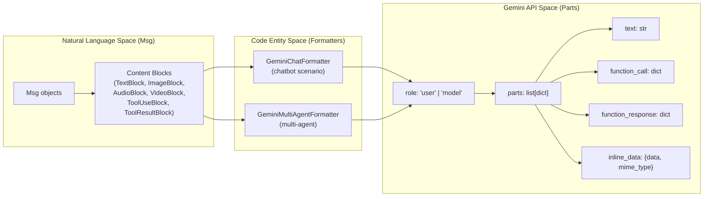
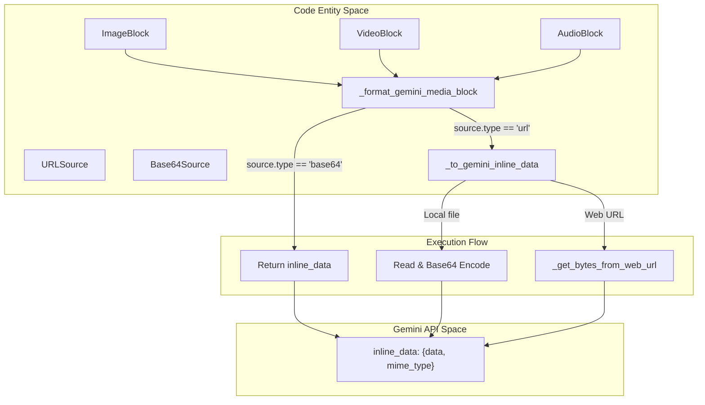

<!-- source: DeepWiki mcp.deepwiki.com · repo modelscope/agentscope · page 3.4 Gemini Integration · fetched 2026-10-26 -->

# Gemini Integration

<details>
<summary>Relevant source files</summary>

The following files were used as context for generating this wiki page:

- [src/agentscope/formatter/_gemini_formatter.py](src/agentscope/formatter/_gemini_formatter.py)
- [tests/formatter_anthropic_test.py](tests/formatter_anthropic_test.py)
- [tests/formatter_deepseek_test.py](tests/formatter_deepseek_test.py)
- [tests/formatter_gemini_test.py](tests/formatter_gemini_test.py)
- [tests/formatter_ollama_test.py](tests/formatter_ollama_test.py)
- [tests/model_gemini_test.py](tests/model_gemini_test.py)

</details>


This page documents the integration of Google's Gemini models into AgentScope. It covers the `GeminiChatModel` wrapper, message formatting for Gemini's API, tool calling mechanics, thinking/reasoning support, and multimodal content handling.

For general model integration patterns, see [ChatModelBase and Provider Architecture](). For formatter architecture details, see [Message Formatters](). For tool calling concepts, see [Structured Output and Tool Calling]().

---

## Overview

The Gemini integration consists of two main components:

- **`GeminiChatModel`**: Model wrapper that communicates with the Google Gemini API using the `google.genai` SDK [src/agentscope/model/_gemini_model.py:115-116]().
- **`GeminiChatFormatter` / `GeminiMultiAgentFormatter`**: Formatters that convert AgentScope messages to Gemini's specific API format [src/agentscope/formatter/_gemini_formatter.py:107-108]().

The integration supports Gemini-specific features including:
- **Thinking mode** for models like Gemini 2.0/2.5 Pro/Flash [src/agentscope/model/_gemini_model.py:137-140]().
- **Multimodal content** (images, audio, video) via `inline_data` format [src/agentscope/formatter/_gemini_formatter.py:25-27]().
- **JSON schema flattening** to work around Gemini's lack of `$ref` support [src/agentscope/model/_gemini_model.py:36-37]().
- **Tool calling** with `thought_signature` identifiers [src/agentscope/model/_gemini_model.py:483-485]().
- **Structured output** via Pydantic models and forced tool calling [src/agentscope/model/_gemini_model.py:261-263]().

Sources: [src/agentscope/model/_gemini_model.py:1-661](), [src/agentscope/formatter/_gemini_formatter.py:1-508]()

---

## GeminiChatModel Architecture

`GeminiChatModel` acts as the primary interface between AgentScope's agentic logic and the Google GenAI SDK.

Title: Gemini Model Interaction Flow


**Model Wrapper Flow**

The `GeminiChatModel` wraps the Google Gemini API and handles:
1. **Initialization**: Instantiates `google.genai.Client` with the provided `api_key` and `client_kwargs` [src/agentscope/model/_gemini_model.py:194-197]().
2. **Schema flattening**: Resolves `$ref` references that Gemini doesn't support by inlining definitions [src/agentscope/model/_gemini_model.py:536-541]().
3. **Tool choice formatting**: Maps AgentScope's `tool_choice` to Gemini's `function_calling_config` structure [src/agentscope/model/_gemini_model.py:625-630]().
4. **Response parsing**: Processes `GenerateContentResponse` for both streaming [src/agentscope/model/_gemini_model.py:336-340]() and non-streaming modes [src/agentscope/model/_gemini_model.py:443-447]().
5. **Usage extraction**: Captures token counts and timing information from the response [src/agentscope/model/_gemini_model.py:306-310]().

Sources: [src/agentscope/model/_gemini_model.py:115-304](), [src/agentscope/model/_gemini_model.py:336-534]()

---

## Initialization and Configuration

### Basic Initialization

```python
from agentscope.model import GeminiChatModel

model = GeminiChatModel(
    model_name="gemini-2.5-flash",
    api_key="your-api-key",
    stream=True,
)
```

### Configuration Parameters

| Parameter | Type | Description |
|-----------|------|-------------|
| `model_name` | `str` | Gemini model name (e.g., "gemini-2.5-flash") [src/agentscope/model/_gemini_model.py:131-132]() |
| `api_key` | `str` | Google API key [src/agentscope/model/_gemini_model.py:133-134]() |
| `stream` | `bool` | Enable streaming output (default: `True`) [src/agentscope/model/_gemini_model.py:135-136]() |
| `thinking_config` | `dict \| None` | Thinking mode configuration (keys: `include_thoughts`, `thinking_budget`) [src/agentscope/model/_gemini_model.py:137-140]() |
| `client_kwargs` | `dict \| None` | Extra kwargs for `genai.Client` initialization [src/agentscope/model/_gemini_model.py:150-152]() |
| `generate_kwargs` | `dict \| None` | Extra kwargs for generation (e.g., `temperature`, `top_p`) [src/agentscope/model/_gemini_model.py:153-155]() |

### Thinking Configuration

Models like Gemini 2.5 Pro support a thinking mode for extended reasoning [src/agentscope/model/_gemini_model.py:137-140]():

```python
model = GeminiChatModel(
    model_name="gemini-2.5-pro",
    api_key="your-api-key",
    thinking_config={
        "include_thoughts": True,    # Enable reasoning output
        "thinking_budget": 1024       # Max tokens for reasoning
    }
)
```

The reasoning content appears as `ThinkingBlock` objects with a `type="thinking"` field in the `ChatResponse` [src/agentscope/model/_gemini_model.py:403-405]().

Sources: [src/agentscope/model/_gemini_model.py:118-200](), [tests/model_gemini_test.py:236-287]()

---

## Message Formatting System

Title: AgentScope to Gemini Message Transformation


**Formatter Architecture**

### GeminiChatFormatter

Used for single-agent scenarios where only a user and assistant are involved [src/agentscope/formatter/_gemini_formatter.py:107-111]():
- Maps `role="assistant"` to `role="model"` [src/agentscope/formatter/_gemini_formatter.py:249-250]().
- Maps `role="user"` and `role="system"` to `role="user"` [src/agentscope/formatter/_gemini_formatter.py:252-253]().
- Formats content as `parts` array with various block types [src/agentscope/formatter/_gemini_formatter.py:188-190]().
- Supports `promote_tool_result_images` to append images from tool results as a separate user message [src/agentscope/formatter/_gemini_formatter.py:152-153]().

### GeminiMultiAgentFormatter

Used for multi-agent conversations [src/agentscope/formatter/_gemini_formatter.py:312-315]():
- Aggregates conversation history into `<history>...</history>` tags [src/agentscope/formatter/_gemini_formatter.py:327-331]().
- Places history in a single user message with the `conversation_history_prompt` [src/agentscope/formatter/_gemini_formatter.py:441-446]().
- Preserves tool calls/results as separate role-appropriate messages [src/agentscope/formatter/_gemini_formatter.py:378-382]().

Sources: [src/agentscope/formatter/_gemini_formatter.py:107-310](), [src/agentscope/formatter/_gemini_formatter.py:312-508]()

---

## Content Block Formatting

### Text Blocks
Formats to standard Gemini text parts [src/agentscope/formatter/_gemini_formatter.py:192-197]().

### Tool Use Blocks
Formats to `function_call` parts. The `thought_signature` field is used to pass the AgentScope `id` through the API [src/agentscope/formatter/_gemini_formatter.py:199-209]().

### Tool Result Blocks
Formats to `function_response` parts. AgentScope wraps the output in a dict under the key `"output"` to satisfy Gemini's JSON requirement for responses [src/agentscope/formatter/_gemini_formatter.py:211-231]().

Sources: [src/agentscope/formatter/_gemini_formatter.py:177-310]()

---

## Multimodal Content Handling

### Supported Media Types
AgentScope supports a wide range of extensions for Gemini multimodal inputs:
- **Image**: `png`, `jpeg`, `webp`, `heic`, `heif` [src/agentscope/formatter/_gemini_formatter.py:135]().
- **Video**: `mp4`, `mpeg`, `mov`, `avi`, etc. [src/agentscope/formatter/_gemini_formatter.py:136-146]().
- **Audio**: `mp3`, `wav`, `aac`, `flac`, etc. [src/agentscope/formatter/_gemini_formatter.py:147]().

### Media Processing Pipeline

Title: Gemini Multimodal Data Processing


The `_to_gemini_inline_data` function automatically detects the MIME type based on file extensions and converts local files or web URLs into the Base64 format required by Gemini's `inline_data` [src/agentscope/formatter/_gemini_formatter.py:60-104]().

Sources: [src/agentscope/formatter/_gemini_formatter.py:25-105]()

---

## Tool Integration

### JSON Schema Flattening

Gemini's API does not support `$defs` and `$ref` in JSON schemas. The `_flatten_json_schema()` function recursively resolves all references inline to ensure compatibility [src/agentscope/model/_gemini_model.py:36-43]().

It includes logic to handle circular references by returning a placeholder object, preventing infinite loops during flattening [src/agentscope/model/_gemini_model.py:77-85]().

### Tool Choice Configuration

AgentScope maps common tool choice modes to Gemini's `function_calling_config` [src/agentscope/model/_gemini_model.py:625-630]().

| AgentScope Value | Gemini Mode | Description |
|------------------|-------------|-------------|
| `"auto"` | `AUTO` | Model decides whether to call tools [src/agentscope/model/_gemini_model.py:637-638]() |
| `"none"` | `NONE` | Model cannot call tools [src/agentscope/model/_gemini_model.py:639-640]() |
| `"required"` | `ANY` | Model must call a tool [src/agentscope/model/_gemini_model.py:641-642]() |
| Specific tool name | `ANY` | Forced call to specific tool via `allowed_function_names` [src/agentscope/model/_gemini_model.py:646-651]() |

Sources: [src/agentscope/model/_gemini_model.py:36-112](), [src/agentscope/model/_gemini_model.py:625-660]()

---

## Response Parsing

### Non-Streaming Responses

The `_parse_gemini_generation_response()` method [src/agentscope/model/_gemini_model.py:443-447]():
1. Iterates through `response.candidates[0].content.parts` [src/agentscope/model/_gemini_model.py:465-467]().
2. Distinguishes between `text` parts and `thought` (reasoning) parts [src/agentscope/model/_gemini_model.py:471-475]().
3. Extracts `function_call` details and maps `thought_signature` back to the AgentScope call ID [src/agentscope/model/_gemini_model.py:480-485]().

### Streaming Responses

The `_parse_gemini_stream_generation_response()` method [src/agentscope/model/_gemini_model.py:336-340]() yields incremental `ChatResponse` objects. It maintains accumulators for `text`, `thinking`, and `tool_calls` to handle partial data across stream chunks [src/agentscope/model/_gemini_model.py:355-357]().

Sources: [src/agentscope/model/_gemini_model.py:336-534]()

---

