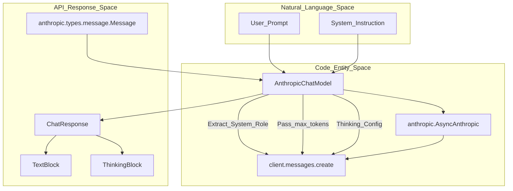
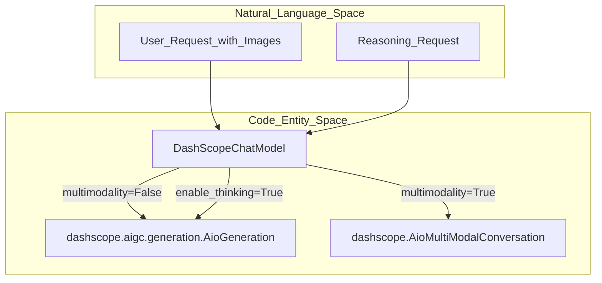
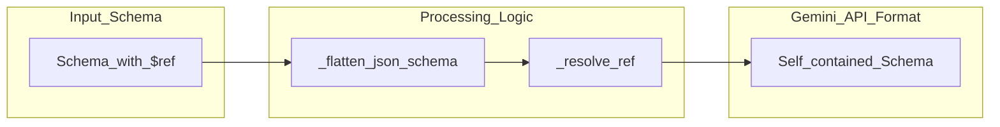

<!-- source: DeepWiki mcp.deepwiki.com · repo modelscope/agentscope · page 3.5 Anthropic and Other Providers · fetched 2026-10-26 -->

# Anthropic and Other Providers

Relevant source files

The following files were used as context for generating this wiki page:

- [src/agentscope/_utils/_common.py](src/agentscope/_utils/_common.py)
- [src/agentscope/agent/_react_agent.py](src/agentscope/agent/_react_agent.py)
- [src/agentscope/formatter/_anthropic_formatter.py](src/agentscope/formatter/_anthropic_formatter.py)
- [src/agentscope/formatter/_deepseek_formatter.py](src/agentscope/formatter/_deepseek_formatter.py)
- [src/agentscope/formatter/_ollama_formatter.py](src/agentscope/formatter/_ollama_formatter.py)
- [src/agentscope/formatter/_openai_formatter.py](src/agentscope/formatter/_openai_formatter.py)
- [src/agentscope/model/_anthropic_model.py](src/agentscope/model/_anthropic_model.py)
- [src/agentscope/model/_dashscope_model.py](src/agentscope/model/_dashscope_model.py)
- [src/agentscope/model/_gemini_model.py](src/agentscope/model/_gemini_model.py)
- [src/agentscope/model/_model_usage.py](src/agentscope/model/_model_usage.py)
- [src/agentscope/model/_ollama_model.py](src/agentscope/model/_ollama_model.py)
- [src/agentscope/model/_openai_model.py](src/agentscope/model/_openai_model.py)
- [src/agentscope/token/_anthropic_token_counter.py](src/agentscope/token/_anthropic_token_counter.py)
- [tests/model_anthropic_test.py](tests/model_anthropic_test.py)
- [tests/model_dashscope_test.py](tests/model_dashscope_test.py)
- [tests/model_ollama_test.py](tests/model_ollama_test.py)
- [tests/model_openai_test.py](tests/model_openai_test.py)

This document covers the integration of Anthropic's Claude models and other third-party providers into AgentScope. It details the `AnthropicChatModel`, `DashScopeChatModel` (for Qwen/DeepSeek via DashScope), `GeminiChatModel`, and `OllamaChatModel` implementations, including their specific features like extended thinking, multimodal support, and configuration patterns.

## AnthropicChatModel Architecture

The `AnthropicChatModel` class wraps Anthropic's Messages API, providing integration with Claude models. Unlike other providers, Anthropic requires explicit `max_tokens` configuration [src/agentscope/model/_anthropic_model.py:64-65]() and supports extended thinking capabilities through dedicated thinking blocks [src/agentscope/model/_anthropic_model.py:66-75]().

### Anthropic Initialization and Data Flow

**Diagram: AnthropicChatModel data flow from user input to structured response blocks**

Sources: [src/agentscope/model/_anthropic_model.py:40-144](), [src/agentscope/model/_anthropic_model.py:201-240]()

### Initialization Parameters

| Parameter | Type | Required | Description |
|-----------|------|----------|-------------|
| `model_name` | `str` | Yes | Claude model identifier (e.g., "claude-3-5-sonnet-20241022") [src/agentscope/model/_anthropic_model.py:58-59]() |
| `api_key` | `str \| None` | No | Anthropic API key (defaults to environment variable) [src/agentscope/model/_anthropic_model.py:60-61]() |
| `max_tokens` | `int` | Yes | Maximum output token limit (default: 2048) [src/agentscope/model/_anthropic_model.py:64-65]() |
| `stream` | `bool` | No | Enable streaming responses (default: True) [src/agentscope/model/_anthropic_model.py:62-63]() |
| `thinking` | `dict \| None` | No | Extended thinking configuration (budget and status) [src/agentscope/model/_anthropic_model.py:66-75]() |
| `stream_tool_parsing` | `bool` | No | Parse incomplete JSON in streaming mode (default: True) [src/agentscope/model/_anthropic_model.py:77-82]() |

Sources: [src/agentscope/model/_anthropic_model.py:43-92]()

## DashScope Integration (Qwen & DeepSeek)

The `DashScopeChatModel` provides a unified interface for Alibaba's DashScope API, supporting text-only (Generation API) and multimodal (MultiModalConversation API) endpoints.

**Diagram: DashScope API selection logic based on multimodality and thinking parameters**

Sources: [src/agentscope/model/_dashscope_model.py:51-120]()

### Thinking Mode in DashScope
For models like Qwen3 or DeepSeek-R1, `enable_thinking` can be set to `True` [src/agentscope/model/_dashscope_model.py:94-98](). Note that in DashScope, `stream` must be `True` when `enable_thinking` is enabled [src/agentscope/model/_dashscope_model.py:123-128]().

## Google Gemini Integration

The `GeminiChatModel` integrates Google's Gemini API, supporting features like thinking configurations and complex tool schemas.

### Schema Flattening
Gemini's API does not natively support `$defs` or `$ref` in JSON schemas [src/agentscope/model/_gemini_model.py:39-43](). AgentScope implements `_flatten_json_schema` to recursively resolve these references before sending tool definitions to the API [src/agentscope/model/_gemini_model.py:36-112]().

**Diagram: Tool schema transformation for Gemini API compatibility**

Sources: [src/agentscope/model/_gemini_model.py:36-112]()

## Ollama and Local Models

The `OllamaChatModel` provides a wrapper for local models served via Ollama. It supports the `keep_alive` parameter to control how long models stay in memory and an `enable_thinking` flag for models like DeepSeek-R1 [src/agentscope/model/_ollama_model.py:33-78]().

### Configuration Parameters
- `host`: The address of the Ollama server (defaults to `http://localhost:11434`) [src/agentscope/model/_ollama_model.py:66-68]().
- `keep_alive`: Duration (e.g., "5m") to keep the model loaded [src/agentscope/model/_ollama_model.py:58-61]().
- `options`: Additional parameters like `temperature` passed to the Ollama API [src/agentscope/model/_ollama_model.py:55-57]().

Sources: [src/agentscope/model/_ollama_model.py:36-98]()

## Message Blocks and Content Types

All providers in this category interact with AgentScope's unified message block system.

| Block Type | Class Name | Fields |
|------------|------------|--------|
| Text | `TextBlock` | `type`, `text` [src/agentscope/message/__init__.py:21]() |
| Thinking | `ThinkingBlock` | `type`, `thinking` [src/agentscope/message/__init__.py:31]() |
| Tool Use | `ToolUseBlock` | `type`, `id`, `name`, `input` [src/agentscope/message/__init__.py:19]() |
| Audio | `AudioBlock` | `type`, `source` [src/agentscope/message/__init__.py:22]() |

Sources: [src/agentscope/model/_openai_model.py:27-33](), [src/agentscope/model/_dashscope_model.py:31](), [src/agentscope/model/_anthropic_model.py:28]()

## Response Handling and Tool Parsing

Most modern providers (Anthropic, DashScope, OpenAI, Gemini) support `stream_tool_parsing`. When enabled, AgentScope uses `_json_loads_with_repair` and `_parse_streaming_json_dict` to handle partial JSON chunks during streaming, allowing for immediate tool execution even before the full response is received [src/agentscope/model/_anthropic_model.py:77-82](), [src/agentscope/model/_dashscope_model.py:114-119](), [src/agentscope/model/_openai_model.py:105-110]().

### Model Usage Tracking
The `ChatUsage` class tracks token consumption and latency across all providers [src/agentscope/model/_model_usage.py:9-27]().

Sources: [src/agentscope/model/_model_usage.py:9-27](), [src/agentscope/model/_anthropic_model.py:21](), [src/agentscope/model/_dashscope_model.py:25](), [src/agentscope/_utils/_common.py:31-94]()

---

