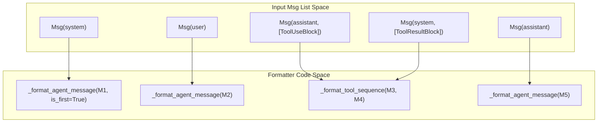
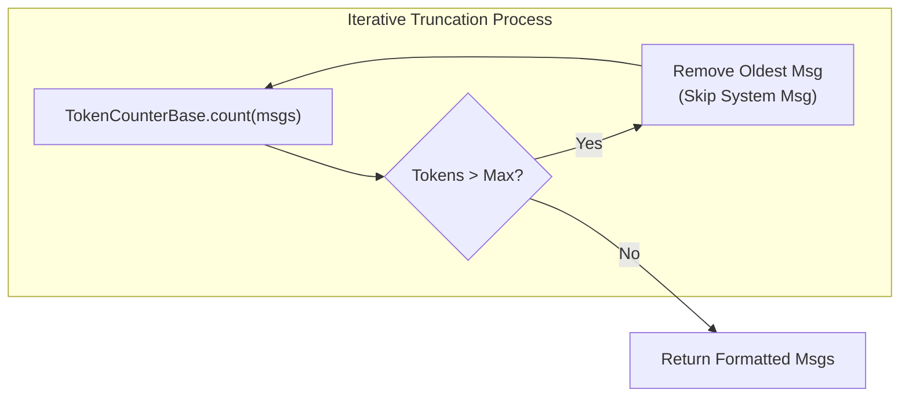
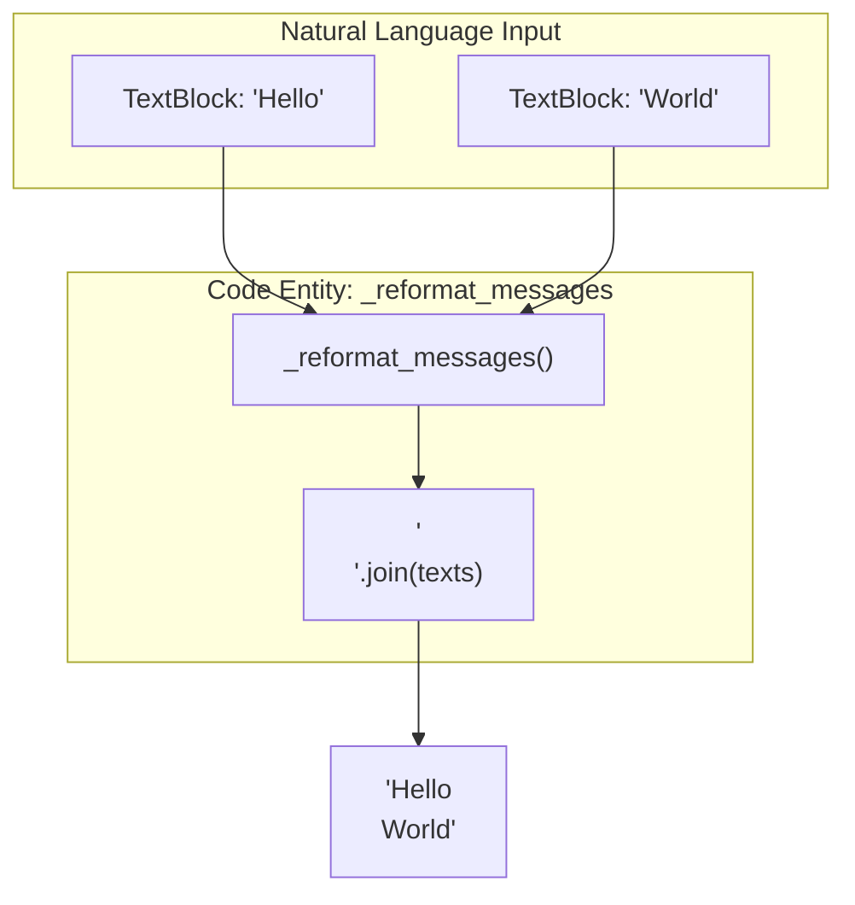

<!-- source: DeepWiki mcp.deepwiki.com · repo modelscope/agentscope · page 3.6 Message Formatters · fetched 2026-10-26 -->

# Message Formatters

Relevant source files

The following files were used as context for generating this wiki page:

- [.gitignore](.gitignore)
- [docs/tutorial/en/src/task_prompt.py](docs/tutorial/en/src/task_prompt.py)
- [docs/tutorial/zh_CN/src/task_prompt.py](docs/tutorial/zh_CN/src/task_prompt.py)
- [src/agentscope/formatter/_anthropic_formatter.py](src/agentscope/formatter/_anthropic_formatter.py)
- [src/agentscope/formatter/_dashscope_formatter.py](src/agentscope/formatter/_dashscope_formatter.py)
- [src/agentscope/formatter/_deepseek_formatter.py](src/agentscope/formatter/_deepseek_formatter.py)
- [src/agentscope/formatter/_formatter_base.py](src/agentscope/formatter/_formatter_base.py)
- [src/agentscope/formatter/_gemini_formatter.py](src/agentscope/formatter/_gemini_formatter.py)
- [src/agentscope/formatter/_ollama_formatter.py](src/agentscope/formatter/_ollama_formatter.py)
- [src/agentscope/formatter/_openai_formatter.py](src/agentscope/formatter/_openai_formatter.py)
- [src/agentscope/mcp/_client_base.py](src/agentscope/mcp/_client_base.py)
- [src/agentscope/memory/_long_term_memory/_long_term_memory_base.py](src/agentscope/memory/_long_term_memory/_long_term_memory_base.py)
- [src/agentscope/memory/_long_term_memory/_mem0/_mem0_long_term_memory.py](src/agentscope/memory/_long_term_memory/_mem0/_mem0_long_term_memory.py)
- [src/agentscope/token/_anthropic_token_counter.py](src/agentscope/token/_anthropic_token_counter.py)
- [src/agentscope/tool/_response.py](src/agentscope/tool/_response.py)
- [tests/formatter_anthropic_test.py](tests/formatter_anthropic_test.py)
- [tests/formatter_dashscope_test.py](tests/formatter_dashscope_test.py)
- [tests/formatter_deepseek_test.py](tests/formatter_deepseek_test.py)
- [tests/formatter_gemini_test.py](tests/formatter_gemini_test.py)
- [tests/formatter_ollama_test.py](tests/formatter_ollama_test.py)
- [tests/mcp_streamable_http_client_test.py](tests/mcp_streamable_http_client_test.py)
- [tests/model_gemini_test.py](tests/model_gemini_test.py)

## Purpose and Scope

Message Formatters are responsible for converting AgentScope's internal `Msg` objects into the specific message formats required by different LLM provider APIs. This module bridges the gap between AgentScope's multimodal message protocol and the varied requirements of providers like OpenAI, Anthropic, DashScope, and Gemini.

Key responsibilities include:
- **Format Conversion**: Transforming `Msg` objects and their `ContentBlock` sequences into provider-specific JSON structures.
- **Context Management**: Implementing token counting and FIFO (First-In-First-Out) truncation to stay within model context limits.
- **Multi-Agent Support**: Consolidating multi-party conversation history into formats compatible with standard user-assistant chat APIs.
- **Multimodal Handling**: Processing `ImageBlock`, `AudioBlock`, and `VideoBlock` into base64 data or specialized URL formats.

For information about the `Msg` object structure, see [Message Protocol and Content Blocks](#2.4). For details on how formatters are utilized within model calls, see [ChatModelBase and Provider Architecture](#3.1).

---

## Formatter Architecture

AgentScope uses a hierarchical architecture centered around `FormatterBase` and `TruncatedFormatterBase`.

### Formatter Hierarchy and File Locations

```mermaid
graph TB
    subgraph "Base Abstractions"
        FormatterBase["FormatterBase<br/>_formatter_base.py<br/>@trace_format"]
        TruncatedFormatterBase["TruncatedFormatterBase<br/>_truncated_formatter_base.py<br/>FIFO Truncation"]
    end
    
    subgraph "Chat Formatter Implementations"
        OpenAIChatFormatter["OpenAIChatFormatter<br/>_openai_formatter.py:168"]
        DashScopeChatFormatter["DashScopeChatFormatter<br/>_dashscope_formatter.py:147"]
        AnthropicChatFormatter["AnthropicChatFormatter<br/>_anthropic_formatter.py:13"]
        GeminiChatFormatter["GeminiChatFormatter<br/>_gemini_formatter.py:107"]
        OllamaChatFormatter["OllamaChatFormatter<br/>_ollama_formatter.py:71"]
        DeepSeekChatFormatter["DeepSeekChatFormatter<br/>_deepseek_formatter.py:13"]
    end
    
    subgraph "Multi-Agent Formatter Implementations"
        OpenAIMultiAgentFormatter["OpenAIMultiAgentFormatter<br/>_openai_formatter.py:362"]
        DashScopeMultiAgentFormatter["DashScopeMultiAgentFormatter<br/>_dashscope_formatter.py"]
        AnthropicMultiAgentFormatter["AnthropicMultiAgentFormatter<br/>_anthropic_formatter.py:123"]
        GeminiMultiAgentFormatter["GeminiMultiAgentFormatter<br/>_gemini_formatter.py:312"]
        OllamaMultiAgentFormatter["OllamaMultiAgentFormatter<br/>_ollama_formatter.py:266"]
        DeepSeekMultiAgentFormatter["DeepSeekMultiAgentFormatter<br/>_deepseek_formatter.py:123"]
    end
    
    FormatterBase -->|"async format()"| TruncatedFormatterBase
    
    TruncatedFormatterBase -->|"_format()"| OpenAIChatFormatter
    TruncatedFormatterBase --> DashScopeChatFormatter
    TruncatedFormatterBase --> AnthropicChatFormatter
    TruncatedFormatterBase --> GeminiChatFormatter
    TruncatedFormatterBase --> OllamaChatFormatter
    TruncatedFormatterBase --> DeepSeekChatFormatter
    
    TruncatedFormatterBase --> OpenAIMultiAgentFormatter
    TruncatedFormatterBase --> DashScopeMultiAgentFormatter
    TruncatedFormatterBase --> AnthropicMultiAgentFormatter
    TruncatedFormatterBase --> GeminiMultiAgentFormatter
    TruncatedFormatterBase --> OllamaMultiAgentFormatter
    TruncatedFormatterBase --> DeepSeekMultiAgentFormatter
```

### Base Class Responsibilities

| Class | Location | Key Functionality |
|-------|----------|-------------------|
| `FormatterBase` | `_formatter_base.py` | Defines the abstract `format(msgs)` interface. Uses `@trace_format` for observability. |
| `TruncatedFormatterBase` | `_truncated_formatter_base.py` | Implements the main `format` loop. Handles token counting via `TokenCounterBase` and provides the `_truncate()` logic. |

Sources: [src/agentscope/formatter/_openai_formatter.py:168-191](), [src/agentscope/formatter/_gemini_formatter.py:107-132](), [src/agentscope/formatter/_dashscope_formatter.py:147-187](), [docs/tutorial/en/src/task_prompt.py:16-51]()

---

## Formatter Patterns: Chat vs. Multi-Agent

AgentScope distinguishes between two primary formatting scenarios based on how agent identities are represented.

### ChatFormatter: User-Assistant Scenario
Designed for standard chatbot scenarios where the conversation is a dialogue between a `user` and an `assistant`.
- **Identity**: Uses the `role` field (`user`, `assistant`, `system`) to map messages directly to the API's role-based requirements.
- **Conversion**: Messages are converted 1-to-1 into the provider's native list of dictionaries.

### MultiAgentFormatter: Multi-Agent Scenario
Designed for environments where multiple agents (identified by `name`) interact.
- **Identity**: Uses the `name` field to distinguish between different agents (e.g., "Alice", "Bob", "Charlie").
- **Consolidation**: Since most APIs only support `user` and `assistant` roles, this formatter merges sequences of agent messages into a single `user` message wrapped in `<history>` and `</history>` tags.
- **DashScope Example**: `{"role": "user", "content": "<history>\nBob: Hello\nAlice: Hi Bob\n</history>"}`.

Sources: [docs/tutorial/en/src/task_prompt.py:16-51](), [docs/tutorial/en/src/task_prompt.py:133-150]()

---

## Provider Support Matrix

Built-in formatters are provided for all major supported LLM backends.

| Provider | Chat Formatter | Multi-Agent Formatter | Tool Use | Image | Audio | Video | Thinking |
|----------|----------------|-----------------------|----------|-------|-------|-------|----------|
| OpenAI | `OpenAIChatFormatter` | `OpenAIMultiAgentFormatter` | ✅ | ✅ | ✅ | ❌ | - |
| DashScope | `DashScopeChatFormatter` | `DashScopeMultiAgentFormatter` | ✅ | ✅ | ✅ | ❌ | - |
| Gemini | `GeminiChatFormatter` | `GeminiMultiAgentFormatter` | ✅ | ✅ | ✅ | ✅ | - |
| Anthropic | `AnthropicChatFormatter` | `AnthropicMultiAgentFormatter` | ✅ | ✅ | ❌ | ❌ | ✅ |
| Ollama | `OllamaChatFormatter` | `OllamaMultiAgentFormatter` | ✅ | ✅ | ❌ | ❌ | - |
| DeepSeek | `DeepSeekChatFormatter` | `DeepSeekMultiAgentFormatter` | ✅ | ❌ | ❌ | ❌ | - |

**Note on Thinking Blocks**: Anthropic suggests preserving thinking blocks in prompts for extended reasoning [docs/tutorial/en/src/task_prompt.py:131](). Other formatters generally ignore `ThinkingBlock` objects during formatting.

Sources: [docs/tutorial/en/src/task_prompt.py:21-131](), [src/agentscope/formatter/_openai_formatter.py:174-190](), [src/agentscope/formatter/_gemini_formatter.py:113-132](), [src/agentscope/formatter/_dashscope_formatter.py:171-187]()

---

## ReAct-Oriented Formatting Logic

Formatters are optimized for ReAct-style agents that alternate between conversation history and tool execution sequences.

### Message Sequence Processing

The `TruncatedFormatterBase` processes message lists by identifying segments such as standard agent messages and tool sequences (a `tool_use` message followed immediately by a `tool_result` message).

Sources: [docs/tutorial/en/src/task_prompt.py:133-150](), [src/agentscope/formatter/_openai_formatter.py:183-190]()

---

## Token Truncation and FIFO Strategy

To prevent context overflow, formatters implement an iterative truncation strategy.

### Truncation Flow

### Key Parameters
- `token_counter`: An instance of `TokenCounterBase` (e.g., `HuggingFaceTokenCounter`).
- `max_tokens`: The hard limit for the formatted prompt.
- `promote_tool_result_images`: If `True`, extracts images from tool results and appends them as separate `user` messages, as most APIs do not support multimodal data within tool-role messages [src/agentscope/formatter/_openai_formatter.py:201-206]().

Sources: [docs/tutorial/zh_CN/src/task_prompt.py:250-289](), [src/agentscope/formatter/_openai_formatter.py:192-217](), [src/agentscope/formatter/_gemini_formatter.py:150-176]()

---

## Provider-Specific Implementations

### OpenAI Formatter
Uses the `name` field in the API to identify different entities [src/agentscope/formatter/_openai_formatter.py:169-172](). It supports multimodal content via `_format_openai_image_block` and `_to_openai_audio_data`.

**Conversion Details**:
- **Images**: Local files are converted to base64 strings; web URLs are passed directly [src/agentscope/formatter/_openai_formatter.py:64-113]().
- **Audio**: Supports `.wav` and `.mp3`. Local files are encoded to base64 [src/agentscope/formatter/_openai_formatter.py:116-165]().

Sources: [src/agentscope/formatter/_openai_formatter.py:27-61](), [src/agentscope/formatter/_openai_formatter.py:168-191]()

### DashScope Formatter
Handles specific DashScope requirements like mandatory `content` fields and `file://` URI prefixes for local files.

**Local File Handling**:
- Uses `_is_accessible_local_file` to detect local paths [src/agentscope/formatter/_dashscope_formatter.py:47]().
- Automatically prepends `file://` and uses absolute paths for the DashScope SDK [src/agentscope/formatter/_dashscope_formatter.py:48]().

Sources: [src/agentscope/formatter/_dashscope_formatter.py:25-65](), [src/agentscope/formatter/_dashscope_formatter.py:152-169]()

### Gemini Formatter
Supports `inline_data` for images, audio, and video [src/agentscope/formatter/_gemini_formatter.py:25-58]().
- **Multimodal Support**: Maps extensions to mime-types (e.g., `.heic`, `.webp` for images; `.mp4`, `.webm` for video) [src/agentscope/formatter/_gemini_formatter.py:134-148]().
- **Tool Use**: Includes `thought_signature` mapping to AgentScope's tool IDs [src/agentscope/formatter/_gemini_formatter.py:208]().

Sources: [src/agentscope/formatter/_gemini_formatter.py:60-105](), [src/agentscope/formatter/_gemini_formatter.py:107-132]()

---

## Implementation Details: Multi-Part Text Consolidation

In DashScope, multiple `TextBlock` entries are often consolidated into a single string to maintain compatibility with standard token counters.

Sources: [src/agentscope/formatter/_dashscope_formatter.py:67-144]()

---

