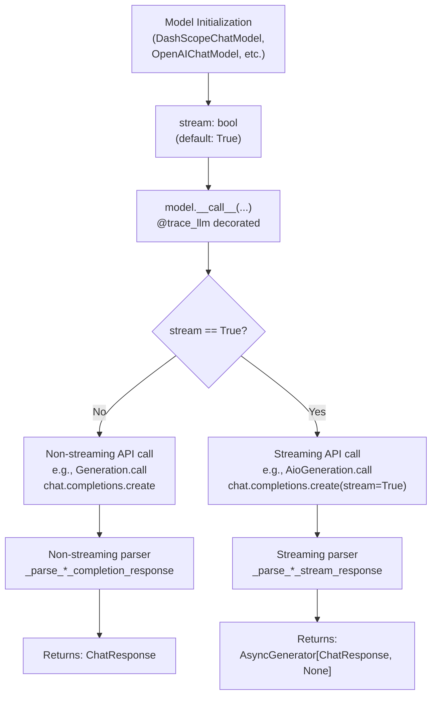
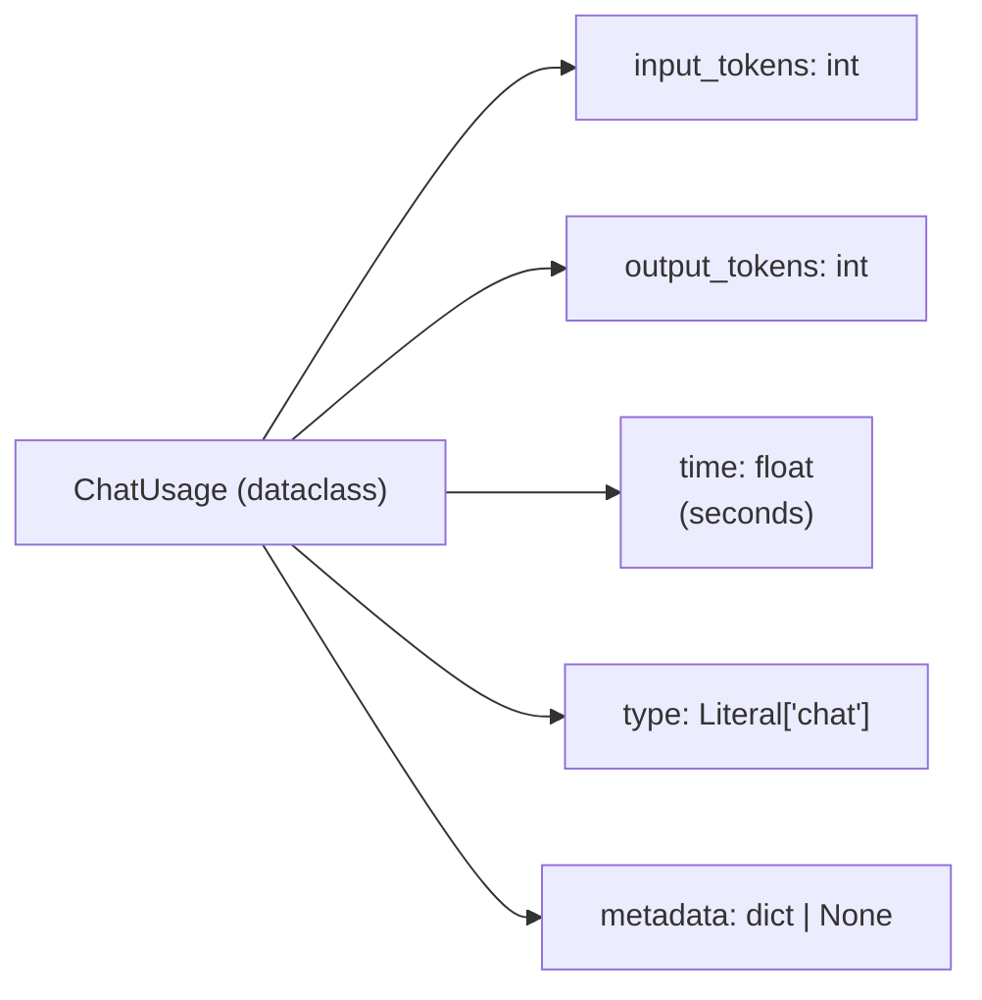
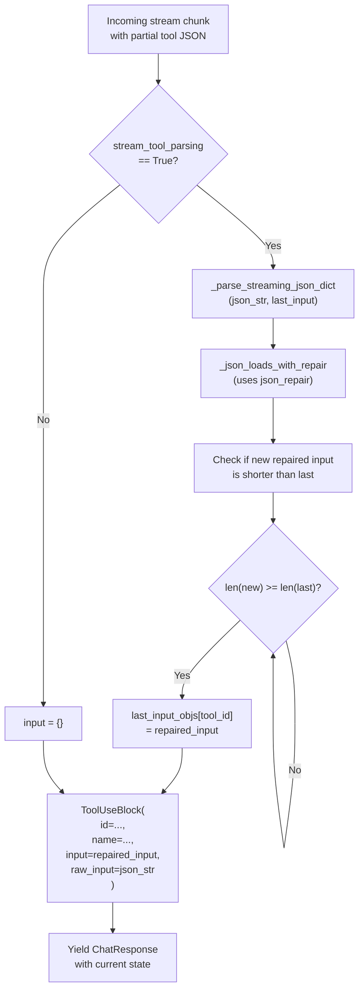

<!-- source: DeepWiki mcp.deepwiki.com · repo modelscope/agentscope · page 3.7 Streaming and Response Handling · fetched 2026-10-26 -->

# Streaming and Response Handling

<details>
<summary>Relevant source files</summary>

The following files were used as context for generating this wiki page:

- [.pre-commit-config.yaml](.pre-commit-config.yaml)
- [examples/agent/voice_agent/README.md](examples/agent/voice_agent/README.md)
- [src/agentscope/_utils/_common.py](src/agentscope/_utils/_common.py)
- [src/agentscope/agent/_react_agent.py](src/agentscope/agent/_react_agent.py)
- [src/agentscope/model/_anthropic_model.py](src/agentscope/model/_anthropic_model.py)
- [src/agentscope/model/_dashscope_model.py](src/agentscope/model/_dashscope_model.py)
- [src/agentscope/model/_gemini_model.py](src/agentscope/model/_gemini_model.py)
- [src/agentscope/model/_model_response.py](src/agentscope/model/_model_response.py)
- [src/agentscope/model/_model_usage.py](src/agentscope/model/_model_usage.py)
- [src/agentscope/model/_ollama_model.py](src/agentscope/model/_ollama_model.py)
- [src/agentscope/model/_openai_model.py](src/agentscope/model/_openai_model.py)
- [tests/model_anthropic_test.py](tests/model_anthropic_test.py)
- [tests/model_dashscope_test.py](tests/model_dashscope_test.py)
- [tests/model_ollama_test.py](tests/model_ollama_test.py)
- [tests/model_openai_test.py](tests/model_openai_test.py)

</details>


This document describes how AgentScope handles LLM responses in both streaming and non-streaming modes, including the `ChatResponse` structure, incremental tool call parsing, and provider-specific streaming implementations.

For information about model integration and initialization, see [ChatModelBase and Provider Architecture](src/agentscope/model/_model_base.py). For details on tool execution after responses are parsed, see [Tool Registration and Execution](src/agentscope/tool/toolkit.py). For structured output generation, see [Structured Output and Tool Calling](src/agentscope/model/_model_base.py).

---

## Overview

AgentScope supports two response modes for LLM API calls:

- **Non-streaming mode**: The complete response is generated server-side and returned as a single `ChatResponse` object. [src/agentscope/model/_model_response.py:20-43]()
- **Streaming mode**: The response is generated incrementally, yielding `ChatResponse` objects as chunks arrive. [src/agentscope/model/_dashscope_model.py:170-170]()

All model wrappers (`DashScopeChatModel`, `OpenAIChatModel`, `GeminiChatModel`, `AnthropicChatModel`, `OllamaChatModel`) implement both modes through a unified interface. The mode is controlled by the `stream` parameter during model initialization and affects the return type of the `__call__` method. [src/agentscope/model/_dashscope_model.py:77-130](), [src/agentscope/model/_openai_model.py:77-147](), [src/agentscope/model/_gemini_model.py:122-192](), [src/agentscope/model/_anthropic_model.py:48-125](), [src/agentscope/model/_ollama_model.py:39-88]()

---

## Streaming vs Non-Streaming Execution

### Execution Mode Selection



**Diagram: Streaming vs Non-Streaming Execution Flow**

The `stream` parameter determines both the API invocation method and the return type. When `stream=False`, the model's `__call__` method returns a single `ChatResponse` object after the complete generation. When `stream=True`, it returns an async generator that yields `ChatResponse` objects as chunks arrive from the API.

**Sources:** [src/agentscope/model/_dashscope_model.py:163-281](), [src/agentscope/model/_openai_model.py:174-264](), [src/agentscope/model/_gemini_model.py:202-304](), [src/agentscope/model/_anthropic_model.py:137-257](), [src/agentscope/model/_ollama_model.py:101-172]()

### Return Type Signatures

| Model Class | Non-Streaming Return | Streaming Return |
|-------------|---------------------|------------------|
| `DashScopeChatModel` | `ChatResponse` | `AsyncGenerator[ChatResponse, None]` |
| `OpenAIChatModel` | `ChatResponse` | `AsyncGenerator[ChatResponse, None]` |
| `GeminiChatModel` | `ChatResponse` | `AsyncGenerator[ChatResponse, None]` |
| `AnthropicChatModel` | `ChatResponse` | `AsyncGenerator[ChatResponse, None]` |
| `OllamaChatModel` | `ChatResponse` | `AsyncGenerator[ChatResponse, None]` |

All model wrappers use the same return type convention defined in their `__call__` method signatures.

**Sources:** [src/agentscope/model/_dashscope_model.py:170](), [src/agentscope/model/_openai_model.py:181](), [src/agentscope/model/_gemini_model.py:208](), [src/agentscope/model/_anthropic_model.py:144](), [src/agentscope/model/_ollama_model.py:108]()

---

## ChatResponse Structure

### Response Object Components

The `ChatResponse` object is the unified response format across all model providers:

```python
@dataclass
class ChatResponse(DictMixin):
    content: Sequence[TextBlock | ToolUseBlock | ThinkingBlock | AudioBlock]
    id: str = field(default_factory=lambda: _get_timestamp(True))
    created_at: str = field(default_factory=_get_timestamp)
    type: Literal["chat"] = field(default_factory=lambda: "chat")
    usage: ChatUsage | None = field(default_factory=lambda: None)
    metadata: dict[str, JSONSerializableObject] | None = field(default_factory=lambda: None)
```

**Content blocks** defined in `agentscope.message` include:
- `TextBlock`: Text content from the model. [src/agentscope/message/__init__.py]()
- `ThinkingBlock`: Reasoning/thinking content (for models like DeepSeek-R1, QwQ, Claude with thinking). [src/agentscope/message/__init__.py]()
- `ToolUseBlock`: Tool/function call requests including `id`, `name`, `input`, and `raw_input`. [src/agentscope/message/__init__.py]()
- `AudioBlock`: Audio output (for models like GPT-4o Audio). [src/agentscope/message/__init__.py]()

**Sources:** [src/agentscope/model/_model_response.py:19-43](), [src/agentscope/message/__init__.py]()

### ChatUsage Structure



**Diagram: ChatUsage Structure**

The `ChatUsage` object tracks token consumption and response time. In streaming mode, usage information typically appears in the final chunk. The `metadata` field stores provider-specific usage details.

**Sources:** [src/agentscope/model/_model_usage.py:9-27]()

---

## Stream Tool Parsing

### Incremental JSON Repair Mechanism

The `stream_tool_parsing` parameter (default `True`) controls how tool call arguments are parsed during streaming. This feature enables real-time access to partial tool arguments before the complete JSON arrives.



**Diagram: Stream Tool Parsing Logic**

When `stream_tool_parsing=True`, the system attempts to parse incomplete JSON at each chunk using `_parse_streaming_json_dict` and `_json_loads_with_repair`. To prevent regression (where a later chunk has less valid JSON than an earlier one), the system keeps the longest successfully parsed result. The `raw_input` field preserves the original incomplete string.

**Sources:** [src/agentscope/_utils/_common.py:31-95](), [src/agentscope/model/_dashscope_model.py:82-119](), [src/agentscope/model/_openai_model.py:80-110](), [src/agentscope/model/_anthropic_model.py:50-82]()

---

## Provider-Specific Streaming Implementation

### DashScope Streaming

The `DashScopeChatModel` handles both text and multimodal APIs. It accumulated `acc_content` and `acc_thinking_content` (for models like QwQ or DeepSeek-R1) and yields `ChatResponse` objects. It supports `stream_tool_parsing` to repair partial JSON in `tool_calls`.

**Sources:** [src/agentscope/model/_dashscope_model.py:72-122](), [src/agentscope/model/_dashscope_model.py:300-481]()

### OpenAI Streaming

The `OpenAIChatModel` uses `AsyncStream` from the OpenAI SDK. It processes deltas for text, thinking, and tool calls. It handles `reasoning_content` for models like `o1` or `o3`. Audio chunks are also supported for omni models.

**Sources:** [src/agentscope/model/_openai_model.py:308-514](), [src/agentscope/model/_openai_model.py:45-69]()

### Gemini Streaming

The `GeminiChatModel` processes an `AsyncIterator[GenerateContentResponse]`. It distinguishes between `thought` parts and `text` parts. Tool calls are extracted from `part.function_call`.

**Sources:** [src/agentscope/model/_gemini_model.py:336-441]()

### Anthropic Streaming

The `AnthropicChatModel` handles Claude's event-based streaming (`message_start`, `content_block_delta`, etc.). It supports internal reasoning through the `thinking` block and uses buffers to accumulate partial tool use JSON.

**Sources:** [src/agentscope/model/_anthropic_model.py:359-532]()

### Ollama Streaming

The `OllamaChatModel` parses chunks from the Ollama API. It supports thinking blocks and tool calls. It uses `_json_loads_with_repair` to handle structured output parsing from streaming text.

**Sources:** [src/agentscope/model/_ollama_model.py:174-273]()

---

## Content Block Accumulation

All streaming parsers maintain internal state to accumulate content across chunks before yielding a unified `ChatResponse`.

| Provider | Text Accumulator | Thinking Accumulator | Tool Calls Storage |
|----------|-----------------|---------------------|-------------------|
| DashScope | `acc_content` | `acc_thinking_content` | `collections.defaultdict` |
| OpenAI | `text` | `thinking` | `collections.OrderedDict` |
| Gemini | `text` | `thinking` | `list[ToolUseBlock]` |
| Anthropic | `text_buffer` | `thinking_buffer` | `OrderedDict` |
| Ollama | `text` | `thinking` | `list` |

**Sources:** [src/agentscope/model/_dashscope_model.py:337-390](), [src/agentscope/model/_openai_model.py:337-417](), [src/agentscope/model/_gemini_model.py:365-410](), [src/agentscope/model/_anthropic_model.py:388-450](), [src/agentscope/model/_ollama_model.py:210-250]()

---

## Best Practices

### Consuming Streaming Responses

The standard pattern for consuming streaming responses in AgentScope:

```python
model = DashScopeChatModel(model_name="qwen-turbo", api_key="...", stream=True)
result = await model(messages)

# result is an AsyncGenerator[ChatResponse, None]
async for response in result:
    # response is a ChatResponse object containing partial content
    for block in response.content:
        if isinstance(block, TextBlock):
            print(block.text, end="")
        elif isinstance(block, ThinkingBlock):
            print(f"Thinking: {block.thinking}", end="")
```

**Sources:** [tests/model_dashscope_test.py:153-189](), [tests/model_openai_test.py:145-181]()

---

