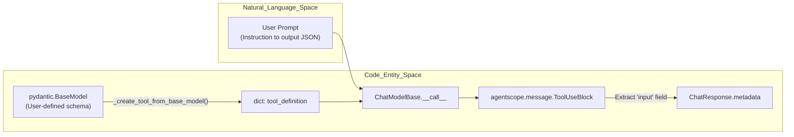
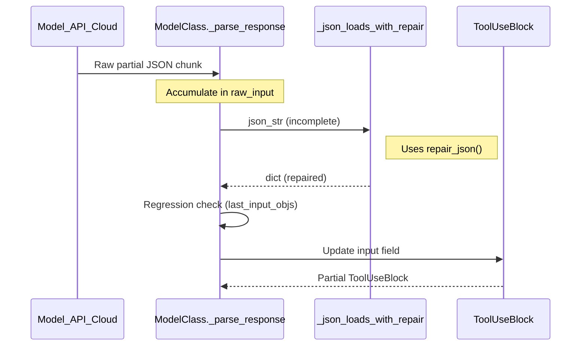

<!-- source: DeepWiki mcp.deepwiki.com · repo modelscope/agentscope · page 3.8 Structured Output and Tool Calling · fetched 2026-10-26 -->

# Structured Output and Tool Calling

<details>
<summary>Relevant source files</summary>

The following files were used as context for generating this wiki page:

- [.gemini/styleguide.md](.gemini/styleguide.md)
- [.github/copilot-instructions.md](.github/copilot-instructions.md)
- [src/agentscope/_utils/_common.py](src/agentscope/_utils/_common.py)
- [src/agentscope/_version.py](src/agentscope/_version.py)
- [src/agentscope/agent/_react_agent.py](src/agentscope/agent/_react_agent.py)
- [src/agentscope/model/_anthropic_model.py](src/agentscope/model/_anthropic_model.py)
- [src/agentscope/model/_dashscope_model.py](src/agentscope/model/_dashscope_model.py)
- [src/agentscope/model/_gemini_model.py](src/agentscope/model/_gemini_model.py)
- [src/agentscope/model/_model_usage.py](src/agentscope/model/_model_usage.py)
- [src/agentscope/model/_ollama_model.py](src/agentscope/model/_ollama_model.py)
- [src/agentscope/model/_openai_model.py](src/agentscope/model/_openai_model.py)
- [src/agentscope/tool/_toolkit.py](src/agentscope/tool/_toolkit.py)
- [src/agentscope/tool/_types.py](src/agentscope/tool/_types.py)
- [tests/model_anthropic_test.py](tests/model_anthropic_test.py)
- [tests/model_dashscope_test.py](tests/model_dashscope_test.py)
- [tests/model_ollama_test.py](tests/model_ollama_test.py)
- [tests/model_openai_test.py](tests/model_openai_test.py)
- [tests/toolkit_async_execution_test.py](tests/toolkit_async_execution_test.py)

</details>


## Purpose and Scope

This document explains how AgentScope handles **structured output generation** and **tool calling** across different LLM providers. Structured output refers to forcing models to return data conforming to a Pydantic schema, while tool calling enables models to invoke external functions with typed parameters.

**Scope:**
- Tool schema formatting and JSON schema generation.
- Structured output via Pydantic `BaseModel` conversion.
- Provider-specific tool formatting (OpenAI, DashScope, Gemini, Anthropic).
- Streaming tool call parsing with automatic JSON repair.
- Tool choice modes and their effects on model behavior.

**Related Topics:**
- For tool registration and execution, see [4.1]() and [4.2]().
- For message blocks and content types, see [2.4]().
- For model integration architecture, see [3.1]().

---

## Tool Schema Format

AgentScope uses a **unified JSON schema format** for tool definitions across all model providers. Each tool is represented as a function with typed parameters.

### Standard Tool Schema Structure

```json
{
  "type": "function",
  "function": {
    "name": "tool_name",
    "description": "Tool description",
    "parameters": {
      "type": "object",
      "properties": {
        "param1": {
          "type": "string",
          "description": "Parameter description"
        },
        "param2": {
          "type": "integer",
          "default": 10
        }
      },
      "required": ["param1"]
    }
  }
}
```

### Schema Extraction from Python Functions

The `_parse_tool_function` utility automatically extracts JSON schemas from Python functions by parsing their docstrings and type annotations [src/agentscope/_utils/_common.py:38]().

1. **Docstring Parsing**: Uses `docstring_parser` to extract parameter descriptions [src/agentscope/_utils/_common.py:18]().
2. **Type Annotation**: Converts Python type hints to JSON schema types using Pydantic's `create_model` [src/agentscope/_utils/_common.py:20]().
3. **Title Removal**: Strips `title` fields via `_remove_title_field` [src/agentscope/_utils/_common.py:239-245]() to avoid misleading LLMs.

**Sources:** [src/agentscope/_utils/_common.py:18-40](), [src/agentscope/_utils/_common.py:239-245]()

---

## Structured Output with Pydantic BaseModel

Structured output enables models to return data conforming to a specific Pydantic schema. AgentScope achieves this by **converting the schema into a tool function** or using native provider features.

### Conversion Mechanism

The diagram below shows how a `BaseModel` is transformed into a system entity used by the model APIs.

**Model Schema to Code Entity Mapping**

**Sources:** [src/agentscope/_utils/_common.py:29-30](), [src/agentscope/model/_dashscope_model.py:247-261](), [src/agentscope/model/_openai_model.py:267-287]()

### Implementation Details

The `_create_tool_from_base_model` function performs the conversion [src/agentscope/_utils/_common.py:29-30]():

```python
# Simplified flow
schema = structured_model.model_json_schema()
_remove_title_field(schema)  # Remove title fields
tool_definition = {
    "type": "function",
    "function": {
        "name": "generate_structured_output",
        "description": "Generate the required structured output with this function",
        "parameters": schema,
    },
}
```

### Provider-Specific Handling

| Provider | Method | `structured_model` Behavior |
|----------|--------|---------------------------|
| **OpenAI** | `response_format` | Uses native structured output API when `structured_model` is provided [src/agentscope/model/_openai_model.py:267-287](). |
| **DashScope** | Tool call conversion | Converts to tool function, sets `tool_choice` to function name [src/agentscope/model/_dashscope_model.py:247-261](). |
| **Gemini** | `response_schema` | Uses `response_mime_type="application/json"` with flattened schema [src/agentscope/model/_gemini_model.py:261-272](). |
| **Anthropic** | Tool call conversion | Converts to tool function, sets `tool_choice` to function name [src/agentscope/model/_anthropic_model.py:232-246](). |
| **Ollama** | `format` | Passes `model_json_schema()` directly to the `format` parameter [src/agentscope/model/_ollama_model.py:153-154](). |

**Sources:** [src/agentscope/model/_openai_model.py:267-287](), [src/agentscope/model/_dashscope_model.py:247-261](), [src/agentscope/model/_gemini_model.py:261-272](), [src/agentscope/model/_anthropic_model.py:232-246](), [src/agentscope/model/_ollama_model.py:153-154]()

---

## Tool Calling Mechanics

### ToolUseBlock Structure

When a model decides to call a tool, it returns a `ToolUseBlock` [src/agentscope/message/_message_block.py:79-92] (implied by usage in [src/agentscope/model/_dashscope_model.py:31]()):

```python
{
    "type": "tool_use",
    "id": "call_123",           # Unique identifier for this call
    "name": "function_name",    # Tool function name
    "input": {"key": "value"},  # Parsed input dictionary
    "raw_input": '{"key": "value"}'  # Raw JSON string from model
}
```

### Tool Choice Modes

The `tool_choice` parameter controls which tools the model can invoke:

| Mode | Behavior | Provider Support |
|------|----------|-----------------|
| `"auto"` | Model decides whether to call tools | All providers |
| `"none"` | Model cannot call tools | All providers |
| `"required"` | Model must call at least one tool | OpenAI, DashScope, Anthropic |
| `"function_name"` | Model must call specific function | OpenAI, DashScope, Anthropic |

**Sources:** [src/agentscope/model/_openai_model.py:178](), [src/agentscope/model/_dashscope_model.py:167](), [src/agentscope/model/_anthropic_model.py:141](), [src/agentscope/model/_gemini_model.py:206]()

### Response Parsing Flow

**Streaming Tool Parsing Sequence**

**Sources:** [src/agentscope/_utils/_common.py:31-69](), [src/agentscope/model/_dashscope_model.py:82-119](), [src/agentscope/model/_openai_model.py:105-110]()

---

## Provider-Specific Tool Formatting

### Gemini Format and Schema Flattening

Gemini requires **flattening nested schemas** to remove `$defs` and `$ref` references. This is handled by `_flatten_json_schema` [src/agentscope/model/_gemini_model.py:36-112]().

**Transformation Logic:**
- Resolves all `$ref` references by inlining definitions.
- Detects circular references to prevent infinite recursion [src/agentscope/model/_gemini_model.py:77-85]().
- Merges additional properties from the original object [src/agentscope/model/_gemini_model.py:97-99]().

**Sources:** [src/agentscope/model/_gemini_model.py:36-112]()

### DashScope and Anthropic Validation

Both `DashScopeChatModel` and `AnthropicChatModel` use the `_create_tool_from_base_model` utility to ensure structured output is requested via a tool-calling interface when native JSON modes are unavailable or less reliable [src/agentscope/model/_dashscope_model.py:29-30](), [src/agentscope/model/_anthropic_model.py:26-27]().

---

## Streaming and Tool Parsing

### JSON Repair and Regression Prevention

The `_json_loads_with_repair` utility [src/agentscope/_utils/_common.py:31-69]() uses `repair_json` to handle malformed or incomplete strings. During streaming, `_parse_streaming_json_dict` ensures that the repaired JSON does not "shrink" or regress compared to previous chunks [src/agentscope/_utils/_common.py:72-94]().

### Control Parameter: `stream_tool_parsing`

The `stream_tool_parsing` parameter (default: `True`) allows real-time access to tool arguments:
- **If `True`**: Partial JSON is repaired and updated in the `input` field of `ToolUseBlock` in real-time [src/agentscope/model/_dashscope_model.py:82-119](), [src/agentscope/model/_openai_model.py:105-110]().
- **If `False`**: The `input` field typically remains empty or unparsed until the final chunk arrives.

**Sources:** [src/agentscope/_utils/_common.py:31-69](), [src/agentscope/_utils/_common.py:72-94](), [src/agentscope/model/_dashscope_model.py:136](), [src/agentscope/model/_openai_model.py:170]()

---

## Summary Table: Provider Comparison

| Feature | OpenAI | DashScope | Gemini | Anthropic | Ollama |
|---------|--------|-----------|--------|-----------|--------|
| **Tool Schema Format** | Standard | Standard | Flattened [src/agentscope/model/_gemini_model.py:36]() | Standard | Standard |
| **Structured Output** | Native [src/agentscope/model/_openai_model.py:267]() | Tool Call [src/agentscope/model/_dashscope_model.py:247]() | Native [src/agentscope/model/_gemini_model.py:261]() | Tool Call [src/agentscope/model/_anthropic_model.py:232]() | Native [src/agentscope/model/_ollama_model.py:153]() |
| **Tool Choice "required"** | ✅ Native | ✅ Native | ✅ Native | ✅ Native | ❌ Ignored [src/agentscope/model/_ollama_model.py:151]() |
| **Streaming Tool Parsing** | ✅ Supported | ✅ Supported | ✅ Supported | ✅ Supported | ✅ Supported |

**Sources:** [src/agentscope/model/_openai_model.py:267-287](), [src/agentscope/model/_dashscope_model.py:247-261](), [src/agentscope/model/_gemini_model.py:261-272](), [src/agentscope/model/_anthropic_model.py:232-246](), [src/agentscope/model/_ollama_model.py:151-154]()

---

