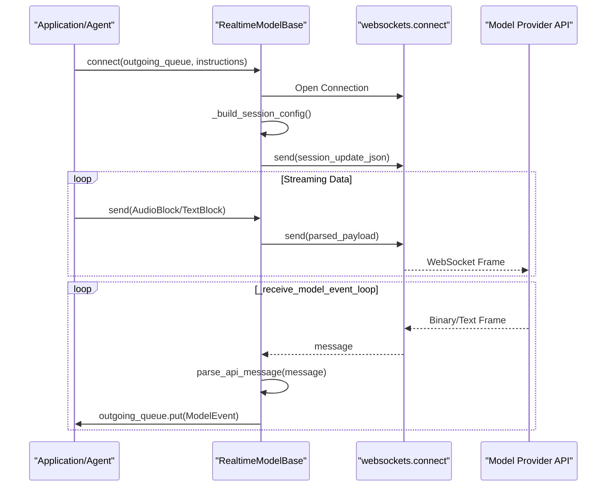
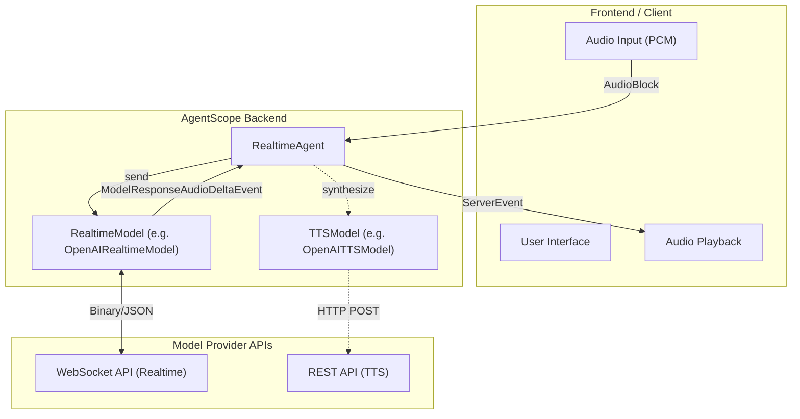

<!-- source: DeepWiki mcp.deepwiki.com · repo modelscope/agentscope · page 3.9 Realtime and TTS Models · fetched 2026-10-26 -->

# Realtime and TTS Models

Relevant source files

The following files were used as context for generating this wiki page:

- [assets/images/dingtalk_qr_code.png](assets/images/dingtalk_qr_code.png)
- [docs/tutorial/en/build.sh](docs/tutorial/en/build.sh)
- [docs/tutorial/en/src/task_realtime.py](docs/tutorial/en/src/task_realtime.py)
- [docs/tutorial/en/src/task_tts.py](docs/tutorial/en/src/task_tts.py)
- [docs/tutorial/zh_CN/build.sh](docs/tutorial/zh_CN/build.sh)
- [docs/tutorial/zh_CN/src/task_realtime.py](docs/tutorial/zh_CN/src/task_realtime.py)
- [docs/tutorial/zh_CN/src/task_tts.py](docs/tutorial/zh_CN/src/task_tts.py)
- [src/agentscope/realtime/_base.py](src/agentscope/realtime/_base.py)
- [src/agentscope/realtime/_dashscope_realtime_model.py](src/agentscope/realtime/_dashscope_realtime_model.py)
- [src/agentscope/realtime/_gemini_realtime_model.py](src/agentscope/realtime/_gemini_realtime_model.py)
- [src/agentscope/realtime/_openai_realtime_model.py](src/agentscope/realtime/_openai_realtime_model.py)
- [src/agentscope/tts/__init__.py](src/agentscope/tts/__init__.py)
- [src/agentscope/tts/_dashscope_cosyvoice_realtime_tts_model.py](src/agentscope/tts/_dashscope_cosyvoice_realtime_tts_model.py)
- [src/agentscope/tts/_dashscope_cosyvoice_tts_model.py](src/agentscope/tts/_dashscope_cosyvoice_tts_model.py)
- [src/agentscope/tts/_openai_tts_model.py](src/agentscope/tts/_openai_tts_model.py)
- [src/agentscope/tts/_utils.py](src/agentscope/tts/_utils.py)
- [tests/realtime_gemini_test.py](tests/realtime_gemini_test.py)
- [tests/realtime_openai_test.py](tests/realtime_openai_test.py)
- [tests/tts_dashscope_cosyvoice_test.py](tests/tts_dashscope_cosyvoice_test.py)

This page documents the integration of Realtime multimodal models and Text-to-Speech (TTS) models within AgentScope. These components enable low-latency, bidirectional voice and multimodal interactions, allowing agents to perceive and respond using audio, text, and images in real-time.

## Realtime Models

Realtime models in AgentScope are designed for low-latency, streaming communication, typically over WebSockets. They differ from standard chat models by supporting continuous data flow and event-based interactions.

### RealtimeModelBase Architecture

`RealtimeModelBase` provides the foundation for all realtime model implementations. It manages the WebSocket lifecycle, message queuing, and event parsing.

*   **Initialization**: Sets up the model name and an internal `_incoming_queue` for handling data returned from the API [src/agentscope/realtime/_base.py:34-54]().
*   **Connection Management**: The `connect` method establishes the WebSocket connection using the `websockets` library and starts a background task (`_receive_model_event_loop`) to process incoming messages [src/agentscope/realtime/_base.py:68-93]().
*   **Data Flow**: Data is sent via the `send` method [src/agentscope/realtime/_base.py:57-66]() and received through an `outgoing_queue` provided during connection [src/agentscope/realtime/_base.py:70-78]().

### Supported Realtime Providers

AgentScope provides specialized implementations for major realtime API providers:

| Provider | Class | Supported Modalities | Key Features |
| :--- | :--- | :--- | :--- |
| **DashScope** | `DashScopeRealtimeModel` | text, audio, image | 16kHz input, 16/24kHz output, Server VAD [src/agentscope/realtime/_dashscope_realtime_model.py:23-42]() |
| **OpenAI** | `OpenAIRealtimeModel` | audio, text, tool_result | 24kHz sample rate, native tool support [src/agentscope/realtime/_openai_realtime_model.py:22-38]() |
| **Gemini** | `GeminiRealtimeModel` | audio, text, image, tool_result | Native audio preview support [src/agentscope/realtime/_gemini_realtime_model.py:24-27]() |

**Sources:** [src/agentscope/realtime/_dashscope_realtime_model.py:15-83](), [src/agentscope/realtime/_openai_realtime_model.py:19-79](), [src/agentscope/realtime/_base.py:13-33]()

### Event System and Data Flow

Communication between the model and AgentScope is unified using an event-based system defined in `ModelEvents`. The `parse_api_message` method in each provider converts raw WebSocket frames into structured events [src/agentscope/realtime/_base.py:160-174]().

**Realtime Model Interaction Logic**

**Sources:** [src/agentscope/realtime/_base.py:68-157](), [src/agentscope/realtime/_dashscope_realtime_model.py:133-207](), [src/agentscope/realtime/_openai_realtime_model.py:151-215]()

---

## Text-to-Speech (TTS) Models

AgentScope provides a unified interface for TTS models, supporting both standard (non-realtime) and realtime streaming synthesis.

### TTSModelBase Interface

The `TTSModelBase` class defines the interface for all TTS providers [src/agentscope/tts/_tts_base.py:14-14]().

*   **`synthesize(msg)`**: The primary method for generating speech from text. In streaming mode (`stream=True`), it returns an `AsyncGenerator` yielding `TTSResponse` objects [src/agentscope/tts/_openai_tts_model.py:76-111]().
*   **Streaming Input**: Indicated by the `supports_streaming_input` attribute. Realtime TTS models (like `DashScopeRealtimeTTSModel`) can accept incremental text chunks via a `push()` method [docs/tutorial/en/src/task_tts.py:156-189]().

### Supported TTS Providers

| Class | Provider | Streaming Input | Streaming Output |
| :--- | :--- | :--- | :--- |
| `DashScopeTTSModel` | DashScope | ❌ | ✅ |
| `DashScopeRealtimeTTSModel` | DashScope | ✅ | ✅ |
| `DashScopeCosyVoiceTTSModel` | DashScope | ❌ | ✅ |
| `OpenAITTSModel` | OpenAI | ❌ | ✅ |
| `GeminiTTSModel` | Gemini | ❌ | ✅ |

**Sources:** [docs/tutorial/en/src/task_tts.py:13-58](), [src/agentscope/tts/_openai_tts_model.py:17-25](), [src/agentscope/tts/__init__.py:4-13]()

### Implementation Detail: OpenAI TTS
The `OpenAITTSModel` uses the `openai.AsyncOpenAI` client [src/agentscope/tts/_openai_tts_model.py:67-71](). When `stream=True`, it calls `with_streaming_response.create` and uses `_parse_into_async_generator` to yield chunks of `AudioBlock` with `Base64Source` [src/agentscope/tts/_openai_tts_model.py:100-184]().

---

## Voice Agent Pattern

The "Voice Agent" pattern integrates a `ChatModel` for reasoning and a `TTSModel` for vocalization.

### Integration with ReActAgent
When a `ReActAgent` is initialized with a `tts_model`, it automatically handles speech synthesis for its responses [docs/tutorial/en/src/task_tts.py:208-226]().

1.  **Generation**: The agent generates text (potentially streamed) via its `model`.
2.  **Synthesis**: The generated text is passed to `tts_model.synthesize()`.
3.  **Attachment**: Synthesized audio is attached to the `speech` field of the `Msg` object [docs/tutorial/en/src/task_tts.py:193-205]().
4.  **Output**: Audio is played or processed during `agent.print()` [docs/tutorial/en/src/task_tts.py:204-205]().

### Realtime Voice Agent Components
For high-performance voice interaction, AgentScope uses a combination of `RealtimeModel` and specific `AudioBlock` structures.

**Voice Agent Architecture**

**Sources:** [docs/tutorial/en/src/task_tts.py:193-205](), [src/agentscope/realtime/_openai_realtime_model.py:187-194](), [src/agentscope/realtime/_dashscope_realtime_model.py:180-187]()

### Audio Configuration Requirements
Different providers require specific sample rates for audio processing:
*   **DashScope**: 16,000 Hz input [src/agentscope/realtime/_dashscope_realtime_model.py:74-74](). Output is 24,000 Hz for `qwen3-omni-flash-realtime` or 16,000 Hz otherwise [src/agentscope/realtime/_dashscope_realtime_model.py:79-82]().
*   **OpenAI**: Fixed 24,000 Hz for both input and output [src/agentscope/realtime/_openai_realtime_model.py:68-69]().

**Sources:** [src/agentscope/realtime/_dashscope_realtime_model.py:72-82](), [src/agentscope/realtime/_openai_realtime_model.py:67-69]()

---

