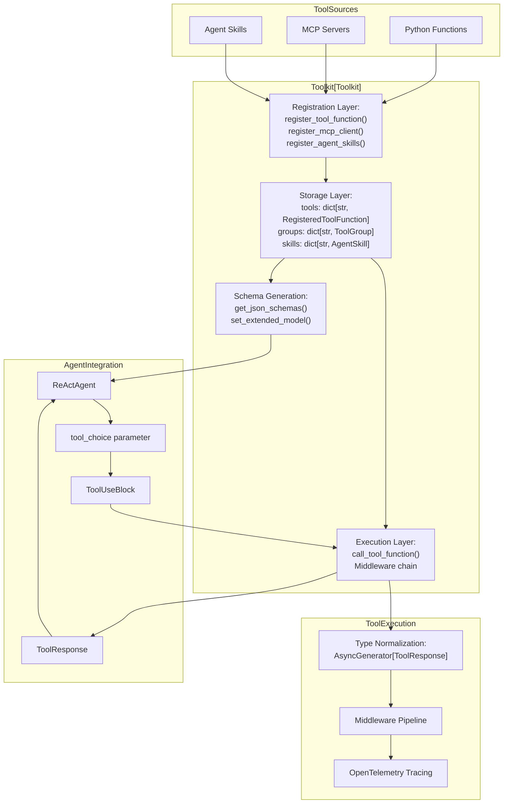
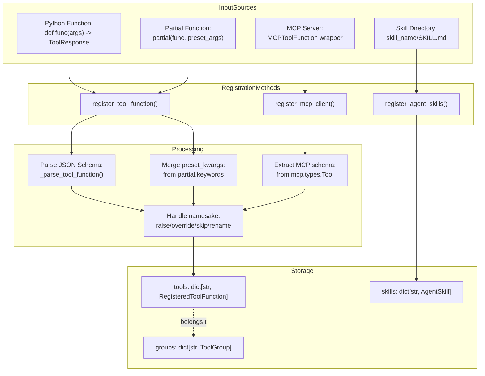
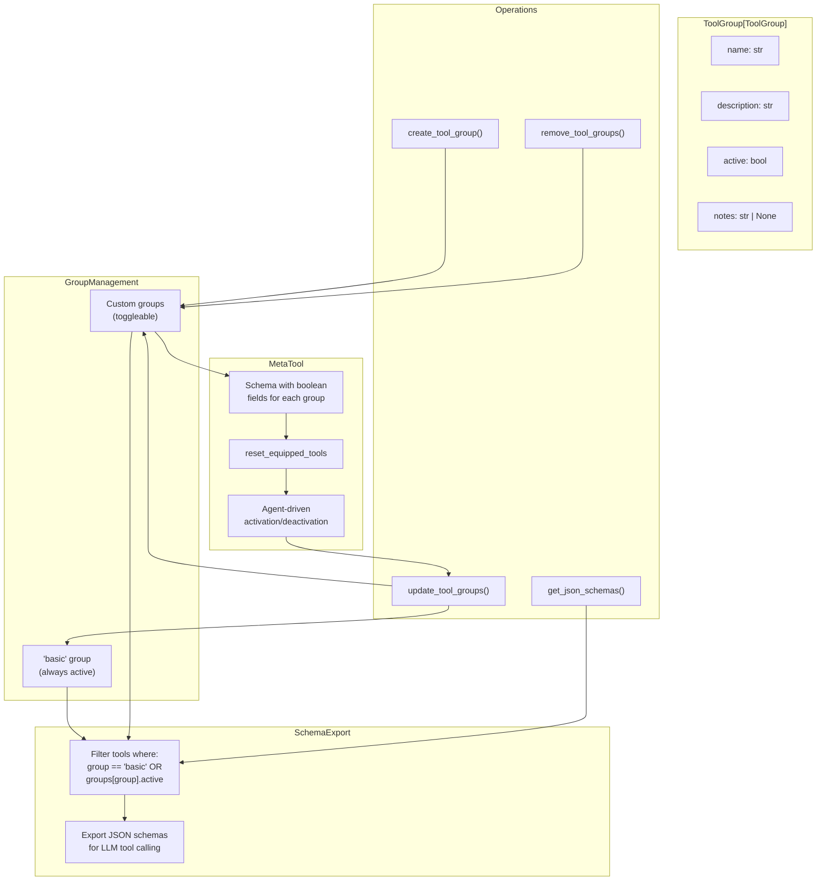
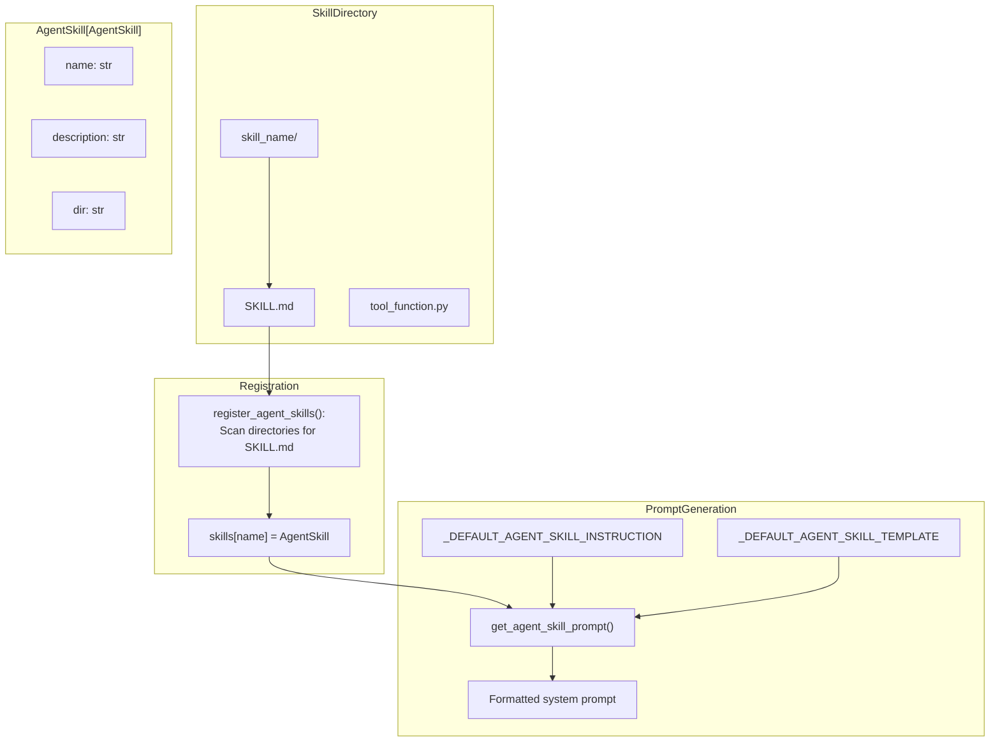
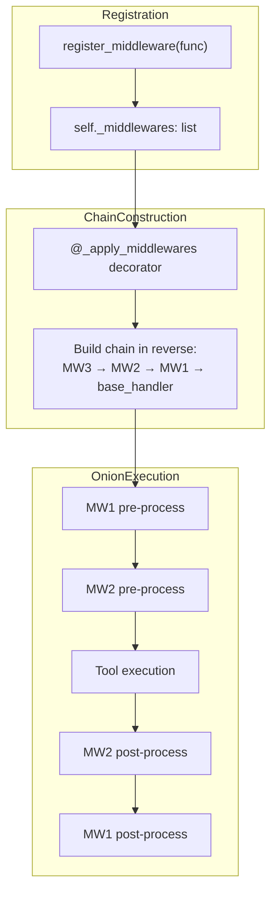

<!-- source: DeepWiki mcp.deepwiki.com · repo modelscope/agentscope · page 4 Tool System · fetched 2026-10-26 -->

# Tool System

<details>
<summary>Relevant source files</summary>

The following files were used as context for generating this wiki page:

- [.gemini/styleguide.md](.gemini/styleguide.md)
- [.github/copilot-instructions.md](.github/copilot-instructions.md)
- [docs/tutorial/en/src/quickstart_agent.py](docs/tutorial/en/src/quickstart_agent.py)
- [src/agentscope/_version.py](src/agentscope/_version.py)
- [src/agentscope/plan/_in_memory_storage.py](src/agentscope/plan/_in_memory_storage.py)
- [src/agentscope/plan/_plan_model.py](src/agentscope/plan/_plan_model.py)
- [src/agentscope/plan/_plan_notebook.py](src/agentscope/plan/_plan_notebook.py)
- [src/agentscope/tool/_toolkit.py](src/agentscope/tool/_toolkit.py)
- [src/agentscope/tool/_types.py](src/agentscope/tool/_types.py)
- [tests/plan_test.py](tests/plan_test.py)
- [tests/toolkit_async_execution_test.py](tests/toolkit_async_execution_test.py)
- [tests/toolkit_basic_test.py](tests/toolkit_basic_test.py)
- [tests/toolkit_meta_tool_test.py](tests/toolkit_meta_tool_test.py)

</details>


The Tool System provides infrastructure for registering, managing, and executing tool functions in AgentScope. It enables agents to extend their capabilities through Python functions, MCP (Model Context Protocol) servers, and agent skills. The system supports dynamic tool activation, middleware interception, streaming execution, and structured output validation.

**Key Capabilities:**

- **Multi-source registration**: Python functions, MCP clients, and partial functions. [src/agentscope/tool/_toolkit.py:269-521]()
- **Hierarchical organization**: Tool groups with activation/deactivation control. [src/agentscope/tool/_toolkit.py:182-266]()
- **Unified execution**: Streaming interface for all tool types (sync/async, generators). [src/agentscope/tool/_toolkit.py:672-815]()
- **Schema management**: Automatic JSON schema generation from docstrings and Pydantic models. [src/agentscope/tool/_types.py:59-128]()
- **Runtime control**: Meta-tools for agent-driven tool management. [src/agentscope/tool/_toolkit.py:545-606]()
- **Extensibility**: Middleware system for execution interception and modification. [src/agentscope/tool/_toolkit.py:57-114]()
- **Async Execution**: Support for long-running tasks with background execution and status tracking. [src/agentscope/tool/_toolkit.py:619-670]()

This page provides an architectural overview. For detailed information, see the subsections:
- **[Toolkit Core Architecture](#4.1)**: `Toolkit` class and `RegisteredToolFunction` data structures.
- **[Tool Registration and Execution](#4.2)**: Registration mechanics and the execution pipeline.
- **[Tool Groups and Meta-Tools](#4.3)**: Hierarchical organization and the `reset_equipped_tools` system.
- **[MCP Integration](#4.4)**: Patterns for connecting to Model Context Protocol servers.
- **[Built-in Tools and Agent Skills](#4.5)**: Pre-defined tools and the `SKILL.md` skill system.
- **[Middleware System](#4.6)**: Architecture for tool execution interception.

## System Architecture

The tool system is centered around the `Toolkit` class, which manages registration, storage, schema generation, and execution of tool functions. It coordinates multiple subsystems to provide a unified interface for agents.

**High-Level Architecture**



**Core Components**

| Component | File | Description |
|-----------|------|-------------|
| `Toolkit` | [src/agentscope/tool/_toolkit.py:117-1168]() | Central registry and execution engine. |
| `RegisteredToolFunction` | [src/agentscope/tool/_types.py:16-128]() | Tool metadata and schema with extended model support. |
| `ToolGroup` | [src/agentscope/tool/_types.py:132-145]() | Hierarchical organization with activation state. |
| `ToolResponse` | [src/agentscope/tool/_response.py]() | Unified streaming response format. |
| `MCPToolFunction` | [src/agentscope/mcp/_mcp_function.py:15-116]() | Wrapper for MCP server tools. |

Sources: [src/agentscope/tool/_toolkit.py:117-181](), [src/agentscope/tool/_types.py:1-157]()

## Tool Registration

The toolkit accepts tool functions from three primary sources: Python callables, MCP clients, and agent skill directories. Each source follows a different registration path but results in a unified `RegisteredToolFunction` storage format.

**Registration Sources and Flow**



The toolkit provides flexible registration with automatic schema generation, conflict resolution strategies (raise, override, skip, rename), and support for `preset_kwargs` that are hidden from the agent. [src/agentscope/tool/_toolkit.py:269-521]() See **[Tool Registration and Execution](#4.2)** for detailed registration mechanics.

Sources: [src/agentscope/tool/_toolkit.py:269-521](), [src/agentscope/tool/_toolkit.py:817-955](), [src/agentscope/tool/_types.py:29-33]()

## Tool Execution

The `call_tool_function()` method provides a unified streaming interface for all tool types. It accepts a `ToolUseBlock` (containing tool name and input arguments) and returns an `AsyncGenerator[ToolResponse, None]`, regardless of whether the original function is sync/async, generator/non-generator.

**Unified Execution Interface**

```mermaid
graph LR
    subgraph "Input"
        ToolUseBlock["ToolUseBlock:<br/>{name, input, id}"]
    end
    
    subgraph "ExecutionPipeline"
        Lookup["Lookup in tools dict"]
        Validate["Check group.active"]
        Merge["Merge preset_kwargs"]
        Invoke["Invoke original_func"]
    end
    
    subgraph "TypeNormalization"
        TypeCheck{"Function Type"}
        AsyncGen["AsyncGenerator"]
        SyncGen["Generator"]
        AsyncFunc["Coroutine"]
        Normalize["Normalize to<br/>AsyncGenerator[ToolResponse]"]
    end
    
    subgraph "ProcessingLayers"
        Postprocess["postprocess_func<br/>(optional)"]
        Middleware["Middleware chain<br/>(onion model)"]
        Tracing["@trace_toolkit<br/>(OpenTelemetry)"]
    end
    
    subgraph "Output"
        Stream["Stream accumulated<br/>ToolResponse chunks"]
    end
    
    ToolUseBlock --> Lookup
    Lookup --> Validate
    Validate --> Merge
    Merge --> Invoke
    
    Invoke --> TypeCheck
    TypeCheck --> AsyncGen
    TypeCheck --> SyncGen
    TypeCheck --> AsyncFunc
    
    AsyncGen --> Normalize
    SyncGen --> Normalize
    AsyncFunc --> Normalize
    
    Normalize --> Postprocess
    Postprocess --> Middleware
    Middleware --> Tracing
    Tracing --> Stream
```



**Execution Features:**

- **Type flexibility**: Supports sync/async functions and generators via wrappers like `_sync_generator_wrapper` and `_async_generator_wrapper`. [src/agentscope/tool/_async_wrapper.py:50-110]()
- **Streaming**: All tools return streaming responses via `AsyncGenerator`. [src/agentscope/tool/_toolkit.py:672-815]()
- **Interruption**: Handles `asyncio.CancelledError` with graceful termination, yielding an interrupted `ToolResponse`. [src/agentscope/tool/_async_wrapper.py:85-109]()
- **Post-processing**: Optional transformation of tool results via `postprocess_func`. [src/agentscope/tool/_async_wrapper.py:16-35]()
- **Middleware**: Interception at execution boundary via `_apply_middlewares`. [src/agentscope/tool/_toolkit.py:57-114]()
- **Async Execution**: When `async_execution=True` is set during registration, the toolkit returns a Task ID immediately, allowing the agent to manage the task via `view_task`, `wait_task`, and `cancel_task`. [src/agentscope/tool/_toolkit.py:619-670]()

Sources: [src/agentscope/tool/_toolkit.py:672-815](), [src/agentscope/tool/_async_wrapper.py:1-110](), [src/agentscope/tool/_toolkit.py:1148-1168]()

## Tool Groups and Dynamic Activation

Tool groups provide hierarchical organization with runtime activation control. The special `"basic"` group is always active. Custom groups can be toggled by agents using the `reset_equipped_tools` meta-tool or programmatically via `update_tool_groups()`.

**Group-Based Tool Organization**



The `reset_equipped_tools` meta-tool is automatically registered when groups exist. Its schema is dynamically generated with boolean parameters for each custom group. [src/agentscope/tool/_toolkit.py:545-606]() See **[Tool Groups and Meta-Tools](#4.3)** for details.

Sources: [src/agentscope/tool/_toolkit.py:182-266](), [src/agentscope/tool/_toolkit.py:545-606](), [src/agentscope/tool/_types.py:132-145]()

## MCP Integration

The toolkit integrates with MCP (Model Context Protocol) servers to dynamically register external tools.

**MCP Client Architecture**

| Client Type | Connection Pattern | Use Case |
|-------------|-------------------|----------|
| `StatefulClientBase` | Persistent session with `connect()`/`close()` | Long-running agents with stateful MCP servers. [src/agentscope/mcp/_stateful_client_base.py:16-177]() |
| `HttpStatelessClient` | Per-call connection via context manager | HTTP-based MCP servers (SSE/streamable HTTP). [src/agentscope/mcp/_http_stateless_client.py:16-153]() |

The `MCPToolFunction` wrapper handles connection management internally, supporting both stateful sessions and disposable clients. [src/agentscope/mcp/_mcp_function.py:15-116]() See **[MCP Integration](#4.4)** for details.

Sources: [src/agentscope/tool/_toolkit.py:817-955](), [src/agentscope/mcp/_mcp_function.py:15-116](), [src/agentscope/mcp/_stateful_client_base.py:16-177](), [src/agentscope/mcp/_http_stateless_client.py:16-153]()

## Agent Skills

Agent skills provide directory-based organization of related tools with semantic documentation via `SKILL.md`.

**Agent Skill Structure**



See **[Built-in Tools and Agent Skills](#4.5)** for detailed skill organization.

Sources: [src/agentscope/tool/_toolkit.py:139-180](), [src/agentscope/tool/_toolkit.py:1003-1146](), [src/agentscope/tool/_types.py:148-157]()

## Middleware System

The middleware system provides an onion-model interception layer. Middlewares are async generator functions that receive `kwargs` and a `handler`.

**Middleware Execution Model**



See **[Middleware System](#4.6)** for implementation details. [src/agentscope/tool/_toolkit.py:57-114]()

Sources: [src/agentscope/tool/_toolkit.py:57-114](), [src/agentscope/tool/_toolkit.py:1148-1168]()

## State Management

The `Toolkit` implements the `StateModule` interface to serialize and restore the activation state of tool groups.

**State Flow**

```mermaid
graph LR
    subgraph "Serialization"
        GetState["state_dict()"]
        StateDict["{'active_groups': [...]"}
    end
    
    subgraph "Deserialization"
        LoadState["load_state_dict(state_dict)"]
        UpdateActive["Update group.active states"]
    end
    
    GetState --> StateDict
    StateDict --> LoadState
    LoadState --> UpdateActive
```

Sources: [src/agentscope/tool/_toolkit.py:957-1001](), [src/agentscope/module/state.py]()

---

