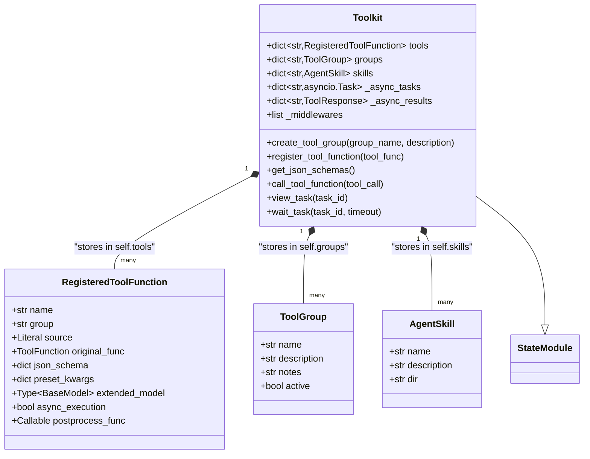
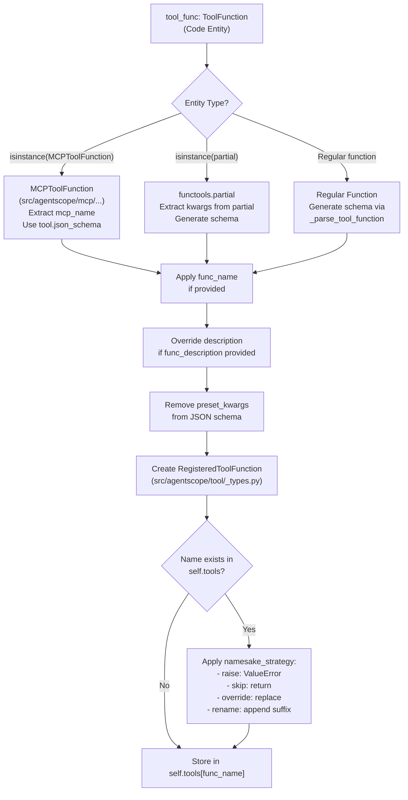
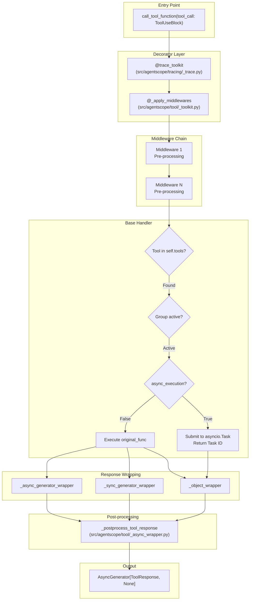

<!-- source: DeepWiki mcp.deepwiki.com · repo modelscope/agentscope · page 4.1 Toolkit Core Architecture · fetched 2026-10-26 -->

# Toolkit Core Architecture

Relevant source files

The following files were used as context for generating this wiki page:

- [.gemini/styleguide.md](.gemini/styleguide.md)
- [.github/copilot-instructions.md](.github/copilot-instructions.md)
- [src/agentscope/_version.py](src/agentscope/_version.py)
- [src/agentscope/tool/_async_wrapper.py](src/agentscope/tool/_async_wrapper.py)
- [src/agentscope/tool/_toolkit.py](src/agentscope/tool/_toolkit.py)
- [src/agentscope/tool/_types.py](src/agentscope/tool/_types.py)
- [tests/toolkit_async_execution_test.py](tests/toolkit_async_execution_test.py)

This document describes the architecture of the `Toolkit` class in AgentScope, which serves as the central registry and execution engine for tool functions. The Toolkit manages tool registration, JSON schema generation, execution with middleware support, and dynamic tool group activation.

For information about registering and executing tools, see [Tool Registration and Execution](#4.2). For MCP client integration, see [MCP Integration](#4.4). For middleware implementation patterns, see [Middleware System](#4.6).

---

## Overview

The `Toolkit` class ([src/agentscope/tool/_toolkit.py:117-137]()) provides a unified interface for managing tool functions in AgentScope. It handles:

- **Tool Registry**: Stores and manages registered tool functions, MCP clients, and agent skills.
- **JSON Schema Generation**: Automatically generates function schemas for LLM tool calling, supporting Pydantic model extensions ([src/agentscope/tool/_types.py:62-132]()).
- **Group Management**: Organizes tools into groups with dynamic activation control ([src/agentscope/tool/_toolkit.py:187-215]()).
- **Execution Pipeline**: Executes tools with a unified streaming interface and middleware support ([src/agentscope/tool/_toolkit.py:57-114]()).
- **Async Task Management**: Experimental support for background tool execution with task tracking ([src/agentscope/tool/_toolkit.py:182-185]()).
- **State Persistence**: Supports checkpoint/restore of tool activation state via the `StateModule` interface ([src/agentscope/tool/_toolkit.py:957-1006]()).

Sources: [src/agentscope/tool/_toolkit.py:117-137](), [src/agentscope/tool/_toolkit.py:957-1006](), [src/agentscope/tool/_types.py:62-132]()

---

## Core Class Structure

### Toolkit Data Model

The `Toolkit` class extends `StateModule` and maintains several primary data structures to manage the mapping between "Natural Language Space" (descriptions/schemas) and "Code Entity Space" (callables).

**Toolkit Entity Relationship:**

**Key Attributes:**

| Attribute | Type | Purpose |
|-----------|------|---------|
| `tools` | `dict[str, RegisteredToolFunction]` | Registry of all registered tool functions indexed by name ([src/agentscope/tool/_toolkit.py:170]()) |
| `groups` | `dict[str, ToolGroup]` | Tool groups for organizing and controlling tool activation ([src/agentscope/tool/_toolkit.py:171]()) |
| `skills` | `dict[str, AgentSkill]` | Agent skills loaded from directories ([src/agentscope/tool/_toolkit.py:172]()) |
| `_async_tasks` | `dict[str, asyncio.Task]` | Registry of running background tool tasks ([src/agentscope/tool/_toolkit.py:184]()) |
| `_middlewares` | `list` | Ordered list of registered middleware functions ([src/agentscope/tool/_toolkit.py:173]()) |

Sources: [src/agentscope/tool/_toolkit.py:170-185](), [src/agentscope/tool/_types.py:16-60](), [src/agentscope/tool/_types.py:136-150]()

---

## Tool Registration Pipeline

### Registration Flow

The registration process transforms various code entities (functions, partials, MCP tools) into a unified `RegisteredToolFunction` object.

Sources: [src/agentscope/tool/_toolkit.py:269-521](), [src/agentscope/tool/_types.py:16-60]()

### RegisteredToolFunction Schema Extension

A unique feature of the `Toolkit` is the ability to dynamically extend a tool's JSON schema using Pydantic models via the `extended_json_schema` property ([src/agentscope/tool/_types.py:62-132]()). This allows the framework to inject parameters (like group activation flags) into existing tool definitions without modifying the original code.

Sources: [src/agentscope/tool/_types.py:62-132]()

---

## Tool Execution Pipeline

### Execution Architecture with Middleware

Tool execution follows an "Onion Model" where the core execution is wrapped by tracing and a chain of user-defined middlewares.

Sources: [src/agentscope/tool/_toolkit.py:672-815](), [src/agentscope/tool/_toolkit.py:57-114](), [src/agentscope/tool/_async_wrapper.py:16-110](), [src/agentscope/tracing/_trace.py:53]()

### Async Execution Support

Toolkit supports an `async_execution` mode for long-running tools ([src/agentscope/tool/_types.py:57-60]()). When enabled:
1. The tool is executed in a background `asyncio.Task` ([src/agentscope/tool/_toolkit.py:184]()).
2. `call_tool_function` returns immediately with a **Task ID** ([tests/toolkit_async_execution_test.py:82-91]()).
3. Users can track progress using `view_task`, `wait_task`, or `cancel_task` ([src/agentscope/tool/_toolkit.py:838-955]()).

Sources: [src/agentscope/tool/_toolkit.py:838-955](), [tests/toolkit_async_execution_test.py:19-158]()

### Unified Async Interface

Regardless of whether the underlying tool is a synchronous function, a generator, or an asynchronous coroutine, the `Toolkit` wraps the result into an `AsyncGenerator[ToolResponse, None]` using specialized wrappers:

| Wrapper Function | Input Type | File Reference |
|------------------|------------|----------------|
| `_object_wrapper` | `ToolResponse` | [src/agentscope/tool/_async_wrapper.py:38-47]() |
| `_sync_generator_wrapper` | `Generator[ToolResponse, ...]` | [src/agentscope/tool/_async_wrapper.py:50-61]() |
| `_async_generator_wrapper` | `AsyncGenerator[ToolResponse, ...]` | [src/agentscope/tool/_async_wrapper.py:63-110]() |

Sources: [src/agentscope/tool/_async_wrapper.py:38-110]()

---

## Tool Groups and Dynamic Control

### Group Management System

Tools are organized into `ToolGroup` objects ([src/agentscope/tool/_types.py:136-150]()). The `Toolkit` provides methods to create, update, and remove these groups, which directly impacts which tools are visible to the LLM.

- **`create_tool_group`**: Initializes a group with a name, description, and activation status ([src/agentscope/tool/_toolkit.py:187-215]()).
- **`update_tool_groups`**: Activates or deactivates groups ([src/agentscope/tool/_toolkit.py:217-234]()).
- **`get_json_schemas`**: Filters tools based on group activation. Tools in the "basic" group are always included ([src/agentscope/tool/_toolkit.py:545-606]()).

Sources: [src/agentscope/tool/_toolkit.py:187-266](), [src/agentscope/tool/_toolkit.py:545-606](), [src/agentscope/tool/_types.py:136-150]()

---

## State Management

The `Toolkit` inherits from `StateModule` ([src/agentscope/module/state_module.py]()), allowing it to serialize and restore its internal state—specifically the activation status of tool groups.

- **`state_dict()`**: Captures the list of currently active tool groups ([src/agentscope/tool/_toolkit.py:957-981]()).
- **`load_state_dict()`**: Restores group activation from a provided state dictionary ([src/agentscope/tool/_toolkit.py:983-1006]()).

Sources: [src/agentscope/tool/_toolkit.py:957-1006]()

---

