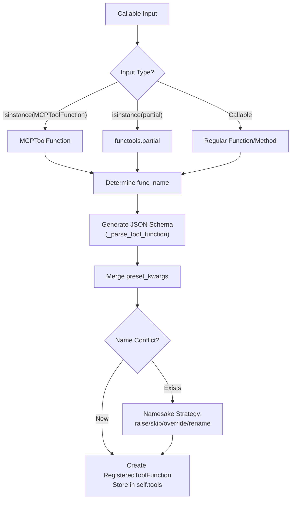
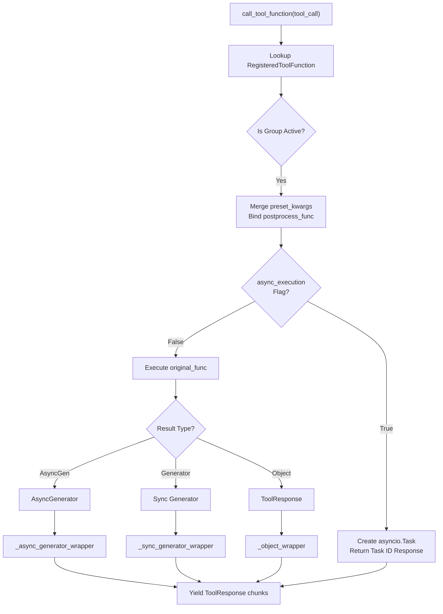

<!-- source: DeepWiki mcp.deepwiki.com · repo modelscope/agentscope · page 4.2 Tool Registration and Execution · fetched 2026-10-26 -->

# Tool Registration and Execution

Relevant source files

The following files were used as context for generating this wiki page:

- [.gemini/styleguide.md](.gemini/styleguide.md)
- [.github/copilot-instructions.md](.github/copilot-instructions.md)
- [docs/tutorial/en/src/quickstart_agent.py](docs/tutorial/en/src/quickstart_agent.py)
- [src/agentscope/_version.py](src/agentscope/_version.py)
- [src/agentscope/plan/_in_memory_storage.py](src/agentscope/plan/_in_memory_storage.py)
- [src/agentscope/plan/_plan_model.py](src/agentscope/plan/_plan_model.py)
- [src/agentscope/plan/_plan_notebook.py](src/agentscope/plan/_plan_notebook.py)
- [src/agentscope/tool/_async_wrapper.py](src/agentscope/tool/_async_wrapper.py)
- [src/agentscope/tool/_toolkit.py](src/agentscope/tool/_toolkit.py)
- [src/agentscope/tool/_types.py](src/agentscope/tool/_types.py)
- [tests/plan_test.py](tests/plan_test.py)
- [tests/toolkit_async_execution_test.py](tests/toolkit_async_execution_test.py)
- [tests/toolkit_basic_test.py](tests/toolkit_basic_test.py)
- [tests/toolkit_meta_tool_test.py](tests/toolkit_meta_tool_test.py)

This page documents the tool registration and execution mechanisms in AgentScope's `Toolkit` class. It covers how tool functions are registered, how their JSON schemas are generated, and how they are executed with a unified streaming interface, including support for asynchronous execution tasks.

For the overall Toolkit architecture and data structures, see [Toolkit Core Architecture](4.1). For tool groups and dynamic activation/deactivation, see [Tool Groups and Meta-Tools](4.3). For MCP client integration, see [MCP Integration](4.4).

## Overview

The `Toolkit` class serves as the central manager for agent capabilities. It handles two primary lifecycle stages for tools:

1.  **Registration** (`register_tool_function`): Normalizes various callables (functions, partials, MCP tools) into `RegisteredToolFunction` objects, extracts docstring-based or Pydantic-based JSON schemas, and manages naming conflicts. [src/agentscope/tool/_toolkit.py:218-460]()
2.  **Execution** (`call_tool_function`): Executes tools with a unified asynchronous generator interface. It supports standard execution, streaming execution, and an experimental **async background execution** mode that returns a Task ID. [src/agentscope/tool/_toolkit.py:610-752]()

## Tool Function Registration

### Registration Flow

The `register_tool_function` method accepts input callables and processes them through several stages to ensure they are ready for agent consumption.

**Sources:** [src/agentscope/tool/_toolkit.py:218-460](), [src/agentscope/tool/_types.py:16-60]()

### Function Type Handling

| Function Type | Detection | Schema Source | Special Handling |
| :--- | :--- | :--- | :--- |
| **MCPToolFunction** | `isinstance(tool_func, MCPToolFunction)` | `tool_func.json_schema` | Captures `mcp_name` for tracking. [src/agentscope/tool/_toolkit.py:309-314]() |
| **partial** | `isinstance(tool_func, partial)` | `_parse_tool_function` | Automatically extracts `partial.keywords` into `preset_kwargs`. [src/agentscope/tool/_toolkit.py:316-332]() |
| **Regular** | Default | `_parse_tool_function` | Parses docstrings for descriptions and parameter types. [src/agentscope/tool/_toolkit.py:343-351]() |

### JSON Schema and Pydantic Extensions

AgentScope uses `_parse_tool_function` to extract OpenAI-compatible function schemas from docstrings. [src/agentscope/_utils/_common.py:313-350]() 

Tools can be dynamically extended using Pydantic models via the `extended_model` parameter. When `RegisteredToolFunction.extended_json_schema` is accessed, it merges the original schema with the Pydantic model's properties and `$defs` (for nested models). [src/agentscope/tool/_types.py:63-132]()

**Sources:** [src/agentscope/tool/_types.py:63-132](), [tests/toolkit_basic_test.py:131-149]()

### Namesake Conflict Resolution

The `namesake_strategy` determines behavior when registering a tool whose name is already taken:

*   **raise** (default): Raises a `ValueError`. [src/agentscope/tool/_toolkit.py:400-405]()
*   **skip**: Keeps the old version and ignores the new one. [src/agentscope/tool/_toolkit.py:407-412]()
*   **override**: Replaces the existing tool with the new one. [src/agentscope/tool/_toolkit.py:414-420]()
*   **rename**: Appends a random 5-character suffix (e.g., `func_a1b2c`) to the new tool's name. [src/agentscope/tool/_toolkit.py:422-449]()

## Tool Execution Pipeline

### Unified Execution Flow

`call_tool_function` transforms any tool result into an `AsyncGenerator[ToolResponse, None]`.

**Sources:** [src/agentscope/tool/_toolkit.py:610-752](), [src/agentscope/tool/_async_wrapper.py:38-110]()

### Async Background Execution

When a tool is registered with `async_execution=True`, calling it does not wait for the result. Instead:
1.  A unique `task_id` is generated. [src/agentscope/tool/_toolkit.py:694]()
2.  The tool function is wrapped in an `asyncio.Task` and stored in `self._async_tasks`. [src/agentscope/tool/_toolkit.py:702]()
3.  A `ToolResponse` containing the Task ID is returned immediately to the agent. [src/agentscope/tool/_toolkit.py:705-715]()

Agents can then manage these tasks using built-in toolkit methods:
*   `view_task(task_id)`: Checks if the task is "still running" or returns the result. [src/agentscope/tool/_toolkit.py:516-545]()
*   `wait_task(task_id, timeout)`: Blocks until completion or timeout. [src/agentscope/tool/_toolkit.py:547-580]()
*   `cancel_task(task_id)`: Terminates a running task. [src/agentscope/tool/_toolkit.py:582-608]()

**Sources:** [src/agentscope/tool/_toolkit.py:516-608](), [tests/toolkit_async_execution_test.py:70-96]()

### Middleware and Post-processing

*   **Middlewares**: Applied via the `_apply_middlewares` decorator. It wraps the execution in a chain, allowing interception of the `ToolUseBlock` and modification of the `ToolResponse` stream. [src/agentscope/tool/_toolkit.py:57-114]()
*   **Post-processing**: If a `postprocess_func` is defined in the `RegisteredToolFunction`, it is applied to every chunk yielded by the execution wrappers. [src/agentscope/tool/_async_wrapper.py:16-35]()

## Tracing and Observability

Execution is wrapped with the `@trace_toolkit` decorator. This captures:
*   The tool name and input arguments. [src/agentscope/tool/_toolkit.py:610]()
*   The execution result (once the generator is exhausted or the task completes). [src/agentscope/tracing/_trace.py:220-258]()
*   Any exceptions or interruptions (e.g., `asyncio.CancelledError`). [src/agentscope/tool/_async_wrapper.py:85-109]()

**Sources:** [src/agentscope/tool/_toolkit.py:610](), [src/agentscope/tracing/_trace.py:220-258]()

---

