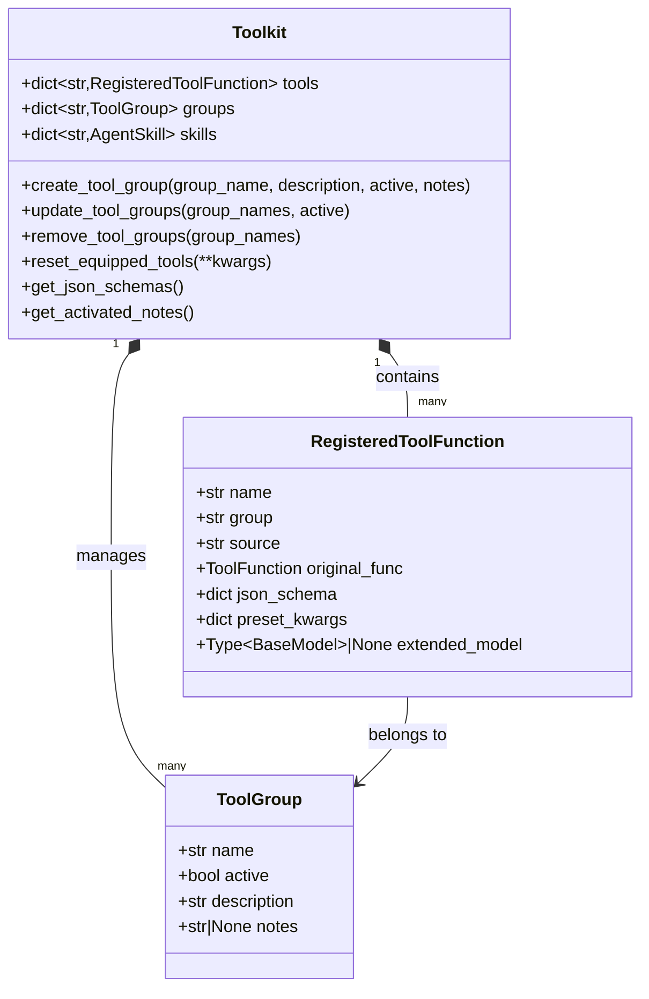
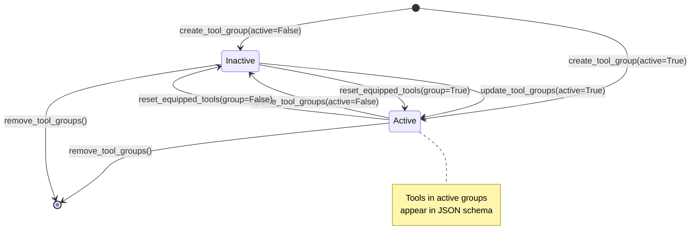
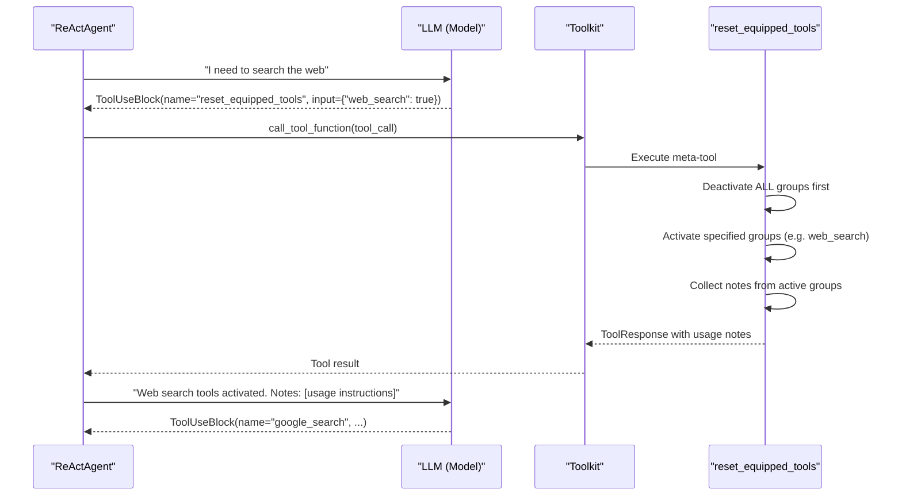
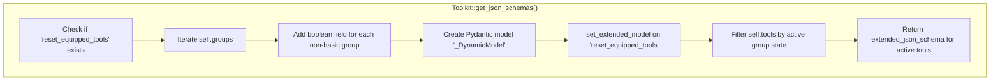
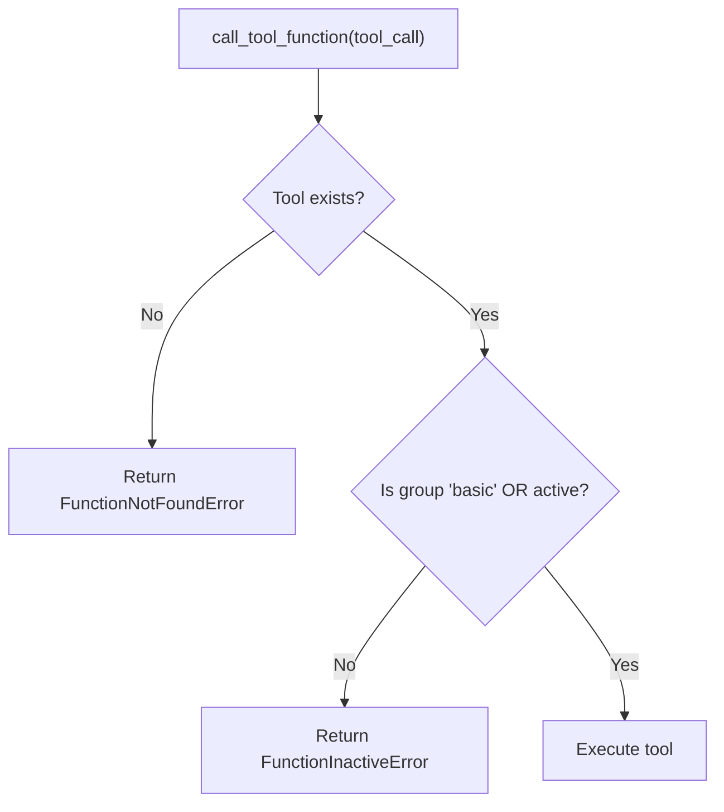

<!-- source: DeepWiki mcp.deepwiki.com · repo modelscope/agentscope · page 4.3 Tool Groups and Meta-Tools · fetched 2026-10-26 -->

# Tool Groups and Meta-Tools

<details>
<summary>Relevant source files</summary>

The following files were used as context for generating this wiki page:

- [.gemini/styleguide.md](.gemini/styleguide.md)
- [.github/copilot-instructions.md](.github/copilot-instructions.md)
- [docs/tutorial/en/src/quickstart_agent.py](docs/tutorial/en/src/quickstart_agent.py)
- [src/agentscope/_version.py](src/agentscope/_version.py)
- [src/agentscope/plan/_in_memory_storage.py](src/agentscope/plan/_in_memory_storage.py)
- [src/agentscope/plan/_plan_model.py](src/agentscope/plan/_plan_model.py)
- [src/agentscope/plan/_plan_notebook.py](src/agentscope/plan/_plan_notebook.py)
- [src/agentscope/tool/_toolkit.py](src/agentscope/tool/_toolkit.py)
- [src/agentscope/tool/_types.py](src/agentscope/tool/_types.py)
- [tests/plan_test.py](tests/plan_test.py)
- [tests/toolkit_async_execution_test.py](tests/toolkit_async_execution_test.py)
- [tests/toolkit_basic_test.py](tests/toolkit_basic_test.py)
- [tests/toolkit_meta_tool_test.py](tests/toolkit_meta_tool_test.py)

</details>


## Purpose and Scope

This page documents the tool grouping system and dynamic capability management in AgentScope. Tool groups enable agents to organize tool functions into logical categories and activate/deactivate them at runtime based on task requirements. This reduces context window usage and helps agents manage large tool collections efficiently through the use of meta-tools like `reset_equipped_tools` [src/agentscope/tool/_toolkit.py:937-999]().

For basic tool registration and execution, see **4.2 Tool Registration and Execution**. For MCP client integration, see **4.4 MCP Integration**. For the overall toolkit architecture, see **4.1 Toolkit Core Architecture**.

## Tool Group Fundamentals

### The ToolGroup Dataclass

Tool groups organize related tool functions into logical categories. Each group has an activation state that determines whether its tools are included in the JSON schema presented to the LLM [src/agentscope/tool/_types.py:136-150]().

**Tool System Class Relationships**



**Sources:** [src/agentscope/tool/_types.py:16-61](), [src/agentscope/tool/_types.py:136-150](), [src/agentscope/tool/_toolkit.py:117-186]()

### The "basic" Group

The `"basic"` group is a special reserved group that is always active and cannot be deactivated or removed [src/agentscope/tool/_toolkit.py:209-213](). Tool functions in this group are always included in the JSON schema provided to the agent.

| Group Type | Activation | Can be Removed | Use Case |
|------------|-----------|----------------|----------|
| `"basic"` | Always active | No | Core tools needed for all tasks |
| Named groups | Dynamic | Yes | Specialized tools for specific tasks |

**Sources:** [src/agentscope/tool/_toolkit.py:187-216](), [src/agentscope/tool/_toolkit.py:209-213](), [src/agentscope/tool/_toolkit.py:466-527]()

## Creating and Managing Tool Groups

### Creating Tool Groups

Tool groups are created using `create_tool_group()` before registering tool functions to them [src/agentscope/tool/_toolkit.py:187-216]():

```python
toolkit.create_tool_group(
    group_name="web_search",
    description="Tools for searching the web and retrieving online information",
    active=False,  # Initially inactive
    notes="Use these tools when you need to find current information online."
)
```

**Key Parameters:**
- `group_name`: Unique identifier for the group (cannot be `"basic"`) [src/agentscope/tool/_toolkit.py:209-213]().
- `description`: Explains what the group contains (used by `reset_equipped_tools`) [src/agentscope/tool/_toolkit.py:199-200]().
- `active`: Initial activation state [src/agentscope/tool/_toolkit.py:201-203]().
- `notes`: Usage instructions added to system prompt when group is active [src/agentscope/tool/_toolkit.py:204-207]().

**Sources:** [src/agentscope/tool/_toolkit.py:187-216]()

### Group State Transitions



**Sources:** [src/agentscope/tool/_toolkit.py:218-236](), [src/agentscope/tool/_toolkit.py:237-268](), [src/agentscope/tool/_toolkit.py:937-999]()

### Bulk Group Management

The `update_tool_groups()` method changes activation state for multiple groups simultaneously [src/agentscope/tool/_toolkit.py:218-236](). The `remove_tool_groups()` method deletes groups and their associated tool functions from the toolkit [src/agentscope/tool/_toolkit.py:237-268]().

**Sources:** [src/agentscope/tool/_toolkit.py:218-268]()

## Dynamic Tool Control with reset_equipped_tools

### The Meta-Tool Function

The `reset_equipped_tools()` method is the primary mechanism for agentic tool control. When registered as a tool function, it allows agents to dynamically activate/deactivate tool groups based on task requirements [src/agentscope/tool/_toolkit.py:937-999]().

**Meta-Tool Execution Flow**



**Sources:** [src/agentscope/tool/_toolkit.py:937-999](), [src/agentscope/tool/_toolkit.py:593-725]()

### Function Behavior

The `reset_equipped_tools()` function signature is dynamically generated to include all non-basic groups as boolean parameters [src/agentscope/tool/_toolkit.py:504-527]().

**Key Characteristics:**
1. **Absolute State Setting**: Each call deactivates ALL groups first, then activates specified ones [src/agentscope/tool/_toolkit.py:941-943]().
2. **Returns Usage Notes**: Provides instructions for newly activated groups [src/agentscope/tool/_toolkit.py:949-950]().
3. **Boolean Arguments**: Each group becomes a boolean parameter in the schema [src/agentscope/tool/_toolkit.py:511-514]().

**Sources:** [src/agentscope/tool/_toolkit.py:937-999](), [src/agentscope/tool/_toolkit.py:504-527]()

## Dynamic Schema Generation

### Schema Filtering by Active State

Only tools from the `"basic"` group or active groups are included in the JSON schema returned by `get_json_schemas()` [src/agentscope/tool/_toolkit.py:466-527]().

**Schema Generation Logic**



**Sources:** [src/agentscope/tool/_toolkit.py:504-527](), [src/agentscope/tool/_types.py:63-132]()

### Extended Model System

The `extended_model` field in `RegisteredToolFunction` allows dynamic schema extension [src/agentscope/tool/_types.py:36-38](). This is used by `reset_equipped_tools` to reflect the current set of available groups. The `extended_json_schema` property merges the original tool schema with the Pydantic model's schema [src/agentscope/tool/_types.py:63-132]().

**Sources:** [src/agentscope/tool/_types.py:36-132](), [src/agentscope/tool/_toolkit.py:529-555]()

## Notes and Usage Instructions

### Retrieving Active Notes

The `get_activated_notes()` method collects notes from all active groups, formatted with headers [src/agentscope/tool/_toolkit.py:919-935](). These notes are typically injected into the system prompt or returned by the meta-tool.

**Example Note Structure:**
```markdown
## About Tool Group 'web_search'
1. Use specific queries.
2. Verify information across multiple sources.
```

**Sources:** [src/agentscope/tool/_toolkit.py:919-935](), [src/agentscope/tool/_toolkit.py:978-999]()

## State Management

### Serialization and Persistence

The toolkit inherits from `StateModule` and implements `state_dict()` and `load_state_dict()` to persist the active status of tool groups [src/agentscope/tool/_toolkit.py:867-918]().

| Method | Role | Data Structure |
|--------|------|----------------|
| `state_dict()` | Exports active group names | `{"active_groups": ["group1", "group2"]}` |
| `load_state_dict()` | Restores group activation | Iterates `self.groups` and updates `active` flag |

**Sources:** [src/agentscope/tool/_toolkit.py:867-918](), [src/agentscope/tool/_toolkit.py:117-118]()

## Tool Execution and Group Validation

When a tool is called via `call_tool_function()`, the toolkit verifies that the tool's group is active [src/agentscope/tool/_toolkit.py:631-650]().

**Execution Validation Logic**



**Sources:** [src/agentscope/tool/_toolkit.py:593-725](), [src/agentscope/tool/_toolkit.py:631-650]()

---

