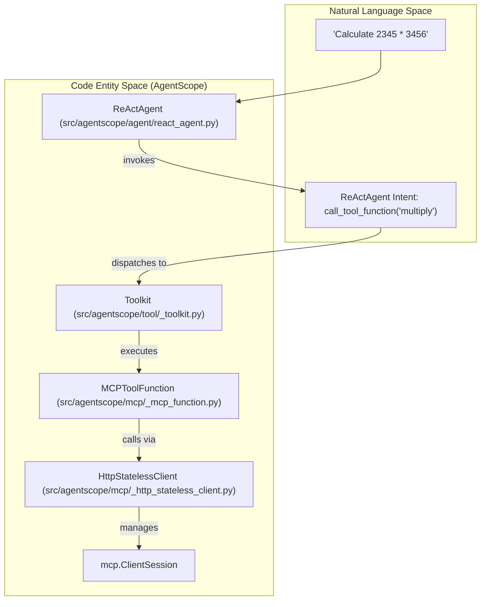
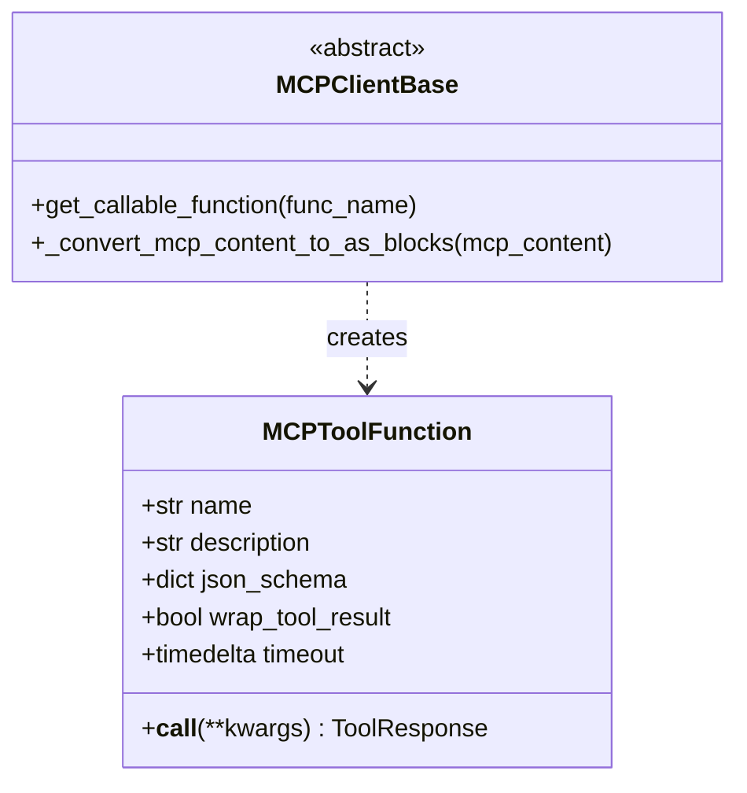
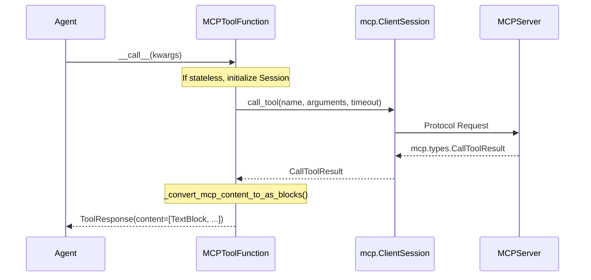

<!-- source: DeepWiki mcp.deepwiki.com · repo modelscope/agentscope · page 4.4 MCP Integration · fetched 2026-10-26 -->

# MCP Integration

<details>
<summary>Relevant source files</summary>

The following files were used as context for generating this wiki page:

- [examples/functionality/mcp/README.md](examples/functionality/mcp/README.md)
- [examples/functionality/mcp/main.py](examples/functionality/mcp/main.py)
- [examples/functionality/mcp/mcp_add.py](examples/functionality/mcp/mcp_add.py)
- [examples/functionality/mcp/mcp_multiply.py](examples/functionality/mcp/mcp_multiply.py)
- [src/agentscope/formatter/_dashscope_formatter.py](src/agentscope/formatter/_dashscope_formatter.py)
- [src/agentscope/formatter/_formatter_base.py](src/agentscope/formatter/_formatter_base.py)
- [src/agentscope/mcp/_client_base.py](src/agentscope/mcp/_client_base.py)
- [src/agentscope/mcp/_http_stateless_client.py](src/agentscope/mcp/_http_stateless_client.py)
- [src/agentscope/mcp/_mcp_function.py](src/agentscope/mcp/_mcp_function.py)
- [src/agentscope/mcp/_stateful_client_base.py](src/agentscope/mcp/_stateful_client_base.py)
- [src/agentscope/tool/_response.py](src/agentscope/tool/_response.py)
- [tests/formatter_dashscope_test.py](tests/formatter_dashscope_test.py)
- [tests/mcp_streamable_http_client_test.py](tests/mcp_streamable_http_client_test.py)

</details>


This page documents AgentScope's integration with the Model Context Protocol (MCP), which enables agents to access external tools and data sources provided by MCP-compatible servers. For general tool registration and execution patterns, see [4.2](). For tool organization and activation, see [4.3]().

## Overview

MCP (Model Context Protocol) is an open protocol for connecting AI applications to external tools and data sources. AgentScope provides native MCP support through:

- **Multiple client types**: Stateful (persistent connections) and stateless (HTTP-based) MCP clients [src/agentscope/mcp/_stateful_client_base.py:16-22](), [src/agentscope/mcp/_http_stateless_client.py:16-23]().
- **Flexible registration**: Register entire MCP servers or individual tools into the `Toolkit` [examples/functionality/mcp/main.py:58-60]().
- **Fine-grained control**: Use MCP tools as local callable functions via `get_callable_function` [src/agentscope/mcp/_client_base.py:32-37]().
- **Seamless integration**: MCP tools work like regular tools in the `Toolkit` by wrapping them into `MCPToolFunction` [src/agentscope/mcp/_mcp_function.py:15-25]().

Sources: [src/agentscope/mcp/_mcp_function.py:1-25](), [src/agentscope/mcp/_client_base.py:1-37](), [examples/functionality/mcp/main.py:37-60]()

## MCP Client Architecture

AgentScope categorizes MCP clients based on their connection lifecycle. `MCPClientBase` defines the common interface for fetching tool definitions and converting content [src/agentscope/mcp/_client_base.py:18-30]().

### Natural Language to Code Entity Mapping

The following diagram illustrates how a natural language request from a user is translated through AgentScope's MCP architecture into a protocol call.


Sources: [src/agentscope/mcp/_mcp_function.py:15-25](), [examples/functionality/mcp/main.py:63-83](), [src/agentscope/mcp/_http_stateless_client.py:16-23]()

### Client Types and Implementation

| Client Type | Implementation Class | Transport Support | State Management |
| :--- | :--- | :--- | :--- |
| **Stateless** | `HttpStatelessClient` | `sse`, `streamable_http` | Starts and closes a new session for every tool call [src/agentscope/mcp/_http_stateless_client.py:19-22](). |
| **Stateful** | `StatefulClientBase` | `stdio`, `sse`, `http` | Maintains `ClientSession` state across multiple calls using `connect()` and `close()` [src/agentscope/mcp/_stateful_client_base.py:17-21](). |

Sources: [src/agentscope/mcp/_http_stateless_client.py:16-39](), [src/agentscope/mcp/_stateful_client_base.py:16-45]()

## MCPToolFunction Wrapper

The `MCPToolFunction` class is the core bridge between the MCP protocol and AgentScope's tool system. It encapsulates the MCP tool definition and the logic required to invoke it.



### Key Behaviors
1. **Schema Extraction**: Automatically extracts JSON schemas from `mcp.types.Tool` objects using `_extract_json_schema_from_mcp_tool` [src/agentscope/mcp/_mcp_function.py:61]().
2. **Result Conversion**: If `wrap_tool_result` is `True`, it converts MCP `TextContent`, `ImageContent`, and `AudioContent` into AgentScope's internal message blocks (`TextBlock`, `ImageBlock`, etc.) via `_convert_mcp_content_to_as_blocks` [src/agentscope/mcp/_client_base.py:40-101]().
3. **Execution**: Handles session initialization and `call_tool` execution. If `client_gen` is provided (stateless), it uses an `async with` block to manage the temporary session [src/agentscope/mcp/_mcp_function.py:88-97](). If a persistent `session` is provided (stateful), it uses the existing session [src/agentscope/mcp/_mcp_function.py:100-104]().

Sources: [src/agentscope/mcp/_mcp_function.py:15-115](), [src/agentscope/mcp/_client_base.py:40-101]()

## The get_callable_function Pattern

For developers needing fine-grained control, individual tools can be extracted from an MCP client without registering the entire server to a `Toolkit`.

```python
# Example of manual extraction (from examples/functionality/mcp/main.py)
add_tool_function = await add_mcp_client.get_callable_function(
    "add",
    wrap_tool_result=True,
)

# Call it manually
manual_res = await add_tool_function(a=5, b=10)
```

### Implementation Details
- **Stateless**: `HttpStatelessClient.get_callable_function` returns an `MCPToolFunction` initialized with a `client_gen` (a context manager factory) [src/agentscope/mcp/_http_stateless_client.py:131-137]().
- **Stateful**: `StatefulClientBase.get_callable_function` returns an `MCPToolFunction` initialized with the active `self.session` [src/agentscope/mcp/_stateful_client_base.py:157-162]().

Sources: [src/agentscope/mcp/_http_stateless_client.py:92-137](), [src/agentscope/mcp/_stateful_client_base.py:112-162](), [examples/functionality/mcp/main.py:94-104]()

## Data Flow: MCP Tool Execution

When an agent triggers a tool call, the data flows through several layers of conversion between the AgentScope block system and the MCP protocol.



### Content Conversion Mapping
| MCP Content Type | AgentScope Block Type | Conversion Logic |
| :--- | :--- | :--- |
| `TextContent` | `TextBlock` | Direct text mapping [src/agentscope/mcp/_client_base.py:47-53](). |
| `ImageContent` | `ImageBlock` | Converted to `Base64Source` with `mimeType` and `data` [src/agentscope/mcp/_client_base.py:54-63](). |
| `AudioContent` | `AudioBlock` | Converted to `Base64Source` with `mimeType` and `data` [src/agentscope/mcp/_client_base.py:64-75](). |
| `TextResourceContents` | `TextBlock` | JSON dumped using `model_dump_json(indent=2)` [src/agentscope/mcp/_client_base.py:77-86](). |

Sources: [src/agentscope/mcp/_client_base.py:39-101](), [src/agentscope/mcp/_mcp_function.py:106-113]()

## Lifecycle Management

Stateful clients require explicit lifecycle management to avoid leaking resources.

- **`connect()`**: Enters the `AsyncExitStack`, initializes the transport stream, and starts the `ClientSession` [src/agentscope/mcp/_stateful_client_base.py:46-66]().
- **`close()`**: Closes the session and transport via the stack [src/agentscope/mcp/_stateful_client_base.py:72-95]().
- **Validation**: Methods like `list_tools` and `get_callable_function` in stateful clients call `_validate_connection()` to ensure the session is active [src/agentscope/mcp/_stateful_client_base.py:104](), [src/agentscope/mcp/_stateful_client_base.py:140]().

Sources: [src/agentscope/mcp/_stateful_client_base.py:46-95](), [src/agentscope/mcp/_stateful_client_base.py:164-177]()

---

