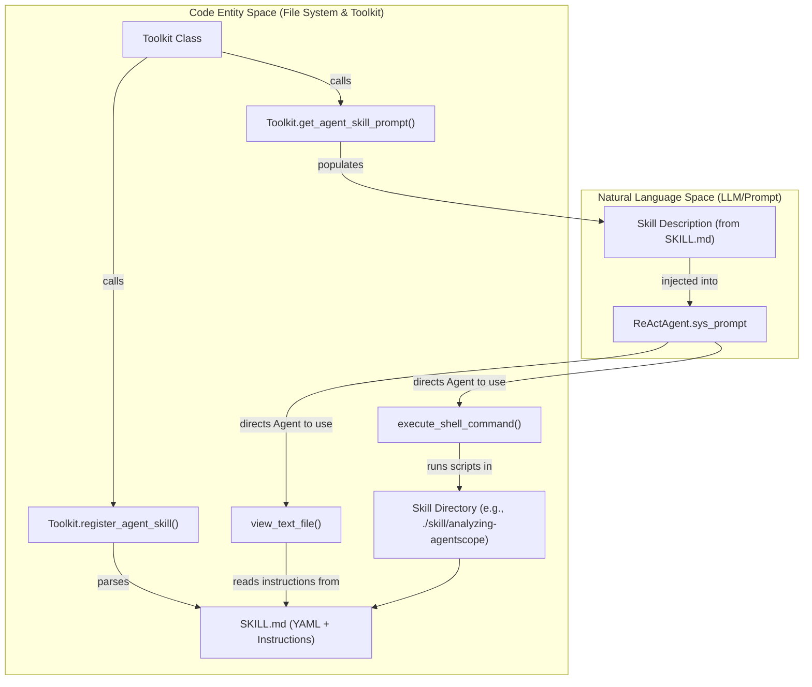
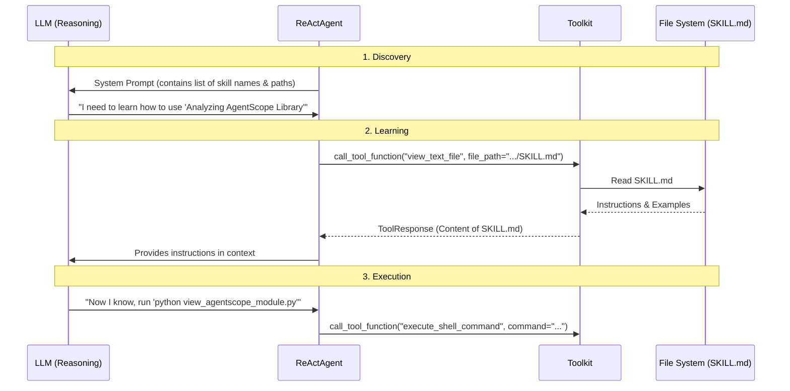

<!-- source: DeepWiki mcp.deepwiki.com · repo modelscope/agentscope · page 4.5 Built-in Tools and Agent Skills · fetched 2026-10-26 -->

# Built-in Tools and Agent Skills

<details>
<summary>Relevant source files</summary>

The following files were used as context for generating this wiki page:

- [.github/workflows/pre-commit.yml](.github/workflows/pre-commit.yml)
- [LICENSE](LICENSE)
- [docs/tutorial/en/src/task_agent_skill.py](docs/tutorial/en/src/task_agent_skill.py)
- [docs/tutorial/zh_CN/src/task_agent_skill.py](docs/tutorial/zh_CN/src/task_agent_skill.py)
- [examples/agent/react_agent/main.py](examples/agent/react_agent/main.py)
- [examples/functionality/agent_skill/README.md](examples/functionality/agent_skill/README.md)
- [examples/functionality/agent_skill/main.py](examples/functionality/agent_skill/main.py)
- [examples/functionality/agent_skill/skill/analyzing-agentscope-library/SKILL.md](examples/functionality/agent_skill/skill/analyzing-agentscope-library/SKILL.md)
- [examples/functionality/agent_skill/skill/analyzing-agentscope-library/view_agentscope_module.py](examples/functionality/agent_skill/skill/analyzing-agentscope-library/view_agentscope_module.py)
- [src/agentscope/tool/_coding/_python.py](src/agentscope/tool/_coding/_python.py)
- [src/agentscope/tool/_text_file/_view_text_file.py](src/agentscope/tool/_text_file/_view_text_file.py)
- [src/agentscope/tool/_text_file/_write_text_file.py](src/agentscope/tool/_text_file/_write_text_file.py)
- [tests/mcp_sse_client_test.py](tests/mcp_sse_client_test.py)
- [tests/tool_test.py](tests/tool_test.py)

</details>


This page documents the built-in tool functions provided by AgentScope and the agent skills system. Built-in tools are ready-to-use functions for common operations like file manipulation and code execution. Agent skills are directory-based packages containing instructions, scripts, and resources that agents can dynamically load, inspired by the approach proposed by Anthropic to improve agent capabilities on specific tasks [[docs/tutorial/en/src/task_agent_skill.py:8-12](), [examples/functionality/agent_skill/README.md:3-5]()].

For information about registering custom tools, see [Tool Registration and Execution](#4.2). For MCP-based tools, see [MCP Integration](#4.4).

---

## Built-in Tool Functions

AgentScope provides several built-in tool functions that can be registered directly with a `Toolkit` instance [[examples/agent/react_agent/main.py:20-24]()]. All built-in tools return `ToolResponse` objects [[src/agentscope/tool/_text_file/_write_text_file.py:16-32]()] and support both synchronous and asynchronous execution patterns.

### Text File Manipulation Tools

AgentScope includes three built-in tools for working with text files:

| Tool Function | Purpose | Key Parameters |
|--------------|---------|----------------|
| `view_text_file` | View file content with line numbers | `file_path`, `ranges` |
| `write_text_file` | Create or replace content in a file | `file_path`, `content`, `ranges` |
| `insert_text_file` | Insert content at a specific line | `file_path`, `content`, `line_number` |

#### view_text_file

The `view_text_file` function reads and displays file content with line numbers. It supports range-based viewing and tilde expansion for home directory paths [[src/agentscope/tool/_text_file/_view_text_file.py:13-29]()].

**Function Signature:**
```python
async def view_text_file(
    file_path: str,
    ranges: list[int] | None = None,
) -> ToolResponse
```

**Parameters:**
- `file_path`: Target file path (supports `~` expansion).
- `ranges`: Optional `[start, end]` line range (inclusive). If `None`, returns entire file. Supports negative indices (e.g., `[-100, -1]` for last 100 lines) [[src/agentscope/tool/_text_file/_view_text_file.py:15-23]()].

**Behavior:**
- Returns formatted content with line numbers: `"1: content\n2: content\n..."` [[tests/tool_test.py:165-168]()].
- Returns error `ToolResponse` for non-existent files or non-file paths [[src/agentscope/tool/_text_file/_view_text_file.py:30-47]()].
- Validates that the requested range is within file bounds [[tests/tool_test.py:187-192]()].

**Sources:** [src/agentscope/tool/_text_file/_view_text_file.py:13-82](), [tests/tool_test.py:155-207]()

#### write_text_file

The `write_text_file` function creates new files or replaces content in existing files. When `ranges` is provided, it performs targeted replacement; otherwise, it overwrites the entire file [[src/agentscope/tool/_text_file/_write_text_file.py:108-127]()].

**Function Signature:**
```python
async def write_text_file(
    file_path: str,
    content: str,
    ranges: None | list[int] = None,
) -> ToolResponse
```

**Behavior:**
- Creates file if it doesn't exist (ignores `ranges` in this case) [[src/agentscope/tool/_text_file/_write_text_file.py:129-152]()].
- For range-based replacement: validates start line, replaces lines `[start-1:end]` with content [[src/agentscope/tool/_text_file/_write_text_file.py:165-183]()].
- Returns a snippet of the modified content with line numbers [[src/agentscope/tool/_text_file/_write_text_file.py:200-218]()].

**Sources:** [src/agentscope/tool/_text_file/_write_text_file.py:108-241]()

#### insert_text_file

The `insert_text_file` function inserts content at a specific line number without replacing existing content [[src/agentscope/tool/_text_file/_write_text_file.py:12-16]()].

**Function Signature:**
```python
async def insert_text_file(
    file_path: str,
    content: str,
    line_number: int,
) -> ToolResponse
```

**Behavior:**
- Returns error if `line_number <= 0` [[src/agentscope/tool/_text_file/_write_text_file.py:33-42]()].
- If `line_number` exceeds file length, it appends to the end [[src/agentscope/tool/_text_file/_write_text_file.py:59-60]()].
- Returns a snippet showing the insertion point with 5 lines of context [[src/agentscope/tool/_text_file/_write_text_file.py:85-105]()].

**Sources:** [src/agentscope/tool/_text_file/_write_text_file.py:12-105]()

### Code Execution Tools

AgentScope provides tools for executing Python code and shell commands in isolated environments.

#### execute_python_code

Executes Python code in a temporary file using a subprocess and captures the return code, standard output, and standard error [[src/agentscope/tool/_coding/_python.py:17-36]()].

**Function Signature:**
```python
async def execute_python_code(
    code: str,
    timeout: float = 300,
    **kwargs: Any,
) -> ToolResponse
```

**Behavior:**
- Writes code to a temporary `.py` file using `tempfile.TemporaryDirectory` and `shortuuid` for unique naming [[src/agentscope/tool/_coding/_python.py:38-41]()].
- Executes using `sys.executable` with `asyncio.create_subprocess_exec` and sets environment variables like `PYTHONUTF8` [[src/agentscope/tool/_coding/_python.py:43-53]()].
- Returns formatted XML-like output: `<returncode>...</returncode><stdout>...</stdout><stderr>...</stderr>` [[src/agentscope/tool/_coding/_python.py:81-90]()].
- On timeout: returns `<returncode>-1</returncode>` and a `TimeoutError` message in `stderr` [[src/agentscope/tool/_coding/_python.py:62-67]()].

**Sources:** [src/agentscope/tool/_coding/_python.py:17-90](), [tests/tool_test.py:30-96]()

#### execute_shell_command

Executes shell commands with timeout support.

**Behavior:**
- Executes command in a shell subprocess [[tests/tool_test.py:101-102]()].
- Returns the same formatted XML output as `execute_python_code` [[tests/tool_test.py:104-109]()].
- Handles command-not-found errors gracefully by checking for "not found" or "not recognized" in output [[tests/tool_test.py:112-116]()].

**Sources:** [tests/tool_test.py:98-153]()

---

## Agent Skills System

The agent skills system allows packaging domain-specific instructions, scripts, and resources into directory-based skills that agents can dynamically discover and use.

### Agent Skills Architecture

The system bridges natural language descriptions with directory-based code resources.

**Architecture: From Natural Language to Code Entity Space**



**Sources:** [docs/tutorial/en/src/task_agent_skill.py:16-30](), [examples/functionality/agent_skill/main.py:29-50](), [examples/functionality/agent_skill/skill/analyzing-agentscope-library/SKILL.md:1-4]()

### Registering Agent Skills

#### register_agent_skill Method

The `register_agent_skill` method registers a skill from a given directory. The directory must contain a `SKILL.md` file with YAML frontmatter [[docs/tutorial/en/src/task_agent_skill.py:47-50]()].

**Directory Structure Requirements:**
```
sample_skill/
├── SKILL.md        # Required: YAML frontmatter (name, description) + instructions
├── script.py       # Optional: supporting scripts referenced in instructions
└── ...
```

**SKILL.md Format Example:**
```markdown
---
name: sample_skill
description: A sample agent skill for demonstration.
---

# Sample Skill
Detailed instructions go here...
```
[[docs/tutorial/en/src/task_agent_skill.py:64-74]()]

**Sources:** [docs/tutorial/en/src/task_agent_skill.py:41-83](), [examples/functionality/agent_skill/skill/analyzing-agentscope-library/SKILL.md:1-4]()

### Generating Agent Skills Prompt

#### get_agent_skill_prompt Method

The `get_agent_skill_prompt` method generates a formatted prompt for all registered skills, which can be attached to the agent's system prompt [[docs/tutorial/en/src/task_agent_skill.py:25-28]()].

**Customization:**
The instruction and template can be customized during `Toolkit` initialization:
```python
toolkit = Toolkit(
    agent_skill_instruction="<system-info>You're provided a collection of skills...</system-info>\n",
    agent_skill_template="- {name}({dir}): {description}",
)
```
[[docs/tutorial/en/src/task_agent_skill.py:97-103]()]

**Template Variables:**
- `{name}`: Skill name from YAML frontmatter.
- `{description}`: Skill description from YAML frontmatter.
- `{dir}`: Path to the skill directory.

**Sources:** [docs/tutorial/en/src/task_agent_skill.py:86-109]()

### Integration with ReActAgent

The `ReActAgent` class automatically attaches the agent skill prompt to its system prompt when initialized with a `Toolkit` containing skills [[docs/tutorial/en/src/task_agent_skill.py:114-116]()].

**Important Requirement:**
When using agent skills, the agent **must** be equipped with text file reading (e.g., `view_text_file`) or shell command tools to access the skill instructions in `SKILL.md` files [[docs/tutorial/en/src/task_agent_skill.py:119-121](), [examples/functionality/agent_skill/main.py:23-27]()].

### Workflow: Skill Discovery to Execution

**Skill Usage Sequence**



**Sources:** [examples/functionality/agent_skill/main.py:52-77](), [examples/functionality/agent_skill/skill/analyzing-agentscope-library/SKILL.md:16-31](), [docs/tutorial/en/src/task_agent_skill.py:119-121]()

---

## Tool Response Format

All built-in tools return `ToolResponse` objects. The content is usually a list containing a `TextBlock` [[src/agentscope/tool/_text_file/_write_text_file.py:34-42](), [src/agentscope/tool/_coding/_python.py:81-90]()].

### Success Response (File Insertion)
```python
ToolResponse(
    content=[
        TextBlock(
            type="text",
            text="Insert content into {file_path} at line {line_number} successfully..."
        ),
    ],
)
```
[[src/agentscope/tool/_text_file/_write_text_file.py:95-105]()]

### Success Response (Code Execution)
```python
ToolResponse(
    content=[
        TextBlock(
            type="text",
            text="<returncode>0</returncode><stdout>Hello, World!\n</stdout><stderr></stderr>",
        ),
    ],
)
```
[[tests/tool_test.py:45-51]()]

### Error Response
```python
ToolResponse(
    content=[
        TextBlock(
            type="text",
            text="InvalidArgumentsError: The line number {line_number} is invalid. ",
        ),
    ],
)
```
[[src/agentscope/tool/_text_file/_write_text_file.py:34-42]()]

**Sources:** [src/agentscope/tool/_text_file/_write_text_file.py:33-105](), [src/agentscope/tool/_coding/_python.py:81-90](), [tests/tool_test.py:30-96]()

---

